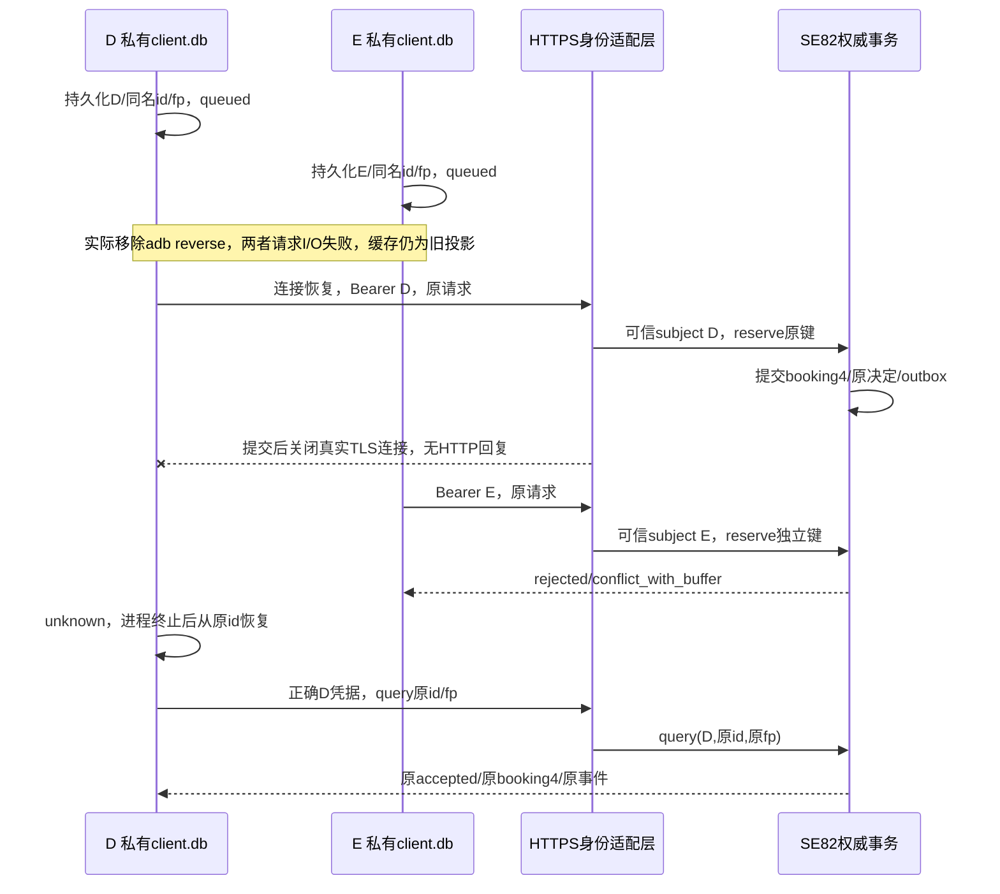

# 双客户端、网络身份与容量冲突：两边都排队，谁真的占到了时段

D和E各看到同一份预约投影：A540–600、B600–630、C650–680。两人都想约690–720，断网时各自点击排队。手机分别显示“本地待发送”，记录也确实落盘了。恢复连接以后，应该把两个本地列表取并集，再告诉两人都成功吗？

这会把“保存了请求”偷换为“获得了容量”。[[计算机知识/64-移动平台开发/01-生命周期状态归属与离线同步|上一单元]]解决一个进程消失后怎样找回原请求；本页把权威移出两个客户端，用**实际HTTPS**观察两份私有状态怎样竞争同一条权威记录。先保留四层状态，再加入身份与网络：草稿是输入，意图是本地持久请求，缓存投影是曾经看见的服务状态，accepted/rejected才是这条意图的权威决定。

实践沿原工程新增`:networkApp`的d/e变体；`org.wwl.networkdemo.d`与`.e`在**同一API35模拟器**有不同UID和私有client.db。它们不是两台实体设备，也不模拟两种运营商网络。原`:app`仍是本地假服务实验，代码和旧证据继续有效。新规范入口、命令与实际记录见 [[计算机知识/64-移动平台开发/android-intent-demo/网络实践#固定输入与执行|网络实践]]；先读以下判据，再看绿色文字。

## 三个身份，不能拿一个字符串包办

| 身份 | 本例从哪里取得 | 它回答什么 |
| --- | --- | --- |
| Android应用沙箱 | 系统给两个applicationId分配不同UID | 哪个客户端能直接读哪个私有文件 |
| HTTP认证主体 | 服务端验证Authorization中的公开教学Bearer，并映射为D或E | 这次调用以谁的权限访问资源 |
| 业务意图键与指纹 | 持久`(actor,intent_id)`和原参数的规范SHA256 | 是不是同一次请求，有没有偷偷换参数 |

本例的Bearer字符串和CA/服务私钥全部是**公开教学fixture**，任何拿到它们的人都能扮演相应主体；它演示“信任来源怎么接进协议”，不提供真实账号安全。没有OAuth发证、登录、刷新令牌、撤销或安全存储。不要把这些字符串送到真实服务，也不把公开私钥当部署凭据。

服务端只从已验证的Bearer映射得到`subject`。POST中仍有actor字段，以便核请求身份，但它必须等于subject。带E凭据、JSON写actor D，返回403，**不调用D的业务reserve**；改JSON文字不能获得D的身份。查询接口干脆不收actor参数，用subject和intent_id查键。服务能验证指纹不代表完成认证：任何人都能计算`SHA256(canonical(D,690,720))`，它没有秘密密钥。

[RFC6750 §2.1、§3.1、§5.2](https://www.rfc-editor.org/rfc/rfc6750)说明Bearer的HTTP携带、无效令牌/权限不足与传输保护；本实验只借用Authorization机制和状态分层，自己的403具体错误是`actor_mismatch`，不是声称实现了完整OAuth scope体系。原文也有后续更新，生产方案应按现行安全规范另外选型。公开fixture尤其不能满足真实Bearer不可猜测、秘密保管等条件。

业务键包含actor。因此D和E可以都使用文字id=`dual-shared-1`，形成两条独立意图。D的指纹仍是

```text
canonical = {"actor":"D","end":720,"op":"reserve","policy_version":2,"start":690}
SHA256    = d644656f03ece17dcce05e3855ec43ae1c4b50186e8b58c631c77ed2f846a867
```

E因actor改变而得到另一fp。换凭据也不能把D的旧意图改写为E：旧actor/id/参数仍留在D数据库，当前凭据不相容就明确拒绝；恢复到D凭据后再查D原键。两个客户端偶然生成相同id，不构成去重碰撞；**同一个actor同一个id偷偷改参数**才触发409 `intent_conflict`。

## 一条请求穿过三个失败边界



这里有三次不同的提交：客户端把意图放进自己的SQLite；权威把预约、原决定和事件放进另一个SQLite；客户端把已经校验的回复存进原意图行。它们没有跨网原子事务。每段之间都可能失败；TLS让通信具有安全属性，不能使三份状态同时提交。

| 观察 | 能推出什么 | 客户端本例怎样处理 |
| --- | --- | --- |
| 连接失败、TLS失败、读超时、提交后连接关闭 | 没得到可用业务结果；仅凭此不能断言服务没提交 | 保留原意图，unknown，展示传输提示 |
| HTTP401无效凭据 | 这次认证没有通过 | 不造业务rejected，修凭据后恢复原id |
| HTTP403主体不符 | 这次可信主体不能操作请求所称actor | 不改actor、不换id，保留草稿与原记录 |
| HTTP409意图参数冲突 | 同一业务键与已有参数不相符 | 尚无终局时protocol_error；已有终局保留，查明参数冲突 |
| HTTP200 + unknown/not_registered | 此次查询尚未查到登记 | 非终局；恢复路径按原id/fp重放 |
| HTTP200 + 合同匹配accepted/rejected | 收到原意图终局，仍须核字段/类型/既有终局一致 | 校验后事务写回该原行 |

401/403在这个适配层于业务写入前返回，但客户端此时可能在恢复**更早已提交、回复丢失**的请求。新401不能抹掉更早的accepted；“这次未获授权”不是“这项业务从未发生”。HTTP200同样只说明HTTP成功，body可以是业务拒绝，不能据状态码直接绿勾。已有本地终局也不因后来传输失败降级；复用的ClientStore只对尚无result的行改sending/unknown。

`recover`先query。若unknown，经严格核protocol/actor/id/理由后才用持久原参数reserve；不从当前EditText另造请求。存在“query未知→原请求随后提交→重放”的交错，故真正防重复的是权威事务内的同键检查，不是两次HTTP调用之间没有人插队。

## 旧投影为什么不能保证容量

把690–720这个竞争对象的已确认新预约数记为N，容量不变量是`N≤1`。两个断连客户端都从相同旧投影`N=0`开始，如果各在本地批准一次，再做集合并集，最终是两条不同记录，`N=2`。集合收敛只是大家最后同意这份超订列表；数学上的并不自动满足业务上的“只能一个”。这就是 [[计算机知识/65-分布式系统/02-复制一致性与可见性历史#同一空时段为什么还能被接受两次|复制课程的容量反例]] 在Android中的落点。

实际实现仍由SE82 `Authority.reserve`决定。一次新决定的事务先取得`BEGIN IMMEDIATE`写入许可，再在**同一事务**中检查已有键与预约冲突，最后保存终局。设先取得写许可的是D：D看见可用，提交690–720；E随后检查时，D已存在，不相容则拒绝。若E先取得，结论对调；并发不保证D公平地先赢，却不能让两者都沿同一个旧快照各自批准。这个推导依赖该单SQLite权威、事务隔离与所有写入走同合同；不能搬到多主各写一份DB后仍称证明成立。

时间单位为**同一天零点后的整数分钟**，政策2要求540≤start<end≤1020，时长30–120，且对每条既有预约满足

\[
end+10\le oldStart\quad\lor\quad oldEnd+10\le start.
\]

三条旧预约按政策1保留，不为新请求偷偷删除。690–720与C650–680恰好留10分钟，但D/E两条690–720彼此冲突。业务证明、模式与writer fence的完整解释仍归 [[计算机知识/75-软件工程与人机交互/82-v2意图恢复与演进实验#唯一业务合同：移动端与流处理共用|SE82]]。本页服务端**直接导入那份Python源码**，不是再写一个“差不多”的规则；客户端继续直接编译原Protocol.kt/Stores.kt，也不复制第二套类型/指纹定义。

本适配器只支持policy2和**固定决策epoch2**。启动既有epoch3权威会拒绝启动；它没有推进fence的HTTP管理入口。未知恢复、旧结果重放是本单位承担的能力，生产多writer发现/迁移兼容不能由固定epoch实验推出。

## HTTPS、线程、超时与资源各管哪一段

`:networkApp`沿同一工具版本，只有新增模块声明INTERNET。它是安装时授予的normal权限，本页没有危险权限弹窗，也不调用ConnectivityManager；没有为了看网络状态而额外申请ACCESS_NETWORK_STATE。网络在应用单worker上运行，主线程负责View与发布；异步不代表后台进程有无限执行时间。平台的连接与线程接口见[Android网络文档](https://developer.android.com/develop/connectivity/network-ops/connecting)。本轮不把一次短请求换算成电量预算。

`HttpsTransport`固定目标`https://127.0.0.1:18751`，使用平台默认TrustManager与HostnameVerifier，不装trust-all、不把名字校验改成永真。debug资源仅给这个可调试App添加公开教学CA，release资源只保留系统CA；没有向设备/系统全局安装CA。此做法来自[Network Security Configuration的debug-overrides](https://developer.android.com/privacy-and-security/security-config)，名字与证书校验由[HttpsURLConnection默认行为](https://developer.android.com/reference/javax/net/ssl/HttpsURLConnection)承担。证书SAN含localhost及127.0.0.1，固定证书有有效期；过期就应失败，不能用关闭校验“修复”。本轮API35测试不外推其它API的新默认值。

关闭自动重定向：任意3xx都当非业务成功，不继续把Bearer送到另一个目标。连接超时1500ms、读取超时2000ms，每个响应最多读65537字节以检测并拒绝超过65536的body，`finally`断开连接。**这些不是整个操作的严格墙钟上界**：名称解析、各阶段和客户端内部行为还需单列。固定使用IP减少名字解析变量；单worker也使慢请求阻塞后续仓库任务，属于简明教学实现的代价，不能据此称高吞吐客户端。

主机服务仅绑定127.0.0.1，由adb reverse把来宾18751接到宿主18751。这是真实socket/TLS/HTTP，但不是公网或无线质量测试。移除该**一条**reverse映射会使原路不可达；重建映射恢复这条路，不等于切飞行模式、禁Wi-Fi或测试系统网络迁移。两个独立UID的沙箱确实分开，仍共享同一内核、AVD、宿主机与故障域。把两个图标说成两地容灾，图标会很努力，机房还是只有一台。

## 实际操纵与同一结果的判据

本轮高重要性实验分开支撑三个断言，原始输入/命令/结果保存在 [[计算机知识/64-移动平台开发/android-intent-demo/网络实践#结果与边界|实践回执]]。

1. **操纵是真的发生。** 两客户端先取三条种子投影；移除reverse后各queue同名id、尝试HTTPS，记录实际I/O失败、客户端unknown和服务0新增意图；不能用一个offline布尔值代替断链。
2. **服务接受与客户端知道分开。** 恢复reverse，D请求正常进入权威并提交，适配器在返回后关闭真实TLS连接、没有HTTP头。服务端事件记录提交后断链；D记录unknown。该fault header仅显式开启的教学服务使用，每个带header的尝试都断回复，避免客户端内部重试偶然把成功送回来；不假定一次按钮必然只产生一个wire attempt。
3. **恢复的是原事实。** E用同文字id提交，得到自己键下的冲突拒绝；D分别遇到401/403，进程确实终止后，新进程从原id/fp和另存的测试凭据模式恢复，正确D凭据再查询原accepted。必须核完整原结果、booking id、event id及两张意图行；仅核预约数仍4不能排除“错换id后碰巧冲突”的伪恢复。

另一个`delay`按钮是在客户端**已经收到合法HTTPS回复后**，在本地暂扣3秒才写原行并回调。期间创建新意图810–840；旧结果可入旧行，但旧callback因前台/generation/当前业务键发布门不能盖新queued。它不模拟服务晚提交，也不是网络延迟测量。发布门和保存期间busy的推导复用 [[计算机知识/64-移动平台开发/01-生命周期状态归属与离线同步#界面代号与持久意图id|上一页]]；本轮只核新适配路径，不冒充重跑旧31轨迹。

## 变条件、迁移题与答案

1. **E也使用D的文本id，为什么不能直接拿到D的accepted？**  
   答：服务查询键从可信主体E与id组成；D的键是(D,id)。E的未登记/拒绝与D已接受可同时成立。若仅按id查结果，就可能泄漏另一主体的结果并误确认。
2. **把JSON actor改D、fp也重算，带E凭据。** 服务应在哪层拒绝？  
   答：身份适配层403主体不符，尚不调用业务reserve。SHA256无秘密，重算正确不等于有D授权。不能把403存成`conflict_with_buffer`。
3. **D提交后断链，随后查询遇到401。能把原请求标“没提交”并换id吗？**  
   答：不能。401只描述这次认证失败；原服务决定仍可能存在。保留原actor/id/参数，修认证后查询/重放。若真换账号，不能把原未知请求随账号文字一起改归属。
4. **E先获得权威写事务，D后到。预测两结果和计数。**  
   答：E accepted，D rejected/conflict_with_buffer；仍4条预约、2条终局意图、1条新outbox。固定设备链的D先赢不是算法保证；主机并发TLS例允许任意一个先赢，断言集合恰有一个accepted。
5. **把D的新请求改为720–750。它与690–720是否相容？**  
   答：不相容，新政策需要10分钟缓冲；相接不足。730–760才与690–720留足10分钟，且还须检查所有其它预约与时长。若仍使用旧id改参数，即使区间相容也先报意图参数冲突，需显式新意图。
6. **去掉名字校验，只留CA链校验，连接能成功。它改善了哪条正确性？**  
   答：没有改善目标身份正确性。可信CA签出的另一个名字也可能被错当本目标。应修SAN/目标配置，保留默认校验；仅凭连接成功不认证目标。
7. **两份旧缓存最终都刷新到4条，能证明冲突解决正确吗？**  
   答：不能。还须核D/E各自终局、同名id分键、accepted恰一、另一个明确拒绝、原事件没有多发。最终界面相同不证明此前没有双重承诺。
8. **服务返回302指向另一个HTTPS站点，让库自动跟随更省事吗？**  
   答：本合同固定authority，不需要重定向；保留Bearer跨目标会扩大泄漏/错误受众风险。本实现拒绝3xx；生产若真要迁移地址，应另定可验证的目标/认证受众/重试合同，不靠自动跟随决定。
9. **把epoch推进到3或删掉去重旧结果以后再恢复。哪些证明失效？**  
   答：固定epoch2客户端不兼容新决定，适配器也拒绝epoch3启动；删掉去重记录还会破坏永久同键原结果合同。本页没有TTL/跨epoch升级证明，须回SE82迁移并给保留期、错误与旧请求恢复策略。

## 这一段补上什么，还剩什么

现在有独立客户端沙箱、真实本机HTTPS、可信主体与body actor核对、旧投影容量竞争和同意图断链恢复。它们连续消费上一单元的持久意图，不再把本地假服务当网络证据。实际构建、服务端TLS反例、模拟器链、数据库关系和非作者核查分别读实践记录；本页的证明与预测不冒充真人效果。

[#175](https://github.com/EunsonZ/WWL/issues/175)仍剩权限/设备输入、后台任务与重试调度、网络电量预算、签名发布/安装更新与迁移、跨版本/实体设备边界。真实账号要有发证/撤销/安全存储和授权政策；真实网络要有DNS/外网/无线切换和跨设备故障记录。本轮未做的具体输入与失败观察见实践接口，不把“生产上还有无限事情”添成新课程门槛，也不因一个HTTPS请求成功就勾完移动平台开发。
