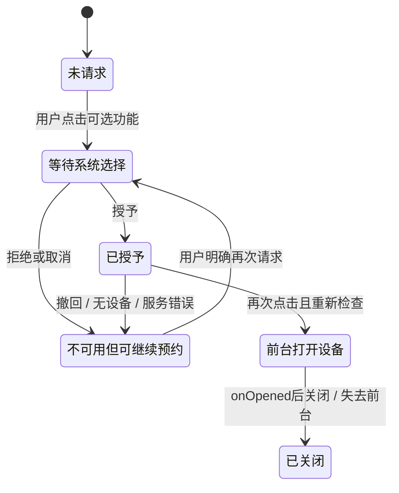

# 权限、设备输入与后台资源：允许读相机，为什么不等于允许改预约

D的原预约已经在本机排队。此时D拒绝可选相机权限，再把App送到后台：该删掉原id、清空草稿，还是继续显示“等待同步”？两个动作分别改变**设备能力**和**执行机会**，都没有给服务发出业务撤销。上一页的身份/网络/权威仍存在；现在要补上移动平台能够收走哪些能力，以及工作如何在这些条件下继续。

工程沿原`:networkApp`增加r变体，包`org.wwl.networkdemo.resources`，与d/e各自独立UID。它复用原Protocol/ClientStore/NetworkRepository；新ResourceStore只记后台预算和迁移轨迹，不定义第二套预约规则。源、固定输入、实际命令与证据见 [[计算机知识/64-移动平台开发/android-intent-demo/资源与更新实践|资源与更新实践]]，源码镜像见 [[计算机知识/64-移动平台开发/android-intent-demo/资源源码与测试|资源源码与测试]]。本页与 [[计算机知识/64-移动平台开发/04-构建签名与更新迁移|下一页更新迁移]] 使用同一个原意图，不另造一条跑得通却接不回来的演示。

## 四种许可，谁有权作出哪一种决定

| 条件 | 实际决定者 | 允许的对象 | 不推出什么 |
| --- | --- | --- | --- |
| CAMERA已授予 | Android权限系统/用户选择 | App在相关平台条件下调用相机API | 服务允许该actor预约、已有预约已接受 |
| 相机/传感器存在且可用 | 设备、系统服务与当前占用状态 | 获得相应设备句柄或输入 | 物理测量准确、所有设备都同能力 |
| JobScheduler约束满足且被调度 | 系统调度器 | 有限后台执行机会及相应资源 | 请求必然到达服务、业务必然接受 |
| 服务认证/业务合同通过 | HTTPS身份适配层与SE82权威 | 对原actor/id作出或返回原决定 | 获得本机相机权限、工作能无限后台运行 |

本例只在用户点击“可选：相机权限与设备打开”时请求CAMERA，每次敏感操作重新检查授予状态。拒绝或撤回时，显示原因和下一步，保留业务id与输入；不循环弹窗惩罚拒绝。需要解释时有“继续请求/取消”，授予以后再点按钮才打开设备。平台权限流程和单次授权/撤回边界见[官方请求指南](https://developer.android.com/training/permissions/requesting)。它是危险权限案例；上一页INTERNET和本页ACCESS_NETWORK_STATE、RECEIVE_BOOT_COMPLETED是normal权限，不能拿安装时授予冒充危险权限交互。

相机只用于“前台打开一个真实枚举到的设备，再立即关闭”的教学探针，**没有照片、帧采集或上传**。它不是预约的先决条件。若实际产品只需用户选择已有图片，应先评估系统选择器等更小权限方案，而不是照搬本例的敏感能力请求。拒绝按钮不是服务端DELETE API；把两者绑在一起，相当于用户关了窗帘，预约系统就自行退房。

这里没有“权限拒绝→业务rejected”的箭头。权限状态可能在应用外被改变，甚至引起进程终止；下一次打开从ClientStore找原意图，而不是信任内存里的permission布尔值。

### 设备存在、授权成功、打开成功仍是三件事

ResourceActivity在同一个try/catch内调用cameraIdList与openCamera：枚举本身也可能抛CameraAccessException，不能把它留在错误反馈之外。无设备、权限不足、设备占用、断开和服务错误分别降级显示。onOpened是异步回调；前台已失效或旧token不符时立即关闭返回设备，不把旧回调发布到新界面。[CameraManager参考](https://developer.android.com/reference/android/hardware/camera2/CameraManager)给API与异常合同，本轮实际枚举/打开的是模拟器报告的设备，不是拍到现实世界。

输入示例另选低频加速度计，不为其凭空添加危险权限。数据是设备坐标中的三轴**加速度，单位m/s²，包含重力成分**；事件timestamp为单调时基纳秒，不是UTC预约时间；量纲与重力关系可核[SensorEvent参考](https://developer.android.com/reference/android/hardware/SensorEvent)。模拟器控制台注入`1:2:9.81`以后，App显示对应三轴值与样本数；它证明输入从模拟设备服务到达App，不认证真实传感器校准、姿态估计或生理/地理含义。

registerListener请求200000微秒采样间隔，是一个**提示**而非“精确5Hz”承诺；平台可能更快或更慢。只保存最近一份观察，不积累或上传流。onPause先置本地未注册标记，再unregisterListener，排队中的旧回调也不能发布。[SensorManager文档](https://developer.android.com/reference/android/hardware/SensorManager)说明注册/注销及提示语义。实践分别检查样本值、界面可见反馈与暂停后的服务注册/样本变化；仅把UI数字冻结不能证明底层已经停止采集。

## 从一个worker换到系统任务，究竟保留什么

上一页Application中的worker只是应用进程里的线程池，进程死了就没有那条线程。需要在离开界面后仍可被系统恢复的工作，必须把业务身份和执行计划放在适合的持久来源；但二者也不能混成一个id。

| 对象 | 本例持久来源 | 作用 |
| --- | --- | --- |
| actor/id/原参数/fp、原终局 | 原client.db | 同一次业务请求；先落盘才允许调度 |
| 后台已用尝试数 | resources.db的(actor,id,fp,attempts) | 重启后不把预算重新置零 |
| jobId、actor/id/fp、约束、backoff | 系统JobScheduler持久JobInfo | 系统以后绑定JobService时定位原记录 |
| 本次Run、stopped、transport句柄 | JobService实例内存 | 取消当前执行与拒绝旧回调；不是业务永久身份 |
| 权威预约/结果/事件 | 本机HTTPS适配后的SE82数据库 | 业务是否提交及同键原结果 |

本例JobInfo固定jobId17503，只提供一个待执行槽。再次安排同键可更新计划；若这个槽仍被另一原意图占用，就明确拒绝覆盖，不为了显示最新草稿偷偷取消旧unknown。每次绑定先从client.db读原键，核actor/fp；已有终局无需再发；没有持久意图则失败，不从Job extras创建新业务。

声明`setPersisted(true)`并配置RECEIVE_BOOT_COMPLETED，是系统持久计划的接口；本轮实际验证的是**应用进程终止后任务仍在、后来新进程运行**，不冒称已重启整台设备。App force-stop、设备重启、配额/OEM策略各有不同条件；持久计划不是一份“必在某秒执行”的保单。

JobService的onStartJob/onStopJob在主线程，不能把SQLite、TLS或等待塞进这两个回调。onStartJob返回true后把工作送到单worker，完成时对正确JobParameters调用jobFinished；系统可在约束消失等情况下调用onStopJob，之后就不再为这次Run调用jobFinished。[JobService参考](https://developer.android.com/reference/android/app/job/JobService)规定这个生命周期。本实现用stop原子标记、旧Run身份和异步disconnect响应停止；回调本身不等待网络。取消发生在发送附近仍可能已提交，因此“停止工作”不等于“撤销服务事务”。合法已到结果仍可写入原意图，旧Run不能替新Run宣布完成。

通常产品可选[WorkManager](https://developer.android.com/develop/background-work/background-tasks/persistent)组织持久任务与约束；本课直接用平台JobScheduler，目的是露出调度回调、约束和持久身份，不宣称它比推荐的高层方案更适合一般业务。WorkManager也不能替代服务同键去重、授权或资源预算。

## 网络可用，不等于这个服务可达

JobInfo声明“有网络且充电”，指数backoff初始30000ms。平台认为有可用网络以后，`127.0.0.1:18751`那条具体adb reverse仍可能不存在。网络条件是可运行前提的一部分，**不是探测服务已经能处理本条请求**。

本例在API28以上使用JobParameters给的Network打开连接；API26/27保留默认网络分支，但本轮未实测这两个版本。共享HttpsTransport新增可选Network与实例cancel接口，旧d/e默认参数与业务行为保持；默认TLS/hostname与禁止自动redirect不被后台路径绕过。

一次后台逻辑attempt执行“query原id/fp；若严格核为unknown/not_registered，再reserve原参数”。后台凭据固定为公开教学D/self，不消费原网络练习中的invalid/other测试开关；r界面不提供这些切换。它不演示真实令牌刷新/撤销，真实身份应把认证失败停重试、保留原unknown，再按安全凭据流程恢复。

服务明确accepted/rejected后保存原终局；HTTP401/403或协议错误不无限自动重试。I/O失败可以请求系统重调，但仍保留原id/fp。停止时若已经收到合法原结果，保存不应依赖旧屏幕是否还在。基本业务/HTTP分层回到 [[计算机知识/64-移动平台开发/02-双客户端网络身份与容量冲突#一条请求穿过三个失败边界|上一页]]，后台代码不复制新权威规则。

## 给资源花费一个可检查的上界

资源预算约束的是**每个原id的后台逻辑attempt最多3次**。ResourceStore用事务先核原fp，再把attempts加一，提交后才进入发送；消耗预算后进程立即死掉，可能没有任何HTTP效果，但不会凭重开App再次免费取三次。达到预算只停后台自动尝试，原unknown仍unknown；用户显式同id恢复是另一条入口，不在这个后台计数里。

设实际后台attempt数为A，应用层发起的query和reserve调用总数为H。就本例恢复算法，有

\[
0\le A\le3,\qquad H\le 2A\le6.
\]

它是**逻辑调用**上界：平台库内部的wire重试、握手、响应字节、调度唤醒和用户手工恢复不因此都算作6。接收body另受每次65536字节合同限制；取消和超时也不是事务回滚。更大的预算可能提高暂时故障后的恢复机会，同时增加网络、CPU和唤醒成本；设得很小则更早把尚unknown的操作交回用户处理。

用教学能量账本描述方向：`E≈P_active·t_active+E_radio_tail+E_CPU+E_sensor`，每项单位为焦耳，功率单位瓦、时间秒。这里P_active专指通信硬件活动态相对空闲的平均增量功率，t_active只覆盖该活动态；尾态另计，CPU与传感器项分别归各自组件，不重叠计入P_active。它不是整机功率再加两个组件的重计账本。合并可延迟工作、在合适网络/电源条件运行、停止无用传感器，都可能减少某些项；它们也牺牲时效或覆盖范围。本轮有尝试数、命令与时间记录，**没有物理电量测量**，不能把少一次请求直接报成节省某个百分比。

### 调度测试要写明有没有越过约束

实践用本机实际`cmd jobscheduler help`的`run -s`：请求立即执行，但只在所有约束满足时运行。无参数的run也可能忽略某些约束；`run -f`更会强制越过技术条件。它们都不是自然调度时刻。故分别观察“未充电时-s拒绝”“有条件后实际JobService后台运行”与停止回调。原资源链在held query期间撤充电，实际先得到读超时，没有观察到onStopJob；不能把这次写成真正停止通过。回调路径另用独立隔离fixture的明确系统timeout核对，不称充电自然触发，也不能把任何主动命令写成自然后台必然及时。

能够到达服务的首次query由显式lab hold人为延迟，以便在读回复期间改变充电条件。这个故障夹具不改权威决定，不模拟真实无线延迟分布；每步的预算、旧id、原结果与停止事件都要按原始记录核，不用一张成功截图跨过所有失败。

## 变条件与完整答案

1. **用户拒绝相机，当前预约已accepted。要不要改为rejected？**  
   答：不要。设备能力许可与服务终局分属不同对象；显示可选功能不可用，保留原结果。若业务真要撤销，需另有授权的撤销协议。
2. **permission=true，但cameraIdList抛异常。**  
   答：权限不是设备可用证明；枚举与打开都在错误处理内，显示缺设备/服务不可用并允许继续预约，不能崩溃或无限重新请求权限。
3. **采样请求200000µs，1秒只收到3个事件。程序一定错吗？**  
   答：不由这一点判错，它是提示。核实际timestamp、设备能力/调度和注册状态；不把模拟输入当真实5Hz采样仪器。暂停后还收到一个排队事件，应由未注册/前台门拒绝发布。
4. **把任务id等同业务id，App进程重建后再造UUID。**  
   答：系统jobId只定位计划；原actor/id/fp必须从持久业务记录恢复。换UUID可能失去原accepted，即使冲突碰巧阻止第二条预约，也不是恢复原成功。
5. **本地attempts已2，网络未发送前崩溃。重启能把它改回1吗？**  
   答：不能无证据回退。先取预算再发送使上界保守；恢复用同id。可用性与严格成本上界存在取舍，要另设用户明确的恢复策略，不偷偷换id清预算。
6. **-f执行通过，能否说充电约束已验证？**  
   答：不能。它越过条件；需保留未充电时-s拒绝的输入/输出，再按条件变化观察实际运行。即使-s运行，也只证明命令请求下执行，不承诺自然调度时刻。
7. **onStopJob之后服务已经提交，disconnect成功。预约会消失吗？**  
   答：不会由disconnect撤销。客户端可以unknown并按原键恢复；如果合法结果已经到达可存原行，但旧Run不再jobFinished，也不能盖掉新界面。
8. **换成没有相机/加速度计的API26设备，后台配额更紧。**  
   答：可选功能明确降级，预约仍走持久合同；API26分支与布局/权限/调度需目标设备验证。降低采样、合并重试、容忍更晚完成，不能把Build配置里的min26当运行证据。资源记录随下一页同签升级迁移，不通过清库“解决”兼容。
