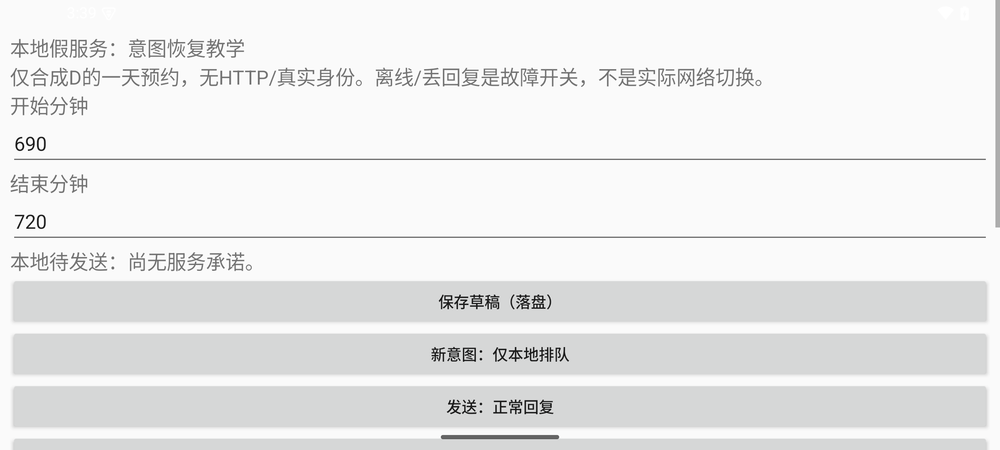
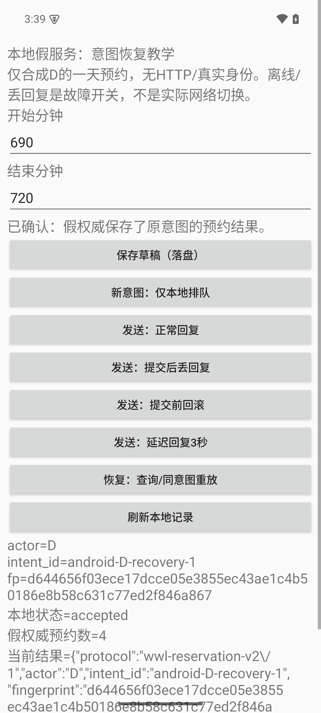

# Android意图恢复：最小工程、固定输入与实测

这里是 [[计算机知识/64-移动平台开发/01-生命周期状态归属与离线同步|状态归属主文]] 的执行入口。源代码是相邻`.kt/.kts/.xml/.py`，[[计算机知识/64-移动平台开发/android-intent-demo/源码与测试|源码与测试]]是逐字镜像。本页只说明原`:app`的合成一天预约，没有账号、HTTP、真实日历、付费云或用户设备数据；新增`:networkApp`两独立UID与真实HTTPS请进入 [[计算机知识/64-移动平台开发/android-intent-demo/网络实践|网络实践]]，两套输出分别读。正式记录保持原样；**复建一律复制工程到新的库外目录，输出到新目录**，不覆盖本页data/中的记录。

## 本实验为何重要

重要性为**高**，因为“看见成功”与“业务已提交”、配置重建与进程死亡、原意图恢复与错换id是三组会造成错误承诺的边界。实验支撑的是有限实现断言：先提交客户端意图再调用假服务；服务提交而回复丢失以后，新进程仍找到原id/fp，query/replay获得原accepted；晚回复只更新原行，不盖掉新屏幕。**不由本轮证明**所有崩溃切面、SQLite掉电持久性、生产身份/并发/HTTP网络、性能或人的理解。

| 层 | 输入与操作 | 成功判据/失败判据 |
| --- | --- | --- |
| 主机JUnit | 已知规范UTF8/hash、Unicode边界、分钟和缓冲规则 | 精确相等；任何规范字节/类型误差失败 |
| Android SQLite仪器测试 | 新测试私有DB，queue重开、提交前回滚/丢回复、同key异参、响应形状 | 查询原id/fp/原终局与保留记录；count相同不足以通过 |
| Activity仪器测试 | recreate、requestedOrientation；同主线程queue后立即attempt | 草稿与业务身份不丢；保存期间不得发送旧shownId |
| 外部Android驱动 | 同一FIRST queued后实际wm转向/重建，再HOME→am kill（必要时自包同UID明确终止）→pid为空→新启动、query/replay、延迟旧回复/新意图、force-stop | pid实变、原accepted完整相等、新queued不被盖、坏草稿显式保存可恢复 |
| 图/界面 | 实际自建AVD截图 | 与同阶段JSON相符；不由截图推断未观察的回调或真人效果 |

## 固定构建组合与依赖

| 项 | 本工程锁定值 |
| --- | --- |
| Application id / namespace | `org.wwl.intentdemo` |
| Android Gradle Plugin | `8.7.2` |
| Kotlin Android插件 | `2.1.21` |
| Gradle Wrapper / 构建JDK | `8.9` / `17` |
| compileSdk / targetSdk / minSdk | `35` / `35` / `26` |
| Android Build Tools | `34.0.0` |
| 主机测试 | JUnit `4.13.2` |
| 仅androidTest依赖 | AndroidX runner `1.6.2`、rules `1.6.1`、core `1.6.1`、ext:junit `1.2.1` |
| 运行时结构 | 原生Activity/Views、SQLiteOpenHelper、单ScheduledThreadPoolExecutor；无Compose/Room/HTTP库 |

[AGP8.7兼容表](https://developer.android.com/build/releases/agp-8-7-0-release-notes)与[Kotlin Gradle表](https://kotlinlang.org/docs/gradle-configure-project.html)支持这组固定选择；不是“升级到最新”。`settings.gradle.kts`从google/mavenCentral/Gradle插件库解析所声明依赖。SDK/JDK/Gradle缓存不进入本工程，`local.properties`不交付，本机绝对SDK路径用环境变量传入。首次联网下载依赖不等于应用进行网络访问；原`:app`的Manifest没有INTERNET权限，新增`:networkApp`单独声明。

wrapper脚本/Jar来自[Gradle官方v8.9.0](https://github.com/gradle/gradle/tree/v8.9.0)，保留原脚本声明与[许可证](GRADLE-LICENSE.txt)。`gradle-wrapper.properties`含distributionSha256Sum，Gradle8.9二进制zip为`d725d707bfabd4dfdc958c624003b3c80accc03f7037b5122c4b1d0ef15cecab`，wrapperJar为`498495120a03b9a6ab5d155f5de3c8f0d986a449153702fb80fc80e134484f17`；它们是第三方启动输入，不是本课程自己实现的Gradle。

在**新复制的工程目录**运行，示例变量须换成自己的库外安装路径：

```bash
export JAVA_HOME=/absolute/path/to/jdk17
export ANDROID_HOME=/absolute/path/to/isolated-sdk
export ANDROID_SDK_ROOT="$ANDROID_HOME"
export GRADLE_USER_HOME=/absolute/path/to/new-gradle-cache
export ANDROID_USER_HOME=/absolute/path/to/new-android-user
export ANDROID_AVD_HOME=/absolute/path/to/new-avd-directory
./gradlew --version
./gradlew --no-daemon --max-workers=1 :app:assembleDebug :app:testDebugUnitTest :app:assembleDebugAndroidTest
```

wrapper需要可用网络/已核下载缓存，JDK17与SDK平台/API工具需事先按[官方SDK工具](https://developer.android.com/tools/sdkmanager)准备。本机SDK组件为platforms;android-35、build-tools;34.0.0及platform-tools；模拟器另外需要emulator和system-images;android-35;google_apis;arm64-v8a。SDK许可按实际环境接受，不复制他机许可作为已同意。默认构建workers1、Xmx1GiB、Kotlin进程内、无并行；冷依赖安装另计，暖编译和本轮测试耗时见实际回执。

只在专用合成AVD、明确serial上安装debug包和test APK。默认debug签名仅供本机安装，不是发布签名/密钥管理课程；不交付私钥。回执中的APK SHA只标识本次实际执行包；新机器的debug签名和构建元数据可能改变APK字节，本页不承诺可重复到相同二进制hash。若已经有自己的设备/工作AVD，不应把它作为这些故障测试的默认目标。

## 固定输入与运行

[lab-inputs.json](lab-inputs.json)给固定公开输入；运行驱动内的常量与它一致。种子只有三条旧政策预约。`android-D-recovery-1`的D690–720应被接受为booking4；客户端先queued，再用drop模拟**服务已提交但回复丢失**。`android-D-next-1`的810–840只排队，不发送；`bad/840`只作原始草稿错误注入，不是业务参数。两意图记录分别保留。

历史首轮未让FIRST实际旋转，因此只作为分段恢复/失败记录；最终完整同id链另存data/lifecycle-complete/，两套记录不拼装。首轮已真实queue/drop，随后am kill未杀，保留了原失败和执行脚本；修后驱动用`--resume-from`读该失败目录，将01/02原字节与当前原id/fp/参数/unknown及完整假权威快照逐项核同，再从同一意图继续写到**新输出目录**，不重置或重造预约。新目录prefix/保留首段原脚本/命令/失败断言，resume-provenance.json给复制身份；后续commands/results另存。读者从全新合成实例跑完整驱动通常不需resume，它只用于这个严格匹配的未知切面，不是任意坏状态自动“修好”。

两文件`client.db`与`mock-authority.db`都在本应用私有目录：前者保存草稿/意图/当前索引/教学轨迹，后者保存合成预约/结果/outbox。它们布局版本各为1，**不与SE82的Python数据库文件兼容**。业务JSON复用协议v2/1，固定actor D、policy2和决策epoch2；查询/同key重放返回原结果，但本模型不支持fence提升或epoch3服务。没有去重TTL，也没有结果回收/线上迁移。显式实验故障按钮不切换网络接口，不把它写成“飞行模式已验证”。

外部驱动只接受`emulator-*`且qemu属性为1的明确serial，不发现/选择/清理用户设备，不安装/清数据，也不关闭全局adb服务器。fresh完整链临时改变**此专用AVD**的wm user-rotation模式，记录实际display rotation、同PID/新Activity实例和同id/fp，然后恢复原模式；不是物理转动手机。最后完整运行前只在原raw/两库均保全后重置了这个自建AVD的合成应用数据，没有清用户设备、其它App或旧证据。它要求这份新合成应用的假权威仍只有3条种子、固定两个id尚未使用；重复执行应使用另一新合成AVD/应用数据副本，不能覆盖正式证据。主机/Android测试用公开临时id，SQLite测试用独占私有测试库并只删这些测试库；Activity测试仅queue，不新增权威预约。

本轮Gradle connected任务结束后目标包已被测试流程卸载，因此外部驱动前重新安装同一最终debug APK（不clear）；首次am start找不到Activity的尝试未触发业务轨迹，保留在执行回执。读者同样先确认合成包已安装，再在新专用AVD上以自己的专用adb环境运行：

```bash
# ADB_SERVER_SOCKET若设，指向自己的隔离adb server；明确serial不可省略。
python3 -B tools/check_lifecycle.py \
  --adb "$ANDROID_HOME/platform-tools/adb" \
  --serial emulator-5580 \
  --output /absolute/path/to/new-lifecycle-output
```

设备测试也只能指向该专用模拟器。最小直接调用为：

```bash
"$ANDROID_HOME/platform-tools/adb" -s emulator-5580 install -r app/build/outputs/apk/debug/app-debug.apk
"$ANDROID_HOME/platform-tools/adb" -s emulator-5580 install -r app/build/outputs/apk/androidTest/debug/app-debug-androidTest.apk
"$ANDROID_HOME/platform-tools/adb" -s emulator-5580 shell am instrument -w \
  org.wwl.intentdemo.test/androidx.test.runner.AndroidJUnitRunner
```

或者在只暴露该专用模拟器的隔离adb环境中运行`./gradlew --no-daemon --max-workers=1 :app:connectedDebugAndroidTest`。不把未限定设备选择的connected任务指向自己的所有已连接设备。实际本机自建AVD、资源限制、专用端口/注册和命令保存在下面环境回执中，不依赖读者拥有相同`/private/tmp`目录。

手动复现不用实验命令extra：先输入690/720，点“新意图：仅本地排队”；看到待发送后点“提交后丢回复”；切后台，针对这份合成包执行am kill并核pid空；若它按平台安全策略保留进程，不得声称已终止。本轮另以同UID run-as核原PID与/proc包名后SIGKILL，只作用自建合成包；再打开，点“查询/同意图重放”。手动新意图id为随机UUID，因而不能拿它逐字对照固定id的自动记录。CLI用debug-only的lab_command/start_raw/end_raw/intent_id extras提供确定输入；每次创建后删除这些extra，保留原launcher Intent身份，旋转不重放实验操作。release不执行这条实验控制入口；本轮没有发布release或认证其攻击面。

## 结果与证据层次

本轮在macOS arm64/JDK17、Android15/API35 arm64专用无窗口模拟器实际完成构建和恢复。**主结果是[完整同id链31条断言](data/lifecycle-complete/results.json)**，另有[两数据库只读复核12条](data/lifecycle-complete/database-readback.json)。[rotation.json](data/lifecycle-complete/rotation.json)记录FIRST/fp在PID5786内0°→90°、新Activity实例及原free模式恢复；之后旧pid5786确实退出，新pid6107恢复原结果。am kill仍未生效，报告明确自包UID SIGKILL而非LMK。后面的force-stop只用于另一条显式草稿恢复。各层分别记，不用其中一个代替另一个。

| 实际证据 | 读哪一个结果 |
| --- | --- |
| 最终debug/测试APK构建与主机3例 | [13秒构建log](data/build/final-build.log)、[JUnit3例0失败](data/build/jvm-3.xml)；[源码/执行APK身份](data/build/source-identity.json)保留实际hash |
| 首轮Android事务/界面 | [原8例XML](data/build/android-first-6pass-2fail.xml)中6个Store例通过、2个Activity例失败；[原log](data/build/android-first.log)与[匹配失败logcat](data/build/first-activity-intent.logcat)保留，不汇报成8/8 |
| 修后Activity补测 | [2例XML](data/build/android-fixed-2pass.xml)、[补测log](data/build/android-fixed.log)；recreate/实际orientation和同主线程竞态通过；Store/Protocol/Repository字节未变，6例复用原结果，没有重复冒充新跑 |
| 同一FIRST排队及配置重建 | [01](data/lifecycle-complete/01-queued.json)、[01b](data/lifecycle-complete/01b-same-intent-rotated.json)、[01c恢复方向](data/lifecycle-complete/01c-same-intent-orientation-restored.json)，同pid、新Activity、同id/fp、假权威仍只有种子 |
| 原服务提交而客户端未知、换进程仍unknown | [02](data/lifecycle-complete/02-committed-reply-lost.json)、[03](data/lifecycle-complete/03-new-process-unknown.json)，仍是FIRST690–720，没有凭旧View宣布成功 |
| 查询与重放恢复原accepted | [04](data/lifecycle-complete/04-recovered-original-result.json)、[05](data/lifecycle-complete/05-replay.json)，booking4与同一event_id，预约4/事件1 |
| 晚回复与新屏幕 | [06](data/lifecycle-complete/06-old-reply-new-screen.json)，旧行保原结果，新意图810–840仍queued |
| 无效输入与显式保存/force-stop | [07](data/lifecycle-complete/07-invalid-preserves-draft.json)、[08](data/lifecycle-complete/08-force-stop-durable-draft.json)，bad/840与新意图整数810/840分开 |
| 文件本身与全命令 | [client.db](data/lifecycle-complete/client.db)、[mock-authority.db](data/lifecycle-complete/mock-authority.db)、[commands](data/lifecycle-complete/commands.json)、[实际执行driver](data/lifecycle-complete/executed-driver.py) |





完整链原08截图捕获了启动splash，**没有显示bad/840或queued，不作状态图证据**；[08原JSON](data/lifecycle-complete/08-force-stop-durable-draft.json)与两库提供该切面的状态记录。其它图片同样不能替代颜色、焦点、读屏或人的任务观察。

历史[分段续跑23条](data/lifecycle/results.json)及[12条数据库复核](data/lifecycle/database-readback.json)另留；其中prefix/保留原am kill未杀的false断言、首段执行脚本和复制身份，executed-driver.py保留当时94d6…版本。它是没有FIRST旋转的旧观察，不是新的规范实现或主31条结果；当前tools/check_lifecycle.py与完整链执行脚本同字节，源码镜像跟当前真源。调试JSON中的pid/UUID/seq在两轮不同，业务身份、规范参数和原结果关系才是共同判据。

### 本机环境与复建输入

实际SDK工具/平台/镜像版本在[SDK source.properties记录](data/environment/sdk-versions.json)，[工具与执行层说明](data/environment/ENVIRONMENT.txt)保留下载来源校验、子进程代理、构建flags与专用ADB/AVD事实，[实际最终APK/driver身份](data/environment/final-identities.json)标识执行输入。本机没有系统升级或他库改动；SDK、JDK、缓存、AVD、adb私钥和debug签名私钥均在库外，不交付。

[环境复建说明](data/environment/REPRODUCTION.txt)、[参数化启动副本](data/environment/start_owned_android.py)和[原执行恢复脚本](data/environment/resume_owned_adb.py)各有身份：两份说明的原字节以TXT保存，旧/tmp路径只标当时执行；组合启动副本只做AST静态检查，**没有重跑成新环境验收**；原脚本/env.sh保留当时硬路径，参数化副本也仍含本机JDK路径，换机先在库外副本改正并核查，不照抄去覆盖日常环境。它只接自建API35 AVD和已知5580/5581，专用adb15037、2GiB/2核，禁止对占用端口/日常AVD运行。实际注册回复和原argv保留，未扫描或关闭用户5037。

两库复核可在**新的库外工程副本/新结果副本**上运行，程序以SQLite只读方式开两库，但会写该副本的database-readback.json，不能指向正式保留目录：

```bash
python3 -B data/environment/verify_exported_databases.py \
  --directory /absolute/path/to/new-copy-of-lifecycle-complete
```

该脚本从原02取出提交前后关系，再查实际SQL行，不由cat成功推断内容完整。本轮导出库journal_mode读取为delete，不能由这一次结果外推任意WAL配置或掉电安全。

外部驱动输出每阶段store/ui JSON、commands/逐条assertions、results、截图和停止该合成包后的两数据库。SQLite文件才是业务记录，files/中的JSON只是工作线程为实验导出的投影，可能在写入中；驱动会重试读取，不把半个JSON当损坏的业务事务。进程号/Activity UUID/轨迹seq与测试UUID依实际运行变化，规范指纹、参数与原结果关系才是判据。截图不是人类任务观察；生命周期audit异步写入，缺日志不能单凭这一点证明某回调未进入。

预期失败应保留原样再定位：编译失败不能标运行过；Activity测试超时要读logcat分清应用崩溃与测试fixture匹配； am kill后pid仍在就不能宣称换进程，需单列真正终止方式并核身份；query回新rejected而非原accepted，即使count=4也失败；晚回复盖掉新queued同样失败。首次ActivityScenario因清空Intent丢MAIN/LAUNCHER身份而不匹配的失败已经定位，源码改为只移除实验extras；[旧MainActivity执行快照](data/build/MainActivity-before-intent-fix.kt)是历史输入，不是第二套现行源码。最终2例复测通过，不把首失败悄悄算PASS。

## 未验接口与下一段

- **实际HTTP/断网**：未来适配层输入固定protocol/actor/id/参数/fp，输出本合同JSON；用服务提交后断链、查询一致性和重连记录核原结果。当前调用本地函数，没有DNS/TLS/认证，也没有真网络恢复证据。
- **其它终止**：低内存选择/OEM、系统重启、掉电、数据库损坏/卸载/数据删除/备份恢复未验。要分别给触发动作、pid/文件/结果观察和失败恢复，不能由本次显式进程终止推断。onDestroy日志即使未出现也不改变先持久要求。
- **双设备/身份/资源**：并发容量、认证用户映射、权限拒绝、设备传感输入、后台任务/重试调度和电量网络预算是原#175后续，不由两个同机DB替代。worker在本进程内，进程死后不保证自动继续，需用户重开/显式恢复；当前界面若已读取后才有旧实例结果入库，也需刷新按钮重读，本例无跨Activity持续订阅，不假称已有后台同步服务。
- **兼容与交付**：实际仅所列API35arm64模拟器；min26并非API26实测。签名发布、更新迁移与真实设备还有独立课程；debug APK可安装不等于生产可分发。
- **人的任务/辅助技术**：参与者0；真人理解、实际读屏/实体键盘/不同设备均未验。后续任务用虚构预约，观察用户能否区分“已排队/未知/已确认”，记录错误解释、帮助、退出和预先约定失败；自动状态断言不能代替这些观察。

非作者已独立核对主文四层归属、epoch2子集、八题、七处局部返回和14个镜像；另由Python独立派生9组规范字节/hash/Unicode与整数缓冲输入，JVM3例通过，在隔离.review包实际跑过2个严格响应/终局不可改及queue竞态反例。完整同FIRST的31条原始命令、实际旋转/换进程、原JSON与SQLite关系已独立核对；官方wrapper、构建副本源码身份、环境实际/仅AST边界及两张正文截图也已核。相关链接/附件静态核对通过；这不等于真人、辅助技术、实体设备、Obsidian预览或一般崩溃安全证明。返回 [[计算机知识/64-移动平台开发/01-生命周期状态归属与离线同步#变式、反例与完整答案|八个变式与题解]]，再判断哪条设计可迁移、哪条证据必须重做。#175首包之后仍保持OPEN。
