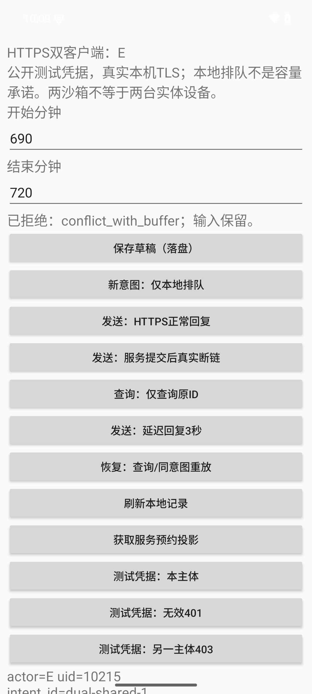
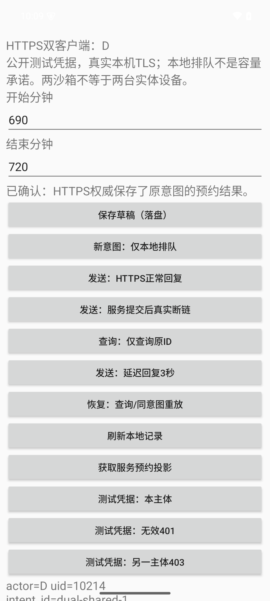

# 网络实践：两个独立UID、一个真实HTTPS权威

本页接 [[计算机知识/64-移动平台开发/02-双客户端网络身份与容量冲突|主文的身份、网络与容量推导]]。新增`:networkApp`编译两个变体；原`:app`及其[旧生命周期记录](README.md)继续是本地假服务，不把旧故障开关改名为真实断网。规范代码是相邻`.kt/.kts/.xml/.py`，[[计算机知识/64-移动平台开发/android-intent-demo/网络源码与测试|网络源码与测试]]逐字镜像；历史执行副本保留在network-data，不能从中挑一份当第二套现行真源。

## 为什么做这组高重要性实验

重要性为**高**：伪造主体可能读写他人意图；把unknown/401误判为未提交会错换id；把两个queued当accepted会超订。有限检查分别对应这些断言，任何一层失败都不能用其它层的PASS补票。

| 层次 | 实际输入/观察 | 通过与失败判据 |
| --- | --- | --- |
| 主机真实TLS | 同一套本机生成证书；默认不信教学CA、同CA错hostname；401/403、严格JSON、同/跨actor键、两并发POST、提交后真关闭socket | 正确链可读；不可信链/错名字拒绝；冒充不写业务；同actor完整原结果；并发恰一accepted；断链后query原结果 |
| Android构建 | 原工具版本、新d/e两debug APK、共享原Protocol/Stores源文件 | 两变体实际构建；不把min26配置当API26运行 |
| 两客户端真实网络 | UID10214/10215、移除一条reverse、原id持久、真实IO失败、恢复route、D提交后关闭TLS、E冲突 | 断链时权威仍3种子/0新增意图；恢复后4预约/2主体键/1事件，非两个accepted |
| 身份及进程恢复 | 同一D原键先401再403，精确自包PID终止7836→8125，修测试凭据后query/replay | 不因认证失败篡改业务终局；新进程保同id/fp；完整原accepted/booking/event一致 |
| SQLite与界面发布 | 两client.db+authority在线backup；晚旧回复/新queued；实际3截图 | 原行终局与新行分开；旧callback被发布门拒绝；数据库关系逐值核，count不足；截图仅证明拍到的可见状态 |

主机TLS单元测试不等于Android默认信任策略实测；实际新UI断言也不等于真人理解。参与者始终为0。原31轨迹和本轮35不是同一条记录，本轮不借旧测试计数冒新运行。

## 固定输入与执行

输入在[network-inputs.json](network-inputs.json)。业务真源是库中[SE82 reservation_v2.py](../../75-软件工程与人机交互/reservation_v2.py)，本次导入SHA256=`5261d679746802ff71ba0065d15bf69226be41506a0a55d84ef1563fb8a65de2`。接口`wwl-reservation-v2/1`、政策2、决策epoch2；原种子A540–600/B600–630/C650–680保留政策1。D/E都使用`dual-shared-1`，都请求690–720；D另建`dual-next-D`810–840仅queued。服务端不接client选择writer_epoch，既有DB若不是epoch2拒绝启动，不提供fence/迁移或通知投递API。

工具版本沿[原工程锁定表](README.md#固定构建组合与依赖)：AGP8.7.2、Kotlin2.1.21、Gradle8.9、JDK17、compile/target35/min26、BuildTools34.0.0。新增模块运行依赖只有平台API；原生Views/SQLite/单worker，INTERNET为normal权限，无危险权限弹窗。`:networkApp`的Kotlin source include直接编译原`:app`中的Protocol.kt和Stores.kt，未复制或修改这两源。Stores文件还声明MockAuthority类，但新网络仓库没有实例化它、没有mock-authority.db；真实预约决定只在宿主Authority中。

**所有复建都在新的库外完整工程副本和新输出目录。** 保留原目录布局即可使用服务默认合同路径；若只复制工程，必须显式`--contract`指向同版SE82源。不要把复制来的旧data当可继续写的权威数据库，也不要对自己的日常App或用户设备运行故障脚本。

```bash
# 使用自己的隔离JDK17/SDK/Gradle缓存；旧README有环境准备与专用AVD接口。
export JAVA_HOME=/absolute/path/to/jdk17
export ANDROID_HOME=/absolute/path/to/isolated-sdk
export ANDROID_SDK_ROOT="$ANDROID_HOME"
export GRADLE_USER_HOME=/absolute/path/to/gradle-cache
# 工程副本中的 generated 必须尚不存在；它会同时生成服务TLS与debug CA资源。
sh network-server/fixtures/generate-fixtures.sh "$PWD/network-server/fixtures/generated"
./gradlew --no-daemon --max-workers=1 :networkApp:assembleDDebug :networkApp:assembleEDebug
```

新输出根先自行建立，子目录彼此不覆盖；服务在一个终端保持前台，不绑定0.0.0.0：

```bash
python3 -B network-server/http_authority.py \
  --contract /absolute/path/to/WWL/计算机知识/75-软件工程与人机交互/reservation_v2.py \
  --database /absolute/path/to/new-output/authority.db \
  --events /absolute/path/to/new-output/server-events.jsonl \
  --ready /absolute/path/to/new-output/server-ready.json \
  --port 18751 --allow-lab-faults
```

服务只在**数据库文件原本不存在**时种入三条；既有文件按原合同打开，不默默清空/重种。新进程/设备测试需新的合成应用状态；本驱动要求D/E私有意图表空、权威只有种子，若不符合就失败退出，不自动clear。原样重复应另建自己的合成AVD/应用数据副本，或在保全旧输出后按明确授权处理自己测试包，不能把清数据作为无提示恢复步骤。

使用明确专用serial、专用ADB server（若已配置）。本轮实际15037/5580复用先前已确认活的专用句柄，没有重启AVD/ADB，也不扫描用户5037或其它设备。

```bash
export ADB_SERVER_SOCKET=tcp:127.0.0.1:15037
export ANDROID_ADB_SERVER_PORT=15037
"$ANDROID_HOME/platform-tools/adb" -s emulator-5580 install -r networkApp/build/outputs/apk/d/debug/networkApp-d-debug.apk
"$ANDROID_HOME/platform-tools/adb" -s emulator-5580 install -r networkApp/build/outputs/apk/e/debug/networkApp-e-debug.apk
python3 -B tools/check_network.py \
  --adb "$ANDROID_HOME/platform-tools/adb" --serial emulator-5580 \
  --authority-db /absolute/path/to/new-output/authority.db \
  --output /absolute/path/to/new-output/new-network-chain
```

driver本身不安装、不clear、不启动/重启服务，不寻找可用设备；只接受明确emulator serial并核qemu属性。它创建/删除/恢复自身18751 reverse，不能拿这个固定端口覆盖他人映射；运行前先核该端口及映射归属。每次ADB远程参数独立shell引用，不把实验文本当shell程序。debug-only lab_command extra提供固定输入，正常人工按钮也走同仓库；一次性extra移除但保留组件Intent action/category，重建不重放命令。它只核自己两新包的唯一PID与/proc/cmdline，再用该包UID run-as SIGKILL；不是LMK、不是系统随机回收，不碰原org.wwl.intentdemo。

实际动作顺序如下；自动驱动以原JSON/数据库核每步，而非仅看截图：

1. D/E取同一三条投影，记录不同UID；移除reverse后各将同名id排队再发，真实IO失败且服务没有新增意图。
2. 恢复reverse。D带显式lab drop header提交，服务事务返回后真实shutdown TLS/TCP，尚未写HTTP头；D unknown。E正常请求按自己键得到冲突拒绝。
3. D使用invalid/other公开测试凭据分别得到401/403，不产生新的业务拒绝/actor改写；该mode独立落盘。终止D并核旧pid空，新pid从原id/fp/unknown与other mode恢复；切回self后query/重放原accepted。
4. D/E刷新投影为4条。D把已收到回复在本地暂扣3秒，同时新建810–840意图；旧终局入旧行，旧callback不盖新queued。这个delay不是网络延迟。
5. 终止两新包导出各client.db；权威另由SQLite在线backup冻结，同时保留baseline时刻server-events，不把后来核查服务流量拼进原35链。

### 公共证书与凭据的准确身份

当前发布源码只保留[签发配置及生成脚本](network-server/fixtures/generate-fixtures.sh)，TLS证书和两把私钥在本机新目录生成，`generated/`被Git忽略。脚本以0700目录、0600私钥写入，拒绝已有目录/文件/符号链接，也拒绝相对输出路径；失败输出保留供诊断，不会覆盖旧材料。新签发CA公证书逐字复制为`generated/android-res/raw/wwl_public_ca.pem`，Gradle的debug资源直接读取该目录，服务默认也读取同目录中的证书与服务私钥。先生成一次，再构建两debug变体、运行服务；不要在两者之间重生成。release资源只保留系统锚，release/发布尚未执行。

证书SAN为localhost和127.0.0.1；CA没有nameConstraints，不能据此声称它只能签这两个名字。debug-overrides对整个debug应用生效，因此该CA仅用于隔离工程、专用测试包与loopback服务，不能加入系统信任或用于真实部署。App只打包CA公证书，无服务私钥进入APK。生成算法与签发配置延续原实验；随机密钥、证书日期使新字节不同，不承诺重建原hash，也不能关闭hostname/链验证来消除差异。

原35链、截图、数据库、[当时源码与fixture SHA256](network-data/build/source-identities.json)、[原主机6例输入/输出](network-data/host-tests/command.json)、[证书文本](network-server/fixtures/server-certificate.txt)、CSR、配置及当时生成输出继续冻结，它们对应2026-10-17那套固定材料和旧规范源码。其有效期为2026-10-17 02:05:16 UTC至2036-10-14 02:05:16 UTC，生成器为LibreSSL3.3.6；独立Android错hostname/未知CA等反例也属于这次旧运行。原私钥及PEM字节保全在维护者的未发布原提交`ec9e86b87050ad3c87588a9e31a9e29012e6f84d`，不随当前发布树提供；该本地SHA不是读者可达的公开下载入口。读者可审计原观察及输入身份，并生成新材料重做同一实验；不能仅凭本包逐字恢复原固定key或把新测试冒充原35链重跑。

新一次复建应保留`generated/openssl-version.txt`和`generated/server-certificate.txt`、生成stdout/stderr，记录服务证书/CA/debug raw的SHA256及新APK身份，使用新业务输出目录。全部PEM和私钥仍只留本机隔离输出，不提交，不改扩展名或编码规避扫描。已有`network-data`文件不被新结果覆盖。

服务只信任固定公开Bearer映射D/E。这里没有生产密钥秘密、OAuth流程或真实用户授权；字段auth mode只保存self/other/invalid这个测试选择。网络接口自身使用平台默认TLS/hostname、禁止cleartext与自动redirect；关闭自动redirect是本协议的固定端点合同，不是声称已实现所有令牌受众/跨域安全策略。

## 主机TLS的复算

在新副本的network-server目录运行：

```bash
export SE82_SOURCE=/absolute/path/to/WWL/计算机知识/75-软件工程与人机交互/reservation_v2.py
# 与本次Android debug构建、服务使用同一套刚生成材料。
export WWL_TLS_FIXTURE_DIR="$PWD/fixtures/generated"
python3 -B -m unittest -v test_http_authority test_tls_fixtures
```

未设置`WWL_TLS_FIXTURE_DIR`时，主机测试自行在临时私有目录生成一套并在结束后删除；设置该变量时读取指定材料，不重生成或清理它。测试使用新的临时DB、动态loopback端口及真实TLS，不碰正式18751。新增生成器用例只核输出拒绝覆盖、权限、Android CA同字节；原6个TLS/业务断言完整保留。它校验未信任CA与错hostname均拒绝，认证失败无业务记录、同key原结果/异参409/跨actor独立键、提交后socket关闭和两个真实并发TLS客户端仅一accepted。运行接口保留固定输入/断言；一般安全性来自协议/信任前提，有限测试不证明任意攻击者、任意调度或生产OAuth安全。

当前本机生成方案另有[新材料、源码与双debug APK身份](network-data/local-tls-generation-check/identities.json)、[8例主机测试](network-data/local-tls-generation-check/host-tests.log)及[双debug构建输出](network-data/local-tls-generation-check/debug-build.log)。这些测试与两APK使用同一套新生成CA，两个APK内CA资源逐字一致，未含`.key`条目；[默认generated目录服务启动核对](network-data/local-tls-generation-check/default-service-check.json)另实测动态loopback端口、同证书HTTPS200及自有进程退出；它们不是原35条设备链的新一轮运行。另有[同一套新CA的原生Android三项核对](network-data/generated-tls-native-check/results.json)：隔离测试包使用原HttpsTransport取得HTTPS200及三条种子；同CA签发的错SAN证书明确产生hostname拒绝，不同CA签发的正确SAN证书明确产生trust-anchor拒绝。[原始命令、测试源码与回执说明](network-data/generated-tls-native-check/README.md)保留实际3次方法输出、APK/CA身份及自有三服务退出和reverse清理记录；这是新CA的窄验证，没有重跑原35链或r资源实验。

原固定fixture运行经两槽runner、线程1实际[6例全部通过](network-data/host-tests/unittest.log)，最终记录0.116秒；设备驱动另用timeout180，构建安装单列。初期主机原型曾在反向DNS等待、缺AKI证书验证上失败，已分别改为固定loopback名绑定和含AKI的签发输入；最终源不会通过跳过证书检查绕过失败。

## 结果与边界

实际环境是同一macOS arm64主机、API35 Android15 arm64模拟器，native HTTPS协商TLS1.3。正式回执在[35条完整设备链](network-data/network-chain/results.json)、[16条数据库逐值复核](network-data/network-chain/database-business-check.json)；数据库只读完整dump另在[database-readback.json](network-data/network-chain/database-readback.json)。

| 层 | 正式入口与观察 |
| --- | --- |
| 原运行输入与构建 | [13秒build](network-data/build/network-final-build.log)、[构建副本源码身份](network-data/build/source-identities.json)、[v2实际driver身份](network-data/build/final-driver-identity.json)、[实际APK身份](network-data/build/network-initial-identities.json)；APK/SDK/AVD/cache/debug签名私钥不入库 |
| 原失败保全 | [首driver4前置断言](network-data/initial-driver-read-failure/assertions.json)、[原stderr](network-data/initial-driver-read-failure/stderr.log)和原执行脚本：只读探针误用id列，尚无业务写入；修为intent_id，在原fresh状态、新输出跑完整链，不clear |
| 真断链前后 | [旧缓存](network-data/network-chain/01-two-cached-seeds.json)、[移除route](network-data/network-chain/02-real-route-removed.json)、[commit后真实关闭](network-data/network-chain/03-commit-then-wire-close.json)、[服务事件](network-data/network-chain/server-events.jsonl)；一次按钮不宣称只有一次底层尝试 |
| 主体/原结果恢复 | [E独立拒绝](network-data/network-chain/04-E-authority-rejected.json)、[401](network-data/network-chain/05-auth-401.json)、[403](network-data/network-chain/05-auth-403.json)、[新D进程](network-data/network-chain/06-new-process-unknown.json)、[原accepted](network-data/network-chain/07-restored-original-results.json) |
| 原行与新屏幕 | [晚回复/新queued](network-data/network-chain/08-late-response-new-intent.json)，旧行accepted、新行810–840无result；audit记录旧callback被拒 |
| 实际文件与全部操作 | [D库](network-data/network-chain/D-client.db)、[E库](network-data/network-chain/E-client.db)、[权威在线backup](network-data/network-chain/authority-snapshot.db)、[commands](network-data/network-chain/commands.json)、[实际driver](network-data/network-chain/executed-driver.py)、[server源/argv与SE82身份](network-data/execution.json) |





两图只显示实际可见的输入/状态与部分控制；完整fp、终局JSON及数据库关系从对应JSON/SQL读，不声称屏幕下方被裁掉的细节已经目视。实际[新queued截图](network-data/network-chain/08-D-new-queued.png)另留，不能由三张图推断辅助技术/真人理解。

[环境执行说明](network-data/README.md)和[工具版本](network-data/tools/sdk-versions.json)保留实际SDK/ADB/模拟器等；旧/tmp路径只标当时运行，不是读者必须拥有的路径。`network-data/server/http_authority.py`和两executed-driver.py是当时源码快照，规范现行真源分别为network-server/http_authority.py及tools/check_network.py。服务器与正式baseline事件切面分开，不把后续独核流量冒作原设备链。

导出库复核只对**复制到新输出目录的证据副本**运行，程序只读SQLite但要新写结果文件，别指向正式保留目录：

```bash
python3 -B network-data/check_network_exports.py --directory /absolute/path/to/new-copy-of-network-chain
```

[参数化在线backup辅助脚本](network-data/backup_authority.py)是AST检查过的复建接口，未另执行为新验收；构建副本身份表在driver只读列名修正前冻结，所以其中tools/check_network.py是首失败版本；实际v2 executed-driver与现行tools/check_network.py逐字相同，[补充身份](network-data/build/final-driver-identity.json)单列两者，未静默替换旧hash。旧运行的Kotlin、CA、服务源码未因该driver修正改变；当前发布源码的TLS输入改为本机生成，旧identity表仍只认证原运行。

实际baseline backup使用同样stdlib `Connection.backup`，原操作已记录。一次integrity_check/16条关系核不证明掉电、损坏恢复或任意WAL配置。

### 自有服务的实际收尾

独核释放窗口后，[实际收尾回执](network-data/shutdown.json)记录精确核对74142的完整cmdline，SIGINT后该服务进程不存在、18751连接拒绝，并仅移除自身18751 reverse；专用AVD/ADB与磁盘/raw继续保留，未动用户5037或设备。这里不是终止Android客户端的SIGKILL，也不是Activity重建。新的复算必须按前述命令启动自己的服务，不能假定当时的74142仍在运行。

[当时执行的收尾源](network-data/finish_owned_network.py)只作冻结输入，保留原环境路径/PID归属检查，不是可照抄的通用清理命令。独立最终events切面与已交[35链baseline事件](network-data/network-chain/server-events.jsonl)逐字相同，13行、SHA256=`25f3eba5dab0f438a6c7b4f65ece14ae37dcbe7b85add9f75b4282582f6f6cca`，因此不再存一份重复文件；新信息是实际退出与route移除，原baseline未覆盖。回执中的final hash据此定位原正式事件文件。

### 本包没有偷做的剩余范围

| 原课程接口 | 下一轮具体输入、动作与失败观察 |
| --- | --- |
| 两实体设备/外网/无线切换 | 同一固定业务键与两端投影；记录设备/账号/实际peer、断连与重连；核原结果与容量，不由同AVD双UID替代 |
| 真实身份 | 发证/失效/撤销/换账号时保留旧unknown；核主体/受众/存储与数据隔离；公开fixture不能当实凭据 |
| 权限与设备输入 | 一个确实需要的设备能力；允许/拒绝/撤回与缺硬件分别给反馈，坏输入不伪成accepted；INTERNET normal权限不是危险权限案例 |
| 后台与预算 | 前台queued后离开、约束不满足、进程终止、恢复调度；记录尝试数/取消/网络字节与时间起终，电量测量需实际仪器/平台方法；当前单worker不保证进程死后继续 |
| 安装发布更新 | 同一applicationId两versionCode、签名兼容/不兼容、保留DB迁移与回滚边界；本轮debug安装不是签名发布，min26不等于API26实测 |
| 人的任务 | 参与者0；用虚构预约让人解释queued/unknown/rejected/accepted，记录误解、帮助、退出；本轮未真人/读屏/实体键盘/Obsidian预览 |

非作者已独立完成主机真实HTTPS的23项核对，以及隔离Android包的4个原生网络反例：错hostname实际得到SSLPeerUnverifiedException（Hostname 127.0.0.1 not verified），未知CA实际得到SSLHandshakeException（Trust anchor not found）；自动重定向关闭且捕获端没有收到请求，401/403后保留原意图并在正确测试凭据下恢复、重放原结果。正文九题、三张实际截图、来源和环境/源码身份、35条原始设备链与三个SQLite文件已独立核对；168项组合检查包含14个新镜像、16条wiki和39个相对附件，原driver失败与最终driver身份分别保留。原README的:app命令限定及409不改既有终局的例外也已核。以上是同一AVD上不同UID与本机HTTPS的有限证据，不是两实体设备、外网无线切换、真人、辅助技术、实体键盘、Obsidian预览或一般安全证明；参与者为0。#175仍OPEN，下一单元继续权限、后台资源及发布更新。

## 继续核平台许可和安装演进

本页d/e与35链保持原输入；继续 [[计算机知识/64-移动平台开发/android-intent-demo/资源与更新实践|r变体资源与更新]]，带回原actor/id/fp/完整结果。该单元实际核权限拒绝可见、前台传感器注销、后台预算、坏迁移回滚与同签release升级；按需TLS生成合同继续共用，release不信debug CA。其第三次后台读超时与用户手动恢复、独立强制timeout停止分别保存，不能替本页网络断链证据改口。
