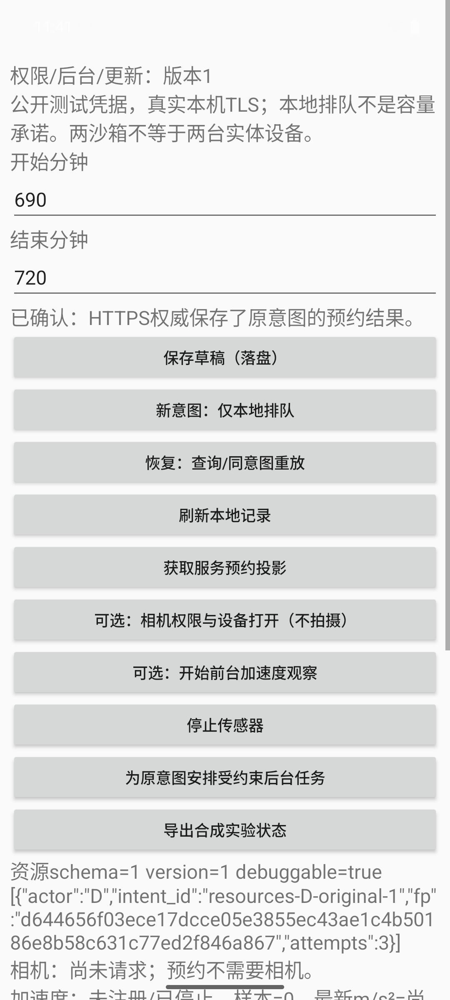
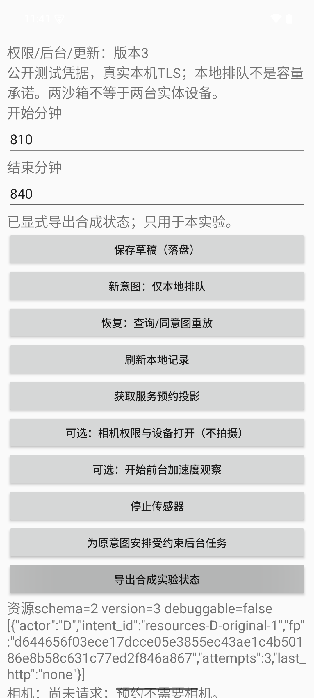

# 资源与更新实践：原意图穿过权限、后台预算与APK升级

从 [[计算机知识/64-移动平台开发/03-权限设备输入与后台资源|权限/资源主文]] 预测平台会收走什么能力，再到 [[计算机知识/64-移动平台开发/04-构建签名与更新迁移|签名/迁移主文]] 预测新APK能否继续解释旧数据。本实验新增r变体，不修改原d/e业务合同；规范源码是相邻源文件，[[计算机知识/64-移动平台开发/android-intent-demo/资源源码与测试|源码与测试镜像]]只用于阅读。

## 重要性、输入与失败判据

重要性为**高**。权限失败被误当业务取消，会抹掉原事实；后台重启清预算会无界重试；更新失败清库会丢失尚未知的意图；异签覆盖会改变更新来源。以下检查分别承担这些断言，构建成功不代替设备行为，截图不代替数据库关系，有限模拟器记录不代替物理测量。

| 层 | 固定输入/操纵 | 判据 |
| --- | --- | --- |
| Android资源仪器测试 | 独占UUID测试库；3预算后第4次、同键换fp、v1→ALTER后抛异常→正确v2、schema降级、cancel前开始 | 预算不回退、不篡原fp；user_version/列/原行保全；无新连接；只删该测试自己的临时库 |
| 权限与输入 | 系统CAMERA拒绝、重新请求/授予、枚举实际设备开即关；模拟器acceleration注入1:2:9.81 | 拒绝可见且原queued不消失；开关设备不拍照；单位/最新数值可见；HOME后真实unregister且不继续发布 |
| 后台执行 | charging false、JobScheduler run -s；原进程结束；route不可达、backoff、held query中unplug | 真实约束拒绝；新进程仍同id/fp；预算持久；原链超时不冒充停止；受控独立onStop/cancel另核；unknown不伪成业务rejected |
| 恢复/更新 | 明确同id手工恢复；v1→坏v2→好v2、异签/降级负例、同签release3 | 原accepted完整相等；坏迁移回滚原行；好迁移保预算/意图；拒装不是先卸载；release保原状态且不信debugCA |
| 人与物理设备 | 本轮参与者0、API35模拟器合成设备能力 | 不给真人理解、真实相机照片、传感器校准、电量节省或商店发布结论 |

公开输入在[resource-inputs.json](resource-inputs.json)：`resources-D-original-1`的D690–720用于恢复，`resources-D-next-1`810–840最终仅queued。身份/fp仍由旧Protocol/ClientStore和SE82定义，resources.db不复制业务规则。后台每个原id最多3次**逻辑attempt**；用户显式恢复不是该自动预算的一部分。工作使用固定公开D/self教学凭据，无真实账号/权限数据。

## 复建用新目录，先固定同一套TLS输入

工具链沿前两单元：JDK17、Gradle8.9、AGP8.7.2、Kotlin2.1.21、compile/target35、min26、BuildTools34.0.0。所有构建、keystore、SDK/缓存、生成TLS材料、APK与输出都放新的库外副本；不覆盖正式resource-data，也不修改用户设备。只消费生成合同，不把旧网络证据的CA/key SHA当本次生成值。

```bash
# 在新的完整工程副本，环境沿原README配置的自有隔离JDK/SDK/Gradle缓存。
sh network-server/fixtures/generate-fixtures.sh "$PWD/network-server/fixtures/generated"
./gradlew --no-daemon --max-workers=1 :networkApp:assembleRDebug :networkApp:assembleRDebugAndroidTest \
  -PcourseVersion=1 -PcourseDbVersion=1
```

生成器要求全新绝对目录、拒绝覆盖；只让CA公证书进入debug资源，私钥不进入发布树/APK。服务同一套generated/server.pem/key来自同一次运行。rRelease只用系统信任锚，不能为本机实验关闭校验或直接沿用debug CA。

每次构建后把输出复制到自己的独占版本目录，下一轮可能覆盖Gradle产物：

| 版本输入 | 任务/属性 | 这份APK用于什么 |
| --- | --- | --- |
| v1 | assembleRDebug，courseVersion1/courseDbVersion1 | 新r包及真实旧schema起点 |
| 故障v2 | assembleRDebug，courseVersion2/courseDbVersion2/failMigration=true | 继承v1库，ALTER后失败；不代表生产版本 |
| 正确v2 | assembleRDebug，courseVersion2/courseDbVersion2/failMigration=false | 在已回滚v1库上完成迁移 |
| releasev3 | assembleRRelease，courseVersion3/courseDbVersion2/failMigration=false | 非debuggable、无debugCA，用相同教学签名作实际升级 |
| 异签v3 | releasev3的另签副本 | 相同包名/版本，但签名不相容，应拒绝覆盖 |

v1/v2的debug产物在networkApp/build/outputs/apk/r/debug/，release未签产物在对应r/release/。本轮先核版本/APK身份，复制每份，再下一轮构建。仅声明属性不等于已经执行该版本。

签名输入只在自己隔离环境保存，不能用生产key作这个故障实验。release需先zipalign再apksigner签名，随后核实际包；以下变量只指向自己的教学keystore和新输出，不在命令中粘贴真实秘密：

```bash
"$ANDROID_HOME/build-tools/34.0.0/zipalign" -p 4 "$UNSIGNED_APK" "$NEW_OUTPUT/aligned.apk"
"$ANDROID_HOME/build-tools/34.0.0/apksigner" sign \
  --ks "$WWL_TEACHING_KEYSTORE" --ks-key-alias androiddebugkey \
  --ks-pass env:WWL_TEACHING_STORE_PASS --key-pass env:WWL_TEACHING_KEY_PASS \
  --out "$NEW_OUTPUT/release-v3.apk" "$NEW_OUTPUT/aligned.apk"
"$ANDROID_HOME/build-tools/34.0.0/apksigner" verify --verbose --print-certs "$NEW_OUTPUT/release-v3.apk"
```

实际隔离debug keystore、签名私钥及APK不随书发布；回执保留命令/版本、公开证书摘要和APK SHA来标识本次输入。新机器使用自己的教学key，不能据此承诺构建出相同APK字节。生产发布要有真正的key保管、更新渠道与兼容策略；本轮不是商店发布。

## 专用模拟器与设备测试入口

本轮复用已核活的专用API35arm64 AVD及私有ADB，不因观察超时重启。原网络服务早已关闭；本单元另起一个明确的新loopback HTTPS进程和新权威库。以下serial/端口仅作实际本机接口示例，读者必须使用自己专用合成设备；不扫描、清理或安装用户日常设备。

```bash
export ADB_SERVER_SOCKET=tcp:127.0.0.1:15037
export ANDROID_ADB_SERVER_PORT=15037
"$ANDROID_HOME/platform-tools/adb" -s emulator-5580 install -r "$V1_DEBUG_APK"
"$ANDROID_HOME/platform-tools/adb" -s emulator-5580 install -r "$V1_TEST_APK"
"$ANDROID_HOME/platform-tools/adb" -s emulator-5580 shell am instrument -w \
  org.wwl.networkdemo.resources.test/androidx.test.runner.AndroidJUnitRunner
```

仪器测试只操作新resources包的UUID测试库，不删除主意图数据，不用connected任务自动卸载目标包。原org.wwl.intentdemo及d/e、旧31/35轨迹均不重跑；网络层自身的TLS修复窄核也另有自己的输入与CA，不混算资源实验。

新后端同样只导入SE82权威，不改容量/原结果合同。显式hold用于捕获运行中Job的停止，不是真实无线延迟模型：

```bash
python3 -B network-server/http_authority.py \
  --contract /absolute/path/to/WWL/计算机知识/75-软件工程与人机交互/reservation_v2.py \
  --database "$NEW_OUTPUT/authority.db" --events "$NEW_OUTPUT/events.jsonl" \
  --ready "$NEW_OUTPUT/server-ready.json" --port 18751 \
  --allow-lab-faults --hold-first-query-seconds 10
```

保持该进程前台；只有真正退出/明确PID终态后再启动，不能因等待不到观察就重开或清权威库。它只在文件原先不存在时seed3；已有DB不静默重种。debug APK与此服务必须核同一次generated CA，release则应拒绝该链。

在**新的合成应用状态**跑完整驱动，输出必须不存在：

```bash
python3 -B tools/check_resources.py \
  --adb "$ANDROID_HOME/platform-tools/adb" --serial emulator-5580 \
  --apk-v1 "$V1_DEBUG_APK" --apk-bad-v2 "$BAD_V2_APK" --apk-v2 "$GOOD_V2_APK" \
  --apk-other-v3 "$OTHER_SIGNER_V3_APK" --apk-release-v3 "$RELEASE_V3_APK" \
  --authority-db "$NEW_OUTPUT/authority.db" --events "$NEW_OUTPUT/events.jsonl" \
  --output "$NEW_OUTPUT/new-resource-chain"
```

驱动只安装这些明确自有r APK，不pm clear、不卸载旧包；要求主client没有意图、权威仅种子、18751 reverse原本为空。它用真实系统权限UI按钮、可见状态和服务/数据库记录核操纵；临时改变自己AVD的电池输入、sensor及一条reverse。JobScheduler采用实际help的-s，不能把-f强制结果混入条件约束证明。run -s本身仍是主动执行请求，不是自然调度时刻。

## 本轮首失败与严格同切面续跑

首驱动已经完成权限拒绝/授予、实际相机开即关、加速度注入及HOME注销。随后未充电条件下run -s实际exit22，**stdout为空、stderr说明functional constraints but --force not specified**；驱动只匹配stdout里的另一种文字，因而把真实约束拒绝误记为fixture失败。不能因此改成-f绕过约束。

原finally恢复电池输入后，系统自然进行了两次后台尝试，具体peer不可达，两次ConnectException、同原id/fp仍unknown。冻结充电条件时已实际用掉2/3预算，权威仍3种子/0新增意图。没有回滚计数、清库或重建原意图。

第一次续跑让第三后台query真正到达显式hold；撤充电后未及时观察到onStop，实际先发生SocketTimeoutException，预算已3、同id仍unknown，权威仍3/0/0。这次超时和失败判据同样保留，不能把“触发输入已发”冒成回调已执行。最终续跑只执行**预算3仍unknown→用户显式同id恢复accepted→更新链**，后面的accepted不是后台自动成功。未知状态与成本上界都保留，正是“没有及时结果”与“业务被拒绝”不能偷换的地方。

复现这类续跑必须使用该失败目录的真实切面，不对任意未知状态自动“修复”：

```bash
# 其余APK/authority/events/ADB参数同上，原失败目录只读保全。
python3 -B tools/check_resources.py \
  --adb "$ANDROID_HOME/platform-tools/adb" --serial emulator-5580 \
  --apk-v1 "$V1_DEBUG_APK" --apk-bad-v2 "$BAD_V2_APK" --apk-v2 "$GOOD_V2_APK" \
  --apk-other-v3 "$OTHER_SIGNER_V3_APK" --apk-release-v3 "$RELEASE_V3_APK" \
  --authority-db "$NEW_OUTPUT/authority.db" --events "$NEW_OUTPUT/events.jsonl" \
  --resume-from /absolute/path/to/preserved-first-resource-chain \
  --output "$NEW_OUTPUT/new-resumed-chain"
```

默认attempts2续跑严格核version/schema1、原actor/id/参数/fp、attempt2/unknown无result、权威3且无决定、route为空；实际最终使用--resume-cut attempts3-timeout，改核已观察的attempt3/SocketTimeout/无job_stopped与route已恢复，不再次消耗后台预算。两种接口复制prefix保留旧false、命令、脚本与冻结两库。实际约束拒绝从原exit/stderr重新解释，不把它改写成一条新的执行PASS。自己的进程终止先核唯一PID及cmdline，再以该包UID SIGKILL；JobService后来新进程仍读原键。它不是LMK、整机重启或force-stop。

原始记录与当前规范源码分别维护。首次脚本是当时输入；当前脚本修stderr并增加严格resume，不覆盖原文件。其它设备若只有1次预算可走原完整路径；当前resume接口只接受明确的2次或3次超时切面，不声称通用恢复器。真正onStop另由隔离.reviewfinal包、独立不触原权威的TLS夹具核；系统命令run-f/timeout是人为启动/停止，不能计作原充电链通过。

实际最后续跑的命令在上一命令基础上加`--resume-cut attempts3-timeout`，并把--resume-from改为保存第三次读超时的那个目录；原失败目录已经包含其prefix。它要求当前后台计数恰3，保留unknown，不能把任意其它切面套入后直接改成功。

## 数据与证据层次

正式入口是[最终31条断言与原结果](resource-data/resource-chain/results.json)，[21项只读关系复核](resource-data/resource-chain/independent-export-check.json)逐项核迁移前/坏v2/好v2六个SQLite文件、权威在线备份和release显式导出。原accepted是D/`resources-D-original-1`、booking4、690–720、event `booking:4:created`，指纹`d644656f03ece17dcce05e3855ec43ae1c4b50186e8b58c631c77ed2f846a867`；最终权威4条预约、1条意图决定、1条outbox事件。原client结果必须与该完整决定一致，不能只看预约条数没变。资源预算始终3，新NEXT仍queued。

| 原始入口 | 用途与证据边界 |
| --- | --- |
| [构建命令](resource-data/build/build-commands.json)、[源码身份](resource-data/build/source-identities.json)、[APK身份](resource-data/build/apk-identities.json) | 固定版本的实际构建/签名输入；4个资源仪器测试见[原日志](resource-data/build/resource-final-instrumentation.log)。不交APK、keystore或私钥 |
| [本次CA资源身份](resource-data/build/CA-resource-identity.json)及build内各certificate文本 | debug v1/坏2/好2含同一新生成CA，release无debugCA；五个APK实际证书区分同签/异签。证书摘要不是私钥 |
| [首次失败prefix](resource-data/resource-chain/prefix/prefix/assertions.json)、[冻结预算2切面](resource-data/resource-chain/prefix/prefix/frozen-charging.json) | 真实exit22/stderr、两次自然ConnectException和原两库保留；旧false不改写成新PASS |
| [第三次读超时切面](resource-data/resource-chain/prefix/failure-state.txt)、[续跑来源](resource-data/resource-chain/resume-provenance.json) | 第三attempt到达held GET但未观察onStop；同原id的最后续跑才由用户明确恢复 |
| [手动恢复](resource-data/resource-chain/08-manual-original-recovery-after-background-budget.json)、[坏迁移](resource-data/resource-chain/10-bad-v2-rollback-readback.json)、[正确迁移](resource-data/resource-chain/11-good-v2-readback.json) | 区分HTTP决定与布局变化；坏迁移user_version仍1，正确v2新增last_http=none且原行保留。none只表示迁移默认值，不表示从未发HTTP |
| [release用户导出](resource-data/resource-chain/14-release-v3-explicit-export.json)、[release TLS拒绝](resource-data/resource-chain/15-release-no-debug-ca.json) | 非debuggable安装保留原accepted/NEXTqueued/预算；调试访问被拒后仍由显式合成导出核状态 |

当前规范driver是tools/check_resources.py；各目录executed-driver.py是当时的冻结输入。构建身份记录的是开始该次执行时的脚本版本，之后stderr/resume窄修由各自执行副本定位，不能静默换旧hash。服务首部说明在构建后窄改为准确的本地生成TLS材料表述，执行逻辑未变；原构建source-identities仍保存旧说明字节的hash，不把它冒充当前全文hash。复算只在**新的库外结果副本**执行`python3 -B resource-data/verify_resource_exports.py --directory /absolute/path/to/new-copy-of-resource-chain`：SQL以只读URI打开，但程序会在该副本写independent-export-check.json，不能指向正式记录目录。当前源码不依赖读者拥有当时的/tmp路径；冻结辅助构建/签名/收尾脚本仍含原环境绝对路径，只是执行输入，不能照抄成通用安装清理命令。

### 同一业务结果和可见反馈分别看什么



这张实际帧可读到690–720、已确认、schema1和后台attempts3；仍需原JSON/SQLite证明完整结果与权威相等。[权限拒绝帧](resource-data/resource-chain/prefix/prefix/02-camera-denied.png)与[注入后的帧](resource-data/resource-chain/prefix/prefix/04-sensor-injected.png)保留实际显示；传感器帧底部被视口截断，完整三轴值取[采样JSON](resource-data/resource-chain/prefix/prefix/04-sensor-injected.json)与[实际服务dump](resource-data/resource-chain/prefix/prefix/04-sensorservice.txt)，暂停注销看[HOME后服务dump](resource-data/resource-chain/prefix/prefix/04-paused-sensorservice.txt)，不假称截图展示了全部三轴。



这张实际帧可见v3、810–840、schema2和预算3；当前业务是新NEXT，原accepted并非此帧可见内容，要查上表用户显式导出和原行。截图不是实时数据库，也不是人理解了状态的证明。

### 真正onStop使用另一条明确受控切面

非作者在独立.reviewfinal包及仅延迟GET的TLS夹具中，执行`run -f`强制启动，再对同包/job执行系统`timeout`。实际[结果](resource-data/independent-stop/real-stop-result.json)、[完整命令](resource-data/independent-stop/real-stop-commands.json)、[前状态](resource-data/independent-stop/real-stop-before.json)、[后状态](resource-data/independent-stop/real-stop-after.json)及[服务事件](resource-data/independent-stop/real-stop-server-events.json)记录真实job_stopped reason3、`review-stop-original`原id/fp不变、attempt1/unknown、0 POST。它不访问原权威库，**不证明原撤充电及时触发停止**。其中另一条review-permission的accepted是权限测试预置的本地夹具，不是远端决定，不计新增业务效果。

[实际独立执行脚本](resource-data/independent-stop/check_real_stop.py)保留当时CA/ADB库外硬路径，仅作冻结输入，不可直接照抄；迁移时先在自己的隔离副本替换环境并核同一CA、包名/UID和端口。未把强制调度变成一般后台及时性保证。

### 此次自有资源的收尾

[实际收尾](resource-data/shutdown.json)核对自有server8416完整cmdline后SIGINT，确认进程退出/18751连接拒绝，仅移除自己的18751 reverse；[最终4行服务事件](resource-data/final-server-events.jsonl)另存不覆盖baseline。[当时收尾源](resource-data/finish_resource_network.py)保留真实路径和归属检查。AVD32285/私有ADB33509及SDK/磁盘/raw保留，未触用户5037或其它设备；下次复算需自建服务，不能假定8416仍活。临时电池输入最终reset，传感器输入是该自有AVD的合成值，不承诺复原到物理设备状态。

release不能run-as；包提供用户明确“导出合成实验状态”按钮，自动驱动通过实际UI点击后读取该自有教学App external files的synthetic-state.json，核原accepted与新queued。它不是生产隐秘调试接口，不导出真实用户数据。坏v2则必须从原v1实际升级，检查原库版本/列/精确行回滚，不能以空装不失败冒迁移成功。

本轮真实物理相机照片、传感校准、物理耗电、API26/其它OEM、整机重启、损坏/掉电、备份恢复、商店与真实账号、真人/读屏/实体键盘/Obsidian未验。应分别使用目标设备/能力/签名渠道与原id输入，记录动作、实际结果和失败；这些接口不是让所有生产环境都先完成才允许学习本课。是否满足#175原课程，由三阶段已交解释链与非作者按原scope核对，不用本页作者自评关闭。

非作者已独立完成四篇新主文/实践及15题、11处共享差异的内容核查，核过5项隔离包原生反例与上述受控真实onStop。另直接读取七个原始SQLite文件，核原行/事件的迁移回滚、权威原accepted与release用户导出；实际验证五个APK的同签/异签关系。89份环境文件与6份独立stop附件逐字核对；补入既有只读上下文后41个源码镜像无差异，33条wiki精确目标/锚与33个相对附件通过，shared.diff实际apply检查通过。权限/传感器/坏迁移/release四张实际帧已查看，并保留截图可见范围限制。这些是有限API35实验与文稿独核，参与者仍0；不等于一般崩溃安全、物理电量、真机兼容、真人/辅助技术或Obsidian预览。原课程范围结合此前单元在发布核验后可作结项判断，作者不据此代为关闭issue。
