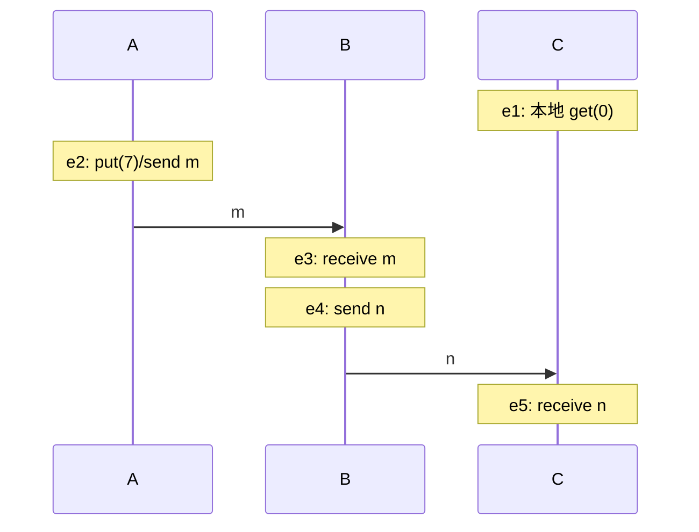

# 故障模型、消息顺序与逻辑时钟

A 写 `x=7` 并发给 B；B 看见它后又把状态发给 C。C 的系统时钟可能比 A 慢五秒。这里真正有用的问题是“C 的事件是否知道 A 的写”，而不是“日志字符串谁的时间戳更大”。物理钟、因果关系和服务允许的可见性分别属于三个合同。

## 先写出允许发生的故障

本课节点遵守程序，可以 crash-stop；模拟的 reboot 则保留 term、vote 和 log 的内存模型字段。消息可以延迟、乱序、丢失及重复，网络可以阻断某些方向。消息不被篡改，节点不会撒谎，成员固定；因此不能用本课证明抵抗 Byzantine 故障。算法安全性要在这些允许的消息次序下成立；活性则必须另加足够节点可运行和消息最终及时到达等前提。

异步模型没有已知的消息延迟或进程速度上界，**不等于每条消息必定丢失**。FLP 所用可容许执行对非故障进程和已发消息有公平性要求；CAP 的分区模型另允许跨分区消息丢失。讲每个定理时须重新核对该层假设。FIFO 是某一通道的顺序保证，不能让两个发送者自动有统一顺序；应用重试可能换连接，更不能把 TCP 的序号当全局操作序号。

## 因果图比墙钟更直接

定义严格关系 `a → b`：同一进程里 a 在 b 前；同一消息的发送在接收前；以及上述关系的传递闭包。若两方向均不成立，事件并发。并发不是物理上必须同一瞬间发生，而是本模型没有观察到传递因果的路径。Lamport 原文的 The Partial Ordering 一节定义该关系，Logical Clocks 一节给 Clock Condition 和 IR1/IR2。[Lamport 1978，印刷页 559–560](https://lamport.azurewebsites.net/pubs/time-clocks.pdf)。

e2→e3→e4→e5，e1→e5。e1 与 e2 没有因果路径；画图时安排在上方并不能制造路径。图中的 e2 合并写入与发送为一个教学事件；若实现分开，必须多加一个本地事件。

## 同一张图手算两类时钟

Lamport 标量 `L_i∈ℕ` 初始 0，本地/发送事件加 1；接收时间戳 t 时取 `L_i=max(L_i,t)+1`。向量 `V_i∈ℕ³` 的分量顺序固定 A、B、C：本地/发送把自己的分量加 1；接收先逐分量 max，再把自己的分量加 1。发送附带的是事件完成后的不可变快照，不能让后续递增修改已发送消息。

| 事件 | Lamport L | 向量 V=(A,B,C) | 为什么 |
| --- | --- | --- | --- |
| e1 C 本地读 | 1 | (0,0,1) | C 第一次事件 |
| e2 A 写并发送 m | 1 | (1,0,0) | A 第一次事件 |
| e3 B 收 m | 2 | (1,1,0) | 合并 A 的快照再加 B |
| e4 B 发 n | 3 | (1,2,0) | B 第二次事件 |
| e5 C 收 n | 4 | (1,2,2) | C 知道 A/B，并记录自己的第二次事件 |

标量满足 `a→b ⇒ L(a)<L(b)`，反方向不成立。若 C 在收到 n 前再做一次本地事件 e1'，有 `L(e2)=1<L(e1')=2`，两者仍并发。可用 `(L,node_id)` 打破平局得到一个因果兼容全序，这个全序的额外边是约定，不能当因果证据，更不能独自保证所有副本已收到所有更早事件。

定义 `u<v` 为所有分量 `u_k≤v_k` 且至少一分量严格小。在固定成员、只通过所记录消息通信、每个本地事件均递增、初始 0 的上述向量算法中，`a→b ⇔ V(a)<V(b)`。简要理由是每个分量记录该进程被观察到的事件前缀：本地递增只引入本进程新事件，接收 max 只引入发送者已经知道的前缀；于是一个事件编号被其他事件向量包含，当且仅当存在本地边和消息边路径。比较 (0,0,1) 与 (1,0,0)，一边 C 分量大、一边 A 分量大，正好不可比。向量保存部分顺序的思想见 [Mattern 1989，§7 Vector time 与 Theorem 10，印刷页 126–128，PDF 页 7–9](https://www.vs.inf.ethz.ch/publ/papers/VirtTimeGlobStates.pdf)；本课采用明确的异步逐事件规则，不能把另一套同步发送语义的伪代码逐行混用。

## 练习、完整答案与边界

练习：B 收 m 后、发 n 前插入一次本地 get；重算 e4、e5。C 的墙钟在 e5 倒退一分钟，会影响结果吗？

答案：插入事件为 L=3、V=(1,2,0)；e4 成为 L=4、V=(1,3,0)；e5 成为 L=5、V=(1,3,2)。墙钟不参与这些计数，所以不影响因果判定。它会影响未经处理的日志显示与租约判断；逻辑钟不校准墙钟，也不估计 RTT。

实验用独立图遍历闭包对照 443 个至多四事件的两进程计划，见 [[计算机知识/65-分布式系统/80-确定性消息调度与复制实验|时钟穷举与代码]]。该规模不能覆盖任意动态成员和未记录的共享存储通信；也不能从“向量不可比”推断两个操作可以随意合并，业务冲突还取决于操作语义。

返回 [[计算机知识/65-分布式系统/00-分布式系统-MOC|课程入口]]。下一页 [[计算机知识/65-分布式系统/02-复制一致性与可见性历史|复制历史]] 说明：因果顺序记录了知道什么，服务合同还要规定允许返回什么。
