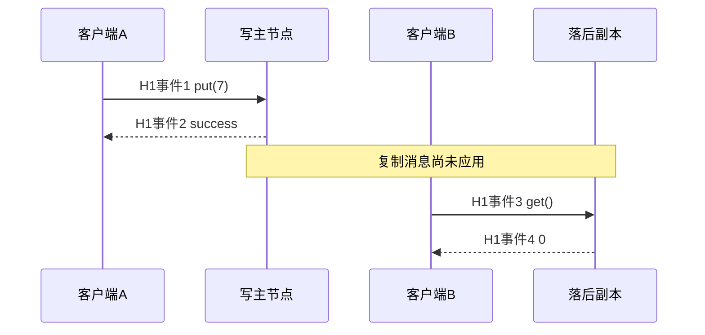

# 复制、一致性与可见性历史

A 已经回答 `put(7)` 成功，随后 B 回答 `get()=0`。这究竟是复制协议错误，还是读副本的合同允许旧值？答案要来自**调用和返回组成的历史**，不能只看某个节点最后也变成了 7。最后收敛是终态问题，一致性是整个观察过程的问题。

## 单键服务的顺序规格

初始 x=0；顺序执行 put(v) 后 x=v，get 返回当前 x。一次操作记为 `(client, kind, value, invocation, response)`，get 的 value 是观察结果，put 的 value 是写入值。put 的结果默认为成功。调用与返回是不同事件；同一客户端本课一次只发一个在途操作。真实时间先后只用于“不重叠”的约束，不要求所有服务器墙钟相同；示例编号是外部观察者给事件的先后序号。

线性一致性要求找到一个合法顺序，使每次操作可放在它的调用与返回之间，且若某操作返回早于另一操作调用，前者必须排在后者前面。顺序一致性只要求合法顺序和每客户端程序顺序，允许重排不同客户端不重叠的操作。[Herlihy 与 Wing 1990，§2.1–2.3，印刷页 467–470；§3.3，页 472–473](https://cs.brown.edu/~mph/HerlihyW90/p463-herlihy.pdf)。规格是寄存器操作，不能把事务可串行化直接替换进来；事务历史和写偏斜继续读 [[计算机知识/55-数据库/10-系统课程/10-MVCC快照写偏斜与重试协议|数据库并发历史]]。

## 四个真正可以判定的历史

| 历史 | 已完成操作（事件序号） | 结论及合法顺序/矛盾 |
| --- | --- | --- |
| H1 | A put(7):1→2；B get(0):3→4 | 顺序一致：B get→A put；非线性一致：实时顺序迫使 put→get，而 get 必须为 7 |
| H2 | A put(7):1→4；B get(0):2→3 | 线性一致：get→put，重叠调用允许如此；put 可在事件 3 与 4 之间生效 |
| H3 | A put(7):1→2；A get(0):3→4 | 两者都不满足：A 自己的程序顺序迫使 put→get |
| H4 | A put(7):1→6；B get(7):2→3；C get(0):4→5 | 非线性一致：B get→C get，但 B 的 7 又迫使 put→B get，C 的 0 迫使 C get→put，构成环；顺序一致可排 C get→put→B get |

H4 说明“两个读都与一个写重叠，所以随便返回新旧”会忽略读之间的实时约束。H1 是实际历史形状的教学反例：异步副本读确实可能产生它，但这里没有运行真实数据库。实验判定的是表中的历史，不能声称测出了生产服务的违例。

## “有多数派”和“线性一致”之间还缺什么

N 个固定副本，写确认集合大小 W、读取集合大小 R。如果 `W+R>N`，两个集合必有交集；但交集本身只证明某读节点接触过写集合中的节点。还需要版本可比较、选取正确版本、并发写仲裁、故障后保留和读过程的完整规则。如果任意节点可以给互相冲突的写打上同一个版本，或者收到一个旧应答就提前返回，集合代数不能补救。不能由 R=2、W=2、N=3 直接宣称线性一致。

领导者复制也需要读协议。少数派里的旧主可能还自以为是主，在本地返回旧读。正确读通常需确认当前领导权、保证已提交日志应用到足够位置，或遵守经证明的租约前提；“向 leader 发请求”不是证明。本实验没有实现 ReadIndex 或租约，因此不能验证线性一致读。复制接收/刷盘/应用的数据库实现边界已在 [[计算机知识/55-数据库/10-系统课程/12-WAL日志恢复与副本确认边界#副本确认要问：哪个节点，到哪一步|副本确认主解释]] 给出。

读己之写只约束同一会话看到自己的写；单调读约束会话不退回较旧的观察。它们不自动规定所有会话共享同一实时顺序。最终一致性必须包含写入停止、相关副本恢复通信及合并协议能推进等前提；它不为每一次读提供“最新”合同，也不允许把错误冲突处理当成正常滞后。

## 怎样检查，而不把小模型当通用检查器

[[计算机知识/65-分布式系统/80-确定性消息调度与复制实验|历史判定器]] 穷举至多八个已完成单键操作的排列，先检查偏序约束，再按顺序规格解释返回值。顺序一致模式只加客户端约束，线性模式加所有不重叠操作的约束。没有合法排列返回 None；合法排列返回操作索引元组作为可复查证据。复杂度约 O(n!·n²)，适合小反例，不适合长期日志。

判定器不支持在途操作、失败/未知结果、多键事务、同客户端并发或连续时间相等端点。未完成调用在一般线性一致定义里需要考虑补全或舍弃；这里输入只限已完成调用，不把“没有收集到成功响应”当作“没有发生”。

练习：H4 中 B/C 的读改为重叠（B:2→4，C:3→5），是否仍矛盾？答案：可排 C get(0)→put(7)→B get(7)。三个操作重叠，实时边 B→C 消失，取线性化点在共同重叠区间内即可。反例的力量来自具体边，不来自三个返回值的表面排列。

返回 [[计算机知识/65-分布式系统/00-分布式系统-MOC|课程入口]]；下一页 [[计算机知识/65-分布式系统/03-共识领导者日志与多数派交集|共识与日志]] 解释怎样让成功确认有跨领导者保留依据。
