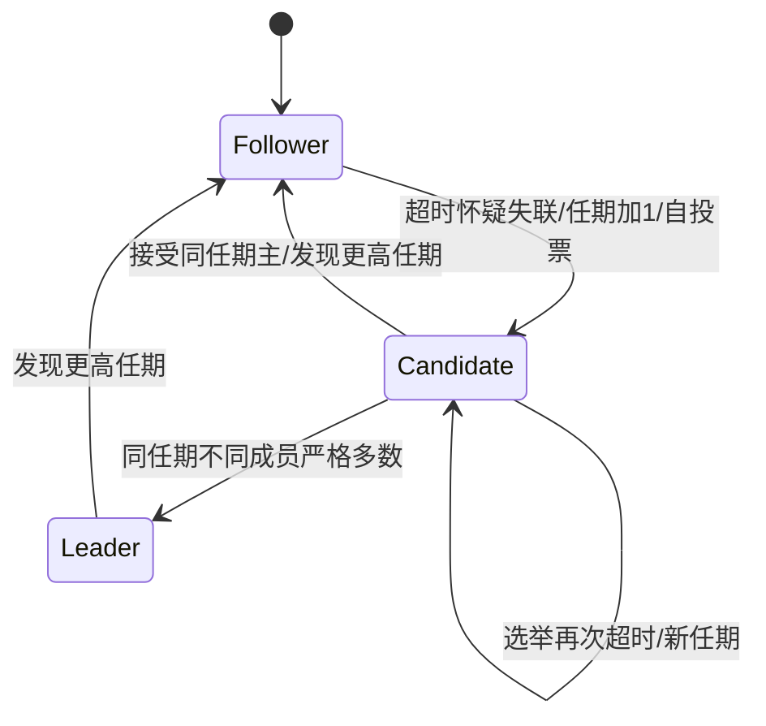

# 共识、领导者、日志与多数派交集

如果三节点共同保存一个按顺序执行的命令日志，A 已返回 `put(7)` 成功，换 B 当领导者后还应该能保留这条命令。共识要求决定一致、有效且在相应活性假设下最终决定；复制状态机进一步让各节点按同一日志顺序应用确定性命令。投票只是其中一个构件。

## 多数派交集：证明到哪里为止

固定成员 U，`|U|=N`，严格多数大小 `q=⌊N/2⌋+1`。两个多数派 Q₁、Q₂ 有

`|Q₁∩Q₂|=|Q₁|+|Q₂|−|Q₁∪Q₂|≥2q−N≥1`。

N=5 时 q=3，{A,B,C} 与 {C,D,E} 至少共享 C；N=4 时 q=3，至少共享两人。不能把恰好一半叫多数：N=4、q=2 的 {A,B} 与 {C,D} 不相交。q 是**不同成员身份的集合大小**，不是消息计数。五节点中 A 自投一票、B 的同一票重传十次，集合仍只有 {A,B}，没有三票。

交集证明没有说明共享节点记得什么、可以给谁投票、日志如何选新或什么算提交。如果它重启忘掉上一票，同任期仍可能给两个候选人投票。若允许任意新主覆盖已确认前缀，交集也只能保证存在一个见过旧记录的人，无法让其拒绝错误候选者。

## 状态转移与日志约束

Raft 用 term 区分时代，节点看见更高 term 更新任期并退回 follower。每任期最多投一个候选者，`currentTerm/votedFor/log` 属于响应 RPC 前须稳定保存的状态。请求投票还要比较末项 `(lastTerm,lastIndex)` 的字典序：任期优先，相同任期才比长度；只比较日志条数会让一百条旧任期日志压过一条新任期日志。[Ongaro 与 Ousterhout 2014，扩展论文 Figure 2、§5.2、§5.4.1，PDF 页 4–5、8](https://raft.github.io/raft.pdf)。

日志条目是 `(index,term,command)`；index 从 1 开始，term 为创建该条目的任期。AppendEntries 带 `prevLogIndex/prevLogTerm`，先核对前缀，再处理冲突的未提交后缀。相同 index、term 的条目必须有相同命令，且前缀相同，这是 Log Matching 所要求的协议不变量；不接受“只要长度差不多就全量覆盖”。应用索引不得超出提交索引，命令按索引递增应用。

实验中的 RaftCore 是局部约束模型，发送从 index 0 开始的全日志快照式 RPC，以减去 nextIndex 回退和计时器细节。它检查任期、投票、新旧、前缀、提交边界，但没有实现 Raft 的完整网络与持久化协议。

## 为何旧任期条目在多数派上仍不能直接提交

这不是“多数派交集失效”，而是新候选人的日志新旧规则还可能允许另一条更高任期日志获胜。下面用五节点、初始共有 index1/term1 的前缀手算；表格只写 index2。

| 阶段 | A | B | C | D | E | 发生什么 |
| --- | --- | --- | --- | --- | --- | --- |
| term2 | (2,put7) | (2,put7) | 空 | 空 | 空 | A 主，只复制两份，未提交 |
| term3 | (2,put7) | (2,put7) | 空 | 空 | (3,put9) | A 不可达，E 从 C、D、E 获票，写下自身一份 |
| term4 | (2,put7) | (2,put7) | (2,put7) | 空 | (3,put9) | E 不可达，A 从 A、B、C 获票，补到 C；put7 现在三份 |
| term5 | 不可达 | 可投E | 可投E | 空 | (3,put9) | 若 A 又失败，E 末项 term3 比 B/C 的 term2 新，可从 B、C、E 获票并覆盖 index2 |

若 term4 的 A 仅数三份就回答 put7 成功，后面它会消失。Raft 因此仅以副本数直接提交**当前任期**条目；当前任期条目提交后，其此前前缀间接提交。term4 若 A 追加 index3/term4 并复制到 A、B、C，再按多数确认，那么 E 末项 term3 不足以从它们取得多数。这是原文 Figure 8 与 §5.4.2 的关键反例，本表是沿用规则的单键数值改写。[扩展论文 PDF 页 8–9，Figure 8](https://raft.github.io/raft.pdf)。

代码测试使用 log=[term2:7]、leader term4、match={A:1,B:1} 确认 commit 仍为 0，再追加 term4:9，复制 index2 到多数后 commit=2、应用终值9。测试只检验该局部门槛；上表的跨任期五节点可达性是手工推演，没有借这个小测试宣称完整 leader completeness 证明。

## 分区中的失败 trace

三节点 term1 A 主，网络阻断 A→B 与 A→C。A 收 put7，在自己的日志追加 index1，但只拥有一份；commit=0，不能回答成功。A 可以继续自称主，名称不会产生多数派。恢复 A→B 后 B 接受同任期前缀，A 得到第二个不同身份的确认；当前任期条目才可提交。重复 B 的确认不再增加人数。随后传播 commitIndex，B/C 才应用 7，见 [[计算机知识/65-分布式系统/80-确定性消息调度与复制实验#故障注入的完整 trace|完整 trace]]。

反例：若代码改成“本地 append 后立即 apply 并返回成功”，分区时 A 已给客户端7，而 B/C 仍是0；新多数选出的主可从不含7的日志继续。新增本地日志不等于承诺，它可以在恢复时被截掉。

## 练习与答案

练习：N=7，最多允许多少 crash-stop 节点同时不可用仍有多数？若两个任期各有主，是否必定违反 Election Safety？

答案：q=4，故最多3个不可用仍有4个可工作节点；这只是人数条件，还需通信和可推进选举。Election Safety 指同一任期至多一个主；不同任期短暂各自认为自己是主并不自动违反它。更高任期消息、法定人数与读写协议要让旧主无法继续产生合法新确认；外部资源还可能需要 fencing，任期字段并不能让任意外部系统自动拒绝旧主。

本课不验证动态成员切换、快照、租约、线性一致读和真实 crash-safe storage；多数规则只针对固定成员的非 Byzantine 模型。返回 [[计算机知识/65-分布式系统/00-分布式系统-MOC|入口]]；下一页 [[计算机知识/65-分布式系统/04-网络分区故障检测与不可能性边界|不可判定的慢与死]] 解释为什么安全等候和活性之间存在模型边界。
