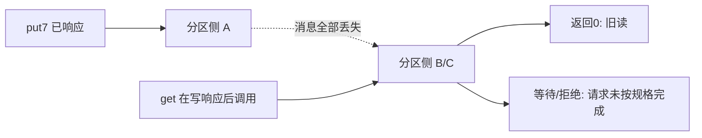

# 网络分区、故障检测与不可能性边界

B 没收到 A 的心跳，可能因为 A 崩溃，也可能因为消息堵在网络里。B 如果永久等待，会丢失活性；若仅因等待足够久就允许任意覆盖旧决定，又可能失去安全性。工程超时和数学证明必须说明使用了什么额外假设。

## CAP 用一个读写构造解释

Gilbert–Lynch 的异步网络模型讨论读写对象的原子一致性（这里的 C 对应线性一致性）、每个非故障节点收到的请求最终得到响应（A），以及允许分区使消息丢失。不存在同时满足这三个要求的实现。[Gilbert 与 Lynch 2002，§2 Formal Model、§3.1 Impossibility Result 的 Theorem 1 及证明，作者版 PDF 页 2–5](https://www.comp.nus.edu.sg/~gilbert/pubs/BrewersConjecture-SigAct.pdf)。这里“最终响应”不是固定毫秒 SLA；返回“无法处理”也不能冒充成功完成寄存器规格的读写。

把节点分成 {A} 与 {B,C}，初始 x=0，跨分区消息全部不通。客户端在 A 发 put7，若要保证所有非故障节点请求都完成，A 必须完成该写。随后另一个客户端在 B 发 get。B 的本地观察与“根本没发生 put7”的世界相同：不能从没有收到的消息得知7。返回0违反已完成写先于读的线性一致合同；返回7在没有写的世界违反寄存器规格；一直等则违反该模型的可用性。

三节点多数协议可选择让 A 不能提交，而 B/C 在能选主和相互通信时继续工作；这保留安全性，但不是 CAP 定义的“所有非故障节点都可用”。也可选择两侧接受写并明确放松实时一致性，恢复后处理冲突。CAP 没有禁止无分区时兼顾低延迟和一致性，没有要求系统每天都删掉一个字母，也没有把备份/可靠性叫成 P。分区发生时跨分区协调不可用，才出现此构造。

## FLP 的量词不能读成“共识总会失败”

FLP 考察确定性共识、完全异步消息传递、进程可能 crash-stop、最多一个故障；消息通信可靠且有合适的公平交付，进程没有消息延迟和速度上界。它证明：不存在对**所有可容许执行**保证终止的这种协议。也就是对任意候选协议存在一个不决定的可容许执行，而不是每次运行都失败，更不是没有故障也不能安全决定。[Fischer、Lynch 与 Paterson 1985，§2 模型、§3 Theorem 1，印刷页 375–378](https://groups.csail.mit.edu/tds/papers/Lynch/jacm85.pdf)。

证明的关键路线是先找一个双价配置：延续执行可能决定0，也可能决定1；随后调度某些尚可交付的步骤保持双价，同时公平地让非故障进程与消息获得机会。因此一直无法安全固定一个决定。两条仅暂时不发消息的 trace 是理解“不可区分”的练习，**不是 FLP 的完整证明**；完整证明需要原文 Lemma 2、Lemma 3 与最后的公平构造。

反例检查量词：一次实验在一千个随机消息次序中都完成，并没有覆盖那个存在量词保证的坏调度；反过来人为丢掉所有消息造成等待，也没有满足 FLP 的可靠、公平条件，不能拿它当定理的实验验证。

## 三条走出条件集合的路线

部分同步可以假设存在但未知的延迟/速度上界，或从未知的 GST 开始系统兑现某上界。协议把任意延迟下的安全性与足够稳定时期的终止分开：GST 前可一直重选，但不许决定冲突；GST 后适当等待和可通信法定人数让进展成为可能。[Dwork、Lynch 与 Stockmeyer 1988，§1.2–1.3，印刷页 289–292](https://groups.csail.mit.edu/tds/papers/Lynch/jacm88.pdf)。这不保证永远分区时仍终止，也不提供“观察过五秒，所以 GST 肯定已发生”的检测器。

随机化改变“确定性”条件。Ben-Or 的非 Byzantine 协议在 N>2t 和相应可容许调度/随机独立性模型下以概率1终止；概率1不等于每条无限随机串都有限时完成，也不等于给定硬截止时间的保证。[Ben-Or 1983，§2 模型、§3 Protocol 与 Theorem 1，印刷页 28–29](https://homepage.cs.uiowa.edu/~ghosh/BenOr.pdf)。Raft 随机选举超时有助于减少平票，仍依赖最终有足够通信时间的进展假设；给确定性模拟随机换种子不会直接变成 Ben-Or 证明。

故障检测器把“不回应”变成怀疑，若后期能稳定地不误判正确节点并发现故障，就提供额外的信息/时序假设；仅靠异步网络的有限超时无法始终准确判定 crash。工程上需同时核对误判、丢包、暂停、负载、时钟漂移和资源 fencing。增加超时可改变误判概率和故障切换延迟，不能逻辑上区分任意慢与死。

## 练习与完整答案

练习：三节点的 A 与 B/C 隔离，A 仍可写本地日志，B/C 已进入 term2。A 尚未看到 term2 时是否应允许它在本地 get 返回0，并声称“线性一致读”？增加超时到一分钟是否解决？

答案：不应仅据本地角色声称线性一致读。B/C 可能已提交7，A 的0与“刚才谁完成了写”之间没有足够证据。需要符合读协议的当前领导权与应用位置确认，或有正确租约前提。增加超时改变等候时间；完全异步模型仍允许一分钟以上延迟。A 后来收到 term2 必须退位，但退位动作不能修复已经返回的错误历史。

[[计算机知识/65-分布式系统/80-确定性消息调度与复制实验|确定性分区 trace]] 只示范安全等待和恢复后提交，不实验证明 CAP/FLP，也没有实现 GST 检测或随机共识。返回 [[计算机知识/65-分布式系统/00-分布式系统-MOC|入口]]；[[计算机知识/65-分布式系统/05-分布式事务幂等与端到端失败|下一页]] 把同样的未知结果带到跨分片事务。
