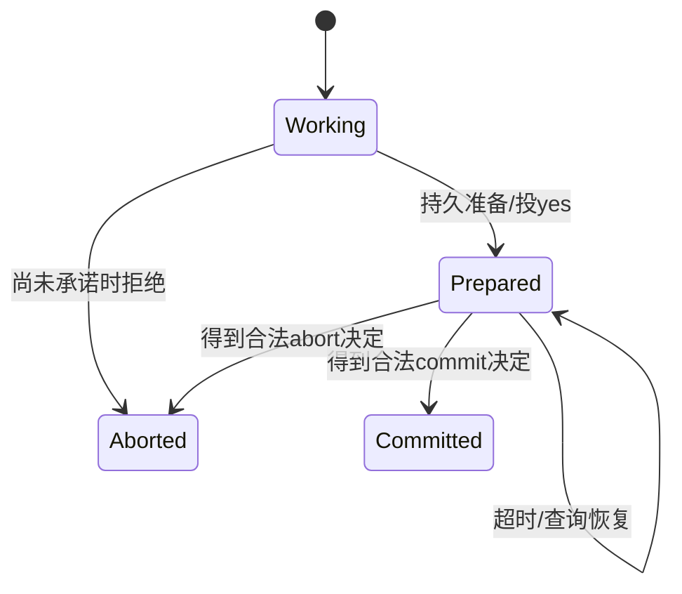

# 分布式事务、幂等与端到端失败

让键值服务扩展为两个资源管理器：A 持有余额 a=10，B 持有余额 b=0，一次业务操作 T 要转移7，期望最终 a=3、b=7，或两边都不转。把操作日志复制三份保证某个决定不易遗失，却没有自动证明两个不同资源都能准备提交。这是复制与跨资源原子提交的分工。

本页重点是 **prepared 后为何会阻塞** 和跨层效果边界。WAL 的恢复算例仍读 [[计算机知识/55-数据库/10-系统课程/12-WAL日志恢复与副本确认边界|日志持久与恢复主解释]]；幂等参数绑定和发件箱事务步骤仍读 [[计算机知识/85-综合贯通/02-超时重试幂等与事务发件箱|幂等与 outbox 主解释]]。

## 两阶段提交的承诺

固定参与者 A/B 与协调者 K。第一阶段 K 请求 prepare；参与者检查能否满足本地约束，并把可恢复的准备状态/必要日志稳定保存后回复 yes。yes 是“我承诺能服从最终决定”，不是“我已经向用户完整提交了业务”。若有人 no，可决定 abort；全员 yes 后协调者可稳定保存 commit 决定，第二阶段通知各参与者执行。参与者的最终决定必须可恢复且不能互相冲突。[Gray 与 Lamport 2006，§2 Transaction Commit、§3 Two-Phase Commit，印刷页 134–139](https://dsf.berkeley.edu/cs286/papers/paxoscommit-tods2006.pdf)。

“尚未承诺时可以 abort”与“投 yes 后可以随便 abort”不能混同。真正系统会有恢复协议、锁、事务 ID、重发和协调者日志；prepared 常占有资源。图不声称实现任意数据库产品的恢复路径。

## 一个阻塞轨迹，两个不可区分世界

公共前缀：A 已稳定 prepared(T) 并投 yes；A 没有收到第二阶段决定，后来观察到超时。

| 隐藏世界 | B/K 的真实状态 | A 本地观察 | A 单方 abort 的后果 |
| --- | --- | --- | --- |
| W0 | B 尚无最终决定，K 未稳定 commit 后故障 | prepared(T)，无决定，timeout | 在这个世界可能还存在全体 abort 的合法恢复 |
| W1 | B 也 yes，K 稳定 commit 并送达 B，然后 K 故障，给 A 的包丢失 | prepared(T)，无决定，timeout | B 已 commit，A abort 会破坏原子一致决定 |

A 的输入相同，不能用同一个有限超时判别 W0/W1。它需要查询可用的决定来源、其它参与者已知决定或等待协调者恢复；若都不可达，就保留 prepared。**并非所有协调者故障都阻塞**：有人已知可靠最终决定时可以按正确恢复协议传播；例子选择的是 A 无法取得该信息的情形。

本课 `two_pc_unknown()` 构造这两个世界，并比较 A 的观察元组；它没有实现完整2PC，也没有执行转账或真实数据库 prepared transaction。这个测试核对反例结构，而非生产协议认证。完整模型与答案见 [[计算机知识/65-分布式系统/80-确定性消息调度与复制实验|事务不可区分测试]]。

## 共识可以帮助保存决定，但不能凭空制造所有 yes

用复制日志维护协调者决定，足够节点恢复时可提升决定来源的可用性；参与者仍须真正准备，并处理准备记录与最终决定的一致关联。单个资源的复制共识与跨资源提交各有有效性条件。Gray–Lamport 的 Paxos Commit 把各参与者的准备意愿组织为相应共识实例，论文中经典2PC是单协调者的退化情形；本课不实现 Paxos Commit，也不把“换用Raft存一个commit字符串”当它的等价证明。[同文 §4–5，印刷页 139–145](https://dsf.berkeley.edu/cs286/papers/paxoscommit-tods2006.pdf)。

2PC 协调原子决定，不独自给业务请求实现幂等、事务隔离或线性一致读。隔离由资源管理器的并发控制提供；去重由业务 ID 与原子效果记录提供；线性读由复制读协议提供。Prepared 的物理持久条件继续受 [[计算机知识/20-操作系统/02-操作系统原理/10-系统课程/11-崩溃一致性与恢复状态机|OS 崩溃状态机]] 限制。

## 同一个业务 ID 穿过四个边界

T 在数据库提交后回复丢失，客户端只得到“未知”。按相同 `(principal,operation,key)` 与相同参数重试，可由已经持久保存的结果证明它是同一意图；换新 ID 会被当新操作。同一键改金额必须冲突，不能悄悄返回旧结果。去重记录删除后，迟到重复可能重新产生效果；允许重试窗口必须与保留期协调。

数据库订单与 outbox 事件同事务提交，投递器发送后、标记已发前崩溃会重投。消费者若在同一事务保存 message ID 并执行本地效果，可把重复投递映射到同一个本地效果。这个结论的范围是该事务覆盖的状态，不自动包含事务外支付、邮件、文件或另一服务。外部副作用必须有相应去重/查询协议；发送邮件后、保存去重记录前的崩溃仍有裂缝。

| 被确认的事情 | 仍不能推出的事情 |
| --- | --- |
| send/TCP ACK | 数据库已commit |
| 一个副本日志接收 | 日志稳定、全体副本应用 |
| 2PC 全体决定commit | 客户端知道结果、消息只投递一次 |
| 业务与outbox共同提交 | 外部消费者已看到、邮件只发一次 |
| 消费者事务去重成功 | 任意外部副作用都被同事务保护 |

因此“恰好一次”应写清可重复调用、去重身份、持久记录、原子边界及时间窗口。Saga 的补偿是新的业务操作：把7转回去可能恢复余额，但已经收取的手续费、已发消息及已消费服务不会因补偿消失；与回滚的区别已在 [[计算机知识/55-数据库/10-系统课程/07-恢复复制与分布式事务#两阶段提交与共识不要混为一谈|数据库事务主解释]] 建立。

客户端也须跨进程保存同一个键：[[计算机知识/64-移动平台开发/01-生命周期状态归属与离线同步#先持久化同一意图，再谈重试|Android意图恢复]]把“服务已提交、回复丢失、客户端进程重启”连起来。带回原id、规范参数、指纹及原accepted结果；只看预约数没有增加，会漏掉“错换新id后被冲突拒绝”的假通过。该实践仍是同设备假服务，不认证真实远端去重或网络。

## 练习与完整答案

练习：参与者 A 在 prepared 后等30秒没听到K，于是回滚。开发者说“我们有持久WAL，所以这样安全”。指出遗漏。若 K 的 commit 已写进三节点多数日志，但 A 现在与该多数分区，结论是否改变？

答案：WAL 可以恢复 A 已保存的信息，不会告诉它一个未收到的最终决定。W1 中 B 已提交，A 的单方回滚造成不同最终决定。多数日志提供可恢复决定的来源；若 A 当前无法取得它，A 仍不能仅凭超时 abort。多数侧或其它知道决定的参与者恢复通信后才可传播合法决定。这里以阻塞换安全，而能否及时释放锁是另一个活性与运维问题。

返回 [[计算机知识/65-分布式系统/00-分布式系统-MOC|课程入口]]，继续 [[计算机知识/65-分布式系统/80-确定性消息调度与复制实验|可复现实验]]；没有运行真实 prepared 事务、消息队列或支付服务。
