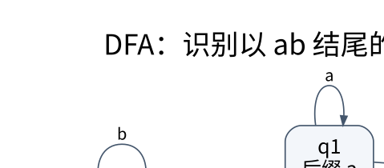

# 形式语言与自动机：把“能识别什么”变成可证明问题

> **学习位置**：[[计算机知识/00-开始/课程地图/12-编译原理-课程地图|编译原理课程地图]] · **适用边界**：教学语言与教学 IR；不把简化模型等同于 LLVM 全语义。

[PNG 备用图](../../_assets/diagrams/round3/dfa-ab.png) · [可编辑图源](../../_assets/diagrams/round3/dfa-ab.dot)

## 语言不是编程语言的同义词

给定有限字母表 $\Sigma$，字符串是其符号的有限序列，语言是 $\Sigma^*$ 的一个子集。空串 $\epsilon$ 长度为 0，空语言没有任何串，二者不同。形式语法描述生成规则，识别器判断一个串是否属于语言；“生成”和“识别”从不同方向刻画同一个集合。

正则语言、上下文无关语言、上下文有关语言和可识别语言对应不同表达能力与机器模型。层级不是实用语言优劣榜：现实编程语言的语法、名称绑定与类型约束常由不同阶段处理，不能只凭一个语法文件就给整门语言贴能力标签。

## NFA 与 DFA 为什么表达能力相同

DFA 的一个状态和一个输入符号确定唯一后继；NFA 可以有多个后继和 epsilon 转移。NFA 的非确定性不是运行时随机选择一条路径赌运气，而是存在任意接受路径即接受。

子集构造把一个 DFA 状态解释为“一组当前可能的 NFA 状态”。先取初始状态的 epsilon 闭包；读符号后求所有可达状态，再取 epsilon 闭包。只要集合包含 NFA 接受态，该 DFA 状态就接受。最坏可能出现指数多个子集，但表达能力没有增加。

## 亲自构造一个识别器

语言是所有以 `ab` 结尾的 a/b 串。用三个状态 q0、q1、q2 表示：尚无有用后缀、当前后缀为 a、当前后缀为 ab。q2 为接受态。转移为：q0读a→q1，读b→q0；q1读a→q1，读b→q2；q2读a→q1，读b→q0。

读 `aab`：q0→q1→q1→q2，接受。读 `aba` 最后在 q1，不接受。状态并不需要记住全部历史，只保留会影响未来接受性的等价信息。

DFA 最小化可从接受/非接受两组开始，不断拆分那些对某个符号转移到不同组的状态。其核心是区分：两个状态是否存在同一个后缀，让一个接受而另一个不接受。Myhill–Nerode 从语言的后缀可区分性给出更深刻的刻画。

## 泵引理要注意量词方向

要用正则泵引理证明某语言非正则，应假设存在泵长度 p，选择语言中的适当长串，再证明**所有满足长度限制的分解**都能通过某次泵送破坏语言。不能自己挑一个坏分解就宣布成功，也不能因为某语言“看起来能泵”就反向证明它正则。

对 $\{a^n b^n:n\ge0\}$，选 $a^p b^p$；满足 $|xy|\le p$、$|y|>0$ 的 y 全是 a，泵掉 y 后 a 与 b 数量不同，矛盾。栈能保存未匹配的 a 数量，解释了下推自动机为何能处理这个正则自动机不能处理的语言。

## 实用正则表达式的边界

数学正则表达式与带反向引用、递归等扩展的正则引擎不是同一个模型。一些回溯引擎在恶意输入上可能指数退化；自动机型实现常有不同的表达能力与复杂度取舍。词法器一般依靠正则规则识别 token，但平衡嵌套与名称作用域应交给更合适的阶段。

**练习**：只记“目前 a 与 b 数量差的奇偶”能识别 $a^n b^n$ 吗？不能，不同数量差会被压缩到同一有限状态，而后续补足所需数量不同。这个反例比“因为它有括号所以非正则”更接近正确的可区分性论证。

## 关联阅读

- [[计算机知识/50-数据结构与算法/10-数据结构系统课程/06-字符串索引自动机与后缀结构|字符串索引、自动机与后缀结构：复用已经比较过的信息]]
- [[计算机知识/70-编译原理/10-系统课程/02-词法分析Token与错误定位|词法分析：最长匹配、位置追踪与可靠错误报告]]
- [[计算机知识/50-数据结构与算法/20-算法设计系统课程/07-复杂性归约与指数算法|复杂性、归约与指数算法：困难结论也要写对方向]]

## 依据与继续查证

- [LLVM Language Reference](https://llvm.org/docs/LangRef.html)
- [LLVM 教程](https://llvm.org/docs/tutorial/)
- [Cornell CS 4120：编译课程讲义](https://www.cs.cornell.edu/courses/cs4120/2023sp/)

本页的例子、推演与练习为教学构造；语言契约、系统接口和版本相关结论应结合以上原始文档核对。

<!-- COURSE SEQUENCE -->
## 顺序导航与验证

[[计算机知识/70-编译原理/10-系统课程/00-编译原理系统课程索引|本课程总索引]] · [[计算机知识/_labs/round3/COMP/编译原理-实验说明|本课程实验]]

下一讲：[[计算机知识/70-编译原理/10-系统课程/02-词法分析Token与错误定位|词法分析：最长匹配、位置追踪与可靠错误报告]]
<!-- END COURSE SEQUENCE -->

<!-- ORIGINAL DEEP LINKS -->
## 与原有长篇专题衔接

- [[计算机知识/70-编译原理/02-词法分析正则自动机Unicode与源位置|02-词法分析正则自动机Unicode与源位置]]

新旧讲解采用的版本与模型可能不同，比较时先核对各自前提，不把教学简化当成实现细节。
<!-- END ORIGINAL DEEP LINKS -->
