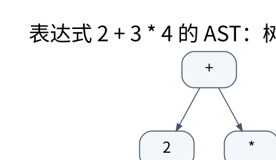

# 语法分析：从预测集合到移进归约冲突

> **学习位置**：[[计算机知识/00-开始/课程地图/12-编译原理-课程地图|编译原理课程地图]] · **适用边界**：教学语言与教学 IR；不把简化模型等同于 LLVM 全语义。

[PNG 备用图](../../_assets/diagrams/round3/ast-precedence.png) · [可编辑图源](../../_assets/diagrams/round3/ast-precedence.dot)

## 文法、推导和歧义

上下文无关文法由终结符、非终结符、产生式和开始符号组成。解析树展示产生式怎样生成输入，AST 则直接表达运算和控制结构。文法 `E→E+E|E*E|id` 对 `a+b*c` 可有不同树，说明文法歧义；语言规范必须决定优先级和结合性，而不是让某次实现偶然选一种。

一种分层表达式文法为 E→TE′，E′→+TE′|ε，T→FT′，T′→*FT′|ε，F→(E)|id。乘法在 T 内完成，因此优先于加法。消除左递归方便预测分析，但生成 AST 时仍要主动维持左结合，不能因文法右递归就错误地把减法变成右结合。

## FIRST 与 FOLLOW 的手算

FIRST(X) 是 X 可生成串的首终结符集合，必要时含 ε；FOLLOW(A) 是某个推导中 A 后面可能紧接的终结符集合，开始符号还包含输入结束标记 `$`（这里是普通符号，不是数学定界符）。

上述文法中 FIRST(E)=FIRST(T)=FIRST(F)={(, id}，FIRST(E′)={+,ε}，FIRST(T′)={*,ε}。FOLLOW(E)=FOLLOW(E′)={),结束标记}；FOLLOW(T)=FOLLOW(T′)={+,),结束标记}；FOLLOW(F)={*,+,),结束标记}。

填 LL(1) 表时，对 A→α，把产生式放进 FIRST(α) 的非 ε 列；若 α 可空，再放进 FOLLOW(A) 的列。一个单元出现多个产生式就发生冲突。递归地传播集合直至不变，不能只扫一遍文法就假设已完成。

## Pratt 分析与递归下降

递归下降把非终结符写成函数，配合显式 token 游标与错误位置。Pratt/优先级爬升把运算符绑定强度作为数据，适合表达式；左结合运算符解析右侧时使用更高的最小绑定强度，右结合幂运算则采用不同规则。

`2+3*4` 应生成 `+(2,*(3,4))`，结果 14；`8-3-2` 应生成 `-(-(8,3),2)`，结果 3，而不是 7。两个极小测试足以揭示许多优先级与结合性错误。

## LR 从已读前缀识别句柄

LR 项目的点标记某条产生式已识别到哪里；closure 加入待识别非终结符的项目，goto 计算读入一个符号后的项目集合。移进把新 token 压入状态栈，归约把一个产生式右部识别为左部，再查 goto。

LR(0)、SLR、LR(1)、LALR 的差异涉及向前看信息的精度与状态合并。SLR 使用非终结符的 FOLLOW 辅助归约，LR(1) 的项目携带更具体的向前看符号；合并状态可以缩表，也可能引入冲突。移进/归约冲突不总意味着语言本身不可解析，可能是文法歧义、分析器能力不足或优先级尚未声明。

## 更广的解析版图

Earley、CYK 和 GLR 处理更一般的上下文无关文法；CYK 的常见形式要求转换到合适范式，并有立方时间量级。PEG 使用有序选择，其语义不同于 CFG 的无序备选；packrat 用记忆化换取某些复杂度保证及空间成本。选择分析器应考虑文法、诊断、增量更新和资源限制。

**练习**：`S→aA|aB` 的两个分支首字符相同，是否可直接证明语言不是 LL(1) 语言？不能，这只证明该文法在该点不适合直接预测选择；可能通过左因子提取和其他等价改写得到适用文法。

<!-- ROUND4 DEPTH LINKS -->
## 继续推演本页难点

[[计算机知识/70-编译原理/10-系统课程/09-从项目集到SLR分析表完整推演|归约之后为什么还要查 GOTO，不能只弹栈？]] 本专题补上完整状态构造、迭代过程或约束求解。

这不是替换本页：先掌握原理，再用补充页核对容易被一句话略过的条件。
<!-- END ROUND4 DEPTH LINKS -->

## 关联阅读

- [[计算机知识/70-编译原理/10-系统课程/01-形式语言正则与自动机|形式语言与自动机：把“能识别什么”变成可证明问题]]
- [[计算机知识/70-编译原理/10-系统课程/04-类型推断统一与语义分析|语义分析：名字指向谁，表达式允许做什么]]

## 依据与继续查证

- 语法分析直接依据：[Cornell CS 412/413，LR Parsing 讲义](https://www.cs.cornell.edu/courses/cs412/2005sp/lectures/lec09.pdf)。
- 后续中间表示阶段参照：[LLVM Language Reference](https://llvm.org/docs/LangRef.html)
- [LLVM 教程](https://llvm.org/docs/tutorial/)
- [Cornell CS 4120：编译课程讲义](https://www.cs.cornell.edu/courses/cs4120/2023sp/)

本页的例子、推演与练习为教学构造；语言契约、系统接口和版本相关结论应结合以上原始文档核对。

<!-- COURSE SEQUENCE -->
## 顺序导航与验证

[[计算机知识/70-编译原理/10-系统课程/00-编译原理系统课程索引|本课程总索引]] · [[计算机知识/_labs/round3/COMP/编译原理-实验说明|本课程实验]]

上一讲：[[计算机知识/70-编译原理/10-系统课程/02-词法分析Token与错误定位|词法分析：最长匹配、位置追踪与可靠错误报告]]

下一讲：[[计算机知识/70-编译原理/10-系统课程/04-类型推断统一与语义分析|语义分析：名字指向谁，表达式允许做什么]]
<!-- END COURSE SEQUENCE -->

<!-- ORIGINAL DEEP LINKS -->
## 与原有长篇专题衔接

这里保留的 LLVM/MLIR 专题属于解析之后的 IR 与后端，不是 FIRST/FOLLOW 或 LR 状态表的直接推导。解析阶段先读本页的“继续推演本页难点”，再向后进入 IR。

- [[计算机知识/70-编译原理/17-LLVM-IR-Pass与MLIR方言-Lowering|17-LLVM-IR-Pass与MLIR方言-Lowering]]

新旧讲解采用的版本与模型可能不同，比较时先核对各自前提，不把教学简化当成实现细节。
<!-- END ORIGINAL DEEP LINKS -->
