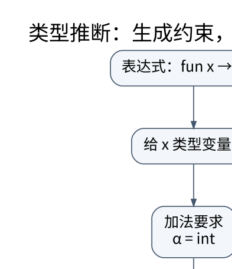

# 语义分析：名字指向谁，表达式允许做什么

> **学习位置**：[[计算机知识/00-开始/课程地图/12-编译原理-课程地图|编译原理课程地图]] · **适用边界**：教学语言与教学 IR；不把简化模型等同于 LLVM 全语义。

[PNG 备用图](../../_assets/diagrams/round3/type-unify.png) · [可编辑图源](../../_assets/diagrams/round3/type-unify.dot)

## AST 正确还不代表程序合法

`x+true` 可能完全符合表达式语法，却违反类型规则；`x+1` 也可能引用未声明名字。语义分析需要建立作用域、绑定声明、检查类型与控制流约束，并把结果传给后续阶段。源位置应一直跟随节点，错误信息才能指向用户写下的结构。

符号表可以按作用域形成栈或树。进入块创建作用域，查找从近到远；是否允许前向引用、遮蔽和同名重载是语言规则。变量名只是文字，两个作用域的同名变量必须绑定到不同声明身份，不能在 IR 中简单按字符串全局替换。

## 类型判断是有前提的规则

写 $\Gamma\vdash e:T$ 表示在环境 Γ 下表达式 e 具有类型 T。整数加法规则要求两个操作数都为整数，再得到整数结果；条件表达式要求条件类型合适，并协调两个分支结果。子类型、隐式转换与重载会让“协调”具有更多规则，不是统一地把一切转成字符串。

类型安全常通过进展与保持性质解释：良类型程序不会卡在模型规定的错误状态，求值后仍保持相应类型。这里的“不会出错”不包括所有逻辑错误、资源耗尽或外部系统失败，更不意味着程序一定终止。

## 从约束生成到统一

考虑 `fun x -> x + 1`。先给 x 新类型变量 α，加法规则产生 α=int，函数类型因此为 int→int。对 `fun f -> fun x -> f x`，设 f:α、x:β、应用结果 γ，则约束 α=β→γ，整体得到 `(β→γ)→β→γ`。

统一算法维护替换：同一基础类型成功；函数类型递归统一参数与结果；变量与类型统一时记录替换并传播。必须做 occurs check：若试图令 α=α→β，会生成无限类型，在简单有限类型系统中应拒绝。忽略此检查可能导致无限展开或不健全的推断。

Hindley–Milner 的 let 多态会泛化不自由出现于环境中的变量，在每次使用时实例化新变量。带可变引用、子类型或高级类型特性的语言往往需要限制或扩展，不能把一个教学版 Algorithm W 称为所有主流语言的完整推断器。

## 作用域、闭包与逃逸

函数内部引用外部变量时，运行时需要保存相应环境。闭包可表示为代码指针加环境指针；按值捕获与按引用捕获有不同生命周期与共享语义。逃逸分析判断对象或引用是否可能越过某边界，影响栈分配、标量替换和借用检查等决策。

例：返回一个读取局部变量的函数，若该语言允许这种闭包，就必须让所需环境继续有效；直接返回指向已销毁栈帧的地址是错误实现。Python 闭包和 Rust 捕获策略提供很好的跨语言比较对象，但其规则不相同。

## 不能漏掉的语义检查

返回路径、未初始化读取、模式匹配覆盖、访问控制、可变性、借用、效果、异常和泛型约束都属于广义语义分析。语言服务器还需在错误代码上尽可能给出有用部分结果，而非整个编译过程立即失败。

**练习**：表达式 `fun x -> x x` 在简单类型系统里产生什么约束？x 既是参数又是函数，得到 α=α→β，occurs check 失败。它在无类型 lambda 演算中可写，不代表在当前静态类型系统中也应接受。

<!-- ROUND4 DEPTH LINKS -->
## 继续推演本页难点

[[计算机知识/70-编译原理/10-系统课程/11-类型统一泛化与值限制|为什么 let 绑定可以多态，可变引用却不能随便泛化？]] 本专题补上完整状态构造、迭代过程或约束求解。

这不是替换本页：先掌握原理，再用补充页核对容易被一句话略过的条件。
<!-- END ROUND4 DEPTH LINKS -->

## 关联阅读

- [[计算机知识/10-编程语言/05-TypeScript/10-系统课程/03-泛型方差与API设计|泛型、方差与 API 设计：保留输入和输出的关系]]
- [[计算机知识/10-编程语言/04-Rust/10-系统课程/02-生命周期方差与高级借用|生命周期不是倒计时：约束、方差与高阶借用]]
- [[计算机知识/10-编程语言/01-Python/10-系统课程/03-生成器闭包与上下文协议|生成器、闭包与上下文协议：控制权和资源如何流动]]

## 依据与继续查证

- [LLVM Language Reference](https://llvm.org/docs/LangRef.html)
- [LLVM 教程](https://llvm.org/docs/tutorial/)
- [Cornell CS 4120：编译课程讲义](https://www.cs.cornell.edu/courses/cs4120/2023sp/)

本页的例子、推演与练习为教学构造；语言契约、系统接口和版本相关结论应结合以上原始文档核对。

<!-- COURSE SEQUENCE -->
## 顺序导航与验证

[[计算机知识/70-编译原理/10-系统课程/00-编译原理系统课程索引|本课程总索引]] · [[计算机知识/_labs/round3/COMP/编译原理-实验说明|本课程实验]]

上一讲：[[计算机知识/70-编译原理/10-系统课程/03-语法分析FIRST_FOLLOW与LR|语法分析：从预测集合到移进归约冲突]]

下一讲：[[计算机知识/70-编译原理/10-系统课程/05-中间表示CFG与SSA|中间表示、控制流与 SSA：给优化一个可证明的对象]]
<!-- END COURSE SEQUENCE -->

<!-- ORIGINAL DEEP LINKS -->
## 与原有长篇专题衔接

- [[计算机知识/70-编译原理/19-从表达式到机器码的贯通推演|19-从表达式到机器码的贯通推演]]
- [[计算机知识/70-编译原理/06-类型系统约束求解泛型与语义检查|06-类型系统约束求解泛型与语义检查]]

新旧讲解采用的版本与模型可能不同，比较时先核对各自前提，不把教学简化当成实现细节。
<!-- END ORIGINAL DEEP LINKS -->
