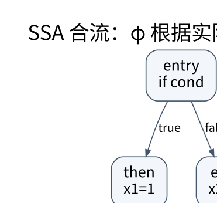

# 中间表示、控制流与 SSA：给优化一个可证明的对象

> **学习位置**：[[计算机知识/00-开始/课程地图/12-编译原理-课程地图|编译原理课程地图]] · **适用边界**：教学语言与教学 IR；不把简化模型等同于 LLVM 全语义。



[PNG 备用图](../../_assets/diagrams/round3/ssa-diamond.png) · [可编辑图源](../../_assets/diagrams/round3/ssa-diamond.dot)

## 为什么不直接从 AST 输出机器码

AST 贴近源语法，机器码贴近目标机器。中间表示为名称、求值顺序、控制流和数据依赖建立稳定表达，让不同前端与后端共享分析。高级 IR 可以保留张量或循环结构，低级 IR 可以显式表示地址和跳转；过早丢失高级信息，会让某些优化难以恢复。

三地址码把复杂表达式拆成简单操作。基本块是通常只有入口进入、只在末尾转出的直线序列；控制流图以块为节点、可能转移为边。异常边和不可达块也可能影响分析，不能只画“正常执行”的路径。

## 支配关系如何控制定义的可见性

若从入口到块 B 的每条路径都经过 A，则 A 支配 B。直接支配者是最接近 B 的严格支配者，形成支配树。循环头常与回边及支配关系联系，但不可约控制流需要更谨慎的结构化处理。

支配是全路径性质，不等于“画图时 A 在 B 上方”，也不等于“有一条路径先经过 A”。分析可用集合迭代或更高效算法计算；先掌握定义，再使用复杂实现。

## SSA 的每个名字只定义一次

原程序：

```text
if cond: x = 1
else:    x = 2
y = x + 3
```

SSA 中分支分别定义 x1 与 x2，在合流块定义 `x3 = φ(x1 from then, x2 from else)`，再计算 `y1=x3+3`。φ 按实际控制流前驱选择输入，不是运行时无条件同时计算两个分支，也不是普通函数调用。

构造 SSA 可先在支配边界放置需要的 φ，再沿支配树重命名。存活性可以减少不必要 φ。内存有别名与可变状态，普通寄存器 SSA 并不自动把全部内存变成无副作用值；Memory SSA 或其他内存依赖表示解决的是额外问题。

## 数据流分析是求不动点

以活跃变量为例，变量在某点活跃，当从该点沿某条路径会先使用它而非重新定义。对块 B：

$$\mathrm{OUT}[B]=\bigcup_{S\in succ(B)}\mathrm{IN}[S],$$
$$\mathrm{IN}[B]=\mathrm{USE}[B]\cup(\mathrm{OUT}[B]-\mathrm{DEF}[B]).$$

这是向后、may 分析；到达定义向前传播，可用表达式通常需要不同的合并方式。把所有分析都写成“后继取并集”会错误。有限高度格、单调转移和适当初始化为迭代终止与结果提供依据。

若块含 `a=b+c; return a`，块内 b、c 在被使用前没有定义，属于 USE；a 在块中定义，属于 DEF。分析粒度必须与所求问题一致，不能只看最后一行。

## 从 SSA 回到机器

离开 SSA 需要把 φ 变成控制流边上的拷贝。多个 φ 可能要求并行拷贝，例如交换 a 与 b，顺序执行 `a=b; b=a` 会丢值，需要临时寄存器或合适调度。临界边可能需要拆分，才能把只属于某条边的拷贝放在正确位置。

**练习**：条件分支的两个分支都定义相同常量 7，合流 φ 可否简化？在相应值语义与可达性前提下可折叠成常量 7；但不能由此删除分支里具有副作用的其他操作。值相同与整段程序等价是不同层次。

## 关联阅读

- [[计算机知识/50-数据结构与算法/10-数据结构系统课程/07-图表示并查集与动态关系|图表示、并查集与动态关系：表达方式决定可支持的操作]]
- [[计算机知识/70-编译原理/10-系统课程/06-优化等价性数据流与陷阱|优化必须保持什么：别名、溢出、异常与浮点]]
- [[计算机知识/70-编译原理/10-系统课程/07-指令选择寄存器分配与后端|编译后端：把无限临时变量放进有限机器]]

## 依据与继续查证

- [LLVM Language Reference](https://llvm.org/docs/LangRef.html)
- [LLVM 教程](https://llvm.org/docs/tutorial/)
- [Cornell CS 4120：编译课程讲义](https://www.cs.cornell.edu/courses/cs4120/2023sp/)

本页的例子、推演与练习为教学构造；语言契约、系统接口和版本相关结论应结合以上原始文档核对。

<!-- COURSE SEQUENCE -->
## 顺序导航与验证

[[计算机知识/70-编译原理/10-系统课程/00-编译原理系统课程索引|本课程总索引]] · [[计算机知识/_labs/round3/COMP/编译原理-实验说明|本课程实验]]

上一讲：[[计算机知识/70-编译原理/10-系统课程/04-类型推断统一与语义分析|语义分析：名字指向谁，表达式允许做什么]]

下一讲：[[计算机知识/70-编译原理/10-系统课程/06-优化等价性数据流与陷阱|优化必须保持什么：别名、溢出、异常与浮点]]
<!-- END COURSE SEQUENCE -->

<!-- ORIGINAL DEEP LINKS -->
## 与原有长篇专题衔接

- [[计算机知识/70-编译原理/08-控制流图支配关系与SSA|08-控制流图支配关系与SSA]]
- [[计算机知识/70-编译原理/20-数据流优化正确性与编译知识全景|20-数据流优化正确性与编译知识全景]]

新旧讲解采用的版本与模型可能不同，比较时先核对各自前提，不把教学简化当成实现细节。
<!-- END ORIGINAL DEEP LINKS -->
