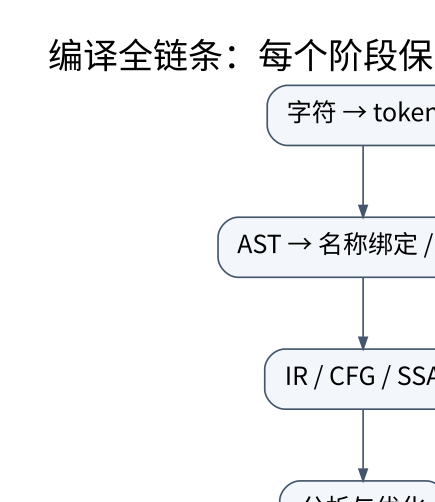

# 链接、运行时与编译器全景：从源文件到可验证系统

> **学习位置**：[[计算机知识/00-开始/课程地图/12-编译原理-课程地图|编译原理课程地图]] · **适用边界**：教学语言与教学 IR；不把简化模型等同于 LLVM 全语义。

[PNG 备用图](../../_assets/diagrams/round3/compiler-pipeline.png) · [可编辑图源](../../_assets/diagrams/round3/compiler-pipeline.dot)

## 汇编完成后为什么还不能直接运行

目标文件包含代码、数据、符号和重定位等信息。不同源文件各自编译时，外部函数最终地址尚未知；链接器解析符号、组织节并应用重定位。静态链接与动态链接在代码共享、部署边界、更新方式与运行时依赖上不同，不应简单概括为一个快一个慢。

ELF 等格式中的 section 面向链接组织，segment 面向加载映射，两者不同。位置无关代码通过相应寻址与重定位机制适应加载位置变化；PLT/GOT 是特定平台上的重要实现机制，不是所有平台的普遍名称。

ABI 包含名字修饰、数据布局、调用约定和异常等二进制契约。两个库都用 C++ 编写，不意味着任意编译器、版本和选项下都能无条件混用。FFI 必须明确谁分配、谁释放、编码、长度和异常能否越过边界。

## 运行时承担源语言留下的义务

闭包需要环境，异常需要传播和栈展开，协程需要保存可恢复状态，动态语言需要对象表示与分派，垃圾回收需要找到活对象。编译器输出的不只是算术指令，还包括元数据与运行时接口。

引用计数即时跟踪引用数量，循环引用需要额外处理；标记清扫从根遍历可达对象，复制回收移动活对象，分代回收利用对象寿命分布并维护跨代引用。写屏障不是把所有写入都锁住，而是为回收器维护必要信息；移动回收还要求更新或约束指针引用。

精确回收依赖可靠的指针元数据，保守回收可能把普通位模式当成指针。停顿时间、吞吐、内存开销与并发复杂度存在权衡，不能用“有 GC 就没有内存问题”结束分析。

## AOT、解释、JIT 与去优化

解释器执行语义或字节码，AOT 提前编译，JIT 利用运行时信息生成代码。它们可以在一个系统里组合。推测优化假定某类型或调用目标暂时稳定，加守卫检查；假设失效时去优化，恢复到能继续正确执行的状态。

去优化要求重建抽象机状态，内联后的栈帧、被消除的对象与局部变量都可能需要元数据。优化越激进，对状态重建的责任越大。热身、代码缓存和编译开销也应纳入 JIT 性能测量。

## 工程质量与安全边界

一个可靠编译器要有稳定诊断、可重现构建、回归测试、模糊测试、最小化工具与崩溃隔离。处理不可信源代码时，还应限制解析深度、编译时间、内存和外部工具调用；编译服务本身也是攻击面。

增量编译、模块系统、宏卫生、语言服务器、调试信息、覆盖率插桩、消毒器、GPU/异构后端、Wasm 和多层 IR 都是继续学习方向。它们连接构建系统、操作系统、硬件与开发工具，而不是编译原理之外无关的附件。

## 综合项目与验收

实现整数表达式语言：扫描器保留跨度，Pratt 解析器建立 AST，解释器定义结果，再生成栈式字节码执行。加入变量、if、while 后构建 CFG；加入常量传播并比较优化前后结果。定义整数是数学无界还是固定位宽，再测试边界，不能让实现语言偷偷替你决定。

测试包括正确程序、词法与语法错误、未定义变量、除零、深度限制、随机表达式差分和编译结果反汇编。每新增一项优化，都补一个曾经能让错误优化失败的反例。课程所附实验是这个链条的最小可运行核，不伪称已经完成工业级编译器。

## 关联阅读

- [[计算机知识/10-编程语言/02-C++/10-系统课程/08-模块ABI协程与工程边界|把 C++ 放进真实工程：模块、ABI、协程与标准库全景]]
- [[计算机知识/10-编程语言/04-Rust/10-系统课程/07-Unsafe别名FFI与表示|unsafe 审计：安全封装必须让所有安全调用都成立]]
- [[计算机知识/20-操作系统/01-Linux/10-系统课程/05-软件管理构建与可复现环境|软件与构建环境：区分安装成功、兼容和可重现]]

## 依据与继续查证

- [LLVM Language Reference](https://llvm.org/docs/LangRef.html)
- [LLVM 教程](https://llvm.org/docs/tutorial/)
- [Cornell CS 4120：编译课程讲义](https://www.cs.cornell.edu/courses/cs4120/2023sp/)

本页的例子、推演与练习为教学构造；语言契约、系统接口和版本相关结论应结合以上原始文档核对。

<!-- COURSE SEQUENCE -->
## 顺序导航与验证

[[计算机知识/70-编译原理/10-系统课程/00-编译原理系统课程索引|本课程总索引]] · [[计算机知识/_labs/round3/COMP/编译原理-实验说明|本课程实验]]

上一讲：[[计算机知识/70-编译原理/10-系统课程/07-指令选择寄存器分配与后端|编译后端：把无限临时变量放进有限机器]]
<!-- END COURSE SEQUENCE -->

<!-- ORIGINAL DEEP LINKS -->
## 与原有长篇专题衔接

- [[计算机知识/70-编译原理/15-目标文件符号重定位链接与装载|15-目标文件符号重定位链接与装载]]

新旧讲解采用的版本与模型可能不同，比较时先核对各自前提，不把教学简化当成实现细节。
<!-- END ORIGINAL DEEP LINKS -->
