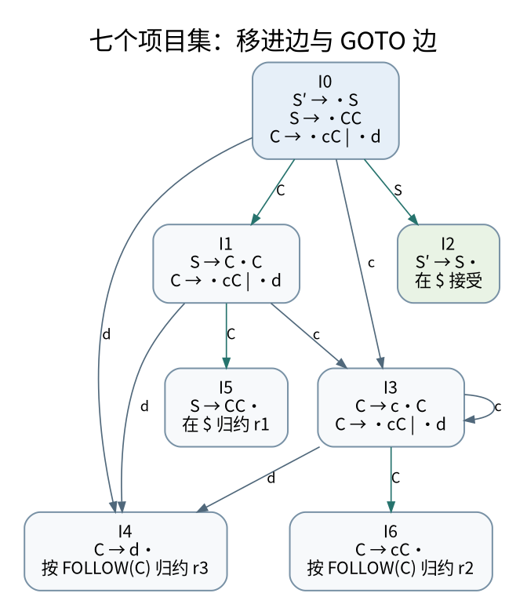

# 不跳步骤地构造解析器：LR 项目集、SLR 表与状态栈

> **本页要解决**：归约之后为什么还要查 GOTO，不能只弹栈？
>
> **先修**：[[计算机知识/70-编译原理/10-系统课程/03-语法分析FIRST_FOLLOW与LR|语法分析：从预测集合到移进归约冲突]]；[[计算机知识/70-编译原理/04-递归下降Pratt-LL与LR解析及错误恢复|递归下降、Pratt、LL 与 LR 解析及错误恢复]]。
>
> **阅读入口**：[[计算机知识/70-编译原理/10-系统课程/00-编译原理系统课程索引|本学科主索引]] · [[计算机知识/00-开始/全局导航/11-难点导读与研究证据|全局难点导读]]。

**版本、模型与证据边界**：SLR、有限类型统一和活跃性模型是独立教学实现，不是完整生产编译器或完整 Algorithm W。

## 从“看到一串符号”到“知道现在允许做什么”

先把问题限定为无二义性的教学文法。终结符为 `c,d`，开始符为 `S`，产生式编号固定：

```text
(0) S' → S
(1) S  → C C
(2) C  → c C
(3) C  → d
```

它生成两个依次排列的 `c* d`。例如 `dd`、`cdd`、`cdccd` 合法，`d`、`cdc` 不合法。增广开始符 `S'` 的作用是把“整个输入已经完成”单独表示出来，避免把普通归约误当接受。

一个 LR(0) 项目是在产生式右侧放一个点。`C → c · C` 不是说已经认出了完整的 `C`，而是已经识别前缀 `c`，现在还等待一个 `C`。状态是一组可能同时成立的项目，不是“当前只在执行某一条产生式”。这也是状态栈能够压缩识别历史的原因。[^lr]

## closure 与 GOTO：一条规则也不跳过

若集合里有 `A → α · B β`，点后是非终结符 `B`，就把每个 `B → · γ` 加入；不断重复到不再变化，这叫 `closure`。它表示“要识别 B，就必须允许从 B 的各个产生式起点开始”。不要因为新增项没有消耗输入而把它删掉。

`GOTO(I,X)` 先把集合 `I` 中点后恰好是 `X` 的项目向右移点，再做闭包。下面使用固定编号；别的程序产生不同编号并不算错误，只要状态集合及转移同构。

```text
I0: S' → · S       I1: S → C · C       I2: S' → S ·
    S  → · C C         C → · c C
    C  → · c C         C → · d
    C  → · d

I3: C → c · C      I4: C → d ·         I5: S → C C ·
    C → · c C
    C → · d

I6: C → c C ·
```

从 `I0` 沿 `C` 到 `I1`：先只得到 `S → C · C`；由于点后还有 `C`，必须补进两条 `C` 的起始项目。从 `I3` 沿 `c` 又回到 `I3`，这是因为移点后得到 `C → c · C`，再闭包正好得到原集合。状态可以有环，不意味着构造算法不能终止：这里可能出现的“产生式加点位置”只有有限多个。



[矢量图](../../_assets/diagrams/round4/slr-automaton.svg) · [可编辑图源](../../_assets/diagrams/round4/slr-automaton.dot)

完整转移是：`0-C→1`、`0-S→2`、`0-c→3`、`0-d→4`、`1-C→5`、`1-c→3`、`1-d→4`、`3-C→6`、`3-c→3`、`3-d→4`。这份清单也是附带程序的核对对象。

## 用 FOLLOW 约束归约，得到 SLR 表

`FIRST(C)={c,d}`，`C` 不能推出空串。`FOLLOW(S)={$}`。在 `S→CC` 中，第一个 `C` 后面可以是 `c` 或 `d`，第二个 `C` 后面可以是 `$`，所以 `FOLLOW(C)={c,d,$}`。`C→cC` 不再带来新符号。

SLR 的规则是：完整项目 `A→α·` 只在 `FOLLOW(A)` 上填归约 `r`；终结符转移填移进 `s`；增广项目完成时只在 `$` 上接受。空格表示语法错误，不是随便选一个默认动作。

| 状态 | c | d | `$` | GOTO S | GOTO C |
|---|---|---|---|---|---|
| 0 | s3 | s4 | 错误 | 2 | 1 |
| 1 | s3 | s4 | 错误 | 空 | 5 |
| 2 | 错误 | 错误 | 接受 | 空 | 空 |
| 3 | s3 | s4 | 错误 | 空 | 6 |
| 4 | r3 | r3 | r3 | 空 | 空 |
| 5 | 错误 | 错误 | r1 | 空 | 空 |
| 6 | r2 | r2 | r2 | 空 | 空 |

这里文法本身也是 LR(0) 文法；不能拿这张无冲突表“证明 SLR 比 LR(0) 更强”。SLR 的限制是使用全局 FOLLOW，可能把某个具体上下文中不可能出现的展望符也拿来归约。经典对照文法 `S→L=R | R, L→*R | id, R→L` 中，包含 `S→L·=R` 和 `R→L·` 的状态会在 SLR 的 `=` 栏冲突；规范 LR(1) 用附着于具体项目的展望符区分上下文。LALR 合并同心 LR(1) 状态可能重新引入归约/归约冲突。不要把三种算法写成只有表大小不同。

## 完整分析 cdd：归约不消耗输入

下面只列状态栈；实现可以另存符号/语义值栈。

| 状态栈 | 剩余输入 | 操作及理由 |
|---|---|---|
| 0 | `cdd$` | s3，读走 c |
| 0 3 | `dd$` | s4，读走第一个 d |
| 0 3 4 | `d$` | r3：C→d，弹 1 个状态，查 GOTO(3,C)=6 |
| 0 3 6 | `d$` | r2：C→cC，弹 2 个状态，查 GOTO(0,C)=1 |
| 0 1 | `d$` | s4，读走第二个 d |
| 0 1 4 | `$` | r3，弹 1 个状态，查 GOTO(1,C)=5 |
| 0 1 5 | `$` | r1：S→CC，弹 2 个状态，查 GOTO(0,S)=2 |
| 0 2 | `$` | 接受 |

为什么归约后不能直接“回到一个固定状态”？因为同一个 `C` 在不同前缀之后具有不同含义：第一个 `C` 应去 `I1`，第二个应去 `I5`，前导 `c` 后归约出的 `C` 应去 `I6`。栈顶留下的状态提供这个上下文。

若有 `A→ε`，弹栈次数是零，但仍要查 `GOTO(当前栈顶,A)`，并构造对应空产生式的语义值。把“右侧字符数”当弹栈数也会错：应数文法符号，不是字符串字符。

## 语法正确只是编译的一个关卡

归约动作可以创建 AST 节点，保存子节点和源码跨度。不要把赋值是否类型匹配塞进 LR 状态里；名称解析和类型约束属于后续语义分析，见 [[计算机知识/70-编译原理/10-系统课程/11-类型统一泛化与值限制|类型统一与泛化]]。词法阶段产生的 token 应区分种类、原始文本、位置和必要字面值，连接 [[计算机知识/50-数据结构与算法/10-数据结构系统课程/11-字符串索引LCP与自动机状态|字符串状态与自动机]]。

错误恢复不能简单“遇错跳一个 token 直到接受”：可能丢失主错误位置并制造级联假错误。实际策略包括同步符号、局部插入/删除建议、带错误节点的 AST。恢复后的树必须明确包含缺损，不能无声进入代码生成。

## 自检与实验

附带程序从产生式构造闭包、状态和 SLR 表，而不只把本表硬编码后运行。它遍历短串，将表驱动解析结果与 `c*d c*d` 的独立识别条件对比；同时核对 `cdd` 的移进/归约序列。练习：为 `dd` 手工写状态栈；解释为什么 `cdcd` 合法而 `cdc` 非法；再给文法加空产生式，观察 FOLLOW 和零长度归约怎样改变。

[^lr]: Cornell CS 412/413，2005 春，Lecture 9: LR Parsing（PDF 第 3–5 页，已对照图表）。概念参照课程材料，本文文法、编号、表和测试为本库重新构造：https://www.cs.cornell.edu/courses/cs412/2005sp/lectures/lec09.pdf 。

## 知识连接：下一步应追问什么

解析状态压缩的是已识别前缀；名称、类型和数据流仍需后续的不同分析。

[[计算机知识/50-数据结构与算法/10-数据结构系统课程/11-字符串索引LCP与自动机状态|字符串索引的隐藏状态：前缀函数、失败边与 LCP]]：KMP 为什么回退匹配长度，却不回退文本指针？

[[计算机知识/70-编译原理/10-系统课程/10-活跃性不动点与抽象解释|从集合传播到安全近似：活跃性、不动点与抽象解释]]：不动点算出来了，为什么还不能自动证明优化正确？

[[计算机知识/70-编译原理/10-系统课程/11-类型统一泛化与值限制|类型推断不是猜类型：统一、泛化与可变引用的反例]]：为什么 let 绑定可以多态，可变引用却不能随便泛化？

## 本地核验与阅读顺序

[[计算机知识/_labs/round4/README|本轮实验：命令、检查范围与未执行项目]] 提供对应文件和记录。[[计算机知识/90-资源/维护/导入-com/_meta/round4/01-研究证据与版本边界|研究证据索引]] 区分规范、推演和实验；[[计算机知识/90-资源/维护/导入-com/_meta/round4/02-缺口回查与后续验证|仍需进一步验证的边界]] 不把概览或模型标成完整实现。

先完成主干，再按问题选择专题；不要求跳过第 1–8 讲。 下一专题：[[计算机知识/70-编译原理/10-系统课程/10-活跃性不动点与抽象解释|从集合传播到安全近似：活跃性、不动点与抽象解释]]。
