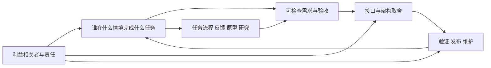

# 软件工程与人机交互：预约按钮背后的承诺

**读者问题：程序能跑以后，为什么仍可能交付了错误的产品？** 因为“计算符合代码”与“服务满足人的任务”之间，还隔着需求冲突、接口承诺、部署演进与责任判断。本路线用一个合成的社区咨询室预约服务，把这些判断连成一条能检查的链。它补充已有编程与测试课；本路线不代表全部软件工程、HCI或职业伦理课程已完成。

设定统一如下：仅考虑一个场地的一天，09:00–17:00，即从午夜起第540–1020分钟；预约是整数分钟半开区间 `[start,end)`，默认时长为30–120分钟。不收集咨询原因。不存在真实客户或研究参与者；页面里的对话与数据均为教学构造。v1模型处理顺序内存状态，交互原型只在当前网页内存中运行；v2演进实验另提供单机SQLite与临时Git教学候选，恢复作者没有运行；后续独立有限执行已完成，实际输入/结果与范围见 [[计算机知识/75-软件工程与人机交互/运行证据/2026-10-10-intent-evolution/README|本版运行入口]]，不能据此认证生产服务。

图中的回路有实际含义：发布后出现“失败消息看不懂”，应回到任务和反馈设计；不能只给测试数加一。

| 卡点 | 阅读出口及所得产物 |
| --- | --- |
| 管理员和预约者说的“不能冲突”含义不同 | [[计算机知识/75-软件工程与人机交互/01-从问题到需求规格与验收\|需求课]]：澄清对象、冲突规则、追踪矩阵与完整题解 |
| 数据库、通知、网页到底谁做最终决定 | [[计算机知识/75-软件工程与人机交互/02-架构接口权衡与变更影响\|架构课]]：两种方案的故障推演、决策记录与迁移顺序 |
| 为什么单测通过还不能上线 | [[计算机知识/75-软件工程与人机交互/03-验证测试发布与维护闭环\|验证课]]：规格独立的判定、发布门、故障与维护闭环 |
| 红字提示失败，用户仍重复点击 | [[计算机知识/75-软件工程与人机交互/04-交互任务反馈可用性与无障碍\|HCI课]]：任务流程、可运行键盘原型、研究设计及未知结果 |
| 为提高利用率是否应收集咨询原因 | [[计算机知识/75-软件工程与人机交互/05-职业伦理利益相关者与责任判断\|职业伦理课]]：利益与风险、两个可辩护方案、责任记录 |
| 两个正确分支合并后为何仍破坏预约，回退为何不能抹掉结果 | [[计算机知识/75-软件工程与人机交互/07-版本协作与行为保持演进\|版本演进课]]：提交图、语义冲突、重构边界与混合版本恢复；[[计算机知识/75-软件工程与人机交互/82-v2意图恢复与演进实验\|演进实验]] 给唯一业务合同和运行预期 |
| 想做完整练习并核对自己的答案 | [[计算机知识/75-软件工程与人机交互/80-一个预约服务的需求到维护案例\|贯穿案例]]：一条变更的需求到维护交接 |

已有主解释各有任务：读 [[计算机知识/10-编程语言/01-Python/10-系统课程/06-测试属性验证与性能方法|Python测试课]]，了解例子、性质、差分为何需要独立证据；读 [[计算机知识/10-编程语言/05-TypeScript/10-系统课程/07-Web边界安全与全栈协议|TypeScript Web协议课]]，检查静态类型、运行时输入和授权边界；读 [[计算机知识/80-实践/08-编译原理/09-MiniLang端到端编译器/README|MiniLang实验]]，练习已有多阶段产物的变更影响。这些是复用出口，不是需求访谈或团队开发的替代证据。

**自测与答案。** “网页能创建预约，是否满足需求？”答案需要至少分开三个命题：创建动作符合区间规则；预约者能知道结果并恢复失败；场地与受影响群体认可服务政策。程序只验证第一类的有限模型。反例是预约重叠检查正确，但用户在断网后看见“已预约”，到场才发现没有记录。

本路线的课程定位参照 [CS2023知识领域入口](https://csed.acm.org/knowledge-areas/) 中SE、HCI与SEP的区分；这只是覆盖坐标，不把页数折算成学时、学分或人的掌握度。
