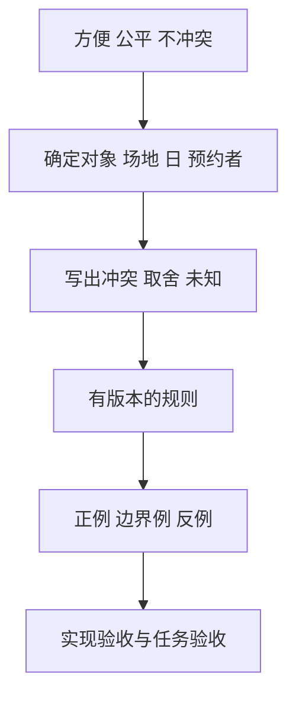

# 从问题到需求规格与验收：先决定什么算成功

**读者问题：怎么把“预约要方便且公平”变成开发者、管理员和预约者能共同检查的承诺？** 先确定要解决的情境，再把不一致的期望写出来。需求工程的产物不是术语清单，而是允许别人指出“你误解了我的意思”的说明。

## 先发现问题，再选功能

教学情境：管理员希望场地不被重复占用，预约者希望操作少，电话代办者希望不会因网络速度失去机会。以下是**模拟访谈提纲与假设回答**，未采访任何人：问“上次预约失败时发生了什么”，假设回答“页面说错误，我再按一次”；问管理员“你如何决定两个请求的先后”，假设回答“谁先打电话”。由此得到待核验假设：不确定结果比多填一项更容易导致重复提交；线上先到先得可能使电话代办者劣势更大。

问题不能直接跳成“加一个重试按钮”。先观察实际工作流、区分预约者与代办者、记录反例，再提方案。真实调查应有参与授权、最少数据与撤回办法；本课只设计问题，不声称上述假设已被用户验证。

## 用对象、规则与例子减少歧义

此处的需求是教学选定的服务政策，不是自然法则：当天只开放一间咨询室；所有时间以当天分钟整数表示；有效范围 `540 ≤ start < end ≤ 1020`，`30 ≤ end-start ≤ 120`。区间半开，即结束点不占用。两个**活动预约**冲突当且仅当 `s₁ < e₂ 且 s₂ < e₁`。取消后释放该区间；只有创建者能取消，重复取消返回“已取消”并保持状态。

管理员的“不重叠”和预约者的“尽量成功”可以同时做到，但“无等待地立即确认”与“所有渠道在同一截止点抽签”不能同作最终承诺。把冲突交给政策决策者，开发者说明后果：本模型选择立即确认，不实现跨渠道公平分配。伦理课会重新讨论这个取舍。

## 追踪矩阵要能暴露缺口

需求编号不是为了增加管理表，而是让规则变化时能找到受影响的判断。矩阵中的“预期”先由规格产生，再检查代码与界面。

| 编号与承诺 | 可检查例子及预期 | 验收位置 | 尚缺的证据 |
| --- | --- | --- | --- |
| R1：输入范围与时长合法 | `[540,570)`通过；`[540,569)`拒绝；`True`不是分钟整数 | `test_reservation.py`输入测试 | 实际网络输入解码未实现 |
| R2：活动预约不能交叠 | 已有`[540,600)`时`[600,630)`通过，`[599,629)`冲突 | 边界例、有限枚举oracle | 数据库并发事务未实现 |
| R3：创建者取消及幂等 | 非创建者拒绝；创建者两次取消都成功，第二次不再改变状态 | 取消回归测试 | 真实身份认证未实现 |
| R4：明确反馈和保留输入 | 冲突后显示“未创建”，保留开始/结束，键盘可修正 | 原型的冲突路径；04已有headless浏览器核查，[[计算机知识/75-软件工程与人机交互/06-认知模型用户研究与比较评价#实际运行证明了哪一层\|06区分AB软件证据与人的效果]] | 实际读屏输出/人的任务效果未做；headless证据不替代二者 |
| R5：不收集咨询原因 | 请求合同、界面和日志都不含原因 | 合同审阅；原型无此字段 | 生产数据流和日志未实现 |

所有表格项都通过仍不能证明“公平”：R2验证的是互斥，R3验证的是权限模型，跨渠道机会是另一个政策问题。还有明确排除范围：跨日、时区/DST、清洁缓冲、费用、通知、预约上限和并发持久化不在v1模型中。

## 完整练习与答案

已存在A=`[600,660)`，候选B=`[570,600)`、C=`[630,690)`、D=`[660,690)`。先校验时长：三者分别30、60、30，都合法。B与A不冲突，因为B结束等于A开始；C冲突，因为`630<660`且`600<690`；D不冲突。若有人要求“结束后清洁10分钟”，B也可能与A冲突，此时不能悄悄改比较运算符，需增加规则版本并处理已有相邻预约。到[[计算机知识/75-软件工程与人机交互/02-架构接口权衡与变更影响|架构与迁移课]]检查怎样保留旧承诺。

**反例。** “每个预约最多120分钟”不能推出“每个人一天最多120分钟”；用户可建四个30分钟预约。对象从预约换成预约者时必须添加聚合规则及它的验收。前端禁用按钮也不能证明R2，数据库仍可能收到两次并发请求。

需要深化测试证据时转到 [[计算机知识/10-编程语言/01-Python/10-系统课程/06-测试属性验证与性能方法#建立三种彼此独立的证据|例子、性质和差分测试的主解释]]；本页保留需求追踪，不复制测试主课。把需求放回人的工作流见[[计算机知识/75-软件工程与人机交互/04-交互任务反馈可用性与无障碍|交互与研究课]]；责任冲突见[[计算机知识/75-软件工程与人机交互/05-职业伦理利益相关者与责任判断|职业伦理课]]。

规格如何成为调用者与实现者的合同，可对照 [MIT 6.005 Specifications（Fall 2016）](https://web.mit.edu/6.005/www/fa16/classes/06-specifications/)。本课区间政策是自定教学规格，不是MIT课程规定。

返回 [[计算机知识/75-软件工程与人机交互/00-软件工程与人机交互-MOC|软件工程与人机交互课程入口]]。
