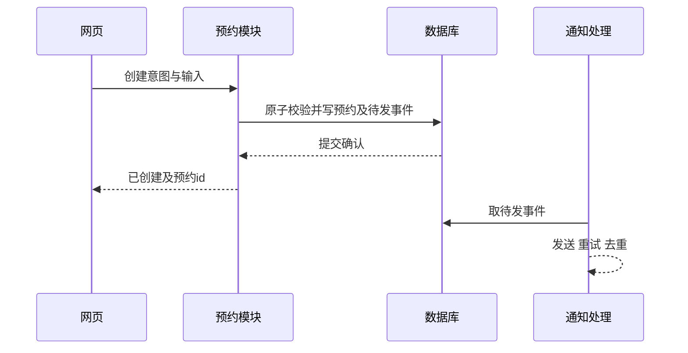

# 架构接口权衡与变更影响：把决定放到能兑现承诺的地方

**读者问题：预约、通知和网页都能各自写对，为什么合起来仍会重复预约或发出错误确认？** 因为正确性还依赖“谁有权作最终决定”及“失败在哪一步发生”。架构描述的不只是方框，更是状态、调用与故障的责任边界。

## 先写接口合同，再画组件

v1教学合同：`reserve(actor,start,end)`在整数验证后检查所有活动区间；成功返回`id,start,end,status=active`；非法输入与冲突分别返回可区分的错误，拒绝时状态不变。`cancel(actor,id)`先检查身份，再取消；未知id与无权限可分别在模型中表示。真实系统是否统一公开错误，以防泄露他人预约存在性，需要另作安全设计。`actor`在模型里是测试字符串；真实服务必须从认证会话获得身份，不能信任body里的用户id。

超时是一种**未知结果**：可能请求没到，也可能已提交但响应丢失。因此HTTP超时后显示“未创建”是错误的承诺。真实API可以为每个创建意图绑定幂等键，在同一事务内保存键、请求指纹和结果；同键同输入重放已有结果，同键不同输入拒绝。界面锁按钮只减少点击，不提供跨进程幂等保证。原v1内存模型尚未实现此机制。新增单机SQLite教学Authority的源码候选将意图、指纹、权威结果与outbox放在同一事务中；唯一合同及固定故障输入见 [[计算机知识/75-软件工程与人机交互/82-v2意图恢复与演进实验#唯一业务合同：移动端与流处理共用|v2意图接口]]。恢复作者未运行；后续独立有限故障/重开检查已执行，结果与边界见 [[计算机知识/75-软件工程与人机交互/运行证据/2026-10-10-intent-evolution/README|本版回执]]；网络API、真实身份认证与线上部署另需实现和验证。

## 两种方案要以同一失败历史比较

| 方案 | 状态和确认边界 | 优点与成本 | 故障推演 |
| --- | --- | --- | --- |
| A：模块化单体＋单事务数据库 | 预约模块负责冲突校验与提交；UI读已提交结果；通知在提交后处理 | 一个部署单元，端到端调试较短；容量与发布节奏共享 | 数据库提交后邮件失败：预约仍有效，通知可重试；不能撤回已确认预约来“修复邮件” |
| B：预约服务＋事件/通知服务 | 预约服务唯一写预约；预约事务同时写outbox；发送方重试事件，消费者按事件id去重 | 通知可独立扩展；增加积压、重复、顺序和运维责任 | 事件发送后确认丢失：会重发；消费者若不去重，用户收到两封邮件。投递成功也不等于用户看见 |

两方案中，预约成功均以预约事务提交为准。outbox把预约变更与待发送事实一起保存，**不自动提供恰好一次外部效果**。数据库选择也要落实R2：仅在事务中先查再写，可能仍发生写偏斜；可以用适合实际引擎的区间约束、对场地日的守护锁，或可串行化与完整重试。原v1内存模型没有验证这些数据库机制。新增SQLite候选采用BEGIN IMMEDIATE，单机事务和重开接口见 [[计算机知识/75-软件工程与人机交互/82-v2意图恢复与演进实验#故障历史、迁移与可检查范围|v2故障与验证范围]]；后续已独立执行五组指定双进程顺序，具体回执见v2实验；不据此认证其他数据库隔离或所有并发交错。相关前提去读 [[计算机知识/55-数据库/10-系统课程/10-MVCC快照写偏斜与重试协议|写偏斜、守护锁与重试协议]]，不要用单线程检查替代该课的并发分析。

**教学决策记录。** 情境是假设只有一支小团队、通知不是立即交付条件；选择A，并让预约/通知模块接口分离。理由是减少独立部署与消息运维责任；后果是共享发布和容量，保留outbox迁移出口。若通知吞吐或不同团队发布节奏变成主要约束，再比较B。没有真实团队测量，不能把“小团队适合A”升级成所有项目结论。

## 10分钟清洁缓冲不是一行代码变更

v2提案在预约结束后占用10分钟，仍要求实际预约不晚于17:00结束，清洁可以延至17:10。同场地两活动预约必须满足`e₁+10 ≤ s₂`或`e₂+10 ≤ s₁`。新增`policy_version`记录适用规则；旧预约标v1而不改时间。

迁移次序：先在副本上找出旧相邻预约，向管理员与受影响者说明；选择过渡政策并审批；部署能读v1/v2的服务与客户端；加入字段和明确兼容缺省（只对已知v1数据回填）；灰度新规则；监测冲突拒绝及旧预约处置；最后再收紧新写入。教学选项是保留已确认v1预约，新写入按v2对所有活动预约检查；过渡期仍可能有旧预约之间无缓冲的例外，管理员必须安排处置。不能宣称全日已经符合v2。

回滚不能只降程序版本：旧程序若忽略缓冲仍接受新邻接预约，会破坏新承诺。应冻结新写入或保留兼容的规则执行层，保存v2预约和迁移记录。具体选择见[[计算机知识/75-软件工程与人机交互/80-一个预约服务的需求到维护案例|贯穿变更案例]]；v1例外导入、协作写者fencing与保留意图/outbox的恢复历史见 [[计算机知识/75-软件工程与人机交互/07-版本协作与行为保持演进#混合版本与恢复边界|演进与恢复]]，有限模型不代替在线数据迁移与部署。

## 练习、答案与反例

数据库已提交预约Q，通知尚未发送，网页响应丢失。能否显示失败并重新建Q？答案：不能把未知说成失败；用创建意图的幂等键查询/重放结果，显示“确认结果中”，通知单独重试。反例是“每个服务都有测试，所以组合正确”：两个都在快照中看见空位的请求各自成功，却违反R2。

静态接口怎样跨网络失效，去读 [[计算机知识/10-编程语言/05-TypeScript/10-系统课程/07-Web边界安全与全栈协议#一份类型定义不是一条可靠协议|TypeScript协议主解释]]；同一新功能如何牵动多个阶段，可用 [[计算机知识/80-实践/08-编译原理/09-MiniLang端到端编译器/README#练习|MiniLang新增运算符练习]]做对照。继续到[[计算机知识/75-软件工程与人机交互/03-验证测试发布与维护闭环|验证和维护课]]判断哪些证据足以支持发布。

返回 [[计算机知识/75-软件工程与人机交互/00-软件工程与人机交互-MOC|软件工程与人机交互课程入口]]。
