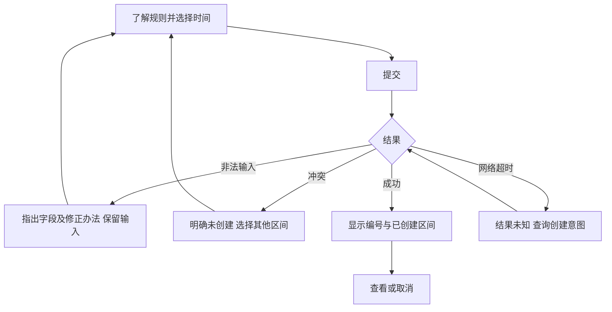

# 交互任务反馈可用性与无障碍：让人知道下一步怎么做

**读者问题：界面报了“冲突”，为什么用户还会重复提交？** 反馈如果没说明操作结果、受影响输入与恢复方法，人就必须猜测系统状态。HCI把人的目标、认知负担、动作和系统反馈放进同一个循环，而不只评价页面是否漂亮。

## 从人的任务拆出操作与反馈

教学任务是“为今天预约30分钟，并确认它已建立”。用户要理解营业时间与输入单位，选择区间，提交，辨认结果；冲突时选择其他区间，成功后可取消。人的工作记忆有限，让人跨页记住先前输入会增加负担；把营业时间、时长规则和冲突时原输入留在同页，便于识别和修正。这是设计理由与待测假设，未由本项目真实参与者证实。

原型是本地内存，因此只有非法/冲突/成功三条提交结果；未知结果路径在真实网络服务中才有意义，原型未实现查询。区间“可选”也不能先显示最终成功，其他用户可能在提交前占位。

把这里的记忆负担理由变成可推翻的预测，继续[[计算机知识/75-软件工程与人机交互/06-认知模型用户研究与比较评价#外部线索怎样参与恢复任务|保留与清空的共同暴露及替代解释]]；带回“先看见什么、恢复什么、怎样的行为会推翻预测”。既有原型不改，新AB材料只用于该比较。

若卡点在“看见了但没注意/把选中当创建/点错目标”，去[[计算机知识/75-软件工程与人机交互/08-感知注意指向选择与评价方法#看得见、被注意和被理解，是三个问题|感知注意与状态理解]]及[[计算机知识/75-软件工程与人机交互/08-感知注意指向选择与评价方法#同一个问题，研究方法怎样各司其职|方法选择对照]]；回来区分实施可达、阶段解释和指向错误，不把同一失败全叫记忆负担。

## 可运行原型与失败反例

用浏览器打开 [reservation-prototype.html](reservation-prototype.html)，无需依赖、登录或服务，刷新会清空数据。它使用原生数值输入、`label`和按钮；文字说明分钟单位与规则；冲突消息明确“未创建”，保留输入；成功消息给id与区间；取消按钮释放预约。控件顺序是开始、结束、创建、各预约取消。`aria-describedby`关联说明，`role=status`报告动作结果，字段错误使用`aria-invalid`和错误文字；可见焦点样式提示键盘位置。

坏交互是仅用红边框表示冲突、抹掉两个输入、显示“请重试”。改善后写“未创建：该时间与活动预约重叠，请修改开始或结束”，焦点留在可修正的位置，输入保留。另一反例是为了“无障碍”加`tabindex=1,2,3`：视觉顺序改变以后，键盘顺序可能与页面不同；原生DOM顺序更易维护。ARIA属性不能弥补没有任务反馈或错误规则的产品。

## 标准条件与具体核查

本课参照 [WCAG 2.2固定版（2024-12-12）](https://www.w3.org/TR/2024/REC-WCAG22-20241212/)，关注2.1.1键盘、2.4.3焦点顺序、2.4.7焦点可见、3.3.1错误识别、3.3.2标签或说明及4.1.3状态消息。条目是技术核查依据，不表示原型已达到AA：符合性涉及完整页面/流程与全部适用成功准则，还需要真实技术组合验证；也不自动等于某地法律合规。[W3C表单反馈教程](https://www.w3.org/WAI/tutorials/forms/notifications/)支持对整体结果、具体字段与修正方法分别反馈。

| 操作 | 预期观察 | 验收如何记录 |
| --- | --- | --- |
| 只用Tab/Shift+Tab及Enter操作 | 所有创建/取消动作可达，顺序符合任务，焦点可见且无陷阱 | 浏览器/版本、动作序列、焦点位置与失败样本 |
| 设`540,569`后提交 | 指出时长至少30分钟，错误与结束字段相关，输入保留 | 可见文字及读屏报告分别记录 |
| 建`540,600`，再建`570,630` | 明确未创建，活动列表仍只有原预约，修正后可继续 | DOM/实际界面与任务结果核对 |
| 在真实读屏组合提交、取消 | 控件有名称，状态变化可被听见且上下文清楚 | OS、浏览器、辅助技术版本和实际输出 |

上述执行设计已在2026-09-17补做隔离 Chrome 152 的11项自动浏览器检查：Tab/Shift+Tab、Enter创建/取消、错误后输入保留与焦点恢复、相邻区间及375px布局符合预期；浏览器无障碍树中的名称和状态属性也已核对。输入测试使用CDP编辑命令，截图和版本见 [[Logs/2026-09-17_第二批课程建设与阅读验收|第二批实际结果]]。这是headless浏览器与DOM/AX证据，未执行真实读屏软件或参与者测试，也不构成完整WCAG符合性验收。

## 一项能暴露问题的研究设计

研究问题：“预约冲突后，参与者能否知道原操作未成功，并改选相邻区间？”先与管理员核对真实任务，再在获授权后招募不同预约经验、键盘/辅助技术使用者和电话代办者；使用虚构预约，不录咨询内容，说明自愿、可撤回与保留期限。教学拟设6–8位有目的样本用于形成性发现，不是概率抽样，也不支持总体成功率。

任务脚本不给按钮路径：“已有09:00–10:00预约，请预约另一段30分钟并说明是否成功。”主持人保持中性，记录完成、未完成、错误、帮助及参与者对状态的解释；完成时间只在相同起止口径下比较。停止规则应事先约定，例如参与者困扰、想退出或技术无法继续。用行为记录与原话分开，分析“把冲突误当成功”的具体机制，修正原型后用同条件复测。若同一参与者见过旧版，学习效应会影响对比，应记录/交替版本或使用新样本。

**模拟数据练习，非真实结果。** 5个虚构记录里3位无需帮助成功、1位求助后成功、1位未完成。无需帮助完成率是`3/5=60%`；“最终完成含帮助”是`4/5=80%`。必须分开分母与帮助口径，不能报道“用户成功率80%，研究证明好用”。答案应包含小样本、任务与人群边界。即使所有参与者完成，也不能证明所有残障用户无障碍。[W3C用户参与评估说明](https://www.w3.org/WAI/test-evaluate/involving-users/)支持将实际用户经验与标准评估结合。

原五条继续保持上述模拟身份与计数；[[计算机知识/75-软件工程与人机交互/06-认知模型用户研究与比较评价#旧五条记录只算一次，分母要跟着任务走|第六条退出/技术失败]]解释分母变化，[[计算机知识/75-软件工程与人机交互/06-认知模型用户研究与比较评价#固定先A后B，界面效果与练习怎样纠缠|配对与顺序比较]]说明为什么第二次更快不等于界面有效。没有为这五条补造时间或原话。

若目标转为学习，继续 [[社会科学/68-教育学/01-教学目标支架与迁移证据#从可用性记录到学习评价，携带什么回来|即时完成与撤提示学习证据]]：保留本段原口径，另观察保持和迁移；帮助提高任务完成不能单独证明持久学习。

需求如何接受研究发现见[[计算机知识/75-软件工程与人机交互/01-从问题到需求规格与验收|需求课]]；电话渠道及机会分配的价值冲突见[[计算机知识/75-软件工程与人机交互/05-职业伦理利益相关者与责任判断|职业伦理课]]。更多网络输入与状态边界去读 [[计算机知识/10-编程语言/05-TypeScript/10-系统课程/07-Web边界安全与全栈协议#缓存与状态同步|Web状态同步主解释]]。

### 形成性停止与统计停止分别约定

前面的困扰、撤回或技术故障是保护参与者与完成任务的停止条件，应照常执行；它不提供总体错误率保证。若另做有明确抽样模型的确认性版本比较，还应在分析方案中规定样本量、主指标、排除与停止规则。例如“最多20位，每来一位都重新算固定样本p值，显著就停止”并不因为预先写下就保持5%误报率。[[数学/30-概率与统计/09-假设检验错误概率与功效#固定终点、逐步偷看与有效似然过程|同一20步数据的三个停止协议]]给出可复算的反例和有效似然过程的条件；实际用户研究还需另核独立性、任务学习效应与招募机制。

**迁移问题与答案：** 6–8位有目的样本一直测到不再出现新问题，可以把“停止时没有发现新问题”解释为总体成功率达到95%吗？不能。它是形成性发现的停止判断，没有提供概率抽样、总体成功率的估计模型或覆盖保证。应保留每位参与者和每轮修改的失败记录，说明停止理由；若要总体推断，另设计对应的样本与分析方案。

返回 [[计算机知识/75-软件工程与人机交互/00-软件工程与人机交互-MOC|软件工程与人机交互课程入口]]。
