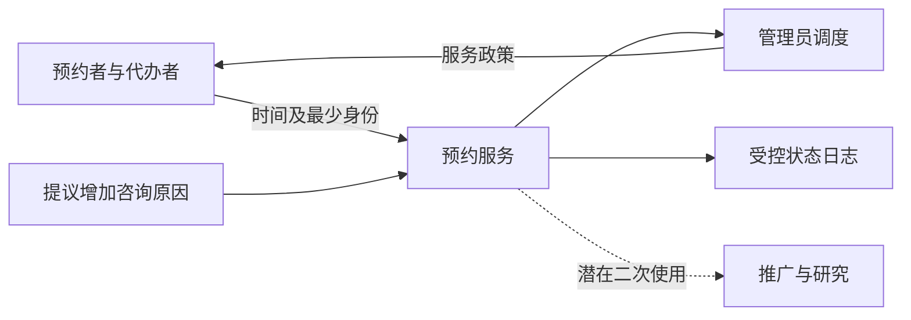

# 职业伦理利益相关者与责任判断：能实现之后仍要说明该不该做

**读者问题：收集咨询原因能提高场地利用率，开发者是否应按管理员要求立即加入？** 先区分经验事实、价值判断、法律条件与未知，然后比较能达成目标的不同手段。效率目标有意义，但它不能自动决定谁承担隐私和排斥风险。

## 同一个预约服务，谁受影响

合成情境：管理员提议让用户填咨询原因，再按“重要程度”优先；推广人员希望发布使用者故事；开发者面临月底上线期限。这些不是现实访谈。未知包括真实缺席率、原因能否预测到场、用户是否愿披露、排序会否排斥特定群体、适用地区与服务义务。不能把管理员的“肯定有用”写成已证实收益。

| 参与者 | 目标与可能利益 | 风险、权利与谁能纠正 |
| --- | --- | --- |
| 预约者 | 得到时段并知道状态 | 敏感原因泄露、被误判重要性；需理解用途、纠错与申诉渠道 |
| 无稳定网络者/代办者 | 有同等可达渠道 | 先到先得可能奖励网络速度；管理员需审查渠道政策 |
| 工作人员 | 负担可控、少空置 | 人工判“重要”可能承受偏差与解释压力；组织给清楚职责 |
| 管理员与资助方 | 利用率、公共服务成果 | 总量指标掩盖拒绝与群体损失；需接受外部质询 |
| 开发与维护者 | 如期可靠交付 | 隐瞒限制、越权数据使用、无恢复能力；必须记录不确定性并报告风险 |

虚线是一项风险提议，不代表已经采集或外发。需求v1只保留时间和最少身份；公开利用率应避免把小群体、具体时间与身份拼回个人。

## 从准则到具体理由

ACM 2018 Code的1.1、1.2、1.3、1.4、1.6及2.5分别提供关注受影响者、伤害、诚实、公平、隐私与风险评估的判断入口；它们不替个案计算出唯一答案。本批ACM主入口访问返回403，实际核对的是[ACM分会站所载讲义中复现的Code条文](https://pok.acm.org/meetings/foils/Topaloglu19.pdf)，PDF第5–10及17页（从1计）：只引用复现条文，讲者的AI案例观点不是准则。官方[Code入口](https://www.acm.org/code-of-ethics)留作后续直接核对。

IEEE-CS/ACM Software Engineering Code v5.2进一步把公共利益、质量取舍、规格、测试与隐私放进工程职责。本批通过[IEEE-CS官方页面的搜索索引正文](https://www.computer.org/education/code-of-ethics)核对1.03、3.01、3.08、3.10、3.12；直接打开同样403，因此来源验收仅覆盖这些已取得条文，未声称完整全文逐条核验。

法律条件必须另查：国家/地区、是否未成年人、数据类别、控制者、目的与保存期限尚未知。本页不提供“合法/违法”的结论；WCAG技术目标也不等于法律义务。准则、适用法律和组织责任相互有关，不能把其中一个通过当成另外两个通过。

将最少身份与预约时段带入[[社会科学/63-法学/20-德国/05-个人数据处理目的与技术保证#D-GDPR的主体、事实与时间|德国私人成人预约服务变体]]：这是新增的虚构事实，原情境的未知继续保留。沿该页的处理目的、假名映射、完整输出和删除条件作有限判断，再返回下节比较A/B；法律候选结论仍不能替代机会分配、压力和责任理由。

## 比较两个可辩护选项

A保留最少信息，采用开放时段和匿名汇总的缺席指标，在所有渠道说明相同规则；优点是少采集和少主观排序，代价是无法按咨询急迫程度分配。B为确有需要的优先服务另设**自愿且独立的支持渠道**，由有职责的工作人员依据公开、可质询标准处理，并提供等效的非数字入口；只收必要信息、权限隔离、限定保留、不供推广复用。优点是可能照顾急需者，代价是工作人员能力、敏感数据与申诉负担。B是否可行要有实际服务证据与法律审查；不能从“自愿”推出没有压力，因为稀缺机会会影响自由选择。

教学暂选A，理由是提高利用率的因果收益未证实，敏感采集的不可逆风险已有合理路径；将急需支持作为待设计的独立制度。此决策偏重隐私和可达性，但承认机会成本。若真实急需者被延误且安全支持渠道可兑现，应重新比较B，不把“数据最少”当永不变化的口号。

责任记录应写：谁提出目标；已知/未知与来源；至少两个方案；谁承担不利后果；由谁授权政策、实现控制和处理申诉；何种证据触发重审。开发者不能替组织承诺医疗优先判断，也不能只说“老板要求”免除自己报告技术风险的职责。[[计算机知识/75-软件工程与人机交互/09-专业沟通许可与软件可持续性#技术说明、复盘与有理由的决定|专业沟通与决定材料]]把同一证据写给工程师/受影响者；其许可与软件负担例另分权利对象、单位强度、总量与受益/承担者。带回谁授权、谁能恢复、何证据触发重审，条款/数值不替代本页伦理比较。

若效率主张来自“大按钮更快”或“选项少更好”，带着错误后果、受影响群体与替代方案，读[[计算机知识/75-软件工程与人机交互/08-感知注意指向选择与评价方法#指向模型：距离和沿运动方向的容许宽度|指向模型的速度—正确性边界]]和[[计算机知识/75-软件工程与人机交互/08-感知注意指向选择与评价方法#同一个问题，研究方法怎样各司其职|方法证据对照]]。回来说明省时的基准、谁被排除、错误成本和哪些仍是预测；高拟合不能自动替利益相关者决定取舍。

## 练习、答案与反例

假设线上请求平均1秒，电话代办5分钟，先到先得使所有快用户成功、慢用户失败，但总利用率都100%。能否说系统公平？答案：不能。利用率只表示资源使用，机会口径是另一个对象；应比较同步受理窗口、电话预留、抽签等政策的可达性、成本与可质询性，最终由负责者公开说明取舍。抽签也不自动公平：若报名本身只可线上完成，障碍仍在。

反例是“用户勾选同意即可用于故事推广”：预约必需目的与推广目的不同，用户可能受稀缺资源压力；不能由一个复选框抹去权力关系与二次使用风险。操作层的最少字段、脱敏与许可边界已有主解释，去读 [[计算机知识/60-数据编码与媒体系统/17-媒体工程安全许可隐私与可复现性#5. 元数据隐私：不止 EXIF GPS|媒体工程隐私]]及 [[计算机知识/60-数据编码与媒体系统/17-媒体工程安全许可隐私与可复现性#6. 许可证、版权与专利：三张不同的表|许可、版权和专利边界]]；它们回答发布操作，不替本页作机会分配判断。

将结论转成可检查字段和验收见[[计算机知识/75-软件工程与人机交互/01-从问题到需求规格与验收|需求课]]；实际可达性与参与研究方法见[[计算机知识/75-软件工程与人机交互/04-交互任务反馈可用性与无障碍|HCI课]]；对外声称与发布责任见[[计算机知识/75-软件工程与人机交互/03-验证测试发布与维护闭环|验证维护课]]。

返回 [[计算机知识/75-软件工程与人机交互/00-软件工程与人机交互-MOC|软件工程与人机交互课程入口]]。
