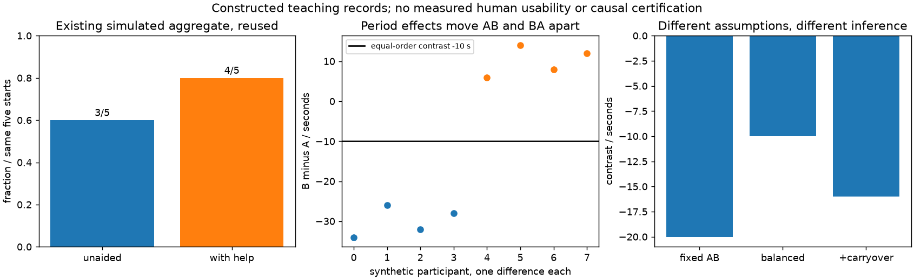

# 认知模型、用户研究与比较评价：保留输入，凭什么说更好？

**读者问题：B版保留冲突输入，A版清空；所有人第二次都更快，能宣布B更好了吗？** 还不能。需要先说明人看见过什么、要恢复什么、哪些观察能区分记忆线索与练习、谁没有完成。浏览器能证明字段留下了，不能替人证明字段有用。让模型赞同模型设计，再写成“用户认可”，证据就完成了漂亮的自助循环。

[[计算机知识/75-软件工程与人机交互/04-交互任务反馈可用性与无障碍|04课]]已提供任务、反馈、可运行预约原型与旧Chrome 152的11项检查；[[计算机知识/75-软件工程与人机交互/81-预约模型源码测试与原型镜像|81镜像]]保存其代码阅读入口。本课补的是其后尚缺的一段：**设计理由如何变成可被推翻的预测，观察如何变成比较，比较怎样被学习与退出误导**。旧原型不改；新实验沿用同一天540–1020分钟、整数半开区间、30–120分钟时长及相邻不冲突的业务规则。

## 外部线索怎样参与恢复任务

人的目标是“预约30分钟，并知道是否建立”；点击创建只是动作。已有预约为`[540,600)`，两版先展示相同预填`570,600`，参与者主动提交，得到相同冲突文字与开始字段焦点。A仅在这个冲突分支清空两个输入；B保留。两版标签、错误文字、时机、列表、颜色、焦点与规则相同。默认真人入口不自动提交；带`stage=conflict`的自动检查入口只用于准备恢复屏。

此时保留值可能让人把“原区间是什么、原时长多少”从回忆转换为看见后识别与计算；清空则要求另找信息或重新构造。这个解释承接[MIT 6.831 Learnability讲义第6–10页](https://ocw.mit.edu/courses/6-831-user-interface-design-and-implementation-spring-2011/c74391b4bc3e58e025b317b61ef5a0ef_MIT6_831S11_lec02.pdf)的外部线索与执行/评价关系。它不是一个给所有人固定容量的“记忆槽数定律”，也不是本课已经测出的心理机制。

目标改为相邻区间`600,630`时，**两版都要改开始和结束两个字段**。B并不必然少输入一个字段，还可能增加全选/替换动作。一个可检验预测是：在看过并主动提交相同原值以后，B减少回看规则或重新计算原时长的片段，且不增加误把旧值当已预约的错误；完成时间与状态理解另测。只有时间变短不够识别机制。

| 假设或替代解释 | 保持或改变什么 | 应观察什么才有区分力 |
| --- | --- | --- |
| 保留值提供恢复线索 | 两版共同暴露原值；只操纵冲突后保留 | 恢复时回看、复述原时长、改值轨迹与状态解释；不用“看起来轻松”代替行为 |
| 第二次熟悉操作 | 分配AB与BA，保留任务期次 | 改善是否总落在第二次，是否随顺序翻转 |
| 文案或焦点才是原因 | 两版实际同文案同焦点 | 若改文案也改保留，无法归因于保留；本原型检查共同路径 |
| 保留造成锚定或隐私负担 | 换为共享屏幕或熟练输入者情境 | 重复提交旧值、清除成本、敏感输入暴露；本公共分钟fixture不证明隐私可接受 |

因此，“保留输入好”是有条件的取舍。熟练者可能更快重填；只记两数可能没有明显负担；辅助技术播报和字段选择成本也会改变收益。更完整的感知注意、指向选择模型是本课程后续单元；[[社会科学/65-心理学/02-注意控制学习记忆与研究方法#从HCI的五条记录回到保持与迁移|心理学的学习与记忆]] 继续区分编码、检索、当场表现与延后测量。带去本页的保留／清空条件，返回时补能区分外部线索、熟悉和访问支持的观察；不能仅凭第二次更快指定机制。

## 先选问题，再选研究方法

要知道人怎样处理冲突，先做任务分析：前提是已理解分钟单位且确实看到原值；子目标是发现未创建、定位原因、构造新时段、提交并解释成功；失败可能来自任一步。把任务拆成按钮清单会漏掉“知道结果”。[MIT任务分析讲义第10–16页](https://ocw.mit.edu/courses/6-831-user-interface-design-and-implementation-spring-2011/e9395ea03b0487fd1df5ccf1cd03775c_MIT6_831S11_lec07.pdf)提供访谈与现场观察的入口。

形成性观察回答“卡在哪里”；中性访谈追问参与者自己的判断；控制比较回答限定条件下版本差是否符合预定指标。问卷可以收集主观负担，但满意度分数不是操作正确率；启发式走查可以暴露反馈缺口，但专家预测不是参与者实际遇到的频率。边做边说可揭示理解过程，却可能改变计时表现；不要把一版边说、一版沉默的时间混在一起比较。[MIT用户测试讲义第4–9页及主持部分](https://ocw.mit.edu/courses/6-831-user-interface-design-and-implementation-spring-2011/e439a4a538175371008c3e492ed59443_MIT6_831S11_lec13.pdf)支持中性任务、试跑和参与者控制。

本课的中性任务是：“先尝试页面预填时段；如果不能建立，请保持原时长，安排在现有预约结束后的最早可用时段，并说明最终结果。”不说“保留输入比较方便”，不提示点击哪个按钮。先确认参与者见到570和600，再由其提交；恢复计时从冲突结果可用且参与者准备好开始，结束须同时满足正确新预约和正确结果解释。若研究全程效率，应另外从任务说明开始计时，不能把这里的局部时间改名成全程时间。

[[计算机知识/_labs/hci_conflict_study/真人任务与记录|可直接执行的真人任务包]]给招募差异、共同暴露、帮助/退出、原始记录字段与失败判据；**本轮参与者数为0，没有真实访谈原话、录音或真人完成时间**。记录必须把“按了两次创建”与“误认为已成功”分开，后者需要参与者解释等证据。构念如何转成可遗漏的指标，返回[[社会科学/10-共同工具/05-测量抽样与调查设计#构念到指标：先决定遗漏什么，再写问题|测量主解释]]。

## 旧五条记录只算一次，分母要跟着任务走

04已有五个**模拟类别**：3独立完成、1求助完成、1未完成。本课复用同一事实，不新增逐人时间或原话；`legacy-outcomes.json`中的L1–L5只是规范化标签，原材料未提供可追认的个人ID、顺序与时间。于是独立完成`3/5=60%`，含帮助完成`4/5=80%`，完成时间是**未知**，不是0秒。

新增第六条也是变条件的构造，三种情况互为替代而非三位新参与者：开始后退出，则分母6，独立`3/6`、含帮助`4/6`；开始后技术故障，同样保留在本任务所有开始尝试的分母6，并单列技术原因；若准备阶段设备就失败，则登记6、开始5、准备失败1。报告条件于已开始的比例仍为3/5与4/5，但端到端服务可达性若以登记尝试为目标，分母应为6。不能悄悄删除故障来提高“成功率”。帮助计数也不能藏进成功标签。

左图是旧五条的再表达，没有新增实测信息。中图每点是一位构造参与者的差值，不是两次操作当两个人。右图的三个条是不同构造条件；没有拿同一批真人做三次实验。

## 固定先A后B，界面效果与练习怎样纠缠

令$t_{iA},t_{iB}$是同一人的完成秒数，较小为快，$d_i=t_{iB}-t_{iA}$。一个简化模型是

$$t_{ic}=\alpha_i+\tau\,1[c=B]+\pi\,1[\text{第二期}]+\epsilon_{ic}.$$

$\alpha_i$是人的稳定差异，$\tau$是本模型的B相对A效果，$\pi$是共同期次效应；负$\pi$可代表练习。配对作差消去$\alpha_i$，却不会消去期次。AB顺序有$d_i=\tau+\pi+\eta_i$，BA有$d_i=\tau-\pi+\eta_i$。这是识别假设，不是人类一定线性相加的定律。

`comparison.json`先给4条全AB构造：A为90、100、110、120秒，B为72、78、90、100秒，均差−20秒。数据生成时$\tau=0,\pi=-20$，故“每人B都快”也完全可能来自练习。只做配对$t$检验不能创造缺少的顺序变化；统计软件会认真计算你认真混淆的东西。[MIT控制实验讲义第9–12页](https://ocw.mit.edu/courses/6-831-user-interface-design-and-implementation-spring-2011/7e721676578869e33403137f45d6926f_MIT6_831S11_lec14.pdf)讨论学习、疲劳和混杂。

接着换一套8人构造，不与旧五条拼接：

| ID | 顺序 | A秒 | B秒 | B−A秒 |
| --- | --- | ---: | ---: | ---: |
| T1 | AB | 90 | 56 | −34 |
| T2 | AB | 100 | 74 | −26 |
| T3 | AB | 110 | 78 | −32 |
| T4 | AB | 120 | 92 | −28 |
| T5 | BA | 79 | 85 | 6 |
| T6 | BA | 81 | 95 | 14 |
| T7 | BA | 97 | 105 | 8 |
| T8 | BA | 103 | 115 | 12 |

AB均差−30，BA均差10；等权顺序对比$\widehat\tau=(\bar d_{AB}+\bar d_{BA})/2=-10$秒，$\widehat\pi=(\bar d_{AB}-\bar d_{BA})/2=-20$秒。所有BA的B反而较慢，仍与真实构造$\tau=-10$相容：B是第一次，没吃到练习收益。随机分配顺序与平衡使比较有机会识别效果；小样本、非随机招募和条件特有迁移仍需另论。单位、时点与目标人群应先固定，返回[[社会科学/10-共同工具/03-因果图反事实与识别#先固定单位、时点与目标总体|因果识别主解释]]。

### 这个区间依赖什么，而不是代表谁

为展示不确定性计算，额外**假设**差值误差相互独立、正态、两顺序同方差、无差异迁移，且各有4个完整配对。两组内样本方差都是$40/3$秒²，合并残差自由度$4+4-2=6$。所以

$$SE(\widehat\tau)=\frac12\sqrt{\frac{40}{3}\left(\frac14+\frac14\right)}=\sqrt{\frac53}\ \text{秒}.$$

取[NIST表](https://www.itl.nist.gov/div898/handbook/eda/section3/eda3672.htm)自由度6、双侧95%的临界值2.447（已舍入），得条件区间$-10\pm2.447\sqrt{5/3}=[-13.1591,-6.8409]$秒。这里的重复抽样覆盖来自所声明模型；没有证实真实用户误差正态，也没有给目的样本变出总体代表性。区间和$p$值的条件见[[数学/30-概率与统计/09-假设检验错误概率与功效#4. 连续模型中的$t$检验及双侧方向|统计主解释]]，停止规则继续使用04已有的固定终点与逐步偷看出口。本例不是新造一套显著性定义。

## 平衡不能修掉迁移，也不能补回退出的人

第一反例：若只有AB的人第二次B额外迁移获益12秒，AB均差变−42、BA仍10；等权对比变−16，偏离构造的−10。顺序平衡消去的是**共同**期次项，不是任意条件特有carryover。可用等难度不同材料、预训练或平行组设计降低特定影响，但各自引入任务等价或组间差异的代价，不能口头“洗脱”就当消失。

第二反例：把同一T8的第二次A改成40秒时退出，`completion_s=null`。A完成7/8，B完成8/8，完整配对7/8。直接对7个差值平均是$-92/7=-13.1429$秒；分别算两顺序均值再等权是$-31/3=-10.3333$秒。后者修复组权重变化，**没有修复退出依赖困难程度的选择偏差**。40秒是退出前经过时间，不是完成时间，不得填40当成功；固定4+4正态区间函数拒绝此输入。

第三反例更尖锐：A两位完成用30、100秒；B只有第一位完成40秒，另一位退出。只看各版本完成者均时，65→40像快25秒；同一个可配对的人却30→40，慢10秒。报告所有尝试的结果和完整配对人数，再说明时间的条件总体。把退出者扔掉之后的漂亮平均值，只是让最困难的任务从统计表里成功退出。

## 一条发现怎样穿过实现，再回来接受质疑

下面S例是**新构造的形成性观察示范，不是旧五条的原始观察，也没有实际参与者**：S甲见过并提交570/600，A清空后停顿、重新查规则，再尝试570/600又冲突；事后说“我不确定刚才是否建上了”。动作与这句模拟原话分栏，解释至少有两种：失去值导致恢复负担；或状态反馈没被理解。这个记录不单独证明记忆机制。

据此提出两种修改：保留原值，或加强“未创建”的反馈。为了识别第一种，当前AB材料只改保留/清空，文字与焦点保持相同。真实本机检查证明B确实保留，A清空，业务仍拒绝冲突；并测到相邻创建、取消、字段错误与键盘路径正常。这完成**实现与软件状态的复核**。

然后用任务包复测同一观察问题，保留状态解释、重试轨迹、帮助与时间；尚未执行真人复测。可以构造S乙在B仍重复提交原值的失败记录：它与“保留必然解决问题”矛盾，却不与“可能提供线索”矛盾。下一轮应查锚定、文字理解与单位，而不是把S乙删成异常。由此，观察→竞争解释→单条件修改→软件复核→真人复测接口是完整的学习链，真人效果端仍明确为空。

## 实际运行证明了哪一层

[[计算机知识/_labs/hci_conflict_study/README|实践入口]]给规范源、固定JSON、图、测试和浏览器记录。分析只是输入记录的可复算算术；Chrome的Tab/Shift+Tab、Enter、可见焦点、错误恢复与AX名称/status是软件行为证据。AX树存在状态节点不等于真实读屏已播报，375px没有横向溢出不等于所有缩放/设备均可用，更不等于真人理解。W3C建议把[用户经验与标准核查结合](https://www.w3.org/WAI/test-evaluate/involving-users/)，同时承认经验差异。

重要性分开：配对/退出算错会直接扭转版本结论，属于高影响方法验证；AB业务不等或键盘不可达会污染操纵并排除参与者，属于高影响实施验证；人的负担、恢复理解及辅助技术体验同样高影响，但本轮未采集，不能用前两类成功代填。真人接口已经写成可执行任务、记录和失败判据，而非一句“以后再测”。

## 迁移练习与答案

1. **B只留结束600，A清空两栏，能归因于“保留原区间”吗？** 不能。操纵变成只留结束值；原时长仍需开始值或其他线索。应重写机制预测并保持其他条件，再比较轨迹。
2. **没有向A的人展示570/600便直接给清空冲突屏，能说A记忆差吗？** 不能。信息未暴露，测的是恢复屏可用信息差。本原型默认先共同展示并主动提交，自动`stage=conflict`不能直接冒充真人起点。
3. **3独立、1帮助、1失败，再加开始后退出一人，报80%对吗？** 所有开始尝试为6，独立3/6、含帮助4/6；原4/5仅描述旧五条，不能自动沿用。
4. **AB均差−18、BA均差6，在共同期次模型下效果和期次是多少？** 等权效果−6秒、期次−12秒；若条件特有迁移存在，这两个数不再唯一识别纯界面效果。
5. **T8退出后可以复制他的B时间当A时间，保住配对吗？** 不可以。那是虚构结局。先报A7/8、B8/8与7个完整配对；缺失机制另论，不能宣称等权对比已消除选择。
6. **保留数据、图和6个测试通过，是否证明B优于A？** 没有。输入是构造记录，程序证明的是算术与软件状态；用户机制、总体效果与外部情境仍缺真人证据。用任务包实际采集后还须核顺序、帮助与退出。
7. **若真实读屏播报很长，B时间更慢，但无需帮助完成更多，怎么选？** 先保留两个指标及群体/任务差异，核播报与计时口径，分析权衡而非事后挑赢家指标。可按无帮助完成的任务目标决策，再用新一轮验证修改后的反馈；本课不预填选择。

本页完成#173原首批指定的冲突机制、旧五条帮助/失败分母、顺序/配对/退出与完整方法实例。首单元未覆盖的感知注意、指向/选择模型及系统方法比较，继续[[计算机知识/75-软件工程与人机交互/08-感知注意指向选择与评价方法|08主解释]]：带回“当前瓶颈是哪一步、变量怎样实际改变、哪种证据能推翻预测”。两页共同提供原课程方法链；真人效果与实际读屏仍未验，issue状态按实际发布和原scope末审维护。返回[[计算机知识/75-软件工程与人机交互/00-软件工程与人机交互-MOC|课程路线]]，把有证据的发现送回[[计算机知识/75-软件工程与人机交互/01-从问题到需求规格与验收#追踪矩阵要能暴露缺口|R4需求与证据边界]]，不要把构造时间写进生产验收。
