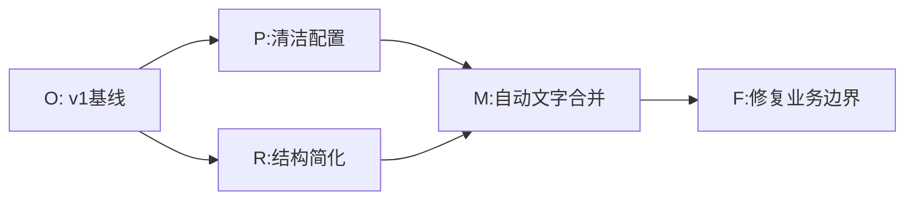
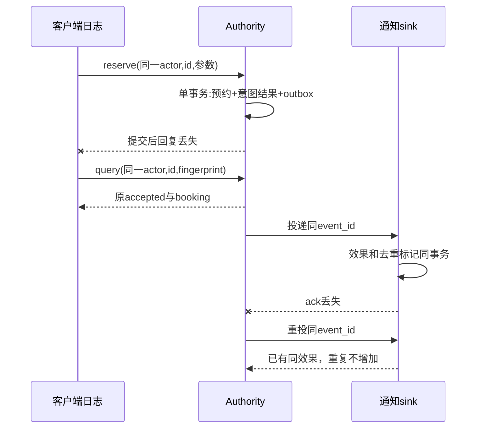

# 版本协作与行为保持演进：别人修改以后，承诺还成立吗？

**读者问题：两个人各自写出通过测试的代码，为什么合并、发布和回退仍可能破坏预约？** 因为一个程序的行为由代码、配置、数据版本和外部效果共同决定。提交保存的是一组字节及其历史；评审要判断的是这些字节在具体条件下是否兑现人的承诺。

本课沿用一个场地、一天、整数分钟半开区间的预约服务。营业时间 `[540,1020)`，预约时长30–120分钟，实际预约须不晚于1020结束。v1允许邻接；v2在每次预约结束后占用10分钟，清洁可以延至1030。所有角色、分歧、发布记录和数据都是合成教学材料。源码、故障开关和Git演练入口在 [[计算机知识/75-软件工程与人机交互/82-v2意图恢复与演进实验|演进实验]]；原来的 `reservation.py` 和v1测试保持可用。

## 提交祖先与语义冲突

Git commit指向内容树和父提交；分支名是可移动的提交引用。两个分支从同一提交分出以后，各自提交不会修改共同祖先。普通merge commit可以有两个父节点，因此不是单一链表。祖先关系让三方合并知道“基线是什么、两边各改了什么”。沿 [[计算机知识/50-数据结构与算法/10-数据结构系统课程/12-持久化版本DAG与分摊分析边界#两种“历史”先分开|版本DAG的主解释]] 画图时，把节点读成提交、边读成父关系；这里没有把Git对象实现说成路径复制BST，也没有把合并后的值交给图算法决定。

箭头表示从父到后代，Git对象实际保存的是指向父的引用。图回答“哪些改动进入M”；它不回答“M允许的结束时间是否正确”。[Pro Git的分支与合并章节](https://git-scm.com/book/en/v2/Git-Branching-Basic-Branching-and-Merging) 可用于核对引用、三方合并与冲突的操作语义。

共同祖先有两个文件。`config.py`给 `OPEN_END=1020, CLEANUP_LIMIT=1020, BUFFER=0`；`service.py`判定 `end <= OPEN_END and end + BUFFER <= CLEANUP_LIMIT`。P把配置改为清洁截止1030、缓冲10，保留营业截止1020；它检查1020接受、1021拒绝。R在v1配置下把判定简化为 `end <= CLEANUP_LIMIT`；在1010–1040的有限整数域它与原式相同。两边改不同文件，Git可以成功合并。

在M中R的简化式读到了P的1030。输入 `end=1021` 被接受，违反“预约不晚于17:00结束”，虽然清洁时间到17:10本身获准。**冲突落在配置依赖与预约截止的需求上**。修复F恢复两个约束，而不是缩回清洁截止。这个结束时间片段只检查R1中的截止子条件；完整预约模型还检查开始、时长和占用，不能把片段的接受当完整预约接受。

文字冲突则是两边都修改同一行 `BUFFER=10`，分别改为15和20。出现冲突标记以后，解决者必须问“批准的政策是什么”；演练仍选择10，保留分支历史和决定理由。删除标记使文件可解析，只完成文字层；还要重新检查政策和下游接口。

读者实际操作演练后，应在 `exercise-result.json` 找到M的两个父提交、1021反例、修复结果和同一行冲突原文，再用 `git log --graph --all` 对照。演练创建一个全新的本地临时仓库，既不代替本项目协作流程，也不产生真实多人讨论证据。

## 一次发布到底是哪组东西

代码提交号不足以复现行为。例如同一R提交搭配v1配置正确，搭配v2配置错误；同一程序在空数据库与存在A/B例外的数据库中也有不同结果。构建记录至少能回答下列对象的对应关系。

| 对象 | 本例具体内容 | 回退影响 |
| --- | --- | --- |
| 源码身份 | 提交及未提交差异，含测试和资源 | 可以恢复旧代码；不能据此恢复旧数据 |
| 构建输入 | Python版本、SQLite库版本、OS；有第三方依赖时含锁定版本和工具链 | 环境改变可能改变兼容性；“只用标准库”不等于环境无差别 |
| 配置与合同 | 营业截止1020、清洁10、协议 `wwl-reservation-v2/1` | 政策改动须经需求与接口验证 |
| 数据模式与写权限 | schema_version=1、writer_epoch、各预约policy_version | 模式版本1不是业务规则v1；epoch也不是客户端UI计数 |
| 外部产物 | 已确认预约、持久意图结果、待通知与通知效果 | 保存已有事实；回退代码不能抹除收到的通知 |

本实验不下载依赖；记录 `python3 --version`、`git --version` 和Python链接的SQLite版本即可辨认实际运行环境。构建输出的可追溯身份是有来源记录，不是已验证逐字节可复现。若要声称可复现构建，应在两个约定环境独立构建并比较所定义的产物；时间戳、资源和工具链也须纳入规则。

## 重构与政策变更的不同预期

先明确可观察行为 `Obs(program,input,state)`：成功或拒绝结果、约定异常及状态变化。结构重构希望在固定合同和前提P内 `Obs(old,x,s)=Obs(new,x,s)`。例如v1的冲突检查可以从区间不等式改为“预约分钟集合是否相交”，但必须保留邻接可接受、失败不写入、快照不随后续操作改变等承诺。只比较返回布尔值会漏掉“失败后偷偷插入记录”。

[[计算机知识/70-编译原理/15-Hoare逻辑循环不变量与终止#2. 部分正确与全正确分别量化什么|Hoare逻辑]] 解释怎样把前提和退出时的后件分开；本课在工程层用它约束重构的观察范围。终止不推出业务正确，两个程序都满足一个宽松后件也不自动推出等价。若变更涉及变量捕获与绑定，应另读其语言语义主解释，不能只按文本替换证明重命名安全。

10分钟缓冲改变合同：`[540,600)`与`[600,630)`在v1可共存，在v2新写入中不行。这是需求变化，不能拿“保持所有v1结果”作验收标准。测试设计分成两组：原 `test_reservation.py` 继续验收v1；`test_reservation_v2.py` 用新占用分钟集合 `[start,end+10)` 给有限oracle，同时测试迁移保留、意图和故障。该oracle独立于实现的两项区间公式；测试设计枚举49对区间，待运行后也只覆盖这个有限域，尚不构成所有时间/故障/输入的证明。预期设计方法复用 [[计算机知识/75-软件工程与人机交互/03-验证测试发布与维护闭环#先独立设计预期，再运行实现|规格独立的验证课]]。

改变规格的追踪链如下，顺着链可回答“这次代码为什么要改”，逆着链可回答“这次失败伤害哪项承诺”。

| 原承诺与新约束 | 设计决定 | 实现与核验 | 对人的含义 |
| --- | --- | --- | --- |
| R1营业时段与时长保持 | 预约≤1020，清洁≤1030 | `valid_interval`，截止反例1021 | 不把清洁例外变成营业延期 |
| R2新写入不相撞，v2增加缓冲 | 检查所有活动记录；保留已确认v1例外 | `compatible_v2`与分钟oracle，A/B/C迁移例 | 旧预约者不被代码静默改时间 |
| R4结果可知道，超时未知 | 稳定意图、指纹、权威查询 | `reserve/query`，提交前/后故障与重开 | 不因回复丢失让人重新预约一次 |
| 通知失败不撤销预约 | 同事务outbox，sink效果去重 | 重投同event_id及丢ack历史 | 通知状态与预约状态分别显示 |

R3创建者取消及权限、R5不收集咨询原因的已有讨论仍适用；新的有限v2实现没有取消操作、认证、咨询原因收集或真实通知通道。不能从这次创建路径推导这些承诺已经上线。

## 从耦合到持久意图的接口

v1的 `Schedule` 维护内存列表，适合观察局部状态性质，进程结束后结果不保留。把网络重试直接放在界面里会出现两种耦合：界面需猜服务器是否提交；通知失败可能被混同为预约失败。v2把最终业务决定放到单一Authority，把界面显示和通知投递分开。

`(actor,intent_id)`标识一次业务意图。actor是合成主体字符串，真实API应从认证上下文取主体；这里不把字符串当身份认证。fingerprint是包含actor、操作reserve、开始、结束、policy_version的规范JSON的SHA256；它用来发现同一意图是否换了参数，**不是MAC、密码或防篡改证明**。intent_id不属于指纹，writer_epoch也不属于指纹：同一业务意图在更新后的合法写者上恢复时，参数意义没有改变。不同语言实现必须使用同一规范化规则；只带名为fingerprint的字段并不证明协议一致。

权威接口只有 `accepted`、`rejected`、`unknown` 三个结果状态。前两者是保存的决定；unknown表示当前查不到已注册决定，不表示已知失败。类型错误 `InvalidInput`、同键异参数 `IntentConflict`、失效写者 `WriterFenced` 是一次调用的协议/权限错误，不能覆盖原先的accepted。请求整形后违反时长或占用规则，则持久记录rejected，重放同一意图继续返回原拒绝；修改时间需要明确创建新的意图。

源码用SQLite `BEGIN IMMEDIATE` 在查意图、检查所有预约、插入预约/意图/outbox到提交之间持有写事务。已有同参数结果先返回，不作第二次决定。根据 [SQLite事务文档](https://www.sqlite.org/lang_transaction.html)，IMMEDIATE会先尝试取得写事务，也可能因别的写者返回busy；模型设置有限等待，数据库错误仍是调用失败而不是业务rejected。它是单机、单文件事务，尚无副本、网络API或故障检测器；不能把顺序双连接测试当真正并发实验，也不能把关闭重开当断电后物理持久证明。

## 混合版本与恢复边界

原 [[计算机知识/75-软件工程与人机交互/02-架构接口权衡与变更影响#10分钟清洁缓冲不是一行代码变更|迁移政策]] 保留A=`[540,600)`、B=`[600,630)`、C=`[650,680)`的原时间与policy_version=1。A/B不符合新缓冲，因为610≤600为假；B/C满足640≤650。迁移选的是已确认v1例外，新写入仍按v2对所有活动预约检查。D=`[630,660)`拒绝，改为新意图D=`[690,720)`接受。系统不能宣称整个旧数据已经满足v2；旧例外需管理员处置，若清洁不可豁免则重新协商，不能让程序替人批准。

`seed_legacy` 是空数据库的一次离线fixture导入：先校验v1格式与冲突，在事务内保存，失败全部回滚；已存在任何预约/意图后拒绝导入。它演示数据状态，不是在线迁移工具。生产迁移还需源数据备份、冻结或双读写策略、源到目标逐项对照、第三态冲突处理；本代码不直接读取并迁移真实旧服务。

写者epoch在元数据中单调增加。运维将2提升到3以后，旧epoch=2或policy_version=1的**新意图**不能写入；已保存的同参数意图仍可查询/重放，返回原epoch下的决定。先阻止旧写入，再回退某个显示层或兼容读者，保留v2数据、意图结果、规则与outbox。该fencing只对经过此Authority的协作写者有效：老程序若绕过API直接改SQLite，字符串epoch不会神奇阻止它，实际部署需收回旧连接/文件写权限或在共同写入层强制检查。

接 [[计算机知识/65-分布式系统/05-分布式事务幂等与端到端失败#同一个业务 ID 穿过四个边界|跨边界意图与失败主解释]]，区分客户端日志、Authority、outbox与sink：下游客户端应将原id、参数与指纹持久保存，重开继续使用；本源码未实现客户端日志。Authority保留决策；outbox保留待投递事实；sink用同event_id及相同payload保存一个效果。模型中event_id仅在一个Authority数据库内唯一，不用于拼接多个服务的事件；下游按不透明值使用。真实邮件商若不能把去重和效果原子绑定，仍可能发两封邮件。ack表示sink确认处理，不证明预约者看见或理解通知。

一条具体恢复历史：epoch2接受D690–720并提交，客户端回复丢失；通知效果成功但ack丢失；运营提高epoch3，回退客户端界面。重开查询D得到同booking id，重投通知不增加教学sink效果；旧epoch2发新意图被fenced；epoch3的新请求720–750因D的10分钟缓冲拒绝，730–760才可接受。能回退的是显示代码；不得删D、原结果或通知事实来制造“回到v1”的表象。删除或取消预约需要独立授权和可观察的新业务动作，本模型没有实现它。

## 可复核评审与团队决定

[Google代码评审指南](https://google.github.io/eng-practices/review/reviewer/looking-for.html) 提醒评审关注设计、复杂度、测试与文档。本课把意见落到可重现输入和合同，不用“看起来更优雅”作结论。以下是模拟作者/评审者材料，**不是实际团队聊天或用户研究**。

| 评审意见 | 作者回应与决定 | 核对证据 |
| --- | --- | --- |
| “简化结束检查只有在两个截止相同才等价；1021在合并配置被错误接受” | 接受，恢复独立营业限制；R提交可保留历史但不单独上线 | Git语义冲突输入与修复前后结果 |
| “提交后再插意图会在崩溃后重复创建” | 接受，预约、意图结果、outbox用同事务提交 | 提交前故障无部分状态，提交后故障可重放 |
| “同id异参数显示拒绝会覆盖用户已确认预约” | 接受，IntentConflict独立于原业务结果，UI保留原记录 | 同key改参数后原accepted不变 |
| “加一个bool通知已发送就足够去重” | 部分接受；须说明副作用与标记原子性。这里限定论证SQLite教学sink的效果与去重原子记录条件 | sink重启、丢ack与重投；真实邮件待外部协议 |
| “两连接测试已证明所有并发和持久性” | 拒绝此结论；现有两连接调用是顺序历史，需另做受控两进程竞争 | 单独记录实验范围；不外推断电/分布式 |

模拟决策记录：问题是清洁政策与失败恢复；选择模块化单体Authority及事务outbox；理由是一个场地的冲突决定需一致，分离通知重试有价值，拆出独立预约微服务增加协调而未解除该一致性责任。代价是单SQLite写者串行、可用性随单机、API中携带协议版本；评审后的发布条件包括保留v1例外、禁止旧写入、失联界面保持unknown。若下节负载或独立团队要求改变，此选择需重审。

技术债不是自动坏事：保留兼容读者与v1例外可减少立即破坏，但必须记录理由、受影响群体、偿还触发与负责者。此例的触发是旧预约清单结束或政策责任者确认替代安排；不能永远保留一个无人检查的“TODO”，也不能在数据尚存时删除兼容读路径。

## 可观察运行目标与迁移题

SLI是量的口径，SLO是其目标。对本服务可设计“成功恢复比例”：分母是窗口内参数合法、具有客户端持久意图的恢复尝试，分子是在限定时间内得到权威accepted/rejected的尝试；另报仍unknown和参数冲突，避免只挑成功记录。业务冲突rejected可以是正确响应，不应一概算服务不可用。再设计客户端从点击到确定结果的延迟分布、outbox最老事件年龄和错误旧写入数。比如“30天内99%的恢复尝试在2秒内确定”只是**假设讨论目标**，本实验没有网络或30天数据，不能填达标。口径/目标区分及尾延迟问题参照 [SRE服务水平目标章节](https://sre.google/sre-book/service-level-objectives/)。

[[计算机知识/35-计算机网络/06-DNS-TLS-HTTP与端到端请求|网络端到端请求]] 给出客户端、网络与服务器路径；从这一路径理解为什么服务端提交耗时不包含UI阻塞、DNS/TLS或回复丢失。系统测到100ms事务只回答事务耗时，不能替代“用户知道结果”。在没有客户端采样时说明代理量和遗漏，保留请求关联id而不记录咨询原因。

**迁移题一：两个开发者增加到八个、两个客户端版本并存，是否立即拆微服务？** 完整答案：先确认是否有独立发布/责任边界。预约的唯一冲突决定仍归Authority，通知可独立消费outbox；增加合同测试、接口版本与评审责任、兼容读者和灰度环节。团队人数本身不使两边同时写正确。若独立团队需要单独部署通知，拆出通知工作者的收益明确；把最终决定拆两份却没有一致性协议会产生双预约。

**迁移题二：从几十请求变为高峰每秒数千，SLO升为短时失机也需确认，能否继续使用本代码？** 完整答案：先量队列、锁等待、unknown比例与尾延迟；这里没有负载测量，不能声称某吞吐。缓存或多worker不能绕过原子检查。可将Authority移到支持目标并发/复制的共同事务层，但需重新验证隔离、故障和写者fencing，保持意图协议；复制恢复还需明确RPO/RTO及未确认结果。旧例外、用户授权和通知效果不会因换数据库消失。

**迁移题三：意图记录占用空间，删除七天前记录是否安全？** 完整答案：本模型永久保存记录。若删除后旧客户端重投同id，可能再次创建；业务预约还在只会阻止部分冲突，不能证明不会重做别种副作用。线上保留期限须由离线恢复窗口、客户端兼容窗口、归档查询或明确过期拒绝合同共同规定，测试过期和旧备份恢复；本课没有给出安全TTL实现。

恢复后的独立执行按冻结源码完成22项单测、默认JSON演示和真实临时仓库Git演练；v1原实现/重构的完整行为trace，以及同意图、相冲突意图和两种fence顺序等五组受控双进程结果分别保存。[[计算机知识/75-软件工程与人机交互/运行证据/2026-10-10-intent-evolution/README|本版实际输入、原始结果与复现入口]]列明事务顺序、初次初始化锁失败和计时器拒绝；指定顺序不证明所有交错，也不认证网络/SLO或真人迁移理解。旧稿实跑日志未随完整包恢复，本轮不以其代替这些新结果。

完成本课的检查是：能画提交父图、给1021的合并反例、区别v1等价与v2变更、用同意图恢复丢回复、解释为什么旧写入要fence，以及在新条件下重新给有证据的设计决定。程序运行、Obsidian显示、真实团队互动与真人迁移理解是各自证据；合成演练与模型测试只支撑这里明确的范围。
