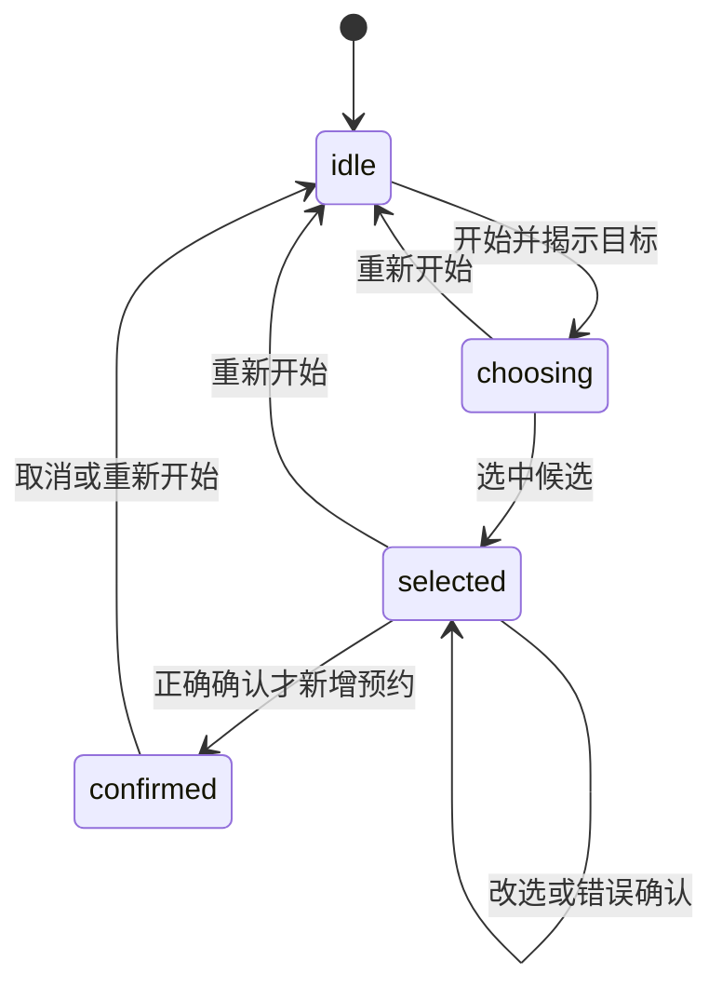
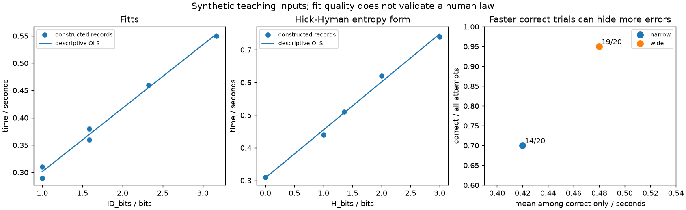

# 感知、注意、指向与选择：把设计模型放回任务和证据

**读者问题：按钮更大、选项更少、反馈更醒目，就一定更好用吗？** 这三个改动针对不同瓶颈：看清与解释状态、把指针移到目标、在刺激与响应间选择。把它们统称“认知负荷”，再用一张模拟曲线宣布胜利，只是给偏好穿了一件实验服。

[[计算机知识/75-软件工程与人机交互/06-认知模型用户研究与比较评价|06课]]已建立外部记忆线索、中性任务、配对/顺序/退出和条件区间。本课接完剩余链：感知与注意怎样给出可推翻预测；心理模型如何与真实状态相抵牾；指向与选择的经验关系怎样计算；研究与评价方法怎样互补。原五条模拟计数、旧原型及81不重做。

## 看得见、被注意和被理解，是三个问题

感知涉及从输入中辨认对象和关系；注意是在目标与环境影响下选择处理什么；理解还需要把线索映射到任务意义。高对比文字可能更容易辨认，仍可能在视野边缘被忽略；红色引起注目，也可能被误解为“已占用”而非“已选择”。靠近、相似、对齐可帮助组织选项，但把不同状态画得很相似也会造成错误分组。它们是设计预测的根据，不是跨人群无条件的成功开关。

具体到时段任务：开始一轮后，参与者看到“请选择600–630分钟，选中后确认创建”。按钮描边与`aria-pressed`表示**当前选中**；只有确认成功后活动列表才增加预约2。这里要检验的是“是否能找到并解释这两个阶段”，不能只统计按钮被点击。

[MIT Visibility讲义PDF第4–11页](https://ocw.mit.edu/courses/6-831-user-interface-design-and-implementation-spring-2011/a6b07e952da55deae19d4b13fdd98d8c_MIT6_831S11_lec03.pdf)讨论动作、状态、反馈及注意位置。其spotlight是有用简化，不应读成神经系统永远只能处理单一通道；DOM焦点、眼睛朝向与实际注意也不是同一个量。本课不把“内容在屏幕里”代填为“人看见了”。

### 一个能复算的反例：醒目可能只改善第一关

令$N$表示注意到新反馈，$C$表示正确理解新反馈。概率恒等式是

$$P(N\cap C)=P(N)P(C\mid N).$$

构造材料设普通提示$P(N)=0.90,P(C\mid N)=0.80$，交集为0.72；醒目但含糊的提示设0.98与0.60，交集反降为0.588。这是**自选参数的条件概率例子**，没有估计真实注意概率。总体正确率还需加$P(\neg N)P(C\mid\neg N)$，例如人可能凭先前经验或另一通道答对；只有额外规定未注意就不可能正确，交集才等于总体正确。故“更醒目”不充分推出“更正确”，也不能从这个反例反推某色彩一定有害。

实际可推翻预测：在同任务和提示内容下，把新状态置于当前操作附近并持续呈现，可能减少漏报；需记录参与者何时获知、怎样解释及误报，不用模型猜的眼动代替观察。若只把提示文字由“已选择”改成“尚未创建，请确认”，测的是**语义反馈**，不能把改善归为纯视觉注意。

### 对比度有技术计算，人仍有情境

编码颜色先变线性相对亮度再求对比，不能直接拿8bit灰度相除。[W3C 1.4.3说明的定义](https://www.w3.org/WAI/WCAG22/Understanding/contrast-minimum.html#dfn-relative-luminance)给sRGB反传递函数和$L=0.2126R+0.7152G+0.0722B$；对比为$(L_{\rm bright}+0.05)/(L_{\rm dark}+0.05)$，无量纲。黑对白为21；`#777777`对白实际约4.47809，不能四舍五入成4.5后声称满足普通小文本的4.5:1阈值。阈值有文本类型、大小与例外条件，不是整页AA认证。

色彩数值与显示编码的主解释仍在[[计算机知识/60-数据编码与媒体系统/05-图像表示色彩空间采样与图像编码#2. 线性光与 gamma 编码值|媒体色彩课]]。对比计算不测真实屏幕亮度、眩光、视力或阅读理解；颜色以外仍要有文字/状态、键盘可达与适当辅助技术接口。没有物理标定和参与者，不能宣称实测视觉改善。

## 心理模型要预测下一步，不是给用户贴标签

心理模型是人对“对象、状态和操作后果”的可用解释；不要求了解实现细节。界面给出的线索可以支持或误导该解释。[MIT Learnability讲义第16–20页](https://ocw.mit.edu/courses/6-831-user-interface-design-and-implementation-spring-2011/c74391b4bc3e58e025b317b61ef5a0ef_MIT6_831S11_lec02.pdf)区分系统、界面与用户理解，给出模型错位的例子。

本例至少存在两个竞争模型：“选中一个时段就已预约”和“选中是草稿，确认才创建”。它们在按钮高亮时作出不同预测：关闭页面后前者预计预约仍在，后者预计没有。实际本地材料刷新全部复位；这又与真实持久服务不同，所以研究任务不能借它认证真实预约保存。提问应是“你认为此刻系统里有哪些预约？接下来做什么会改变它们？”，不诱导“你知道还没创建吧”。

颜色高亮只对应`selected`，不是创建事实。代码禁止未选择便确认，错误目标确认不创建且回焦所选项；正确确认只新增一次，取消只释放新预约。两种提示`brief`与`explicit`的业务状态相同：前者选中后仅写“已选择”，后者补时段、尚未创建和确认提示。预测可以是后者减少阶段误解；另一代价是文字更长、播报成本增加。此处不预先宣布赢家。

**检验模型，而非责备“不会用”的人。** 若参与者正确复述两阶段，却误点邻项，问题可能在指向而不是心理模型；若指向准确但把“选择”当“提交”，扩大按钮没有修复概念错位。若只能在主持人反复提醒后正确复述，也不能记作无帮助理解。

## 指向模型：距离和沿运动方向的容许宽度

考虑一维、快速、有目标的指向任务，距离$D\ge0$、目标宽度$W>0$使用**同一长度单位**。采用Fitts的Shannon形式

$$ID=\log_2(1+D/W),\qquad MT=a+b\,ID.$$

$ID$以bit计，$MT,a$为秒，$b$为秒/bit。它是条件化的经验模型；信息论类比不等于从香农定理证明所有人的运动。原始Fitts形式为$\log_2(2D/W)$，与这里不同。[MacKenzie 1992 §3.3–3.4](https://www.yorku.ca/mack/hci1992.html)说明变式与误差处理，系数须由适当任务数据拟合。

一个反馈修正的**直觉模型**是每轮把剩余误差乘$0<r<1$，直到$Dr^k\le W/2$。当$2D/W>1$时，$k\ge\log(2D/W)/\log(1/r)$；若每轮近似固定时间，出现对数趋势。这依赖几何衰减、固定周期等假设，不是Shannon形式的完整生理推导，也不保证极端小距离、拖拽、路径跟随、眼动或触屏可搬同一参数。

| 构造条件 | D / CSS px | W / CSS px | ID / bit | 声明a=.18、b=.12的预测 / 秒 |
| --- | ---: | ---: | ---: | ---: |
| 距离与宽度相同 | 64 | 64 | 1 | .3000 |
| 距离加倍 | 128 | 64 | 1.584963 | .370196 |
| 再加倍 | 256 | 64 | 2.321928 | .458631 |
| 在D=256扩大W | 256 | 128 | 1.584963 | .370196 |

同比例放大D和W，ID不变；只把W翻倍通常降低ID，但对Shannon形式下降不恒等于1bit。CSS px是本材料的布局单位，不是屏幕物理毫米；改变缩放、像素密度、姿势、设备增益或触控方式，系数和可用性都可能变。本机模拟鼠标点中心不是人的运动表现。

矩形按钮横向宽128、高44：**水平接近**时可以把横向128作为本一维例的W；垂直接近不能仍搬128，斜向还需选定二维模型或记录实际几何，不能随便取面积开根号。新原型首目标与开始按钮的DOM中心等高，自动程序从中心注入pointer事件；真实人的起点不被DOM焦点固定。脚本分别记录DOM中心与实际事件坐标，允许1 CSS px事件量化；真实用户若不沿声明轴，就不能套这一维条件。

[MacKenzie 2018 “Adjustment for Accuracy”](https://www.yorku.ca/mack/hhci2018.html)讨论由端点散布估有效宽度，例如在相应约定下$W_e=4.133s_x$。本轮没有真实端点分布，不计算人的$W_e$或设备吞吐率；也不能把自动中心点击的零误差当人体精度。窄目标正确试次均时.42秒、14/20正确，宽目标.48秒、19/20正确的另一组**构造反例**说明：只报正确者更快会遮住错误。任务选择还要考虑误选后果、纠正时间和完成分母。

## 选择模型：选项数不是唯一的不确定性

设一个已练习的刺激—响应任务，目标$j$以声明概率$p_j$出现，$\sum p_j=1$。信息论对象是

$$H(p)=-\sum_{j:p_j>0}p_j\log_2p_j,\qquad RT=a_c+b_cH(p).$$

概率无量纲，$H$为bit，$RT,a_c$为秒，$b_c$为秒/bit。后一式是本课选用的Hick–Hyman熵形式，要求考虑练习、刺激概率与映射兼容性等条件；不是从熵定义推出人的反应时间。[MIT Efficiency讲义PDF第12–13页](https://ocw.mit.edu/courses/6-831-user-interface-design-and-implementation-spring-2011/821f3aa658f9ea1ebcd06dafe7a5251d_MIT6_831S11_lec04.pdf)明确其技能与预期概率条件。

等概率$n$项时，$H=-n(1/n)\log_2(1/n)=\log_2 n$。选$a_c=.30,b_c=.15$的教学参数：1、2、4、8项得到.30、.45、.60、.75秒；一项并非0秒，因为截距仍在。4项不等概率$(.7,.1,.1,.1)$的熵约1.356780，预测.503517秒，低于4项等概率的.60；这不是建议把用户困在常用选项里。

若另选经验拟合形式$a'+b'\log_2(n+1)$，需单独声明模型。它与本课$H=\log_2n$不是恒等式，4项分别是2.321928与2bit；系数及任务不能跨形式直接抄。也不能无依据地给真实菜单增添一个“第n+1个不选”概率来修公式。信息熵定义复用[[数学/50-信息论/01-熵交叉熵KL散度与互信息#3. 熵：来源分布自身的平均不确定性|来源分布自身的熵]]，回来固定目标概率与响应；HCI负责说明行为适用条件，不以bit单位装成心理机制证明。

真实预约偏好、陌生选项文字搜索、取消风险或法律权衡，都可能超出简单技能响应。新原型中URL给定目标；若一轮又一轮永远`target=0`，熟悉后目标不确定性可趋0，尽管页面还显示8项。**本机只核选项数、目标提示和状态，不证明操纵了人的H。** 要研究选择，需要预先声明目标序列/概率与练习映射，不能从按钮数量倒推出人脑输入熵。

### 拟合优良，为什么仍不能认证模型

`model-inputs.json`固定6条Fitts构造时间和5条选择构造时间；保留了小的人工扰动，未冒真人。普通最小二乘以

$$\hat b=\frac{\sum(x_i-\bar x)(y_i-\bar y)}{\sum(x_i-\bar x)^2},\quad\hat a=\bar y-\hat b\bar x$$

拟合描述直线，算残差、SSE与$R^2$。Fitts得到约$a=.185327,b=.116119$，$R^2=.990766$；选择得到$a_c=.307830,b_c=.146919$，$R^2=.994124$。拟合恢复的是构造规律及扰动。把按公式制造的点再拟回公式，不会让公式额外长出一个受试者。

描述性OLS本身可以产负斜率/负截距，不自动满足行为预测条件；源码`predict`另限定本教学声明参数非负，不是让回归悄悄裁剪。若真数据出现负拟合或外推负时间，应查区间、误差、任务和模型，不能当人体越远越快的发现。样本内高$R^2$也不认证外推：同$D=256,W=64$，另选设备参数$a=.30,b=.25$得.880482秒，远非本教学参数的.458631。这仍是换条件的构造，不是另一个设备实测。

不能把$RT+MT$随意写成全程时间。感知、决策与运动可能部分重叠，验证、滚动、错误恢复和网络等待还未计入。原型的`elapsed_from_start_ms`从揭示目标到选中，混合搜索、判断与运动；没有独立的移动开始测量，**既不是纯MT也不是纯RT**，更不是人的实际记录。回归推断和独立单位继续用[[计算机知识/75-软件工程与人机交互/06-认知模型用户研究与比较评价#固定先A后B，界面效果与练习怎样纠缠|06的顺序与配对]]，不拿浏览器事件数当样本量。

## 同一个问题，研究方法怎样各司其职

现在问题具体为：“人为什么把选中当成已预约，扩大目标或减少选项能解决吗？”以下方法不是同一维度的互斥菜单：出声思考是记录技术，形成性是研究目的，控制比较是设计；它们可组合，但组合改变证据与干扰。

| 方法 | 在本任务实际怎么用 | 得到什么，不能得到什么 |
| --- | --- | --- |
| 半结构访谈 | 完成后问“哪一步让你觉得预约建立？若刷新会怎样？”追问具体经历 | 得自报解释与词汇；不能把回忆当逐秒行为或因果效果 |
| 情境观察 | 在获准真实工作环境观察中断、设备和代办关系，分栏记录原情境与解释 | 得真实约束与任务变化；被观察反应、隐私和非代表招募仍在，不等于随机效应 |
| 问卷 | 问“刚才我能区分已选与已创建”并给有序同意选项、无法判断/不愿回答 | 得主观分布；单自编条目非验证量表，满意与正确创建不同 |
| 任务分析 | 目标→开始、读指定时段、选择、确认、查结果；错误返回选择 | 得前提、子目标和计划；分析者路径不等于人已理解 |
| 原型迭代 | 先纸面查阶段概念，再代码查键盘、几何与反馈；按问题选择保真维度 | 纸面不能测真实hitbox/播报/延迟；代码本地也不能测生产并发 |
| 启发式检查 | 按状态可见、用户词汇、错误恢复等原则逐处列风险与正例 | 得有根据的专家预测；严重性/发生频率不能靠作者打分变实测 |
| 认知走查 | 固定新手背景与动作序列，逐步问目标、能否发现、能否对应、能否理解反馈 | 得探索学习路径的具体风险；仍非真人成功率 |
| 出声思考的形成性任务 | 中性任务，记动作和原话分开，困住时先记独立失败再帮助 | 能找误解并修订；发声/主持影响时间，不随便当静默比较 |
| 控制比较 | 独立安排宽度、选项概率或文字条件，事先定指标/顺序/缺失 | 在设计假设内比较；不能同时改三处却只归因于某一模型 |

任务与问法复用[[社会科学/10-共同工具/05-测量抽样与调查设计#构念到指标：先决定遗漏什么，再写问题|构念—指标—问法主解释]]；招募、帮助与退出复用06真人任务包。方法不是“随便挑一种跑个百分比”，而是从不确定性选能使替代解释分开的证据。

### 访谈、情境与问卷，怎样互相纠偏

先在观察表写“选中后停下，未点确认”，不要直接填“注意力差”。访谈追问其解释；如果回答“以为已预约”，仍需核这是当时判断还是事后迎合。情境观察可能发现他被电话打断，界面不是唯一原因。问卷若问“改进版是否明显更清楚”已把期望塞进问题；可改成上表中性条目，再与阶段判断的行为对照。Likert单项的1–5只编码顺序，不自动是等距心理量；本课不计算一个伪精密平均满意度来替代正确率。

还可用参与者复述任务及平时术语，核“预约/选择/确认”是否同义。访谈录音需许可；未许可则记录缺漏，不补造原话。本轮这些真实访谈、情境、问卷全部未执行；[[计算机知识/_labs/hci_target_choice/方法对照与真人接口|方法对照包]]给可执行脚本、记录栏和失败判据，而不是待办平台。

### 启发式检查与认知走查，具体看什么不同

启发式检查先独立列问题/证据，再讨论影响与修订；例如brief提示“已选择”是否容易与创建混淆，confirm控件是否有明确名称，选错后是否有恢复路径。保留“活动列表直到确认才变”的正例。多个独立检查者可发现不同问题，数量没有保证覆盖所有问题的魔法；本轮作者与独核检查的是材料，不冒充多名典型用户。[MIT Heuristic evaluation讲义第10–18页](https://ocw.mit.edu/courses/6-831-user-interface-design-and-implementation-spring-2011/1851746ae1e6b86d4143c4cd9fe4f264_MIT6_831S11_lec23.pdf)区分检查与用户观察。

认知走查沿一条明确路径，每一步检查四件事。以第一次用该服务、懂分钟单位的人为**假设画像**：

| 动作 | 会形成这个子目标吗 | 能发现动作吗 | 能把动作关联到目标吗 | 之后如何知道结果 |
| --- | --- | --- | --- | --- |
| 开始一轮 | 是否知道任务尚未揭示 | “开始一轮”是可聚焦按钮 | 说明它揭示指定时段 | 目标文字出现、仍未创建 |
| 选择指定时段 | 是否读懂分钟与范围 | 候选文字与键盘顺序 | 目标时段与候选标签能匹配吗 | 描边/pressed及brief或explicit提示；风险是误认创建 |
| 确认创建 | 是否还认为需要提交 | 可达且启用的“确认创建” | 确认的是哪个时段 | 错选明确未创建，正确出现id2与区间 |
| 查结果或取消 | 是否需要核对/撤销 | 活动列表与“取消预约2” | 仅取消新预约，不是清草稿 | 列表恢复已有预约，状态说明释放 |

这里的疑问是预测，不是假装每位新手都失败。完整问题/回答依据可对照[同讲义第20页的认知走查](https://ocw.mit.edu/courses/6-831-user-interface-design-and-implementation-spring-2011/1851746ae1e6b86d4143c4cd9fe4f264_MIT6_831S11_lec23.pdf)。若该人不会换算分钟，应先修任务前提；不能在判断隐藏确认按钮时暗中给他专家知识。

### 怎样从发现走到修订和比较

`method-records.json`保留**构造示范**：M1选中后说“已经有了”并停止；M2看见明确“尚未创建”后找确认。这两条有不同构造人物、无真实时间，不能当AB因果效果。它们使“阶段误解”成为待检解释；也保留M3在明确文字下仍错选目标、随后恢复的构造反例。只把提示写长可能解决第一类，不能替代指向与辨认。

据此保留brief/explicit两种语义反馈，先实际核相同业务和键盘、AX与几何；再用任务包做首见任务研究。若比较字面含义，尽量用首次接触的分组，或明确记录先见explicit对brief的学习迁移；AB/BA不消除所有carryover。想比较W则保持n、target和cue；想研究选择不确定性则预定均匀目标序列、练习映射并考虑搜索和运动混合。不要在看到结果后才挑有利指标。

本机软件复评能够排除“B实际上替人自动提交”之类操纵失效；不能排除人的熟悉度、视觉理解与主持影响。原06已经给完整配对与退出反例，本课沿用，不制造第二套研究统计。伦理与包容性决策还要带回[[计算机知识/75-软件工程与人机交互/05-职业伦理利益相关者与责任判断|利益相关者课]]：节省几百毫秒不自动压倒误预约风险、键盘用户排斥或隐私。

## 本机实验和真人接口各支持什么

[[计算机知识/_labs/hci_target_choice/README|完整实践入口]]保留固定输入、模型JSON/图、测试、原型和真实浏览器输出。原型只实现任务提示、选择、正确/错误确认与取消；没有真实预约持久、并发或网络。`width=64/128,n=2/4/8,cue=brief/explicit,target=合法索引`必须显式给出，非法配置关闭任务。模型输入的time字段全部构造；浏览器记录是自动操作的软件事件，不转成真人RT/MT。

高影响验证包括：W实际hitbox而非只改视觉边框；选项n确实改变且目标合法；cue只改语义不改创建规则；选中与创建不混淆、错误不新建、键盘与恢复可达；模型变量/概率/单位和拒绝路径正确。软件过关不是认知效果过关。新人的任务理解、真实读屏输出、手部运动与现场中断均为高重要性但**当前0真人、0实测读屏/实体键盘、无物理视觉/运动标定**；接口已具体到流程和字段，不以缺人作为方法教学无法验收的理由。

## 迁移题与完整答案

1. **字体灰色对比算出4.478，四舍五入显示4.5能通过吗？** 对本普通小文本4.5阈值不能；判据用未舍入值。也不能由对比通过推出注意、理解或整页AA。
2. **N概率升高是否必然提高总体正确？** 不必然。需同时考虑条件理解及未注意分支；本构造交集.72→.588已给反例，总体还需另一分支。
3. **水平按钮宽128高44，改成从下方接近仍用128算ID吗？** 不应；一维例要用沿接近轴的容许宽度，垂直相应看44，斜向另定模型。DOM焦点不能固定手或鼠标起点。
4. **D与W都加倍，模型预测怎样？宽度单独翻倍呢？** 同倍率保持D/W与ID；单增W降低ID但Shannon形式通常不恰好少1bit。变设备/缩放后不能保证同系数或实际同时间。
5. **8个候选每次都是第一个目标，能宣布H=3bit吗？** 不能。熟悉固定目标的先验可集中到第一项；只有声明并实现相应概率/练习条件才可把等概率熵作为任务输入。本页默认一次目标不提供该证据。
6. **4项熵公式和log2(n+1)只差写法吗？** 不同；等概率熵2，log2(5)约2.321928，需各自拟合与适用条件，不能直接互换a/b。
7. **拟合R²=.99，说明真实人的模型已验证？** 不说明。本材料时间由人构造；高拟合只描述这些点。需要另有适当实际任务数据、误差、外推检验与模型假设，不能把自动点击时间当人。
8. **检查者预测确认按钮难找，问卷说清楚，任务里多人停在选择阶段，信谁？** 三者对象不同。保留专家预测、自报和动作证据；核人是否看到/理解目标及主持影响。依据任务与状态误解设计修订，再复评；不以满意票数取消行为失败。
9. **窄目标正确均时.42、宽目标.48，选窄版吗？** 先看14/20与19/20、恢复成本和误预约损害；正确试次条件均值不能单独裁决。键盘/读屏条件的指向模型可能根本不适用，需对应任务指标。
10. **纸面原型上确认流程顺畅，是否可省真实浏览器？** 不能据此认证hitbox、键盘、焦点、实际播报或延迟；纸面用于概念/流程问题，代码用于相关实施问题，真实用户与设备再回答体验层问题。

本课与06、04及05共同覆盖#173原认知模型、研究设计和评价推断范围；结项应由独立审阅按原scope逐项判断。一般人因学全集、全部生理机制、真人招募、生产预约平台与所有设备认证不自动成为新增门槛。返回[[计算机知识/75-软件工程与人机交互/00-软件工程与人机交互-MOC|课程入口]]，从未理解的环节选择下一种证据。
