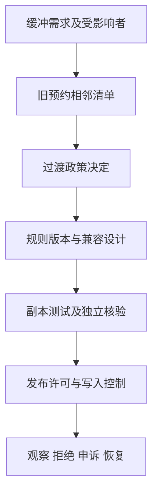

# 一个预约服务的需求到维护案例：交付一次可解释的变更

**读者问题：如何把需求、架构、测试、交互与伦理连成一次可复核的交付，而不只是各写一张表？** 本案例的任务是“为预约结束后的10分钟清洁缓冲提出v2，并保护已确认的v1预约”。所有角色、事件与记录均为合成练习；未进行真实团队协作、客户验收或生产部署。

## v1先取得一条完整证据链

v1规则在[[计算机知识/75-软件工程与人机交互/01-从问题到需求规格与验收|需求课]]，无需重定义：整数分钟、当天营业范围、30–120分钟半开区间，活动预约不冲突，只有创建者取消。教学运行方式：进入本页目录，执行下列命令；没有依赖安装和网络访问。

```bash
python3 -B -m unittest -v test_reservation.py
python3 -B reservation.py
```

再用浏览器打开[本地交互原型](reservation-prototype.html)，创建09:00–10:00（540–600），尝试09:30–10:30（570–630），应拒绝；创建10:00–10:30（600–630），应通过；取消第一条后，09:00–10:00可再次预约。刷新丢失全部记录是明确的内存边界。模型输出和原型反馈是不同实现，需对同一规则单独验收。

| 需求 | 设计责任 | 当前证据与限度 |
| --- | --- | --- |
| 区间合法且不重叠 | 顺序模型校验；生产中预约事务作最终决定 | 单测及有限oracle；未做数据库并发 |
| 本人取消与重复取消 | 模型按actor检查；生产从认证会话取actor | 单测；actor字符串不是安全认证 |
| 冲突能恢复 | 保留输入、明确未创建、原生键盘控件 | HTML实现及核查步骤；人的任务验收未做 |
| 最少数据 | 无咨询原因字段，不用数据排序 | 设计审阅；没有生产日志或数据库 |
| 结果不确定能确认 | API意图幂等键与结果查询 | 原v1及原型没有网络路径；新增SQLite意图合同与恢复候选见v2实验，当前未运行 |



## 手算v2影响，并把政策冲突交给负责者

旧数据有A=`[540,600)`、B=`[600,630)`、C=`[650,680)`。v1均可共存；v2要求前一预约结束加10不超过后一开始。A/B需`610≤600`，不成立；B/C需`640≤650`，成立。因此不能只开缓冲开关宣称旧数据全部有效，也不应自行把B推迟10分钟；B可能有固定交通安排。

候选方案一是联系受影响者并协商调整，保留原确认与通知；方案二是旧预约标v1例外，由管理员提供临时清洁安排，新写入按v2检查所有活动记录。本案例选择方案二作为过渡，公开记录A/B不满足缓冲，限制持续时间并安排重审。不是让程序自动决定谁应牺牲时间。若清洁具有不可豁免的安全要求，方案二不能通过，必须由有权者重新安排并妥善通知。

新请求D=`[630,660)`：与B需要`630+10≤630`，不成立；与C也重叠，所以拒绝。D改为`[690,720)`时，C结束680，加10等于690，通过。清洁允许到17:10的例外由v2明确；原预约仍须17:00前结束。这些是手算预期，课内v1代码**尚未实现v2**。

## 一份能让另一人接手的交接

需求负责人给出规则版本与过渡批准，并登记受影响预约与通知状态；作者给出接口、数据与兼容方案，保持预约和通知责任边界；独立审阅者从规则手算A/B/C/D并设计并发、超时与回滚反例；发布者检查目标与输入版本，先在副本验迁移，保留恢复点，再决定发布。真实团队应由不同人完成沟通与签收，并留下分歧和依据；本页模拟角色分工不能算团队考核完成。

完整发布提案写“v2新写入启用缓冲，v1例外清单仍在处置”，不写“场地完全无冲突”。观察指标至少分开新拒绝、旧例外、失败恢复与申诉，不只看利用率。回滚时保留v2数据及规则版本，关闭新写入或继续由兼容层执行缓冲；不能用忽略版本的旧程序恢复写入。两方案的故障推演详见[[计算机知识/75-软件工程与人机交互/02-架构接口权衡与变更影响|架构课]]。

## 模拟维护事件的完整题解

模拟事件：B预约者点击取消，网页旧请求晚到，又显示B活动。答案分四步：确认服务权威状态及版本；复现“读取先发、取消后发、读取响应最后到”的顺序；客户端丢弃低于已知版本的旧响应或取消其更新权；补组合回归并检查失败反馈/本人取消未破坏。通知副本也应单独核查，不能以网页已修复推出全部渠道已恢复。

**反例与边界。** “代码能禁止A/B新建，所以迁移已完成”遗漏已存在记录；“管理员同意即可”遗漏受影响者的承诺和必要安全要求；“5个模拟用户有4个最终完成”不能推出真实人群80%成功。需要实际研究时沿[[计算机知识/75-软件工程与人机交互/04-交互任务反馈可用性与无障碍|HCI研究设计]]，需要政策理由时沿[[计算机知识/75-软件工程与人机交互/05-职业伦理利益相关者与责任判断|职业伦理分析]]。

本案例完成的是一组可运行v1教学代码、一项本地交互原型、v2手算与交接提案。数据库并发、持久化、网络幂等、v2实现、真实键盘/读屏、访谈、用户测试、团队沟通和生产维护均需各自证据；阅读本页不等于这些工作已完成。

返回 [[计算机知识/75-软件工程与人机交互/00-软件工程与人机交互-MOC|软件工程与人机交互课程入口]]。

## 从变更提案继续到可检查的演进模型

[[计算机知识/75-软件工程与人机交互/07-版本协作与行为保持演进|版本演进课]] 继续本案例的A/B/C过渡政策，将结构重构、配置变更和业务规则变更分开。[[计算机知识/75-软件工程与人机交互/82-v2意图恢复与演进实验|v2演进实验]] 提供唯一业务意图、参数指纹、权威结果、outbox和协作写者fencing接口，以及提交前失败、提交后回复丢失和通知重放的固定输入与预期。它是本机教学候选；本次恢复未运行，不将本案例中的假设团队或发布讨论改写为生产记录。
