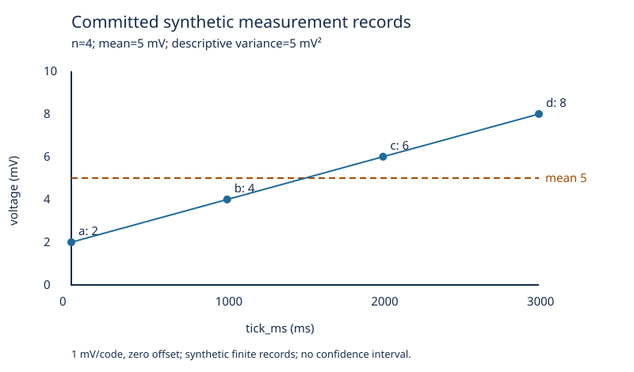

# 测量记录导入与分析

这个 Python 3.11+ 标准库项目把固定测量记录、身份、统计、事务与安装放进同一个可以重做的实验。先读 [[计算机知识/10-编程语言/01-Python/10-系统课程/11-记录流统计与数据语义|记录流与统计语义]]，再读 [[计算机知识/10-编程语言/01-Python/10-系统课程/12-可恢复导入器与安装交付|导入、恢复与安装交付]]。四行数据是教学合成数据，标定为 1 mV/码、零偏置。

## 从一个有限程序开始

在本目录执行 `python3 -B examples/first_record.py`。六项结果依次为 `4, 20, 5, 5, 20/3, 30`；单位、分母与抽样条件见第 11 讲。这个小程序只处理自己的固定输入；外部 CSV 经 `core.read_records` 验证。

## 构建、安装与异目录运行

先确认 `python3 --version` 为 3.11 或以上。以下命令在项目根执行，构建后端 setuptools 是构建依赖，运行时依赖为空；首次构建可能下载后端，环境与软件源按已有 [[计算机知识/10-编程语言/01-Python/08-pip与PyPI依赖管理|pip 主解释]] 选择。

```bash
python3 -m venv .venv
.venv/bin/python -m pip wheel --no-deps --wheel-dir dist .
.venv/bin/python -m pip install --no-deps dist/wwl_measurement_import-0.1.0-py3-none-any.whl
```

记下项目和解释器的绝对路径，将下列示意路径换成自己的实际路径；切换到源码以外的空目录后执行。这一步检验 wheel 安装，而不是靠源码当前目录导入。

```bash
/absolute/project/.venv/bin/wwl-measurements import /absolute/project/data/measurements.csv /absolute/work/run.sqlite
/absolute/project/.venv/bin/wwl-measurements import /absolute/project/data/measurements.csv /absolute/work/run.sqlite
/absolute/project/.venv/bin/wwl-measurements summary /absolute/work/run.sqlite
/absolute/project/.venv/bin/python -B -m unittest discover -s /absolute/project/tests -v
```

首次 `(read,rejected,inserted,duplicates)=(4,0,4,0)`；重放为 `(4,0,0,4)`。汇总来自已提交的库：`n=4,sum_mV=20,mean_mV=5,pvariance_mV2=5,variance_mV2=20/3,rms2_mV2=30`。JSON 中分数以字符串保留精确值。

## 输入与失败合同

`data/measurements.csv` 表头恰为 `sample_id,tick_ms,code`。数值行非法时返回拒绝原因并继续；缺失不补零。表头、UTF-8 解码和 CSV 框架失败时结束输入。身份相同且内容相同跳过；同一身份内容冲突回滚当前批。

`--batch-size 2` 按输入事件分批，拒绝事件也占批位。新记录、重放及拒绝只有在该批完成后进入 `Report`；失败中的批不计入完成计数。`--rejects new.jsonl` 仅新建文件，已有文件会被拒绝。拒绝文件、stdout 与 SQLite 没有共享事务：拒绝文件可能保留后来回滚批的诊断，报告输出失败时数据库可能已经提交，必须查询库并重建报告。

`--dry-run` 在内存库演练，已有库只读备份到内存；不存在的原库不会创建。输出 `inserted=0` 和 `would_insert`，汇总标明假设行集。干跑不接受 `--rejects`，避免额外文件写入。文件/库/拒绝路径不得互相指向同一个文件。

## 当前批回滚与修复重跑

```bash
.venv/bin/python -B examples/recovery.py
```

独立例注入“插入 c 后异常”：第一批 a/b 已提交，第二批 c/d 回滚；关闭后重开同一库仍只见 a/b。修复后重放完整 CSV，新增 c/d、跳过 a/b，最后恰有四个身份。这是本地批事务与重放策略；分布式事件时间、窗口和 exactly-once 继续由 [#172](https://github.com/EunsonZ/WWL/issues/172) 维护。

## 独立复算与可重建图

`tests/test_core.py` 使用固定行集和独立 SQL，检查六项统计、重放、冲突、批回滚和数值边界；`tests/test_cli.py` 检查实际安装包的 CLI、干跑、编码、文件/库失败和资源关闭。

```bash
.venv/bin/python -B examples/plot_committed.py /absolute/work/run.sqlite /absolute/work/measurements.svg
```

绘图脚本只读库内已提交行，标准库生成 SVG 和同名 `.csv` 图源。横轴 `tick_ms (ms)`，纵轴 `voltage (mV)`；均值虚线与样本点分开，不绘制置信区间。`reference/measurements.svg` 与 `reference/measurements.csv` 是固定四行的参考制品，可按上述命令重建。



这张有限数据图把相邻记录连线以帮助阅读，不证明点间连续过程。绘图脚本将选定行集放入列表供排序与画图，其内存随所选数据量增长；它不继承核心导入器仅持有一批的空间承诺。SVG、图源CSV和数据库没有共享事务，图文件输出失败时先查询库内事实，再修复输出目录并重建。

## 撤去提示的迁移题

本题取 a、b、c 三条身份记录（去掉 d），将 b.code 留空、c 重放一次、批大小改为 3。实际输入如下；先写缺失与身份政策，再预测最终行集、统计量和恢复过程，然后运行。第 11 讲练习 3 对这份同样输入给出答案与理由。

```csv
sample_id,tick_ms,code
a,0,2
b,1000,
c,2000,6
c,2000,6
```

额外挑战：已有 a/b 时输入 x 后接 a 的冲突内容，观察 x 是否保留；正确结果是当前批全回滚。

## 本机验证与边界

实际版本、命令、结果和未验层记录在 [VERIFICATION.md](VERIFICATION.md)。核心执行不依赖 NumPy/pandas/Matplotlib；NumPy同数据对照已由第13讲及可选脚本补全；pandas未运行。性能与有界取消实验接第14讲。标准库图已交付，不把本地测试等同于真实仪器精度或真人理解。


## 接着比较科学表示与执行代价

第13讲 [[计算机知识/10-编程语言/01-Python/10-系统课程/13-科学数组与独立统计对照|科学数组与独立统计对照]] 用 `examples/scientific_compare.py` 读取已提交库；已有NumPy时执行，未装时保持标准库主线。第14讲 [[计算机知识/10-编程语言/01-Python/10-系统课程/14-性能观察与有界取消恢复|性能观察与有界取消恢复]] 使用 `benchmark_import.py` 与 `bounded_pipeline.py`，分别观察三类同步负载、Python/进程内存和TaskGroup取消后的提交行集。

本次后续实际环境、运行命令与输出见 [NEXT_VERIFICATION.md](NEXT_VERIFICATION.md)，可检查原始有限观察见 [next-observations.json](reference/next-observations.json)。核心包版本/API未改变；这些例子随课程源码交付，在已安装核心包的解释器中从异目录按绝对路径运行。它们没有成为新的CLI子命令，也没有让核心包默认依赖NumPy。
