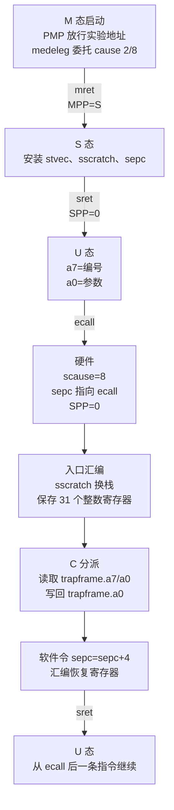
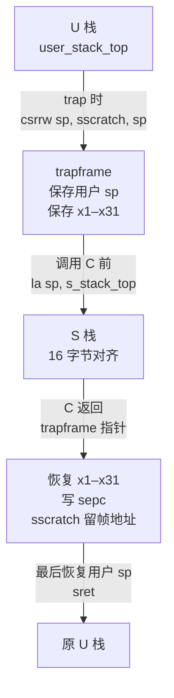

# RISC-V 特权态与系统调用：让一次 `ecall` 真正往返 U/S

这个实验回答一个具体问题：U 态把服务号放进 `a7`、参数放进 `a0` 后执行 `ecall`，处理器和 S 态软件分别做了什么，才能让返回值再次出现在 U 态的 `a0`？它构建一个真正的 RV64 ELF，在 QEMU `virt` 的系统仿真中从 M 态启动，经 `mret` 到 S 态，再经 `sret` 到 U 态。U 态的 `ecall` 和越权读取 `sstatus` 都由硬件形成 trap，S 态入口保存寄存器、读取 `scause/sepc/stval`、分派并恢复，不是 Python 状态模型。

先读 [[计算机知识/30-计算机系统/08-异常中断系统调用与特权级|概念课]]，那里区分 ISA 的受控入口机制和 OS 的系统调用 ABI；本目录只把这一区分落到一条最小可运行路径。想理解进程、IPC 和阻塞语义，再回到 [[计算机知识/20-操作系统/02-操作系统原理/10-系统课程/02-系统调用IPC与进程生命周期|系统调用、IPC 与进程生命周期]]；想理解真实地址空间隔离，读 [[计算机知识/20-操作系统/02-操作系统原理/10-系统课程/09-页表写时复制与TLB失效|页表、CoW 与 TLB 失效]]。本实验没有把这些章节复制进来。

## 先看完整往返



硬件没有替内核保存所有通用寄存器，也没有替内核查系统调用表。硬件把原因和返回位置写进 S 态 CSR，并按 `stvec` 转移；入口汇编再把用户整数寄存器保存到 `trapframe`。本实验定义的教学 ABI 才规定 `a7` 是编号、`a0` 是首参数兼返回值。编号 1 的服务计算 `a0+1`：输入 41，返回 42。

对于本实验固定的 `rv64im_zicsr` 目标，`ecall` 是 4 字节指令。成功识别 `scause=8` 后，S 态软件显式计算

$$
\mathrm{sepc}_{\text{return}}=\mathrm{sepc}_{\text{ecall}}+4,
$$

再由 `sret` 把 PC 取自 `sepc`。这个“加 4”属于已识别的 `ecall` 路径，不能推广成“所有异常都跳过 4 字节”：缺页通常要修复后重试；未知非法指令通常也不能盲跳。受控非法 CSR 探针为何可跳，见 [[计算机知识/80-实践/06-计算机系统/09-RISC-V特权态与系统调用/02-系统调用与非法特权指令怎么分流|系统调用与非法特权指令怎么分流]]。

## 寄存器帧与两次换栈

`trapframe.h` 是 C 结构真源，`trapframe_offsets.h` 是汇编偏移真源；C 的 `_Static_assert` 会让二者一旦错位就编译失败。帧覆盖 `ra/sp/gp/tp`、`t0–t6`、`s0–s11`、`a0–a7`，并附加 `sepc/scause/stval`。U 态返回后把 31 个整数寄存器逐项写入 `user_snapshot`，下一次系统调用由 S 态逐项核对；只有返回寄存器 `a0` 按 ABI 从 41 改为 42。



入口先用 `csrrw` 交换 `sp/sscratch`，因此在还没有可用临时寄存器时也不会丢掉用户 `sp`；保存完用户寄存器才切到独立 S 栈调用 C。返回时反向恢复，最后才恢复用户 `sp`。逐指令说明见 [[计算机知识/80-实践/06-计算机系统/09-RISC-V特权态与系统调用/01-从ecall到sret的逐指令路径|从 ecall 到 sret 的逐指令路径]]。

## 构建并运行

只需 Python 3 标准库、支持 RISC-V 目标的 Clang、`ld.lld` 和 `qemu-system-riscv64`。不需要 `make`，不接受 Xcode 许可，不安装依赖。构建产物默认进入系统临时目录并在成功或失败后清理；传 `--out-dir` 才会保留，而且该目录必须在源码目录之外。

```bash
python3 -B -m unittest -v test_build_run.py
python3 -B build_run.py \
  --clang /path/to/clang \
  --ld /path/to/ld.lld \
  --qemu /path/to/qemu-system-riscv64 \
  --timeout 8
```

运行器逐个编译 `boot.S/trap.S/user.S/kernel.c`，链接 `kernel.elf`，直接解析 ELF 头确认 64 位、小端、`e_machine=243`，再执行等价于下面的 QEMU 命令：

```text
qemu-system-riscv64 -machine virt -accel tcg -smp 1 -m 128M \
  -bios none -kernel kernel.elf -display none -serial stdio \
  -monitor none -net none -no-reboot
```

没有 `hostfwd`、网络后端、共享目录或后台常驻进程。运行器要求 QEMU 退出码为 0、所有标记按顺序出现、恰好一个 `RESULT PASS`，并拒绝任何 `RESULT FAIL`；超时会杀掉整个 QEMU 进程组。它不是“看到启动行就算成功”。

## 2026-09-20 实际证据

本批在 macOS arm64 上用 Clang 23.1.0、LLD 20.1.7、xPack QEMU 9.2.4 实际构建并系统仿真。关键 stdout 是：

```text
MODE M: boot hart=0, delegate causes 2 and 8
MODE S: stvec/sscratch installed, preparing sret
MODE U: entered by sret
TRAP kind=ecall scause=8 ... origin.SPP=0 saved.SPIE=1
SYSCALL number=1 arg0=41 return=42
CHECK registers=PASS
SYSCALL number=99 arg0=7 return=-38 status=unknown
CHECK unknown-return=PASS
TRAP kind=illegal scause=2 ... origin.SPP=0 saved.SPIE=1
ILLEGAL instruction=csrr-a0-sstatus action=skip return=-2
CHECK illegal-recovery=PASS
RESULT PASS
```

QEMU 退出码为 0，运行器报告 14 个有序检查通过，临时构建目录随后删除。完整命令、未删节 stdout、工具版本和候选哈希随本批 `REPORT.md`/`manifest.sha256` 交接；它们是发布外证据，不要求读者维护。

## 成功说明了什么，仍不能说明什么

通过结果说明：这个 ELF 确实执行了 M→S→U；`medeleg[8]` 让 U 态 `ecall` 在 S 态观察到 `scause=8`；入口观察到 `SPP=0、SPIE=1`，软件推进 `sepc` 后 `sret`；整数寄存器逐项往返；未知号仍是正常 syscall trap，只在分派层返回 -38；越权 CSR 是 `scause=2` 的非法指令，走另一条路径并受控恢复。

它不是完整 OS。单 hart、无调度、无中断驱动、无文件系统、无进程、无页表切换；`satp=0` 且 PMP 为教学方便放行整个地址空间，因此 U 态在本实验里没有真实内存/MMIO 隔离。UART 和 SiFive Test finisher 是 QEMU `virt` 设备，不是任意真实 RISC-V 板卡承诺。TCG 结果也不证明宿主隔离、真实硬件时序或生产内核安全。xv6 只作为入口保存、`sepc += 4` 和 `a7/a0` 分派的设计对照；本实验没有复制 xv6 的进程、页表、调度或设备栈。

## 固定来源与许可

- RISC-V International，[*The RISC-V Instruction Set Manual, Volume II: Privileged Architecture*，v20260120，Supervisor-Level ISA v1.13](https://docs.riscv.org/reference/isa/v20260120/priv/supervisor.html)：核对 `sscratch/sepc/scause/stval/sstatus/stvec`、trap entry、`sret`、异常号 2 与 8、`medeleg`。手册仓库声明 CC BY 4.0。
- QEMU，[`virt` Generic Virtual Platform，v9.2.4](https://gitlab.com/qemu-project/qemu/-/blob/v9.2.4/docs/system/riscv/virt.rst) 及同版 [`hw/riscv/virt.c`](https://gitlab.com/qemu-project/qemu/-/blob/v9.2.4/hw/riscv/virt.c)、[`hw/misc/sifive_test.c`](https://gitlab.com/qemu-project/qemu/-/blob/v9.2.4/hw/misc/sifive_test.c)：核对 `virt` 设备、DRAM `0x80000000`、UART `0x10000000`、Test finisher `0x100000` 与退出语义。所引源码文件声明 GPL v2 或更高版本。
- MIT PDOS，[xv6-riscv commit `9e3161a9abf5f51ea402562d1874caf6c4926597`](https://github.com/mit-pdos/xv6-riscv/tree/9e3161a9abf5f51ea402562d1874caf6c4926597) 的 `kernel/trampoline.S`、`kernel/trap.c`、`kernel/syscall.c`：对照保存/恢复、`sepc += 4`、从 trapframe 取 `a7` 并写回 `a0`。xv6 使用 MIT License。本实验代码独立缩小实现，见 `LICENSE-CODE.txt`。

可执行源是同目录 `.S/.c/.h/.ld/.py`；逐字镜像见 [[计算机知识/80-实践/06-计算机系统/09-RISC-V特权态与系统调用/源码与测试镜像|源码与测试镜像]]，镜像不是第二真源。
