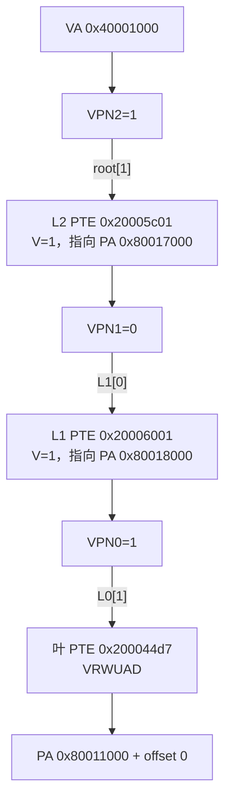

# 从虚拟地址手算到物理地址

## 先固定这一例

实验让 U 态用虚拟地址 `0x40001000` 访问物理页 `0x80011000`。两者不同，因此成功读写不能由恒等映射蒙混过去。Sv39 使用 4 KiB 页、三级页表，每张表含 512 个 8 字节 PTE：

$$
4096\ \text{bytes}\div 8\ \text{bytes/PTE}=512=2^9.
$$

对 39 位有效虚拟地址，拆分为：

$$
\mathrm{VA}[38:0]
=\mathrm{VPN}[2]_{9}
+\mathrm{VPN}[1]_{9}
+\mathrm{VPN}[0]_{9}
+\mathrm{offset}_{12}.
$$

本例 `0x0000000040001000` 的 bit 38 为 0，高位也全为 0，因此是规范的 canonical 地址。三个索引和页内偏移是：

$$
(\mathrm{VPN}[2],\mathrm{VPN}[1],\mathrm{VPN}[0],\mathrm{offset})
=(1,0,1,0).
$$

根表在 `PA 0x80016000`。前两项只有 `V=1`，且 `R=W=X=0`，所以它们是指向下一级表的 non-leaf PTE。第三级项的 `R=1`，因此是 leaf。实验为用户数据页预先设置 `V/R/W/U/A/D`，并让 `X=0`、`G=0`。

## 从 PA 与 flags 编出 PTE

Sv39 PTE 的 PPN 从 bit 10 开始。这个实验不使用 PBMT 或 NAPOT 扩展，高保留位保持 0。构造式为：

$$
\mathrm{PTE}=
\left(\frac{\mathrm{PA}_{\text{page}}}{2^{12}}\ll10\right)
\mathbin{\vert}\mathrm{flags}.
$$

数据页的 PPN 是 `0x80011`；`V/R/W/U/A/D` 对应 flag 值

$$
1+2+4+16+64+128=0xd7.
$$

所以：

$$
(0x80011\ll10)\mathbin{\vert}0xd7
=0x200044d7.
$$

这正是 guest 输出中的 L0 值。反向计算时忽略低 10 位 flags：

$$
\mathrm{PA}
=((0x200044d7\gg10)\ll12)\mathbin{\vert}0
=0x80011000.
$$

`W=1、R=0` 是保留的非法组合，代码的 `leaf_pte` 会拒绝构造。`V=0` 会使条目无效；这个实验没有宣称实测 V=0，而是集中比较 W、U、X 三种权限拒绝。

## 三层不等于每次都走三次内存

这张图描述架构可见的页表关系，不声称 QEMU 或真实 CPU 每次 load 都逐项访问三次 DRAM。TLB 命中可以直接得到翻译；TLB miss 才需要 page-table walk。只要叶 PTE 有效且权限允许，walk 能完成而不进入 S 态。权限不允许时才形成实验观察到的 page fault。更完整的三者区分回到 [[计算机知识/30-计算机系统/16-地址翻译TLB页表遍历与大页|地址翻译、TLB、页表遍历与大页]]。

## `satp` 到底指定了什么

RV64 的 `satp` 把 MODE、ASID 与根页表 PPN 放在同一个 CSR。实验使用 ASID=0：

$$
\mathrm{satp}
=(8\ll60)\mathbin{\vert}(0x80016000\gg12)
=0x8000000000080016.
$$

读回的 MODE=8 表示 Sv39，PPN=`0x80016` 精确指向根表。写 `satp` 改变“以后用哪棵树”，但规范不保证它本身普遍清除旧翻译；代码随后执行全局 `sfence.vma zero, zero`。动态撤销数据页 W 时则执行以 `0x40001000` 为地址、所有 ASID 为范围的定址 fence。

## A/D 为什么一开始就置 1

不同实现对 Accessed/Dirty 更新的支持与配置可以不同。如果 A 或 D 为 0，一次原本权限允许的访问也可能因为 A/D 管理而 fault。为了让三个观测只代表 W、U、X 权限，本实验对所有会访问的叶预设 A=1，并对可写叶预设 D=1。撤销 W 时保留 A/D；PTE 从 `0x200044d7` 变为 `0x200044d3`，唯一权限变化就是 W 从 1 到 0。

## 可以自己复算的检查

1. 把 `0x40001000` 分别右移 30、21、12 位，再与 `0x1ff` 做 AND，应得到 1、0、1。
2. 把输出的 L2/L1 PTE 右移 10 再左移 12，应得到 `0x80017000` 与 `0x80018000`。
3. 把 L0 PTE 的低 8 位 `0xd7` 展开，确认 `X=0、U=1、W=1、R=1、V=1` 且 A/D 为 1。
4. 对照 stdout 的 `ALIAS` 行：U 态在低 VA 完成写后，S 态从高 PA 身份映射读到新值；这一步是非恒等映射生效的实际证据。
