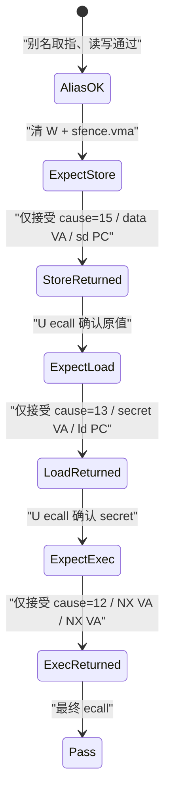

# 权限故障恢复与 `sfence.vma`

## 三次拒绝分别在拒绝什么

实验按固定阶段制造三类权限故障。三者都进入同一个 S 态 trap 入口，但原因、地址和恢复点不同：

| 阶段 | U 态操作 | 触发条件 | `scause` | `stval` | `sepc` |
| --- | --- | --- | ---: | --- | --- |
| store | 向数据别名写 canary | S 已把 leaf 的 W 从 1 清为 0 | 15 | `0x40001000` | `0x400000dc`，故障 `sd` |
| load | 读身份映射的 S 私有页 | leaf 的 U=0 | 13 | `0x80013000` | `0x4000012c`，故障 `ld` |
| instruction | `jalr` 到可读但 X=0 的页 | 目标 leaf 的 X=0 | 12 | `0x40002000` | `0x40002000`，取指目标 |

反汇编中的链接地址分别是 `0x800100dc`、`0x8001012c` 和 `0x80012000`。前两条指令通过固定差值 `0x40010000` 映射到表中的低地址；NX 页目标也映射到 `0x40002000`。runner 从 ELF 符号表独立算出前两个期望 `sepc`，再逐行核对 guest 输出。

## 为什么不用统一的 `sepc += 4`

`ecall` 已经完成，其恢复语义是从下一条指令继续；本实验目标 ISA 没有 C 扩展，所以 S 态对识别成功的 4 字节 `ecall` 使用 `sepc += 4`。权限 fault 不同：

- store 与 load 指令没有成功完成。通用 OS 可能修复 PTE 后让原指令重试，也可能终止进程；
- instruction page fault 的 `sepc` 已经是无法取指的目标，那里甚至没有一条可安全“跳过”的已解码指令；
- 本实验要继续跑完对照，所以 handler 把 `sepc` 改成链接时声明的明确恢复标签，并在 `a0` 返回 `-15/-13/-12`。它没有猜指令长度。



任何阶段收到别的 cause、`stval` 或 `sepc`，都会进入 `RESULT FAIL`。这避免把重复 fault、跑偏 PC 或软件伪造的打印误认成成功。

## trapframe 怎样守住寄存器路径

入口与 09 实验使用同一契约：`sscratch` 预先保存 S 态可访问的 trapframe 地址；trap 时 `csrrw sp, sscratch, sp` 原子取得该地址并暂存 U 栈。汇编保存 31 个可见整数寄存器和 `sepc/scause/stval`，再切换到 16 字节对齐的独立 S 栈调用 C。返回时只按教学 ABI 改 `a0` 和受控的 `sepc`，其余寄存器从帧恢复。


U 态从开始就把 `s0/s1` 设为两组 64 位 canary。每次 trap 的 C handler 都核对帧中数值；store fault 后还核对物理后备没有被 canary 写覆盖。汇编路径覆盖全部整数寄存器，而这两个跨多次 C 调用仍保持的 callee-saved canary 是本实验的运行时哨兵。

## `sfence.vma` 保证的范围

S 态先写内存里的 PTE，再执行：

```text
sfence.vma data_va, zero
```

`rs1=data_va` 把范围收窄到包含该地址的页面，`rs2=zero` 表示所有 ASID。它确保当前 hart 后续隐式地址翻译按规范观察到页表写；若省掉，旧的可写 TLB 翻译可能仍被使用。启动时写新 `satp` 后使用 `sfence.vma zero, zero`，覆盖所有地址和 ASID。

`sfence.vma` 不是普通数据缓存 flush，也不会自动通知别的 hart。本实验固定 `-smp 1`，所以没有 shootdown。多核内核还需要向可能缓存这份地址空间的 hart 发 IPI，并让每个目标 hart 执行合适的 fence。

## SUM、MXR 与 U 位

实验进入 U 态前固定 `SUM=0、MXR=0`，输出也明确记录。它没有把这两个位的开关对照算作已测试结论：

- SUM 控制 S 态 load/store 是否可以访问 U=1 页面；SUM=1 也从不允许 S 态执行 U 页；
- MXR=1 可以让 load 把 X=1 的页也视为可读，但不会授予 store 或 execute 的额外权限；
- U 态访问 U=0 的身份映射 secret 与 SUM 无关，硬件仍必须拒绝。

S handler 检查物理后备时使用 U=0 的身份映射，不通过低地址 U 别名读取，因此不需要打开 SUM。实验也没有声称测量 MXR 对 X-only 页的影响。

## fault 后“恢复”不等于生产策略

这个受控状态机知道每条故障指令和继续标签，适合把三种硬件拒绝串成一个教学运行。真实 OS 不能对任意 fault 都跳到预编排标签：它要根据进程虚拟内存区域、映射后备、访问类型和策略选择调页、建立映射、COW、发信号或终止。这里证明的是 Sv39 翻译和权限路径确实运行，以及 `scause/sepc/stval` 足以让 S 态区分三次实验；它不实现通用 fault handler。
