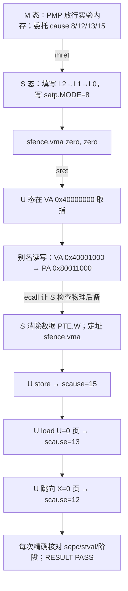

# Sv39 页表与故障隔离：让权限位真的挡住 U 态

这个实验回答一个具体问题：RV64 的 S 态怎样从一个虚拟地址的三个索引找到物理页，又怎样证明 `R/W/X/U` 权限确实由硬件执行，而不是程序打印了几个预设结论？实验构建真正的 RISC-V ELF，在 QEMU `virt` 系统仿真中从 M 态进入 S 态，建立三层 Sv39 页表并写入 `satp`，随后从低地址的 U 态虚拟别名执行代码。U 态先经 `VA 0x40001000` 读写物理页 `PA 0x80011000`，再依次触发真实的 store、load 和 instruction page fault。

这里接着 [[计算机知识/80-实践/06-计算机系统/09-RISC-V特权态与系统调用/README|上一实验]] 的 M→S→U、`sscratch` 换栈和完整整数寄存器保存路径，只增加地址翻译与权限状态机。概念解释、TLB miss 与 page fault 的区别见 [[计算机知识/30-计算机系统/16-地址翻译TLB页表遍历与大页|地址翻译、TLB、页表遍历与大页]]；写时复制和跨 hart TLB 失效属于 [[计算机知识/20-操作系统/02-操作系统原理/10-系统课程/09-页表写时复制与TLB失效|页表、写时复制与 TLB 失效]]。本目录不复制这些主解释。

## 一条可检查的执行路径



关键证据不是日志中的“预计会失败”，而是硬件形成的三个同步异常。S 态处理器只接受当前阶段唯一合法的 `scause/stval/sepc`；重复、乱序或意外 trap 立即写 `RESULT FAIL`，QEMU 以非零状态退出。store fault 后 S 态从身份映射的物理页复核原值仍为 `0x5555666677778888`，说明被拒绝的写没有生效；load fault 后同样复核 S 私有值没有改变。`s0/s1` canary 跨每次入口返回保持不变，检查 trapframe 保存/恢复路径。

## 构建并运行

只需 Python 3 标准库、支持 `riscv64-unknown-elf` 的 Clang、`ld.lld` 和 `qemu-system-riscv64`。不依赖 `make`，不安装依赖，也不要求接受 Xcode 许可。默认构建目录是自动清理的系统临时目录；`--out-dir` 可保留 ELF 和 map，但必须位于源码目录之外。

```bash
python3 -B -m unittest -v test_build_run.py
python3 -B build_run.py \
  --clang /path/to/clang \
  --ld /path/to/ld.lld \
  --qemu /path/to/qemu-system-riscv64 \
  --timeout 8
```

runner 检查 ELF64、小端和 RISC-V `e_machine=243`，解析 ELF 符号确认五张页表位于约定的 4 KiB 边界，再执行：

```text
qemu-system-riscv64 -machine virt -accel tcg -smp 1 -m 128M \
  -bios none -kernel kernel.elf -nographic -serial stdio \
  -monitor none -net none -no-reboot
```

没有网络、`hostfwd`、宿主共享目录或后台守护进程。runner 要求 QEMU 退出码为 0、20 行带数值的输出逐行匹配、恰好一个 `RESULT PASS`，并拒绝 `FAIL`、机器态 trap、乱序、缺行和多余行。超时会杀掉整个进程组。测试还用启动即停、漏 fault、乱序、非零退出、伪 FAIL 和挂起进程作失败对照。

## 2026-09-20 实际 QEMU 证据

本批用 Clang 23.1.0、LLD 20.1.7、xPack QEMU 9.2.4 TCG 实际构建并运行。未删节 guest stdout 为：

```text
MODE M: boot hart=0 delegate=0x000000000000b100
MODE S: build Sv39 tables
PAGE_TABLE root_pa=0x0000000080016000 entries=512 bytes=4096 levels=3
WALK va=0x0000000040001000 vpn2=1 vpn1=0 vpn0=1 offset=0 l2=0x0000000020005c01 l1=0x0000000020006001 l0=0x00000000200044d7 pa=0x0000000080011000 flags=VRWUAD
SATP readback=0x8000000000080016 mode=8 root_ppn=0x0000000000080016 sfence.vma=global
POLICY SUM=0 MXR=0 A=pre-set D=pre-set
MODE U: entry_va=0x0000000040000000 entry_pa=0x0000000080010000 stack_va=0x0000000040005000
TRAP kind=ecall stage=0 scause=8 sepc=0x00000000400000b4
ALIAS execute_va=0x0000000040000000 data_va=0x0000000040001000 data_pa=0x0000000080011000 backing=0x5555666677778888 status=PASS
PTE UPDATE va=0x0000000040001000 before=0x00000000200044d7 after=0x00000000200044d3 sfence.vma=address-asid-all
FAULT kind=store scause=15 sepc=0x00000000400000dc stval=0x0000000040001000 action=redirect-explicit-label
TRAP kind=ecall stage=2 scause=8 sepc=0x0000000040000118
CHECK store-denied=PASS backing=0x5555666677778888
FAULT kind=load scause=13 sepc=0x000000004000012c stval=0x0000000080013000 action=redirect-explicit-label
TRAP kind=ecall stage=4 scause=8 sepc=0x0000000040000140
CHECK load-u0-denied=PASS secret=0xcafebabedeadbeef
FAULT kind=instruction scause=12 sepc=0x0000000040002000 stval=0x0000000040002000 action=redirect-explicit-label
TRAP kind=ecall stage=6 scause=8 sepc=0x0000000040000164
CHECK execute-nx-denied=PASS
RESULT PASS
```

QEMU 退出码为 0，runner 报告 20 行严格匹配。地址拆分、PTE 数值和实际 walk 如何逐项对应，见 [[计算机知识/80-实践/06-计算机系统/10-Sv39页表与故障隔离/01-从虚拟地址手算到物理地址|从虚拟地址手算到物理地址]]；为何三种 fault 不能一律 `sepc += 4`，见 [[计算机知识/80-实践/06-计算机系统/10-Sv39页表与故障隔离/02-权限故障恢复与sfence-vma|权限故障恢复与 sfence.vma]]。

## 成功范围与边界

结果证明这个 guest 在单 hart QEMU TCG 中实际启用了 Sv39：`satp` 读回 MODE=8，根 PPN 对应 4 KiB 对齐的 `0x80016000`；U 态经非恒等别名取指、load 和 store；页表收紧后，硬件分别报告 cause 15、13、12，且 `stval/sepc` 与故障地址和反汇编对应。

它不是完整 OS，也不是生产安全证明。S 态代码页为简化实验使用 RWX 身份映射，没有 S 态 W^X；没有进程、调度、按需分页、COW、文件后备、ASID 管理、中断、PMP 分区或页表并发锁。实验固定单 hart，因此只验证本 hart 的 `sfence.vma`，不实现多 hart shootdown。QEMU TCG 的结果不证明宿主隔离、真实硬件时序、侧信道安全或任意板卡兼容。

## 固定来源与许可

- RISC-V International，[*The RISC-V Instruction Set Manual, Volume II: Privileged Architecture*，v20260120，Supervisor-Level ISA v1.13](https://docs.riscv.org/reference/isa/v20260120/priv/supervisor.html)：核对 Sv39、`satp`、PTE、`SFENCE.VMA`、`SUM/MXR`、`scause/sepc/stval` 和异常号 12/13/15。该规范仓库声明 CC BY 4.0。
- QEMU，[`virt` Generic Virtual Platform，v9.2.4](https://gitlab.com/qemu-project/qemu/-/blob/v9.2.4/docs/system/riscv/virt.rst)、[`hw/riscv/virt.c`](https://gitlab.com/qemu-project/qemu/-/blob/v9.2.4/hw/riscv/virt.c) 与 [`hw/misc/sifive_test.c`](https://gitlab.com/qemu-project/qemu/-/blob/v9.2.4/hw/misc/sifive_test.c)：核对 DRAM、UART、Test finisher 和退出语义。相关 QEMU 源文件为 GPL v2 或更高版本。
- 本实验少量复用同库 [[计算机知识/80-实践/06-计算机系统/09-RISC-V特权态与系统调用/README|09 实验]]的独立 MIT 教学实现，包括启动、trapframe 和 runner 结构；新增页表、别名和故障状态机也按 `LICENSE-CODE.txt` 许可。可执行文件是真源，逐字镜像见 [[计算机知识/80-实践/06-计算机系统/10-Sv39页表与故障隔离/源码与测试镜像|源码与测试镜像]]。
