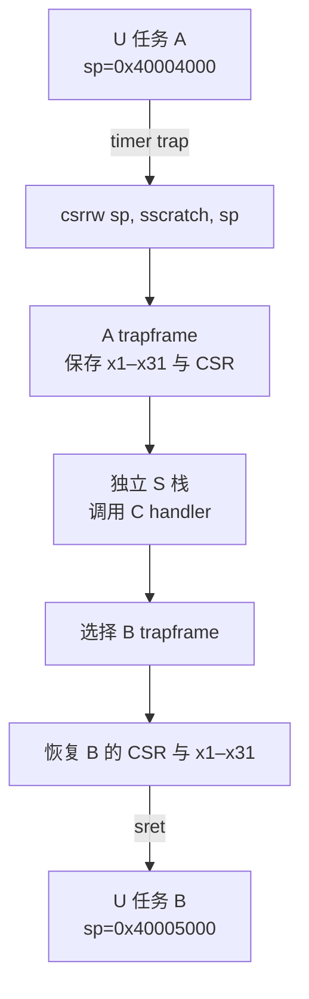
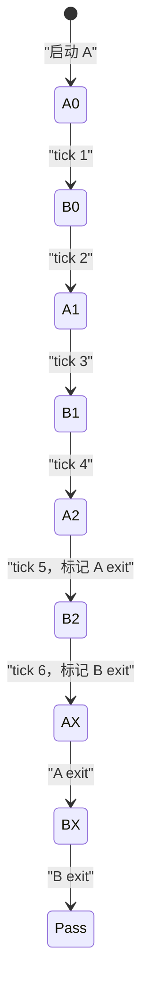

# trapframe 与调度上下文切换

## 两种“上下文”不要混成一个词

这个实验中有两类数据：

| 对象 | 保存什么 | 何时使用 |
| --- | --- | --- |
| trapframe | U 态 x1–x31、`sepc/sstatus/scause/stval` | 硬件陷阱入口保存，`sret` 前恢复 |
| scheduler context | 任务 ID、trapframe 地址、合法 PC/SP 范围、canary、上次工作量、抢占次数、状态 | S 态选择和验证下一个任务 |

trapframe 是“让这个 U 态执行流下一刻还能继续”的架构现场。scheduler context 是调度器的可信账本，指向 trapframe 并记录策略和不变量。这个最小内核没有可睡眠的内核线程，也没有从一个内核调用栈切到另一个内核调用栈，所以不额外保存 xv6 风格的 kernel `context`（例如仅 callee-saved 寄存器与 `ra/sp`）。每次 handler 都在同一份独立 S 栈上运行，最终直接恢复某个 U trapframe。

## trap 入口为什么先交换 `sp`

U 态自己的 `sp` 不能当作可信内核栈。它可能位于用户页边界，甚至被恶意设置。返回 U 态前，S 态把当前任务 trapframe 地址写进 `sscratch`。trap 到来后的第一条入口操作是：

```asm
csrrw sp, sscratch, sp
```

这条指令原子交换两者：

- 新 `sp` 指向当前任务的 S 态可访问 trapframe；
- `sscratch` 暂存刚被打断的 U `sp`。

汇编随后把 `ra/gp/tp/t0–t6/s0–s11/a0–a7` 全部写入帧，再把 `sscratch` 里的 U `sp` 写进 `TF_SP`。保存 `sepc/sstatus/scause/stval` 后，才执行 `la sp, s_stack_top`，用 16 字节对齐的可信 S 栈调用 C。



返回时顺序反过来：先从目标帧写回 `sepc/sstatus`，让 `sscratch` 指向目标帧，恢复其余寄存器，最后才加载目标 U `sp` 并执行 `sret`。如果先恢复 U `sp`，后续寄存器加载就会错误地在用户栈中找 trapframe。

## 为什么要保存全部 x1–x31

同步系统调用可以定义 ABI，允许内核按调用约定改变返回寄存器；异步中断却可能发生在任意指令边界。编译器可能正把临时值放在 caller-saved 寄存器中，也可能依赖 callee-saved 寄存器跨循环保持。调度器不能假定某个任务“刚好没用”某寄存器。

因此帧包含 31 个非零整数寄存器：

$$
31\times8\ \mathrm{bytes}
+4\times8\ \mathrm{bytes}
=280\ \mathrm{bytes}.
$$

后四项是 `sepc/sstatus/scause/stval`。x0 恒为 0，无需保存。C 的 `_Static_assert(sizeof(struct trapframe)==280)` 与汇编 `TF_SIZE=280` 共同固定布局；`trapframe_offsets.h` 给汇编使用逐项偏移。

## 两份独立状态怎样被证实

两个任务初始化不同的地址与哨兵：

| 检查项 | 任务 A | 任务 B |
| --- | ---: | ---: |
| trapframe | `0x8001a000` | `0x8001b000` |
| U `sp` | `0x40004000` | `0x40005000` |
| 热循环 PC | `[0x40000088,0x400000a4)` | `[0x40002084,0x400020a0)` |
| `s0` callee-saved canary | `0x1111222233334444` | `0x5555666677778888` |
| `a5` caller-saved canary | `0x13579bdf2468ace0` | `0x02468ace13579bdf` |
| `t5` temporary canary | `0x0f1e2d3c4b5a6978` | `0x89abcdef01234567` |
| 栈 canary | `0xa0a0b0b0c0c0d0d0` | `0xa1a1b1b1c1c1d1d1` |

每个热循环还同时增加 `s1` 和栈顶下 16 字节处的计数。记它们分别为 $w_{\mathrm{reg}}$ 与 $w_{\mathrm{stack}}$；handler 每次都要求：

$$
\begin{aligned}
w_{\mathrm{reg,new}}&>w_{\mathrm{reg,old}}\ge1000,\\
w_{\mathrm{stack,new}}&>w_{\mathrm{stack,old}}\ge1000.
\end{aligned}
$$

所以“保存恢复成功”不是仅看 PC 来回变化：callee-saved、caller-saved、temporary、用户 SP、栈内值和两个独立工作量都必须跨三次抢占保持并前进。错误 PC、错误 SP、错误 trapframe、canary 损坏、同一任务连续出现、单边工作不前进或嵌套 trap 都会进入 `RESULT FAIL`。

## 六次切换的状态机



前四次切换保留被打断时的原 `sepc`。第 5 次把 A 的保存 PC 改成 A 的退出桩，但当下仍恢复 B；第 6 次同理改写 B，再恢复 A。A 的退出 `ecall` 通过后，S 态恢复 B 已准备好的退出桩。只有双方都报告各自的 `s1` 与栈计数，且两份 scheduler context 都满足 `preemptions=3、switches=3、state=EXITED`，内核才关闭 STIE、把 `stimecmp` 放到最大值并写 `RESULT PASS`。

退出桩里的 `ecall` 不在热循环中，也不参与时间片切换。它只用于在固定六次真实抢占之后，让两份 U 态上下文分别提交最终计数并让 QEMU 受控退出。

## `sepc` 是恢复点，不是“当前 PC 的普通变量”

timer interrupt 发生在指令边界，硬件写入的 `sepc` 是正常返回时应继续执行的位置。handler 不对它做 `+4`。对于前四次切换，帧中的 `sepc` 原样保留；恢复该任务时从同一热循环位置继续。

调度器也可以有意改变恢复点，例如递送信号、启动新线程或结束任务。本实验第三次抢占后把 `sepc` 改为预先链接的退出桩，这个操作必须同时满足三点：

1. 原始 interrupt `sepc` 已经核对为该任务热循环区间；
2. 目标退出地址来自 ELF 符号，不来自用户输入；
3. 退出桩再次用任务 ID、寄存器工作量、栈工作量、精确 ecall PC 和任务状态做联合验证。

因此它是受控的调度决策，不是看到任意 trap 就盲目跳转。

## 这个实验没有实现哪些切换

两任务共用 `satp`，没有地址空间切换和 `sfence.vma`/ASID 管理；S handler 共用一份内核栈，没有保存可阻塞内核线程的调用链；只有严格交替的固定数组，没有 run queue、优先级、动态创建、睡眠与唤醒；固定单 hart，没有锁、跨核迁移、IPI 或 per-CPU scheduler。

这些边界使实验能把一条真实异步路径看清：timer 取得控制，trapframe 保存架构现场，scheduler context 决定目标，另一份 trapframe 恢复，`sret` 回到不同的 U 态执行流。它为理解完整 OS 调度提供可运行支点，但不替代完整调度器。
