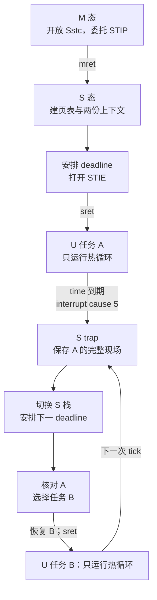

# 定时器中断与抢占调度：两个不会让出的 U 态执行流怎样轮流运行

这个实验回答一个具体问题：两个 U 态执行流都只在热循环里计算、访存和回跳，从不主动调用 `yield`，CPU 怎样仍能定期停下当前任务，保存它的寄存器与栈位置，恢复另一个任务，再从各自被打断的位置继续？

实验构建真正的 RV64 ELF，由 QEMU 9.2.4 `virt` TCG 从 M 态启动，进入 S 态建立 Sv39 映射和两份 U 态上下文，再用 **Sstc v1.0** 的 `stimecmp` 产生真实 supervisor timer interrupt。六次中断形成严格的 A→B→A→B→A→B 序列。每次入口都保存 x1–x31、`sepc/sstatus/scause/stval`，切到独立 S 栈，在 C handler 中核对原因、PC、SP、寄存器 canary、栈 canary 和工作计数，然后恢复另一份 trapframe 并执行 `sret`。

这里复用 [[计算机知识/80-实践/06-计算机系统/09-RISC-V特权态与系统调用/README|09 特权态实验]]的 M→S→U 与 trap 入口，以及 [[计算机知识/80-实践/06-计算机系统/10-Sv39页表与故障隔离/README|10 Sv39 实验]]的三层页表骨架。调度概念回到 [[计算机知识/30-计算机系统/09-进程线程调度同步与IPC|进程、线程、调度、同步与 IPC]]；中断、轮询和 DMA 的系统视角回到 [[计算机知识/30-计算机系统/10-IO设备总线DMA与中断|I/O、设备、总线、DMA 与中断]]。本目录只展开“定时器打断到上下文恢复”的一条可运行路径。

## 一条真正发生的抢占路径



关键不是输出里出现了 `TICK` 字样。可执行文件中真的有：

- M 态对 `menvcfg.STCE`、`mcounteren.TM`、`mideleg.STIP` 的 CSR 写入；
- S 态对 `stimecmp` 的写入和对 `time` 的读取；
- trap 入口对 31 个非零整数寄存器的存储，以及返回路径的逐项加载与 `sret`；
- 两段位于不同代码页的 U 态热循环，它们不含 `ecall`、`wfi`、`yield` 或调度状态轮询；
- QEMU 输出中的 `scause=0x8000000000000005`，即最高位为 interrupt，低位 cause=5；
- 每个被打断的 `sepc` 都落在相应热循环的 ELF 符号区间，两个 `sp` 和两份 trapframe 地址也彼此不同。

## 固定地址布局

| 对象 | U 态 VA | 物理/内核地址 | 用途 |
| --- | ---: | ---: | --- |
| 任务 A 代码 | `0x40000000` | `0x80010000` | 独立入口、热循环与退出桩 |
| 共享 U 数据 | `0x40001000` | `0x80011000` | 保留的数据页 |
| 任务 B 代码 | `0x40002000` | `0x80012000` | 第二段独立代码 |
| 任务 A 栈 | `[0x40003000,0x40004000)` | `[0x80013000,0x80014000)` | A 的栈 canary 与计数 |
| 任务 B 栈 | `[0x40004000,0x40005000)` | `[0x80014000,0x80015000)` | B 的栈 canary 与计数 |
| 根页表 | — | `0x80015000` | `satp.MODE=8` 的根 |
| A trapframe | — | `0x8001a000` | A 的 U 态架构状态 |
| B trapframe | — | `0x8001b000` | B 的 U 态架构状态 |
| S 栈 | — | `[0x8001d000,0x8001f000)` | trap handler 的可信栈 |

两任务共用一棵页表，但代码页、栈页、PC、SP 和 trapframe 都不同。因此实验能证明“恢复了另一份上下文”，却不把它说成进程地址空间隔离。

## 构建、测试并运行

只需要 Python 3 标准库、支持 `riscv64-unknown-elf` 的 Clang、`ld.lld` 和 `qemu-system-riscv64`。不依赖 `make`，不安装依赖，也不要求接受 Xcode 许可。默认构建目录由 `TemporaryDirectory` 创建并清理；需要保留 ELF、map 和对象文件时，可用 `--out-dir` 指向源码树外的目录。

```bash
python3 -B -m unittest -v test_build_run.py
python3 -B build_run.py \
  --clang /path/to/clang \
  --ld /path/to/ld.lld \
  --qemu /path/to/qemu-system-riscv64 \
  --timeout 10
```

runner 固定并核对 QEMU 9.2.4，然后使用：

```text
qemu-system-riscv64 -machine virt -cpu rv64,sstc=true -accel tcg
  -smp 1 -m 128M -bios none -kernel kernel.elf
  -nographic -serial stdio -monitor none -net none -no-reboot
```

没有网络、`hostfwd`、宿主共享目录或常驻后台进程。总超时到达时，runner 杀掉 QEMU 所在进程组。它要求 QEMU 退出码为 0、恰好 23 行 guest 输出、六组按序且交替的 TICK/SWITCH、两条独立 EXIT、准确地址与递增工作量、唯一 `RESULT PASS`，并拒绝启动即停、缺行、乱序、重复任务、非零退出、FAIL、多余行和源码树内构建输出。

## 2026-09-20 的实际系统仿真

本批使用 Clang 23.1.0、LLD 20.1.7、xPack QEMU 9.2.4 TCG 实际构建运行。下面是一次未删节 guest stdout；`now` 和工作计数来自该次运行，因此重跑时数值会变化，地址、顺序和约束保持固定：

```text
MODE M: Sstc=1 STCE=1 mcounteren.TM=1 mideleg.STIP=1 MTIE=0
MODE S: build Sv39 and two user contexts
SATP mode=8 root_pa=0x0000000080015000 user0_code=0x0000000040000000 user1_code=0x0000000040002000
TIMER source=Sstc timebase_hz=10000000 quantum_ticks=2000000 now=0x0000000000005938 first_deadline=0x00000000001eddb8 STIE=1 SPIE=1 SIE-before-sret=0
TASK id=0 tf=0x000000008001a000 stack=[0x0000000040003000,0x0000000040004000) entry=0x0000000040000000
TASK id=1 tf=0x000000008001b000 stack=[0x0000000040004000,0x0000000040005000) entry=0x0000000040002000
MODE U: task=0 hot-loop-no-yield
TICK n=1 cause=0x8000000000000005 now=0x0000000000207a38 deadline=0x00000000003efeb8 from=0 to=1 sepc=0x0000000040000088 sp=0x0000000040004000 work=0x0000000008e6bfb7 stack=0x0000000008e6bfb7 SPP=0 SPIE=1 depth=1
SWITCH from_tf=0x000000008001a000 to_tf=0x000000008001b000 next_pc=0x0000000040002000
TICK n=2 cause=0x8000000000000005 now=0x00000000004086ca deadline=0x00000000005f0b4a from=1 to=0 sepc=0x0000000040002084 sp=0x0000000040005000 work=0x0000000008d836cb stack=0x0000000008d836cb SPP=0 SPIE=1 depth=1
SWITCH from_tf=0x000000008001b000 to_tf=0x000000008001a000 next_pc=0x0000000040000088
TICK n=3 cause=0x8000000000000005 now=0x00000000005fd9ee deadline=0x00000000007e5e6e from=0 to=1 sepc=0x0000000040000088 sp=0x0000000040004000 work=0x000000001193d435 stack=0x000000001193d435 SPP=0 SPIE=1 depth=1
SWITCH from_tf=0x000000008001a000 to_tf=0x000000008001b000 next_pc=0x0000000040002084
TICK n=4 cause=0x8000000000000005 now=0x00000000007fe6bc deadline=0x00000000009e6b3c from=1 to=0 sepc=0x0000000040002084 sp=0x0000000040005000 work=0x0000000011c0b1c6 stack=0x0000000011c0b1c6 SPP=0 SPIE=1 depth=1
SWITCH from_tf=0x000000008001b000 to_tf=0x000000008001a000 next_pc=0x0000000040000088
TICK n=5 cause=0x8000000000000005 now=0x00000000009ff31c deadline=0x0000000000be779c from=0 to=1 sepc=0x0000000040000088 sp=0x0000000040004000 work=0x000000001a725d57 stack=0x000000001a725d57 SPP=0 SPIE=1 depth=1
SWITCH from_tf=0x000000008001a000 to_tf=0x000000008001b000 next_pc=0x0000000040002084
TICK n=6 cause=0x8000000000000005 now=0x0000000000bfffae deadline=0x0000000000de842e from=1 to=0 sepc=0x0000000040002084 sp=0x0000000040005000 work=0x000000001aa69010 stack=0x000000001aa69010 SPP=0 SPIE=1 depth=1
SWITCH from_tf=0x000000008001b000 to_tf=0x000000008001a000 next_pc=0x00000000400000a8
EXIT task=0 work=0x000000001a725d57 stack=0x000000001a725d57 preemptions=3 status=PASS
EXIT task=1 work=0x000000001aa69010 stack=0x000000001aa69010 preemptions=3 status=PASS
SUMMARY ticks=6 task0_preemptions=3 task1_preemptions=3 switches=6 status=PASS
RESULT PASS
```

QEMU 退出码为 0，runner 报告六次真实 timer tick、两次独立退出均通过。为什么这些 CSR 位能把中断送到 S 态，见 [[计算机知识/80-实践/06-计算机系统/11-定时器中断与抢占调度/01-Sstc中断从time到sret|Sstc 中断从 time 到 sret]]；trapframe 与 scheduler context 为什么不是同一种数据，见 [[计算机知识/80-实践/06-计算机系统/11-定时器中断与抢占调度/02-trapframe与调度上下文切换|trapframe 与调度上下文切换]]。

## 成功范围与边界

这次结果证明：在固定的单 hart QEMU 9.2.4 `virt` TCG guest 中，Sstc 定时器确实异步打断两个不合作的 U 态热循环；S 态在真实 trap 路径上保存和恢复两份不同的寄存器与栈上下文；两边的工作计数都跨多次抢占前进；受控退出依赖六次 timer interrupt，而不是 U 态轮询或主动让出。

它是固定两任务、单地址空间、无阻塞、无优先级、无动态创建的最小教学调度器。没有内核线程 context switch、地址空间切换、ASID、进程隔离、系统调用面、设备驱动、睡眠队列、锁、负载均衡、公平性证明、多核 IPI 或 timer broadcast。页表仍有教学用 S 态 RWX 身份映射，PMP 广泛放行实验范围。TCG 结果不证明宿主隔离、生产安全、真实硬件时序、物理时钟精度或任意 RISC-V 板卡兼容。

## 固定来源与许可

- RISC-V International，[*The RISC-V Instruction Set Manual, Volume II: Privileged Architecture*，v20260120，Supervisor-Level ISA v1.13](https://docs.riscv.org/reference/isa/v20260120/priv/supervisor.html)：核对 `sie/sip`、STIE/STIP、`sstatus.SIE/SPIE/SPP`、`scause/sepc/stval` 和 `sret`。规范仓库声明 CC BY 4.0。
- RISC-V International，[*Sstc Extension for RISC-V*，v1.0，v20260120 规范集](https://docs.riscv.org/reference/isa/v20260120/priv/sstc.html)：核对 `stimecmp`、`menvcfg.STCE`、`mcounteren.TM` 与 supervisor timer pending 条件。
- QEMU，[RISC-V `virt` Generic Virtual Platform，v9.2.4](https://gitlab.com/qemu-project/qemu/-/blob/v9.2.4/docs/system/riscv/virt.rst)、[`hw/riscv/virt.c`](https://gitlab.com/qemu-project/qemu/-/blob/v9.2.4/hw/riscv/virt.c)、[`include/hw/intc/riscv_aclint.h`](https://gitlab.com/qemu-project/qemu/-/blob/v9.2.4/include/hw/intc/riscv_aclint.h) 与 [`target/riscv/cpu.c`](https://gitlab.com/qemu-project/qemu/-/blob/v9.2.4/target/riscv/cpu.c)：核对 `virt` 的 10 MHz timebase、默认 Sstc 扩展与机器布局。相关 QEMU 源文件为 GPL v2 或更高版本。
- 本实验从同库 09/10 实验复用少量独立 MIT 教学代码结构；本目录代码统一见 `LICENSE-CODE.txt`。可执行文件是真源，逐字镜像见 [[计算机知识/80-实践/06-计算机系统/11-定时器中断与抢占调度/源码与测试镜像|源码与测试镜像]]。
