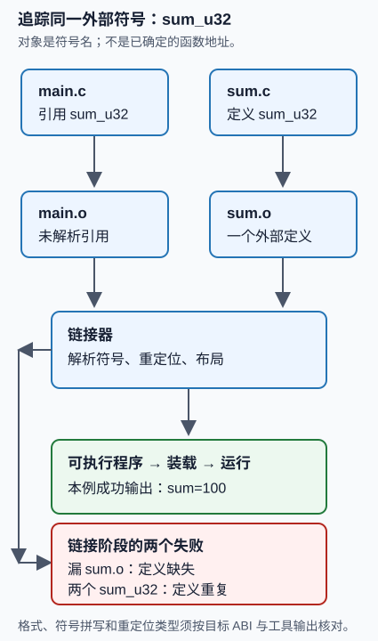

# C 程序构建、链接与装载：同一个 `sum_u32` 到哪里去了？

读者问题：两个 `.c` 文件都单独编译成功时，为什么一个程序仍可能在链接阶段失败？反过来，链接成功又为什么不表示它已经被系统装载、输出正确，或能在另一台机器运行？

本实验用一个长度为 4 的 `uint32_t` 数组 `{7, 11, 23, 59}` 贯穿所有阶段。`main.c` **引用** `sum_u32`，`sum.c` **定义**它；正确程序应只输出 `sum=100`。代码是本库原创的最小例子，并非 CS:APP 的代码或实验题。



图中文字替代：`main.c` 和 `sum.c` 分别经过编译，得到 `main.o`（带有未解析的 `sum_u32` 引用）和 `sum.o`（带外部定义）。链接器在满足定义唯一性和引用可解析的条件下布局并重定位，才产生可执行程序；遗漏 `sum.o` 或另给一个外部 `sum_u32` 定义都在链接阶段失败。成功程序随后才交给平台的装载机制并执行，示例输出 `sum=100`。

## 两个入口在这里汇合

### 基础补桥：先预测，再运行

先不用记目标文件格式。把头文件想成双方共同签过的接口纸条：它让编译器知道 `sum_u32` 的类型，却不会把函数体复制进 `main.o`。请在运行前留下三项预测：

1. `clang -c main.c` 是否会因为没有 `sum.c` 而失败？
2. `main.o` 加 `sum.o` 链接后，输出是否为 `sum=100`？
3. 只链接 `main.o`，以及同时链接 `sum.o`、`duplicate_sum.o`，各会在哪一阶段失败？

执行：

```bash
cd "计算机知识/80-实践/06-计算机系统/12-C程序构建链接与装载"
python3 -m unittest -v
python3 build_trace.py
```

脚本只在自动删除的临时目录中复制本目录四个 C/头文件；每条编译、检查、链接和运行命令都有 15 秒上限。找不到 `clang` 时明确输出 `SKIP`，不会安装工具。它检查的是阶段和可观察的成功/失败合同，故意不匹配某一种链接器报错的自然语言。当前 macOS 若已存在 `/Library/Developer/CommandLineTools`，脚本只为子进程设置 `DEVELOPER_DIR` 指向该目录，以绕开未接受 Xcode 许可的 developer-tool shim；它不接受许可、不安装工具，也不修改系统默认开发目录。

### 本科基础快进：先写对象与条件

把一个翻译单元看成预处理后的一个 `.c` 输入。可重定位目标文件保存机器码片段以及尚待链接器处理的符号和重定位信息。对于本例，关键对象依次是：

| 阶段 | 追踪的对象 | 当前能证明什么 | 还不能证明什么 |
| --- | --- | --- | --- |
| 编译 `main.c` | 对外部 `sum_u32` 的引用 | 声明与这一个翻译单元的类型检查通过 | 某个定义会参与链接 |
| 编译 `sum.c` | `sum_u32` 的一个外部定义 | 实现这一单元能生成目标代码 | 它与调用者的接口、ABI 或链接命令匹配 |
| 链接 | 输入目标、符号解析和重定位 | 这组输入可组成一个本机可执行产物 | OS 已装载它、运行环境与行为正确 |
| 装载并运行 | 可执行文件、动态依赖和进程映像 | 当前机器可启动这一次进程 | 别的 OS、CPU、ABI、库版本也可以 |

本机记录若显示 macOS/arm64，只能成为该平台 **Mach-O** 构建的一次证据。CS:APP 第 7 章主用 x86-64/Linux/ELF 教学语境；ELF 的 section/segment、System V ABI 调用规则，以及 `ld`、`ar` 的选项不能从这次 macOS 运行中推得。即使 `clang --target=x86_64-unknown-linux-gnu -S` 能在某个安装中产生汇编，也只是固定 target 的静态观察，不能称为 Linux/ELF 运行验证。

## 机制层：为什么三类结果落在不同阶段

### 1. 编译：声明让引用有类型，但不提供函数体

`sum.h` 同时被两个翻译单元包含：

<!-- code-sync: ./sum.h -->
```c
#ifndef SUM_H
#define SUM_H

#include <stddef.h>
#include <stdint.h>

uint32_t sum_u32(const uint32_t values[], size_t count);

#endif
```

`main.c` 能据此生成一次“调用这个外部名字”的代码；编译器在这个阶段通常还不知道最终哪一个 `.o` 或库会给它定义。相反，`sum.c` 的定义也能独立编译。本例在源中显式拒绝 `uint32_t` 会先提升为有符号 `int` 的目标；每次 `total += values[index]` 后赋回 32 位无符号 `total`，所以本函数的累计结果按模 $2^{32}$ 截断。此约束和这一次编译只能支持本函数的算术合同；本例和为 100，没有绕回，不能从它推出一般有符号溢出或浮点舍入行为。

<!-- code-sync: ./main.c -->
```c
#include <inttypes.h>
#include <stdint.h>
#include <stdio.h>

#include "sum.h"

int main(void) {
    const uint32_t values[] = {7U, 11U, 23U, 59U};
    const uint32_t total = sum_u32(values, sizeof(values) / sizeof(values[0]));
    printf("sum=%" PRIu32 "\n", total);
    return total == 100U ? 0 : 1;
}
```

### 2. 链接：让引用、定义和最终布局相遇

链接命令把输入对象放在同一次解析中。链接器必须至少能为 `main.o` 的外部 `sum_u32` 引用找到相容定义，并避免把两个同名全局定义都当作本例唯一实现。成功后，链接器还会根据目标格式处理代码/数据的布局与需要的重定位；“把两个 `.o` 拼在一起”不是完整解释。

```text
clang -c main.c -o main.o       # 成功：留下对 sum_u32 的引用
clang -c sum.c  -o sum.o        # 成功：提供一个定义
clang main.o sum.o -o sum_demo  # 成功：再可执行

clang main.o -o missing_demo                    # 预期：链接失败，定义缺失
clang main.o sum.o duplicate_sum.o -o duplicate_demo  # 预期：链接失败，定义重复
```

本实验以返回码而非报错句子判断这两种负例：不同版本工具常把符号写成 `sum_u32`、`_sum_u32`，也会使用不同的“undefined”或“duplicate”措辞。未定义和重复定义都不是“程序运行后算错”，而是在这个输入集合形成最终映像之前，链接合同已经无法满足。

### 3. 装载：链接产物也必须在当前运行环境中成立

成功链接后，操作系统的装载路径需要识别可执行格式、建立进程地址空间，并处理适用的共享依赖；这些步骤与静态链接期符号解析相关但不相同。此实验只执行刚生成的本机程序，避免把库搜索路径、签名政策、动态依赖、懒绑定和页错误数混入结论。继续沿“产物进入进程”的路线读 [[计算机知识/30-计算机系统/25-从可执行文件到一行输出的端到端执行链#ELF program header 把文件区间变成进程映像|端到端执行链的装载映射]]；带着的问题是：链接器已经写入的地址/引用，何时又由加载器和按需映射接手？回来后能补上“可执行文件存在”和“进程已执行”之间的一段。

## 本机可复查证据与限制

`build_trace.py` 的真源与伴随测试如下。它记录实际 `clang` 路径、`sys.platform`、每条命令的 argv、stdout、stderr、返回码和是否超时。若可用，也调用 `nm sum.o main.o`：那是某一次工具输出的观察，不把 `nm` 的文本当成 ABI 或跨平台符号规则。

失败证据本身也要有稳定类型。[Python 的 `TimeoutExpired` 合同](https://docs.python.org/3/library/subprocess.html#subprocess.TimeoutExpired)说明：即使请求 `text=True`，已捕获的超时输出仍可能是 `bytes`，没有输出则可能是 `None`。记录器把常规输出与超时片段都按 UTF-8 解释，不能解码的字节或被截断的字符以 `�` 替换；`None` 变为空字符串。这是便于诊断的文本表示，不是原始字节的无损存档。超时仍保留 `timed_out=true`、`returncode=null`，不会因为 JSON 能保存就成为成功。

无需编译器也能验证这个边界：测试构造有部分 stdout/stderr、无输出、截断 UTF-8 三种超时；另起一个受控 Python 子进程确认实际异常路径。每例都必须能 JSON 往返、保留已有可读输出，且平台工具诊断不再因 `str`/`bytes` 混用而抛错。正常退出和非零退出的返回码仍各自保留。

以下是阶段记录器的结构摘录。可复制、逐字可执行的当前版本及测试在 [[计算机知识/80-实践/06-计算机系统/12-C程序构建链接与装载/源码与测试镜像|源码与测试镜像]]，该页才带 `code-sync` 校验。

<!-- illustrative excerpt: ./build_trace.py -->
```python
#!/usr/bin/env python3
"""Build a small, bounded C program and record which build stage failed.

The script writes only inside a TemporaryDirectory, times every child process,
and treats tool absence as SKIP.  It is not a replacement for an object-file
format specification or a cross-platform linker test suite.
"""

from __future__ import annotations

import json
import shutil
import subprocess
import sys
import tempfile
from dataclasses import asdict, dataclass
from pathlib import Path


ROOT = Path(__file__).resolve().parent
TIMEOUT_SECONDS = 15


@dataclass(frozen=True)
class CommandResult:
    stage: str
    argv: list[str]
    returncode: int | None
    stdout: str
    stderr: str
    timed_out: bool


def output_text(value: str | bytes | None) -> str:
    if value is None:
        return ""
    return value.decode("utf-8", errors="replace") if isinstance(value, bytes) else value


def run(stage: str, argv: list[str], directory: Path) -> CommandResult:
    try:
        completed = subprocess.run(
            argv,
            cwd=directory,
            text=True,
            encoding="utf-8",
            errors="replace",
            capture_output=True,
            timeout=TIMEOUT_SECONDS,
            check=False,
        )
        return CommandResult(stage, argv, completed.returncode,
                             completed.stdout, completed.stderr, False)
    except subprocess.TimeoutExpired as error:
        return CommandResult(stage, argv, None,
                             output_text(error.stdout), output_text(error.stderr), True)


def copy_sources(directory: Path) -> None:
    for name in ("sum.h", "sum.c", "main.c", "duplicate_sum.c"):
        shutil.copy2(ROOT / name, directory / name)


def compile_unit(clang: str, source: str, output: str, directory: Path) -> CommandResult:
    return run(
        f"compile:{source}",
        [clang, "-std=c17", "-Wall", "-Wextra", "-Werror", "-c", source, "-o", output],
        directory,
    )


def trace(clang: str | None = None, nm: str | None = None) -> dict[str, object]:
    clang = clang or shutil.which("clang")
    if clang is None or (Path(clang).is_absolute() and not Path(clang).is_file()):
        return {"status": "SKIP", "reason": "clang was not found; no compiler was installed."}

    nm = nm or shutil.which("nm")
    with tempfile.TemporaryDirectory(prefix="wwl-link-trace-") as raw_directory:
        directory = Path(raw_directory)
        copy_sources(directory)
        results: list[CommandResult] = []
        for source, output in (("sum.c", "sum.o"), ("main.c", "main.o"),
                               ("duplicate_sum.c", "duplicate_sum.o")):
            results.append(compile_unit(clang, source, output, directory))

        if any(result.returncode != 0 for result in results):
            return {"status": "FAIL", "reason": "a required translation unit did not compile",
                    "commands": [asdict(result) for result in results]}

        if nm is None:
            results.append(CommandResult("inspect-symbols", ["nm"], None, "", "", False))
            symbol_note = "SKIP: nm was not found; object symbols were not inspected."
        else:
            results.append(run("inspect-symbols", [nm, "sum.o", "main.o"], directory))
            symbol_note = "nm output is a platform-specific observation, not an ABI specification."

        success = run("link:success", [clang, "main.o", "sum.o", "-o", "sum_demo"], directory)
        results.append(success)
        if success.returncode == 0:
            results.append(run("run:success", [str(directory / "sum_demo")], directory))

        missing = run("link:missing-definition", [clang, "main.o", "-o", "missing_demo"], directory)
        duplicate = run("link:duplicate-definition",
                        [clang, "main.o", "sum.o", "duplicate_sum.o", "-o", "duplicate_demo"], directory)
        results.extend((missing, duplicate))
        passed = (
            success.returncode == 0
            and results[-3].returncode == 0
            and results[-3].stdout == "sum=100\n"
            and missing.returncode != 0
            and duplicate.returncode != 0
            and not any(result.timed_out for result in results)
        )
        return {
            "status": "PASS" if passed else "FAIL",
            "platform": sys.platform,
            "compiler": clang,
            "symbol_note": symbol_note,
            "expectations": {
                "successful_program_stdout": "sum=100\\n",
                "missing_definition_must_fail_at_link": True,
                "duplicate_definition_must_fail_at_link": True,
            },
            "commands": [asdict(result) for result in results],
        }


def main() -> int:
    result = trace()
    print(json.dumps(result, indent=2, sort_keys=True))
    return 0 if result["status"] in {"PASS", "SKIP"} else 1


if __name__ == "__main__":
    raise SystemExit(main())
```

<!-- illustrative excerpt: ./test_build_trace.py -->
```python
import json
import shutil
import subprocess
import sys
import unittest
from pathlib import Path

from build_trace import ROOT, trace


class BuildTraceTests(unittest.TestCase):
    def test_missing_compiler_is_an_explicit_skip(self) -> None:
        self.assertEqual(trace(clang="/definitely/not/a/compiler")["status"], "SKIP")

    @unittest.skipUnless(shutil.which("clang"), "clang is unavailable")
    def test_build_contract_and_failure_stages(self) -> None:
        result = trace()
        self.assertEqual(result["status"], "PASS")
        commands = {entry["stage"]: entry for entry in result["commands"]}
        self.assertEqual(commands["run:success"]["stdout"], "sum=100\n")
        self.assertNotEqual(commands["link:missing-definition"]["returncode"], 0)
        self.assertNotEqual(commands["link:duplicate-definition"]["returncode"], 0)
        self.assertFalse(any(entry["timed_out"] for entry in commands.values()))

    @unittest.skipUnless(shutil.which("clang"), "clang is unavailable")
    def test_cli_returns_machine_readable_trace(self) -> None:
        completed = subprocess.run(
            [sys.executable, str(ROOT / "build_trace.py")],
            text=True,
            capture_output=True,
            timeout=45,
            check=False,
        )
        self.assertEqual(completed.returncode, 0, completed.stderr)
        self.assertEqual(json.loads(completed.stdout)["status"], "PASS")


if __name__ == "__main__":
    unittest.main()
```

`sum.c` 和 `duplicate_sum.c` 是刻意相反的两个定义：前者参与正例，后者仅为负例制造同名外部定义。

<!-- code-sync: ./sum.c -->
```c
#include "sum.h"

#include <limits.h>

/* Reject a target where uint32_t would promote to a signed int before +=. */
#if UINT32_MAX <= INT_MAX
#error "sum_u32 needs uint32_t not representable by int"
#endif

uint32_t sum_u32(const uint32_t values[], size_t count) {
    uint32_t total = 0;
    for (size_t index = 0; index < count; ++index) {
        total += values[index];
    }
    return total;
}
```

<!-- code-sync: ./duplicate_sum.c -->
```c
#include "sum.h"

/* Deliberately a second external definition for the negative link test. */
uint32_t sum_u32(const uint32_t values[], size_t count) {
    (void)values;
    (void)count;
    return 0;
}
```

## 迁移层：联合改变条件后重建判断

下面题目不提供命令顺序。每题的“答案”是可接受结论的合同，并非唯一实现。

1. 有人把 `sum.c` 编成 AArch64/macOS 对象，把 `main.c` 编成 x86-64/Linux 对象，再试图链接。先列出必须检查的两个条件，说明为什么“二者都编译成功”不足够。**可接受答案**：指出目标对象格式/架构与 ABI/链接器输入必须相容，并要求检查实际 target、对象元数据和运行环境；也可进一步指出系统库与加载器差异。不能仅回答“缺头文件”。
2. 把 `sum_u32` 改为 `static`，同时保持 `main.c` 的外部调用。预测最早在哪个阶段失去可解析引用，并说明 `static` 改的是可见性/链接属性的哪一面。**可接受答案**：在常见 C 工具链中，`sum.c` 内部定义不再供 `main.o` 的外部引用解析，因此链接失败；若同时改为由同一翻译单元调用，则可能成功。答案必须声明具体构建布局，不能说 `static` “使函数不存在”。
3. 用静态库替换直接放入 `sum.o`，并把库放在命令行中引用它的对象之前或之后。给出要观察的证据和一个可能改变结果的条件。**可接受答案**：记录完整链接命令、工具/平台、符号表与返回码；库扫描顺序和循环依赖可能影响传统链接器解析。允许使用本机文档说明某工具行为不同，不能把这台 macOS 的一次结果外推为所有 GNU/ELF 链接器规律。
4. 程序在本机成功链接并输出 100，但部署端启动时报共享库缺失。说明原来的哪个断言仍然成立、哪个必须撤回，并给出两个下一步证据。**可接受答案**：本机那组输入形成并运行过一个产物仍成立；“部署端能装载”必须撤回。可检查目标的动态依赖、架构/ABI、加载器搜索/签名政策和部署日志；不把问题归结为 C 加法。

## 继续阅读与返回

- [[计算机知识/10-编程语言/03-C语言/04-函数接口预处理与多文件构建#构建诊断练习|C 的多文件构建诊断]]：去看声明、作用域与 `static`/`extern` 的源语言合同；带着“为什么类型检查通过仍能链接失败？”的问题回来，补全编译与链接的边界。
- [[计算机知识/30-计算机系统/03-ABI调用约定与静态动态链接#4. 从源文件到可执行文件|ABI、符号和重定位]]：去看 API、ISA、ABI 的区分；带着“哪个契约会让两个已生成的对象仍不可组合？”的问题回来，补全对象格式、调用和运行时依赖。
- [[计算机知识/30-计算机系统/25-从可执行文件到一行输出的端到端执行链#ELF program header 把文件区间变成进程映像|可执行文件进入进程]]：去看 section 与装载 segment 的责任不同；带着“链接后的文件还缺哪一步才会输出？”的问题回来，补全装载与按需映射。

CS:APP 第 7 章（Linking）的章节范围和作者维护的勘误/实验入口见 [CS:APP 3e 官方资料](https://csapp.cs.cmu.edu/3e/pieces/preface3e.pdf)、[学生资源](https://csapp.cs.cmu.edu/3e/students.html) 与 [勘误页](https://csapp.cs.cmu.edu/3e/errata.html)。官方教材与教师实验材料不迁入本库；本页只吸收问题结构，并保留本机证据的范围。

**返回**：[[计算机知识/80-实践/06-计算机系统/00-计算机系统实践-MOC|计算机系统实践 MOC]]。完成后，你应能从一个确切外部符号解释“编译、链接、装载、执行”各自完成及未完成的判断。
