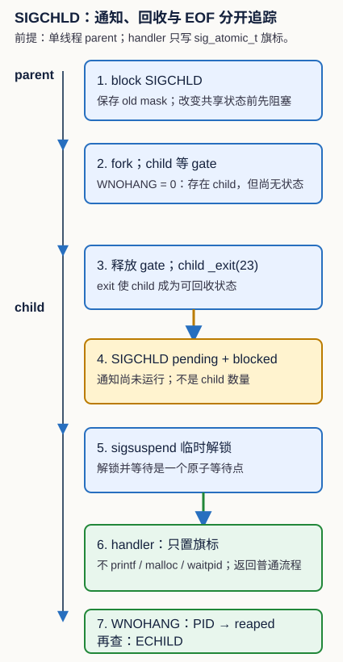

# POSIX 信号回收与可靠 I/O：通知、字节和业务结果不是同一件事

读一个 pipe、等待一个 child 或收到 `SIGCHLD` 时，最容易犯的错误是把三个状态合成一句“任务完成”。本单元固定追踪四个可观察对象：**已转移的字节数**、**流是否到 EOF**、**child 的退出状态是否已被收集**，以及**协议是否已经形成业务结果**。它们可以先后发生，也可以只发生其中一部分。

从 [[计算机知识/20-操作系统/02-操作系统原理/10-系统课程/02-系统调用IPC与进程生命周期|系统调用、IPC 与进程生命周期]] 的“FD/OFD、管道 EOF 和 fork/exec/wait”读到相应小节：它解释对象为什么共享；返回本页后用 `read` 的实际计数和 `waitpid` 状态把对象放进一次受控实验。想把同一字节流接到协议边界时，读 [[计算机知识/35-计算机网络/10-系统课程/07-Socket分帧背压与排障|Socket 分帧、背压与排障]] 的增量缓冲和上限；回来后能区分“读到一行”与“对端关闭”。

> [!warning] 范围
> 代码只在 macOS 或 Linux 的 POSIX 子集上尝试：它创建一个 parent 和一个直接子进程、一个 pipe，并在进程内部等待和回收。它不向外部 PID 发信号、不监听端口、不留下服务或子进程。`epoll`、`/proc`、Linux 作业控制和 x86-64 汇编不在这里。POSIX 函数契约来自文末 Open Group 链接；某次实机输出仍只说明该 OS、libc 与编译器组合。

## 两个入口汇入同一条证据链

### 基础补桥：先预测，不先背 API

父进程写入 `xyz`，关闭 pipe 的写端；读端请求 5 bytes。请先写下预测：成功的 `readn` 最终交给调用者多少有效字节？为什么不是“5”也不是“错误”？答案是 3：`xyz` 已转移，随后所有写端已关闭，下一次读取看到 EOF。缓冲区后两个字节不是结果的一部分。

再把父进程自己的写端**不关闭**。即使 child 已退出、其退出状态甚至已被 `waitpid` 收集，读端也不应据此宣布 EOF，因为仍有一个写端存在。最后，让 child 在写入 `part` 后退出：这说明“有部分字节”和“已得到完整行/完整业务对象”又是不同结论。

本页的具体问题是：怎样让循环只相信每次返回的真实计数，并让 parent 不会错过 child 在“检查完、睡眠前”退出的通知？

### 本科基础快进：先写合同和不变量

对正 `count`，`read(fd, p, count)` 的非负返回值是这一次**实际**放入 `[p, p+returned)` 的字节数；`0` 表示这次读到 EOF；若在任何字节转移前被中断则可能是 `-1/EINTR`，若已经转移一部分则可直接返回部分计数。`write` 同理不能以“非负”推断全部写完。零长度请求不传输字节；本实验的包装器直接返回 0，不借它制造状态变化。

`rio_readn` 的后置条件是返回 `0..count` 的已读前缀或 `-1`；它在 `EINTR` 时重试，在 EOF 处返回已经得到的前缀。`rio_writen` 的后置条件更强：返回 0 时所有 `count` bytes 已交给内核接口；正长度写却返回 0 会造成无进展，所以包装器以 `EIO` 失败而不自旋。对非阻塞 FD，`EAGAIN` 不是“再试一次就好”的许可：调用者必须等待 readiness、累计 deadline 或选择放弃；本阻塞实验不替代那套状态机。

行读取器把 “一行最大 `capacity - 1` 个字节（含换行若有）”作为协议上限。超限时它继续丢弃到换行或 EOF，再以 `EOVERFLOW` 返回；这样下一次调用从下一行开始，而不是从一条已经被静默截断的行中间开始。`EOF` 前没有任何字节才返回 0；EOF 前已取得的短行仍返回其长度。

## 机制层：逐次结果与信号空窗

| 事件 | 可安全宣布的事实 | 还不能宣布的事实 |
| --- | --- | --- |
| `read` 返回 3 | 缓冲区前 3 bytes 有效 | 得到了一条完整消息或 EOF |
| `read` 返回 0 | 此流在当前 FD 上 EOF | child 已回收、业务成功 |
| handler 得到 `SIGCHLD` | 至少有 child 状态变化值得在普通流程检查 | 一个信号对应一个 child，或 child 已收集 |
| `waitpid(..., WNOHANG)` 返回 PID | 该 PID 的状态已写入 `status` | 该 child 写出的 pipe 已由读者读尽 |
| 读到一条协议完整行 | 有一个语法完整的输入单元 | 处理、持久化或响应已完成 |



图的文字替代：parent 先用 `sigprocmask(SIG_BLOCK)` 阻塞 `SIGCHLD`，再 `fork`。child `_exit(23)` 后，通知可处于 pending，但不会在 parent 改 job 表或决定等待的中间窗口运行 handler。parent 用一个临时解锁 `SIGCHLD` 的 mask 调用 `sigsuspend`；该操作同时恢复该 mask 并等待，收到信号后 handler 只把 `sigchld_seen` 置为 1。本实验随后以目标 `child` 调用 `waitpid(child, &status, WNOHANG)`：先得到 0、再得到 PID、最后得到 `ECHILD`。管理多个 child 的 shell 则可在普通控制流中循环 `waitpid(-1, &status, WNOHANG)`；每个正 PID 都取走一个状态，0 表示“还有匹配 child 但现在无状态可取”，`ECHILD` 表示没有匹配 child。恢复原 mask 后才能结束这次协议。

普通信号的教学模型不能把同类通知当成队列计数；多次 child 退出可合并为一次可见 `SIGCHLD`。因此循环的终止条件是 `waitpid` 的结果，不是 handler 被调用的次数。这个例子在 `fork` 时为单线程；多线程程序关于线程专属 mask 应使用 `pthread_sigmask` 等相应接口，不能把此图直接推广。

## 运行、检查与停点

在本目录运行：

```bash
python3 -B -m unittest -v test_posix_lab.py
python3 -B run_lab.py
```

`run_lab.py` 在系统临时目录编译，并让可执行程序完成三组检查：确定性注入的短读/短写和 `EINTR`、真实 pipe 的 “3 bytes 后 EOF”，以及 gate pipe 控制的 `SIGCHLD` 掩码/回收。最后一组先让 child 卡在 gate 上，确定性地检查 `waitpid(..., WNOHANG)` 的 `0`；释放 gate、收到通知后检查 PID；再次检查 `ECHILD`。它用一个 3 秒 alarm 只为受控测试提供有界唤醒，清理分支关闭 gate 并 wait child。源码不写 Vault 构建产物。若没有可用 C 编译器，测试会明确 skip；若 OS 工具链本身要求先接受平台许可或缺少 SDK，记录为“未运行”，不要把它写成代码失败或接口语义已验证。

本次 macOS 候选验证若系统默认 Xcode 路径要求许可，可仅为本次子进程选择已安装的 Command Line Tools SDK；不修改系统设置：

```bash
DEVELOPER_DIR=/Library/Developer/CommandLineTools python3 -B -m unittest -v test_posix_lab.py
```

脚本也只在 `DEVELOPER_DIR` 未设置且该目录存在时，为自己的编译/执行子进程采用该值。Linux、别的 macOS 安装或没有该目录的环境不会推断相同路径。

代码把 syscall 包在 `rio_hooks` 后面。注入器先交付 `ab`，第二次报 `EINTR`，再交付 `cde`；写端每次最多接受 2 bytes，并在第二次调用注入 `EINTR`。这让重试与前缀推进可重复测试，而不是祈祷真实信号恰好落进一次 `read`。真实 pipe 路径仍负责验证 close 写端后短读接 EOF 的 OS 对象关系。可执行源是真源，逐字镜像见 [[计算机知识/80-实践/06-计算机系统/14-POSIX信号回收与可靠IO/源码与测试镜像|源码与测试镜像]]。

## 迁移层：不提供方法提示

某 parent 已阻塞 `SIGCHLD`。两个 child 先后把一段字节写入同一 pipe 后退出；parent 的读取缓冲已有 7 bytes，协议要求一行以换行结束，但 7 bytes 没有换行。此时只观察到一次 handler 置旗标，`waitpid(WNOHANG)` 先返回一个 PID、再返回另一个 PID、最后 `ECHILD`。同时 parent 忘了关闭它复制到的 pipe 写端。

请分别写出：

1. 哪些事实已经成立，哪些仍未知？
2. parent 必须做的回收步骤及循环出口是什么？
3. 读端为什么尚不能把没有换行的 7 bytes 交作“完整请求”，也为什么尚不能得到 EOF？
4. 若把 FD 设为非阻塞，`EAGAIN` 之后应新增什么状态或等待条件？

可接受答案：两个 PID 的状态均已经收集；一次 handler 不能计数 child；7 bytes 是有效前缀但不是完整行；parent 自己保留的写端阻止 EOF，必须关闭；`waitpid` 直到 0 或 `ECHILD`（本题中可到 `ECHILD`）；非阻塞路径可注册 readiness 并保留已读前缀，也可在明确 deadline 后拒绝，前提是不会忙等并且说明结果状态。也接受把不完整输入报告为“暂不能判断业务结果”；不能由 SIGCHLD 或退出码单独推出业务成功。

## 依据、回读与边界

- [POSIX `read`](https://pubs.opengroup.org/onlinepubs/9799919799/functions/read.html) 与 [POSIX `write`](https://pubs.opengroup.org/onlinepubs/9799919799/functions/write.html)：核对真实计数、EOF、零长度与 `EINTR` 的条件。阅读后回来检查本页循环为什么只能移动已转移前缀。
- [POSIX `sigaction`](https://pubs.opengroup.org/onlinepubs/9799919799/functions/sigaction.html)、[POSIX `sigprocmask`](https://pubs.opengroup.org/onlinepubs/9799919799/functions/sigprocmask.html)、[POSIX `wait`/`waitpid`](https://pubs.opengroup.org/onlinepubs/9799919799/functions/wait.html)：核对安装 action、线程/掩码前提与 `WNOHANG` 返回分类；阅读后回来检查图中的空窗为何关闭。
- [CMU 15-213 ECF: Signals and Nonlocal Jumps（2015）](https://www.cs.cmu.edu/afs/cs/academic/class/15213-f15/www/lectures/15-ecf-signals.pdf) 用于教学化的 pending/blocked 模型；它不替代 realtime signal 的排队规则或当前 OS 行为。

---

**上一站**：[[计算机知识/80-实践/06-计算机系统/04-文件描述符pipe-dup与进程/README|文件描述符、pipe、dup 与进程]] · **下一站**：[[计算机知识/80-实践/06-计算机系统/15-同一请求的三种服务模型/README|同一请求的三种服务模型]] · **返回**：[[计算机知识/80-实践/06-计算机系统/00-计算机系统实践-MOC|计算机系统实践 MOC]]
