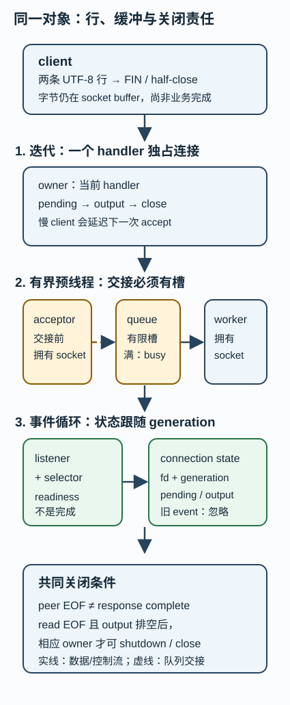

# 同一请求的三种服务模型：谁拥有字节、队列与关闭责任？

一个客户端发来两行 UTF-8 文本后执行 TCP 半关闭：服务端还能回复两行吗？如果此时工作者已满、读预算已到、而一个旧连接的 FD 数字又被新连接复用，代码究竟该拒绝、暂停读、继续回复，还是承认无法判断？

本单元用同一条有限行协议比较迭代、有限预线程和 selectors 事件循环三种模型。它不把三个程序“能跑”当作网络服务的完成证明；目标是把每个字节、连接、队列槽和关闭动作交给一个能说出名字的所有者。

## 共同合同：先把可比较的对象固定下来

所有模型只监听 127.0.0.1 的临时端口。每个请求是一个以 LF (0x0a) 结束的 UTF-8 行，整条 wire line 最多 64 bytes，且这个上限包含 LF；所以有效 payload 最多 63 bytes。CR 不是分隔符，只是 payload 的普通字节。

| 输入条件 | 输出与状态合同 |
| --- | --- |
| 完整且严格 UTF-8 的行 | OK 加原文字节，再加 LF |
| 解码失败 | 排队 ERR utf8，进入 rejected，丢弃尚未处理的后续输入；写完已有响应和错误回复后关闭 |
| 未遇 LF 就已积累 64 bytes，或完整行超过 64 bytes | ERR line-too-long 后进入同样的 rejected 状态；未遇 LF 的第 64 byte 已证明下一字节即使 LF 也会超限 |
| 对端 EOF 时仍有未完成行 | 先回复已完成行，再回复 ERR eof-partial |
| 预线程的工作队列满 | acceptor 回复 ERR busy 并关闭写端，不把 socket 偷塞进无界队列 |

上述回复以连接可写且总 deadline 尚有预算为前提。正常回复可包含中文等合法 UTF-8，错误码本身是 ASCII。`rejected` 与收到 EOF 都意味着不再读取；owner 仍先写出已排队的响应，随后关闭。对输入 `b"\xff\nok\n"`，同块或分块处理都只能产生 `ERR utf8`，不能再执行 `ok`；也不能等待对端再发 EOF 才关闭。若 deadline 已耗尽或连接出错，则终止本连接并回收资源，未写完的响应不承诺送达。

一次 read 或 recv 只得到字节前缀，不是一条业务消息；一次 write 或 send 的非负结果也只表示已交付前缀。三份实现都维护增量 pending 缓冲和待写 output 缓冲。POSIX 对 [read](https://pubs.opengroup.org/onlinepubs/9799919799/functions/read.html) 与 [write](https://pubs.opengroup.org/onlinepubs/9799919799/functions/write.html) 的短 I/O、EOF 与 EINTR 条件是接口合同；本 Python 小实验只验证自己的有限协议，不能替代 C 的 RIO 或特定内核调度。

这一版本还把用户态在途对象写成明确上限：每次读取最多 32 B；每连接最多有 3 个尚未完全写出的响应帧；每帧至多 67 B，因此 output 最多 201 B，代码给出的保守上限为 201 B。当第三帧尚未排空，连接进入 read_paused，selector 只登记写就绪，blocking handler 先排空再读；余下字节留在内核 socket buffer，而不是塞进 Python list。预线程唯一的跨连接用户态等待队列是 Queue(capacity)，默认容量为 2；满时拒绝。迭代和 selector 没有另一个用户态全局请求队列，有限 max_connections 是该次教学运行的 accept 预算，不能被解读成生产过载控制。

图中文字替代：客户端把 alpha/beta 两行分片送入 socket。迭代模型让当前 handler 独占读取、解析和写回，下一连接留在 listen backlog。预线程模型由 acceptor 持有 listener，把连接交给有界 queue 的一个槽，worker 才拥有 socket；队列满时 acceptor 拒绝。事件循环拥有 listener 和 selector；每个连接保存自己的 input/output 状态与 generation，readiness event 必须匹配 generation 才能操作该连接。三个模型都在 peer EOF 后先清空 output，再由所属组件关闭 socket。

## 基础补桥入口：手算一个时间线

不先背 select、线程或 TCP 状态机。客户端在 t0 写 alpha 的前缀；t1 再写余下字节和第二行；t2 执行 shutdown(SHUT_WR)。到 t2，处理者已知道 peer 不会再发，但仍不能关闭写端，因为它必须先清空两条 OK 响应。只有 t3 的最后一个响应字节送出后，它才可关闭 socket。

停在这里先预测：一个 worker 忙、队列容量为 1、第二个连接已经占据唯一槽，第三个连接到达时，“先放进 Python list”为什么不是答案？它使资源无界且没有等待责任。本页选择可见拒绝；暂停读也可以，只要说明何时恢复、谁保存 socket、哪个 deadline 停止等待。

## 快进入口：各模型必须保持的不变量

1. 每个连接的 pending 只属于一个连接状态；完整行只消费一次。
2. 每个响应先进入该连接的 output；预算内正常完成时，output 全部送出后才因 read EOF 或 rejected 关闭；deadline/连接故障是明确的终止条件。
3. 上限必须可数：每行不超过 64 B，预线程队列容量固定。
4. FD 数字不是连接身份。只有 fd 与 generation 同时匹配的 event 可以操作连接。
5. peer 不再发送、本端业务响应完成和本端资源回收是不同状态。

| 模型 | socket 的执行 owner | 背压位置 | 主要风险 |
| --- | --- | --- | --- |
| 迭代 | 当前 accept 后的处理循环 | listen backlog 与当前连接阻塞 | 慢 client 延迟后续 client |
| 有界预线程 | 一个 worker；交接前是 acceptor | 固定容量 Queue | queue 与关闭协议共享；GIL 不是不变量、关闭或 socket 所有权 |
| selectors | 单一 event-loop 与每连接 state | 读预算和应用缓冲 | readiness 不等于完成；旧 event 不能跟随 fd 整数复用 |

Python 的 [selectors](https://docs.python.org/3/library/selectors.html) 会选本平台可用机制，但未抹平 epoll、kqueue 等接口的触发、取消和错误细节。代码的一次 readiness 只 recv 32 B 是教学公平预算，不是性能结论。

## 机制层：同一输入怎样流过三套 owner

~~~mermaid
sequenceDiagram
    participant C as client
    participant A as acceptor/listener
    participant Q as bounded queue
    participant W as handler, worker, or event state
    C->>A: connect
    A->>W: iterative direct; event registers state
    A->>Q: prethread puts only if slot exists
    Q->>W: worker takes socket
    C->>W: two lines, then FIN
    W->>W: pending to complete lines to output
    W-->>C: two OK responses
    W->>W: output empty + read EOF to close
~~~

line_servers.py 的三个 serve 入口都有同样的有限参数：max_connections 和总 timeout。测试使用临时 loopback port；服务在接受完有限连接、总 deadline 到期，或抛出显式错误后关闭 listener 和自己拥有的 socket。没有常驻服务、外网连接或“某模型更快”的断言。

总预算必须绑定一个绝对时刻 $d=t_0+\text{timeout}$。每次阻塞 `recv`、`send` 或过载回复前都重新算 $r=d-\operatorname{monotonic}()$；$r\le0$ 就停止，否则把这次操作的 timeout 设为 $r$。[`socket.settimeout`](https://docs.python.org/3/library/socket.html#socket.socket.settimeout)约束后续阻塞操作，不会替应用累计多次操作的预算。例如总预算 1 s，第一次读取消耗 0.9 s，下一次读或写最多只剩 0.1 s，不能重新等待 1 s。

预线程关闭不再依赖“在满队列里成功塞入结束标记”。acceptor 停止后设置 `done`；worker 继续取已接收的有限任务，用同一个 deadline 处理并关闭连接。队列空时，带 20 ms 超时的 [`Queue.get`](https://docs.python.org/3/library/queue.html#queue.Queue.get)使 worker 能看见 `done` 并退出，0 个客户端也不例外。已经过期的排队连接直接关闭；清理阶段回收仍在队列中的 socket，并把工作者异常传回调用方。所有 worker 共享一次 100 ms 的 join 清理宽限，不按 worker 数反复追加预算；这允许线程调度和回收开销，仍不是生产环境的硬实时保证。`workers`、`capacity` 必须为正，容量 0 不能被误当作有界队列。

GenerationTable 是确定性所有权模型，不是伪装成已经复现的 fd reuse race。它证明旧 fd/generation 在关闭、再分配同一整数后失效。真实内核 readiness 队列和取消细节须按具体 API 复核。

## 运行与可检查结果

~~~bash
python3 -B -m unittest -v test_line_servers.py
~~~

测试检查：分片和同包多行、半关闭后仍写响应及 EOF 残行、超限与坏 UTF-8 的终止状态、中文成功回显、慢读者积累三帧后暂停读取并受 output 上限约束、三个模型同一输出、有界队列压力的 busy 拒绝，以及 generation 模型拒绝过期 event。假时钟验证每次读写都扣除已用预算；loopback 验证 0 客户端和满队列到期后没有遗留 worker，活动、排队、被拒绝的 socket 均关闭。测试会检查服务异常，不能仅以服务线程不再存活当成成功。它没有测量公平性、吞吐、TLS、HTTP、DNS、跨机网络或 OS 调度；通过也不等于完整安全证明。

## 迁移题：不要猜作者想要哪一种模型

请求 R 已收到两条完整行并半关闭；worker 全忙、队列已满、event-loop 本轮读预算耗尽；后来 R 的旧 FD 数字被新连接 S 复用。提出一个方案，并写出 R、S、队列槽、R 待写缓冲的 owner；R 是否还能得到两行回复；哪个 fd/generation 可处理 event；deadline 到达时哪些承诺仍有效；如何避免无界等待。

有限队列拒绝、暂停读后恢复、显式取消并报告失败，或“现有观测不足以判断业务完成”都可能正确。答案必须满足共同合同、资源上限和关闭所有权；仅说“上线程池”“改 epoll”或“GIL 会保护”没有回答条件。

## 从哪里继续，带什么问题回来

- [[计算机知识/35-计算机网络/10-系统课程/07-Socket分帧背压与排障|Socket 分帧、背压与排障]]：读 framing、总 deadline、背压；回来解释 pending/output 为何分开、ERR busy 为什么是协议选择。
- [[计算机知识/20-操作系统/01-Linux/10-系统课程/09-FD共享epoll与非阻塞状态机|从 FD 到事件循环]]：读 FD/OFD、readiness、半关闭、generation；回来解释 fd 整数为何不是身份。
- [[计算机知识/20-操作系统/02-操作系统原理/10-系统课程/10-条件变量丢失唤醒与活性证明|条件变量丢失唤醒与活性证明]]：读有界队列和关闭唤醒；回来检查预线程容量和停止协议。

## 来源、范围与代码镜像

- CMU 15-213，[Concurrent Programming（2015）](https://www.cs.cmu.edu/afs/cs/academic/class/15213-f15/www/lectures/23-concprog.pdf)，pp. 6–7：三类 server 的 logical flow、地址空间与 interleave 比较；不定义 Python、C11 内存模型或生产 SLA。
- The Open Group，[read](https://pubs.opengroup.org/onlinepubs/9799919799/functions/read.html) 与 [write](https://pubs.opengroup.org/onlinepubs/9799919799/functions/write.html)：短 I/O、EOF、EINTR 的 POSIX 边界。
- Python 文档，[selectors](https://docs.python.org/3/library/selectors.html)：selector 抽象的 API 范围。

可执行 Python 是真源；[[计算机知识/80-实践/06-计算机系统/15-同一请求的三种服务模型/源码与测试镜像|源码与测试镜像]] 的代码块由测试逐字核对，不是第二份可编辑实现。
