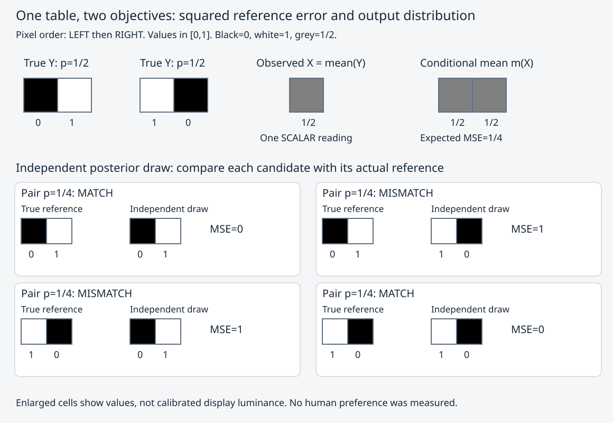

# 两像素：条件均值、参考误差与候选分布

给恢复器一个平均值，丢失的左右顺序还能唯一找回吗？先读 [[数学/30-概率与统计/11-条件期望与最小均方估计#两像素逆问题：均值最优，为什么仍不是真图？|唯一有限模型与证明]]，再用这里的同一表复算。这里只枚举模型，不训练网络，不采集真实媒体或观众评分。

## 从一张有限表重建结果与图

`input.json` 是唯一输入：两种真图 `(0,1)` / `(1,0)` 各概率 `1/2`，像素数固定为2，数值范围 `[0,1]`。`rebuild.py` 是规范生产源码，使用 Python 3 标准库 `fractions.Fraction` 精确枚举，不依赖 FFmpeg、NumPy 或绘图库。源码按观测分组归一化后验，计算均值，然后把当次真图与独立后验候选配对；MSE 先在两个像素上平均，再按配对概率平均。仅 dB 最后转为浮点。

从 Vault 根进入该目录后执行：

```bash
cd '计算机知识/80-实践/07-媒体编码与FFmpeg/05-条件均值与分布恢复'
python3 rebuild.py
```

命令打印新建临时目录的绝对路径，生成 `pairs.csv`、`result.json`、`two-pixels.svg`，不覆盖本页旁的固定结果。`python3 rebuild.py --out /一个已存在可信父目录/一个尚不存在的目录名` 可指定新输出；已有目录会以退出码2拒绝。输入可用 `--input /路径/input.json` 指定。输出父目录需由操作者控制；这不是并发路径替换沙箱。

用编辑器打开打印路径下的三个文件。固定默认结果也可直接读 [逐配对 CSV](pairs.csv)、[总体与条件结果 JSON](result.json) 和下面的图；这三项由当前规范源码与默认输入实际运行生成。重新生成可逐字节比较，因为它们没有时间戳或随机抽样波动。源码链接为 [rebuild.py](rebuild.py)，输入为 [input.json](input.json)，正文不另复制一份代码。

| 观测规则 | 均值的总体每像素MSE | 后验抽样总体MSE | 抽样匹配率 | MAX=1，均值/抽样的池化PSNR |
| --- | ---: | ---: | ---: | --- |
| 两像素平均值 | 1/4 | 1/2 | 1/2 | 6.020599913… / 3.010299957… dB |
| 首像素 | 0 | 0 | 1 | 两者 `+infinity` |

平均值观测有4个非零配对，各 `1/4`；首像素观测有2个非零配对，各 `1/2`。CSV同时保留每图误差、每图PSNR与条件均值。JSON同时保留总体池化PSNR与逐图PSNR的理论期望，防止同名字段混淆。零误差在数学上是 $+\infty$，在两个文本格式中都用 `+infinity`；不会输出非法JSON数值 Infinity。没有用随机蒙特卡洛的一批计数冒充精确概率。



图中上排是两幅真图、一个共同**标量**观测以及均值图；下排逐对标出当次参考/独立候选、匹配与每像素误差。所有图块按输入像素值填灰度并保留数值标签；放大方格仅帮助阅读，灰色不表示经过色彩标定的显示亮度。它显示支持集与配对关系，没有人类感知优势结论。

## 读结果后，把条件带回原问题

- 回 [[计算机知识/60-数据编码与媒体系统/16-媒体质量评估PSNR-SSIM-VMAF与听感边界#同一两像素例：先池化MSE，还是先取dB？|媒体PSNR池化]]，解释为什么抽样器的3.0103 dB不是逐图dB平均，且有限批匹配数不一定刚好一半。
- 回 [[AI/50-扩散模型/03-Score去噪FlowMatching与CFG的联系#局部条件均值为什么没有把全部生成变成灰图|扩散均值与完整采样]]，指出这里没有扩散时间或反向链，不能将直接后验抽样叫DDPM。
- 回 [[数学/30-概率与统计/11-条件期望与最小均方估计#只改观测，再自行求解|改观测迁移题]]，合上结果表后自行重建首像素观测的后验与误差，再展开答案核对。

本结果认证这张有限表的枚举、数值和同源图。条件期望的一般最优性由数学页证明，扩散接口按DDPM论文式(1)/(11)/Algorithm2对照；没有运行真实生成模型、转码、音质测试、艺术评价或真人学习验收。
