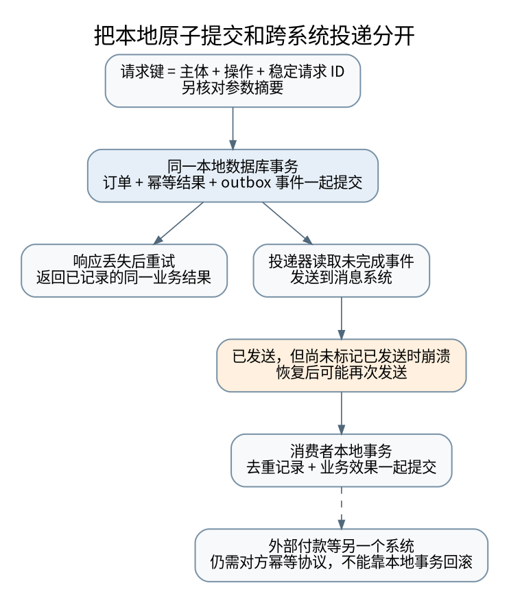

# 贯通案例：超时、重试、幂等与事务发件箱

> **本页要解决**：请求已经执行但确认丢失，怎样避免第二次业务效果？
>
> **先修**：[[计算机知识/85-综合贯通/01-一次订单请求贯通十三学科|一次订单请求的总案例]]。
>
> **阅读入口**：[[计算机知识/00-开始/全局导航/11-难点导读与研究证据|难点与贯通导读]] · [[计算机知识/00-开始/全局导航/11-难点导读与研究证据|全局难点导读]]。

**版本、模型与证据边界**：区分可计算的教学假设、进程内故障注入与真实分布式保证；没有生产环境压测或跨机故障实验。

## 最危险的超时不是“肯定失败”，而是“不知道有没有成功”

设客户端请求创建订单。服务器已经提交事务，但返回包丢失；客户端等待超时。如果按“超时就是没执行”重新创建，就可能产生两份订单。反过来完全不重试，又可能在原请求根本没到达时永久丢失操作。TCP 的重传与去重只处理同一连接中的字节，不会替你合并两次业务调用。TLS 保护传输也不替代业务去重。

应把客户端可见状态至少分成：确认成功、确认失败、结果未知。结果未知可通过相同业务操作标识重试或查询；“取消等待”不是第四种能让历史消失的魔法。[[计算机知识/10-编程语言/04-Rust/10-系统课程/10-Pin投影任务所有权与取消协议|任务句柄所有权]]、[[计算机知识/10-编程语言/01-Python/10-系统课程/10-异步取消异常组与有界流水线|取消传播]] 和 [[计算机知识/10-编程语言/05-TypeScript/10-系统课程/10-运行时边界状态机与取消安全|过期响应]] 分别讨论本地任务层的后果。

## 幂等键必须绑定意图，而不是只存一个字符串

设计键空间为 `(principal, operation, idempotency_key)`，并保存请求规范化后的摘要、完成状态及可重放的业务结果。同一调用者、同一操作、同一键、同一请求可返回原结果；同一键却改变金额或对象必须报冲突，而非把完全不同的意图偷偷当重试。跨用户复用同一键也不应泄露别人的结果。[^retry]

摘要不是取代业务协议：规范化规则要固定，区分金额单位、缺省值和版本；还要决定失败是否缓存、未完成状态如何恢复、键保存多久。保存期必须覆盖允许的重试与迟到消息窗口；删除去重记录后再次收到老请求，旧效果可能重现。

```text
BEGIN
  以唯一约束争取幂等键
  若已有记录：核对请求摘要，再返回原结果或明确的进行中状态
  若新记录：执行业务写入
            保存结果
            写入一条 outbox 事件
COMMIT
返回已提交的结果
```

这不是可直接复制到所有数据库的 SQL：唯一键冲突、并发等待和事务隔离的具体语义要按实现设计。关键不变量是“业务效果与该键的完成记录处在同一原子提交边界里”。先在内存检查键不存在，再执行写入，仍会被两个并发请求同时穿过。

## 为什么还需要事务发件箱

数据库已提交订单后，通知消息队列失败，会得到“订单存在但下游永远不知道”；先发消息再提交数据库，则可能得到“下游处理了不存在的订单”。普通的先后调用无法让两个独立系统凭空共享一个事务。

把业务行和待发事件写进同一数据库事务，提交后由独立发布者扫描 outbox，是把“双写问题”变成“可恢复、可重复的投递问题”。[^outbox]



[矢量图](../_assets/diagrams/round4/outbox.svg) · [可编辑图源](../_assets/diagrams/round4/outbox.dot)

故障时间线必须逐个检查：事务提交前失败，两者都不生效；提交后、发送前失败，事件仍在箱中待恢复；发送成功、标记已发送前失败，重启后会再次发送。因此 outbox 不保证消息只出现一次。先标记已发送再真正发送则可能永久丢失，顺序不能反过来。

## 消费者去重必须和效果一起提交

消费者可在同一个本地事务中插入 `processed(message_id)` 唯一记录并更新业务状态。如果事务回滚，两者都回滚；重投后可以重新处理。若只把 ID 放进内存集合，进程重启就会忘；若先独立提交“已处理”标记，再做业务效果，崩溃时又会永久跳过未完成效果。

如果效果是发邮件、调用外部支付或控制设备，它不在本地数据库事务里。此时必须依赖对方支持幂等键、可查询的操作状态，或使用补偿与对账流程；不能声称一个 `processed` 表解决了跨互联网的“恰好一次”。同样，消息队列 ACK、消费者收到消息、消费者事务持久提交是三种不同确认，连接 [[计算机知识/55-数据库/10-系统课程/12-WAL日志恢复与副本确认边界|日志与副本确认边界]]。

## 什么时候“重试整个事务”仍不够

串行化失败通常要从事务开头重新读取并重新决策，不能只重试最后一个 UPDATE。若事务过程中已经执行不可回滚的外部调用，整段重跑可能重复副作用。因此先把纯计算/数据库事务与外部效果边界拆开，再设计 outbox 或对账，参见 [[计算机知识/55-数据库/10-系统课程/10-MVCC快照写偏斜与重试协议|写偏斜与重试协议]]。

退避和抖动减少请求同时重试，但不改变业务幂等性。多个调用层各自重试会放大负载；应明确总尝试预算、绝对截止时间和可重试错误集合。过载时无界排队会把超时请求继续留在服务器执行，进一步制造重复工作。

租约也不是完整互斥证明。旧持有者暂停后恢复，可能不知道租约已过期。可使用单调 fencing token，并由真正接收写操作的资源拒绝旧 token；若只在客户端自检 token 而资源不校验，仍不能阻止迟到旧写。这个方案还依赖 token 的生成和持久状态正确性，不能靠本地时钟编号随意替代。

## 可以验证什么，不能冒充验证什么

本库附 SQLite 临时数据库的教学实现：幂等键与请求摘要校验、业务记录与 outbox 同事务、发送后未标记导致重复、消费者去重与效果原子提交。通过显式故障点中止流程，而非真的中断生产服务。它证明这些顺序在所建教学模型和本地事务中保持约定，不是对真实消息代理、支付平台或跨地域故障的完整验证。

练习：在“业务提交、发布、消费、确认”每两步之间插入崩溃，分别标明恢复会重试什么、会不会重复效果；再解释一个只保存 24 小时去重记录的接口，为什么不能承诺任意时间后的相同请求仍不产生新效果。

[^retry]: Amazon Builders' Library，Making retries safe with idempotent APIs，调用者提供请求标识和迟到请求的设计经验：https://aws.amazon.com/builders-library/making-retries-safe-with-idempotent-APIs/ 。
[^outbox]: AWS Prescriptive Guidance，Transactional outbox pattern，事务内写事件与重复投递边界：https://docs.aws.amazon.com/prescriptive-guidance/latest/cloud-design-patterns/transactional-outbox.html 。

## 知识连接：下一步应追问什么

回看各层的“完成”，找出取消、传输 ACK、本地提交和外部效果之间的空隙。

[[计算机知识/10-编程语言/01-Python/10-系统课程/10-异步取消异常组与有界流水线|让异步任务有负责人：取消、异常组与有界流水线]]：超时之后，哪些任务仍在运行，谁负责收尾？

[[计算机知识/10-编程语言/05-TypeScript/10-系统课程/10-运行时边界状态机与取消安全|从 unknown 到可信状态：校验、状态机与异步取消]]：声明成某个类型，为什么不能让网络数据自动可信？

[[计算机知识/10-编程语言/04-Rust/10-系统课程/10-Pin投影任务所有权与取消协议|Pin 固定谁，取消谁：地址稳定、任务句柄与外部副作用]]：丢弃 Future 与丢弃 JoinHandle 为什么不是同一件事？

[[计算机知识/35-计算机网络/10-系统课程/10-TCP窗口RTO与拥塞控制手算|从 ACK 到发送决策：TCP 窗口、RTO 与拥塞推演]]：接收窗口、拥塞窗口、在途量与超时分别限制什么？

[[计算机知识/55-数据库/10-系统课程/10-MVCC快照写偏斜与重试协议|两个事务各自正确，合起来为何错误：快照、写偏斜与重试]]：可重复读为什么仍可能让两个值班医生同时离岗？

[[计算机知识/55-数据库/10-系统课程/12-WAL日志恢复与副本确认边界|日志先行之后：重做、撤销、检查点与副本确认]]：提交不强制写全部数据页，为什么仍可能持久？

## 本地核验与阅读顺序

[[计算机知识/_labs/round4/README|本轮实验：命令、检查范围与未执行项目]] 提供对应文件和记录。[[计算机知识/90-资源/维护/导入-com/_meta/round4/01-研究证据与版本边界|研究证据索引]] 区分规范、推演和实验；[[计算机知识/90-资源/维护/导入-com/_meta/round4/02-缺口回查与后续验证|仍需进一步验证的边界]] 不把概览或模型标成完整实现。

下一专题：[[计算机知识/85-综合贯通/03-从复杂度到尾延迟的性能证据链|贯通案例：从复杂度、缓存和队列到尾延迟]]。
