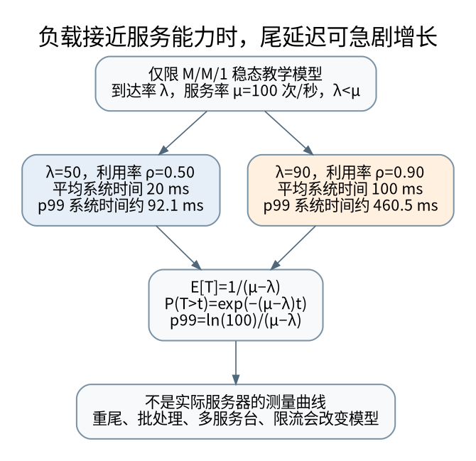

# 贯通案例：从复杂度、缓存和队列到尾延迟

> **本页要解决**：吞吐没变，为什么 p99 已经恶化？
>
> **先修**：[[计算机知识/85-综合贯通/01-一次订单请求贯通十三学科|一次订单请求的总案例]]。
>
> **阅读入口**：[[计算机知识/00-开始/全局导航/11-难点导读与研究证据|难点与贯通导读]] · [[计算机知识/00-开始/全局导航/11-难点导读与研究证据|全局难点导读]]。

**版本、模型与证据边界**：区分可计算的教学假设、进程内故障注入与真实分布式保证；没有生产环境压测或跨机故障实验。

## “这个算法更快”必须补上观察对象

复杂度比较的是规模增长时的资源趋势，不直接给出某台机器某种输入下的延迟。`O(n log n)` 与 `O(n)` 的实际交叉点受常数、内存布局、向量化和数据分布影响；同是 `O(log n)`，连续内存上的二分查找和随机访问磁盘页也不是同一个代价模型。先区分单次 CPU 时间、端到端响应时间、吞吐、内存峰值和尾延迟。

一次请求可拆成输入等待、排队、执行、依赖调用和输出等待。CPU 使用率低不证明系统空闲：它可能在等待磁盘、网络、锁或连接池；CPU 使用率高也不证明应先换算法，可能是重复解析、忙轮询或无意义重试。[[计算机知识/55-数据库/10-系统课程/11-连接基数索引选择与优化器误估|优化器与基数]] 展示的是另一种“模型估错会把正确策略用错地方”。

## Amdahl：局部四倍并非整体四倍

若原耗时 80% 可被优化到四倍速度，其余不变，总加速比：

$$S=\frac{1}{(1-0.8)+0.8/4}=2.5.$$

把那 80% 的部分无限加速，理论上限也只有 5 倍。这里假定问题规模和其他成本不变；并行化引入的通信、调度、同步或缓存冲突要另算。把一个函数的微基准改善直接当服务吞吐同比改善，通常缺少这些桥梁。

## Little 定律先统一边界和单位

稳定系统的长期平均在途量、通过率和逗留时间满足 `L=λW`。`L` 包括哪些请求，`W` 就必须覆盖同一边界；若只统计队列长度，就要使用排队时间而不是排队加执行时间。单位若是每秒请求数和秒，结果就是请求数。

例如系统平均每秒完成 200 个请求，平均从入队到结束 0.05 秒，在一致的稳态统计边界下平均在途量为 10。这个等式不要求服务时间一定指数分布，但有限观测窗口、不断增长的积压、丢弃请求口径不一致都会影响直接套用。它也不表示给每个请求配一个线程就能线性加速。

下面用队列模型解释“接近满载为何危险”，不是宣称所有服务都遵守该分布。

## M/M/1：把假设写在公式前面

假定请求按泊松过程到达、服务时间相互独立且服从指数分布、只有一个服务者、先来先服务、容量无限，且 `λ<μ`。令 `ρ=λ/μ`。平稳队列长度分布为 `P(N=n)=(1-ρ)ρ^n`，由几何级数求得 `L=ρ/(1-ρ)`，再用 Little 定律得到平均系统逗留时间：

$$W=\frac{1}{\mu-\lambda},\qquad W_q=W-\frac{1}{\mu}.$$

为什么平稳长度分布是几何分布？相邻状态的长期跃迁流量满足 $\lambda p_n=\mu p_{n+1}$，于是 $p_{n+1}=\rho p_n$；再用概率总和为 1 求出 $p_0=1-\rho$。这个归一化只有在 $\rho<1$ 时成立，所以“负载低于能力”不是可省略的装饰条件。

尾部公式也可以逐步推出。泊松到达在本模型中看到的是时间平均状态分布；到达时若已有 n 个请求，先来先服务加指数分布的无记忆性，使其逗留时间等于 n+1 段独立指数服务时间之和。条件密度为 $\mu e^{-\mu t}(\mu t)^n/n!$。按看到 n 个请求的概率加权：

$$
\begin{aligned}
f_T(t)&=\sum_{n=0}^{\infty}(1-\rho)\rho^n\mu e^{-\mu t}\frac{(\mu t)^n}{n!}\\
&=(1-\rho)\mu e^{-\mu t}e^{\rho\mu t}\\
&=(\mu-\lambda)e^{-(\mu-\lambda)t},\quad t\ge 0.
\end{aligned}
$$

对密度积分就得到系统逗留时间的尾概率 `P(T>t)=exp(-(μ-λ)t)`，再反解得到第 p 分位数：

$$t_p=\frac{-\ln(1-p)}{\mu-\lambda}.$$

| 服务率 μ | 到达率 λ | 利用率 | 平均系统时间 | p99 系统时间 |
|---|---|---|---|---|
| 100/s | 50/s | 0.5 | 20 ms | 约 92.1 ms |
| 100/s | 90/s | 0.9 | 100 ms | 约 460.5 ms |

这里平均单次服务时间都为 10 ms，但平均响应时间因排队变成两种完全不同的结果。真实服务有批处理、多服务者、重尾分布、优先级、缓存和相关请求，数值不能直接照搬；这个模型提供的是可证伪的机制解释。生产负载管理还需要容量边界、拒绝策略和退避，参见 SRE 的过载处理经验。[^sre]

[矢量图](../_assets/diagrams/round4/queue-load.svg) · [可编辑图源](../_assets/diagrams/round4/queue-load.dot)

## p99 不能随手相加，扇出还会放大尾部

若请求并行等待 100 个相互独立的子请求，且每个在阈值 t 内完成的概率是 0.99，那么所有子请求都按时的概率只有 `0.99^100≈0.366`。这不是说每个子请求变慢了，而是“等待最慢者”改变了整体事件。共享依赖会使延迟相关，独立假设失效时要重新分析。

串行步骤的总延迟是随机变量之和，各步骤的 p99 一般不能直接相加得到总 p99。用 100 个配对请求构造反例，并明确 p99 采用从小到大排序后第 99 个样本：第一阶段只有请求 1 耗时 100 ms，第二阶段只有请求 2 耗时 100 ms，其余均为 0。每个阶段的 p99 都是 0，但总延迟有两个 100 ms，其 p99 为 100 ms。因此两个阶段各自的边际分位数不足以确定和的分位数；换一种样本分位数插值规则时，具体数字会变，不能随意相加的结论不变。

先保留请求级追踪或明确联合分布。只报平均值可能掩盖长尾，只报 p99 又可能隐藏极少但致命的超长超时；样本量、窗口、失败请求是否纳入也应报告。

## 一条可执行的性能证据链

先固定正确性和输入分布，再分层测量：算法层记录规模、操作次数与数据特征；CPU 层观察实际热点、分支和缓存线索；系统层区分就绪等待、阻塞 I/O 和锁竞争；数据库层对照估计/实际行数和访问页；网络层看往返时间、窗口与重传；服务层看队列、背压和请求完成时间。

相关不等于因果。缓存未命中计数升高与延迟升高可能由同一输入变化造成，不足以单独证明缓存是唯一瓶颈。一次只改变一个主要因素，保留基线，交替或随机化测量顺序，区分预热前后，报告分布而非挑最快的一次。虚拟化、频率变化、后台任务和测量工具自身开销都是混杂因素。

闭环压测客户端在每次响应后才发下一次，服务器卡住时客户端也停止加压，可能低估本来会到达的请求等待，即 coordinated omission。按目标到达过程发压可以暴露该问题，但发压器本身也可能饱和。不要把请求超时后继续执行的后台工作从资源统计中隐去，连接 [[计算机知识/85-综合贯通/02-超时重试幂等与事务发件箱|重试放大与不确定结果]]。

## 自检与实验边界

附带程序核对 Amdahl、Little 单位算例、M/M/1 数值、扇出概率及分位数反例。这些是公式和构造数据检查，不是实测某个服务的性能。没有真实工作负载，就不编造“优化提升百分比”。进一步实验应明确硬件、软件版本、负载发生器、样本量和误差；数值累计误差见 [[计算机知识/30-计算机系统/10-组成原理系统课程/09-浮点舍入消去与数值稳定性|浮点稳定性]]，网络吞吐上界见 [[计算机知识/35-计算机网络/10-系统课程/10-TCP窗口RTO与拥塞控制手算|窗口与带宽时延积]]。

[^sre]: Google SRE Book，Handling Overload，过载保护与排队的工程讨论；本文 M/M/1 是单独声明假设后的数学推导，不把书中的实践结果当本库性能数据：https://sre.google/sre-book/handling-overload/ 。

## 知识连接：下一步应追问什么

把理论成本、数值精度和排队假设与测量对象一一对齐，而不是只比较一个平均值。

[[计算机知识/30-计算机系统/10-组成原理系统课程/09-浮点舍入消去与数值稳定性|误差来自哪里：浮点舍入、消去与数值稳定性]]：数学上相等的两个公式，为什么数值结果差很多？

[[计算机知识/35-计算机网络/10-系统课程/10-TCP窗口RTO与拥塞控制手算|从 ACK 到发送决策：TCP 窗口、RTO 与拥塞推演]]：接收窗口、拥塞窗口、在途量与超时分别限制什么？

[[计算机知识/55-数据库/10-系统课程/11-连接基数索引选择与优化器误估|执行计划为什么选错：连接基数、索引代价与统计相关性]]：有索引却走全表扫描，是优化器失灵还是更便宜？

[[计算机知识/50-数据结构与算法/20-算法设计系统课程/11-归约方向随机误差与近似保证|保证写错方向就失效：归约、随机误差与近似界]]：证明新问题很难时，归约箭头应该指向哪边？

[[计算机知识/10-编程语言/01-Python/10-系统课程/10-异步取消异常组与有界流水线|让异步任务有负责人：取消、异常组与有界流水线]]：超时之后，哪些任务仍在运行，谁负责收尾？

## 本地核验与阅读顺序

[[计算机知识/_labs/round4/README|本轮实验：命令、检查范围与未执行项目]] 提供对应文件和记录。[[计算机知识/90-资源/维护/导入-com/_meta/round4/01-研究证据与版本边界|研究证据索引]] 区分规范、推演和实验；[[计算机知识/90-资源/维护/导入-com/_meta/round4/02-缺口回查与后续验证|仍需进一步验证的边界]] 不把概览或模型标成完整实现。

上一专题：[[计算机知识/85-综合贯通/02-超时重试幂等与事务发件箱|贯通案例：超时、重试、幂等与事务发件箱]]。 下一专题：[[计算机知识/85-综合贯通/04-跨层保证与反例矩阵|跨层保证辨析：类型、原子、隔离、一致性与持久性]]。
