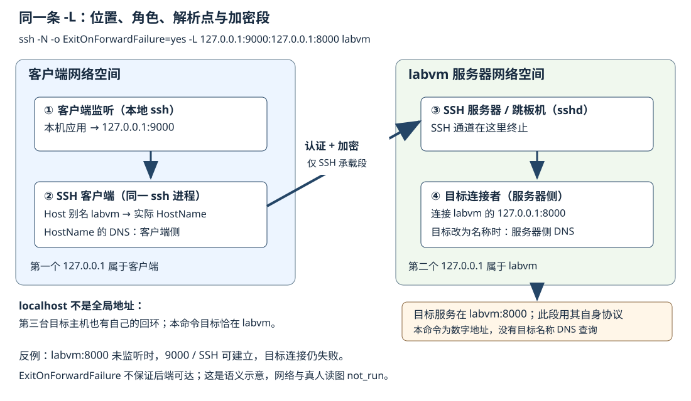

# NetcatSocatSSH与受控代理

**先修关系：** [[计算机知识/Kali/01-系统与网络基础/06-TCPIP路由DNS与TLS|TCPIP路由DNS与TLS]]；[[计算机知识/Kali/01-系统与网络基础/07-HTTP浏览器会话与信任边界|HTTP浏览器会话与信任边界]]；[[计算机知识/Kali/01-系统与网络基础/05-进程服务日志与本机加固|进程服务日志与本机加固]]。

## 连接、转发与代理不是同一件事

Netcat/Ncat 把标准输入输出接到套接字；Socat 能连接多种地址类型；SSH 提供经过认证和加密的远程通信及端口转发。代理则代表客户端发起某些协议连接。它们是诊断与管理工具，但错误配置会把内部服务暴露到新位置。

本章只讨论自有实验服务或明确授权的管理路径，不把隧道当作隐藏身份、绕过组织监测或扩大范围的办法。

## 代理与转发改变的是通信路径，不是自动增加业务权限

本地 `-L`、远程 `-R` 与动态 `-D` 相对 SSH 客户端定义方向：分别在客户端监听/服务器连接、服务器监听/客户端连接，以及提供 SOCKS 入口。绑定、服务器策略与转发类型约束可用性，不能用地理位置猜“本地/远程”。[^v5-ssh] 本地机制集中在 [[#本地转发要画清四个端点|四角色主解释]]；这些路径变化均不扩大业务授权。

### DNS 在哪一端解析，是另一个独立问题

SOCKS 的本地/代理解析取决于请求携带地址还是名称，见 [[#代理中的名字解析在哪里发生|解析记录]]，并对齐 [[计算机知识/Kali/02-信息收集与网络测量/02-DNS域名与证书信息|DNS 观察条件]]。浏览器经另一命名空间代理，而 curl 未用代理时，两者走不同路径；应对齐地址、解析点、TLS 名称、身份与缓存。

### 通道加密到哪里结束

SSH 只保护 SSH 客户端到服务器承载段；目标段是否加密由目标协议决定。业务身份仍独立，参照 [[计算机知识/Kali/03-Web与API安全/13-HTTP中间层与消息解释|TLS 终止]]。纸面检查按四角色图指出监听、名称解析、连接与加密终点。

## Ncat / Netcat：观察最小应用交换

不同 `nc` 实现的选项不完全一致；先看 `nc -h`，不要把 GNU、OpenBSD netcat 和 Ncat 的命令混用。Ncat 的当前帮助由官方包页提供。[^s1]

```bash
# 自建回环服务存在；只请求公开的教学页面
printf 'GET / HTTP/1.1\r\nHost: localhost\r\nConnection: close\r\n\r\n' \
  | ncat --idle-timeout 3s 127.0.0.1 8000
```

`\r\n`（CRLF，回车加换行）是 HTTP/1.1 行结束形态；空行结束首部。该例不执行 Shell，不建立远程命令通道。若没有响应，先判断对端是否等待更多字节、服务是否加密、连接是否未关闭。

Socat 的对应“标准输入输出连 TCP”形态可写为 `socat - TCP:127.0.0.1:8000`；它没有自动替你生成 HTTP 请求。地址选项丰富，也因此更应避免从网上复制带进程执行或宽监听地址的命令。[^s2]

## 为什么 nc 会一直等待

交互有三个独立的结束条件：标准输入结束、TCP 发送方向结束、对端应用结束响应。不同 Netcat 实现如何在 EOF 后关闭连接并不一致；`-q`、`-N` 等选项不能跨实现盲用。先用固定的 Ncat 示例与 `Connection: close` 请求建立基线，再核对本机帮助。

TLS 服务等待的是握手记录，不会因为收到明文 GET 就把自己变成 HTTP。相反，明文服务也不会理解 TLS ClientHello。超时之前先确认协议，而不是给所有连接增加“等待更久”。

## SSH 本地转发的三个位置

以下统一采用已配置并核验主机密钥的自建别名 `labvm`，其服务器回环 8000 是目标。具体命令及地址解释见 [[#本地转发要画清四个端点|四角色图]]；执行会显式新开本机监听，需确认授权与端口冲突。`-N` 不执行远程命令。[^s3]

SSH 主机密钥认证服务器，用户密钥/密码认证用户，TLS 证书属于目标协议层。主机密钥变化先独立核实原因，不直接关闭严格检查。

## 用一张路径账本解释 SSH 转发

用 [[#本地转发要画清四个端点|同一命令与图]] 记录客户端 `127.0.0.1:9000`、SSH 对等方、服务器侧 `127.0.0.1:8000` 与目标日志，不另建一套例子。[^v2-ssh] 先检查本地监听、再检查会话身份、最后做目标应用请求；后端不可达的反例由主解释给出。

## 本地转发要画清四个端点

唯一贯穿命令使用同一 `labvm` 和两个端口；本包没有该主机，不自动执行：

```bash
# 已配置且已核验主机密钥的自建 labvm；显式新开本机回环监听。
# ssh -N -o ExitOnForwardFailure=yes \
#   -L 127.0.0.1:9000:127.0.0.1:8000 labvm
```



1. **客户端监听** `127.0.0.1:9000` 属于发起 SSH 的客户端网络空间，由本地 ssh 进程接受应用连接。
2. **SSH 客户端** 建立到 `labvm` 的认证加密通道。`labvm` 是客户端配置的 Host 别名；实际 HostName 的名称解析在客户端（另有代理配置时核相应路径）。
3. **SSH 服务器/跳板机** 在 `labvm` 接受通道请求。SSH 加密在此终止，不自动保护后面的目标协议段。
4. **目标连接者** 是服务器侧发起连接的角色（通常仍由 sshd 承担），连接 `127.0.0.1:8000`。这里的回环是 labvm 的网络空间，不是客户端回环，也不是另一台目标主机的回环。若参数改为目标名称，由服务器侧解析并连接；本地 dig 不证明其采用的地址。[^v3-ssh]

客户端、labvm 和真正目标主机分别有自己的 localhost；本命令的目标服务正好在 labvm。若改为第三台主机名，第三台的 `127.0.0.1` 仍是它自己的回环，不能拿字符串同名合并位置。HTTP Host/TLS 名称与路由分别核对，不关闭证书验证掩盖不匹配。

正常情形：本机应用连接 9000，SSH 承载字节，服务器连接其回环 8000，再由目标应用响应。失败情形：labvm 的 8000 没监听，本地 9000 和 SSH 会话仍可建立，但目标连接失败；`ExitOnForwardFailure=yes` 处理请求的转发无法建立，**不保证最终后端可达**，所以 ssh 没退出不证明 `/health` 成功。[^v3-sshconfig]

### 收尾也要检查地址范围

回环限制不等于对本机其他进程的身份授权。结束这次 SSH 进程后检查对应监听消失，保留应用控制与日志，不 kill 所有 ssh 进程。其他转发方向见 [[#代理与转发改变的是通信路径，不是自动增加业务权限|方向定义]]。图、网络、客户端与真人读图验收分别为 `not_run`，SVG 当前仅做 XML/文本静态检查。

## SOCKS、ProxyChains 与适用边界

动态 SSH 提供 SOCKS 入口，ProxyChains 可作用于部分用户态连接函数；它们不能保证所有协议、DNS 和原始包流量都被代理。SYN 扫描与普通 HTTP TCP 连接路径不同。`sshuttle` 等路由辅助配置另行审阅，不是默认依赖。单请求代理和名称解析说明集中在 [[#代理中的名字解析在哪里发生|代理解析合同]]。

## 代理中的名字解析在哪里发生

curl 的 SOCKS 配置可区分本地解析与由代理解析的模式。浏览器、命令行和原始包扫描不一定共享路径。排错记录应明确代理地址、DNS 解析位置、是否发生重定向和目标看到的来源；不要只写“已开代理”。

用显式单命令代理比修改整个系统更容易回滚，但也要检查环境变量与应用配置是否另外参与。关闭终端不必然停掉后台转发，结束后仍用监听与进程证据确认清理。

## 证据与清理

记录原始客户端地址、跳转节点、目标看到的来源、DNS 解析位置和监听绑定。停止转发后用 `ss -lnt` 检查监听是否消失。不要在分享包里放 SSH 私钥、真实主机清单或可复用代理凭据。

自检：浏览器通过代理能访问，但 Nmap SYN 扫描失败，是否说明目标状态矛盾？不一定，两者的协议栈、代理支持和来源路径可能不同。先重建路径，再比较结果。

## 来源与核验范围

[^v5-ssh]: [OpenBSD：ssh(1)](https://man.openbsd.org/ssh)；定位：-L、-R、-D：监听端与目标连接端；forwarding 限制。v5 实际网页读取：2026-09-06。支持所引机制；本页数字案例为原创教学推演，不是工具实测。

[^s1]: [Kali 官方：nmap 包及当前帮助](https://www.kali.org/tools/nmap/)；定位：Packages and Binaries：nmap / ncat / ndiff / nping。网页读取：2026-09-05。
[^s2]: [Kali 官方：socat](https://www.kali.org/tools/socat/)；定位：地址类型与 TCP 连接。网页读取：2026-09-05。
[^s3]: [OpenSSH 官方：ssh(1)](https://man.openbsd.org/ssh)；定位：-L / -N / -D / host key checking。网页读取：2026-09-05。
[^s4]: [curl 官方命令手册](https://curl.se/docs/manpage.html)；定位：--connect-timeout / --max-time / --proxy / --resolve / --cacert。网页读取：2026-09-05。

来源支持所引机制，教学模型与实际运行证据分开记录。旧版命令和实验的运行情况见 [[计算机知识/Kali/90-来源与维护/05-v3深度审阅与变更记录|v3 历史验收]]；本轮来源、理论与静态检查见 [[计算机知识/Kali/90-来源与维护/06-v5深度研究与结构梳理记录|v5 研究与验收]]。本轮没有重跑旧实验或进行 Kali 工具、Obsidian 界面实测。

[^v2-ssh]: [OpenSSH 官方：ssh 手册](https://man.openbsd.org/ssh)；定位：-L / -D / -N / forwarding and destination interpretation。本轮网页读取：2026-09-05；教学推演与本包实验另行标明。

[^v3-ssh]: [OpenSSH：ssh(1)](https://man.openbsd.org/ssh)；定位：-L local forwarding；目标由 remote side 建立连接。v3 本轮读取：2026-09-05。仅支持对应机制与接口，案例及实测范围另行标明。

[^v3-sshconfig]: [OpenSSH：ssh_config(5)](https://man.openbsd.org/ssh_config)；定位：ExitOnForwardFailure；不能保证 ultimate destination 连接。v3 本轮读取：2026-09-05。仅支持对应机制与接口，案例及实测范围另行标明。

---
**导航：** [[计算机知识/Kali/00-导航与方法/00-Kali知识地图|知识地图]] · [[计算机知识/Kali/00-导航与方法/05-常用工具覆盖矩阵|按任务查工具]]