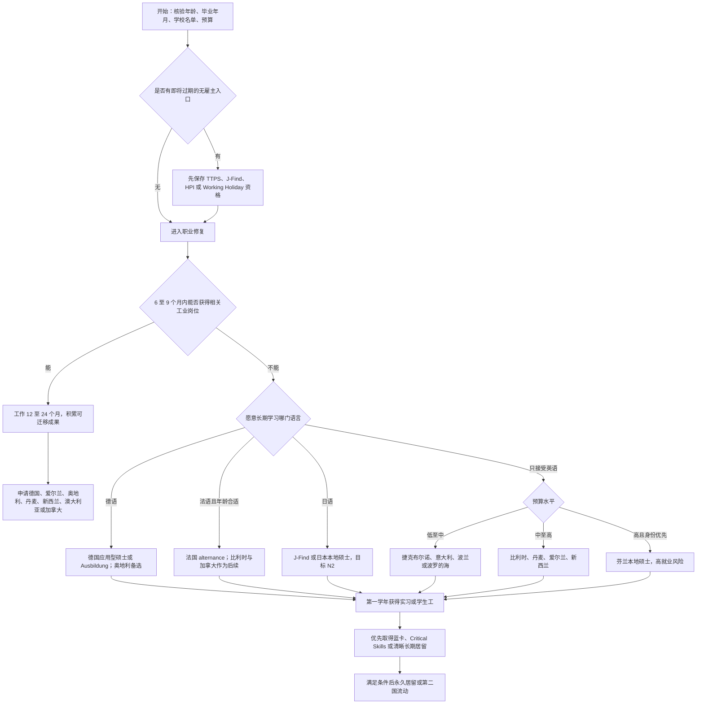

# 中国大陆光电本科背景的多阶段移民路线图

> [!warning] 政策快照
> 本笔记核验日期为 **2026-08-30**。签证门槛、学校名单、工资线、毕业后求职期和永久居留规则都可能变化。任何真正提交申请的动作，都应在提交前重新打开本笔记末尾的官方链接核验。移民政策很喜欢在人把 Excel 做得很漂亮之后突然换列名，行政机关大概也需要一点娱乐。

> [!abstract] 适用画像
> - 中国大陆知名大学本科毕业；
> - 本科为光电、光学工程、光电信息或相邻理工科；
> - 成绩中等，技术能力尚可，但不是顶尖论文型申请人；
> - 近两年无正式工作，近期履历偏弱；
> - 可能受到美国总统公告 PP10043 对美国部分研究生学习或研究签证的影响；
> - 家庭经济条件尚可，但不应把高额学费当成成功率的替代品；
> - 目标是竞争相对可控、生活条件较好、制度与社会环境较开放，并最终取得稳定工作居留或永久居留。

> [!summary] 一句话结论
> **最优策略不是先选国家，而是先制造一种能被多个国家雇主购买的工业技术履历。** 默认主线应为：用 6 至 12 个月修复空档并争取中国大陆或香港的跨国工业技术岗位，积累 12 至 24 个月可迁移经验，再转德国、爱尔兰、奥地利、丹麦、新西兰、澳大利亚或加拿大法语通道。若短期内拿不到合适工作，则以 **德国应用型硕士或德国技术型双元职业培训** 作为最稳健闭环；年龄和法语条件合适时，**法国 alternance** 可与德国路线并列第一梯队。

---

## 目录

- [[#1. 最终战略结论]]
- [[#2. 为什么不能只做“国家排名”]]
- [[#3. 当前画像与约束]]
- [[#4. 资格闸门：两周内必须核验]]
- [[#5. 职业重定位：从光电转成可迁移工业能力]]
- [[#6. 路线总排名]]
- [[#7. 路线族 A：先工作，再跨国迁移]]
- [[#8. 路线族 B：在学习国完成就业闭环]]
- [[#9. 路线族 C：在 A 国学习，在 B 国工作]]
- [[#10. 路线族 D：不读书先入境求职或试水]]
- [[#11. 路线族 E：远程收入、数字游民与创业]]
- [[#12. 路线族 F：带薪博士与研究岗位]]
- [[#13. PP10043 与军民两用审查策略]]
- [[#14. 24 至 36 个月执行计划]]
- [[#15. 申请组合、量化指标与止损规则]]
- [[#16. 预算分层]]
- [[#17. 情景决策树]]
- [[#18. 明确不建议的做法]]
- [[#19. 每周 Obsidian 复盘模板]]
- [[#20. 官方来源索引]]

---

# 1. 最终战略结论

## 1.1 风险调整后的优先顺序

### 第一主线：先获得工业技术经历，再迁移

路径：

> 中国大陆或香港跨国工业企业相关岗位  
> → 12 至 24 个月可核验经验  
> → 内部调动、同集团招聘或海外直接招聘  
> → 德国技术人才居留/欧盟蓝卡、爱尔兰关键技能许可、奥地利红白红卡、丹麦工作许可、新西兰 Green List、澳大利亚雇主担保或加拿大法语通道  
> → 永久居留

这是默认最优解，原因不是它看起来最光鲜，而是它能同时修复：

- 两年无业造成的近期履历断层；
- 海外雇主对能力真实性的怀疑；
- 缺少真实项目、客户、产品和交付记录的问题；
- 直接跨国求职时雇主需要承担的签证与试错成本；
- 成绩平平对纯学术申请的限制。

### 第二主线：德国应用型硕士闭环

路径：

> 德语 B1/B2  
> → 德国公立 HAW/FH 或职业导向硕士  
> → 学生工/实习/企业论文  
> → 德国技术岗位  
> → 技术人才居留或欧盟蓝卡  
> → 永久居留

德国仍是最稳健的单国闭环。它的核心优势不是“德国缺人”这种被说烂的口号，而是：德语可以缩小竞争池，公立教育试错成本相对可控，毕业后求职期长，技术人才和本地毕业生的身份转换路径清楚。

### 第三主线：法国 alternance

适用条件：

- 通常未满 30 岁，或符合例外；
- 法语能够达到企业工作所需的 B2 左右；
- 能同时拿到课程录取和企业合同。

路径：

> 法语 B2  
> → 职业型硕士或工程项目  
> → alternance 学徒合同，边学习边作为雇员工作  
> → 留用或法国毕业求职居留  
> → 法国工作身份  
> → 以后可继续转比利时、加拿大法语通道或其他欧盟国家

它可能比普通硕士更有效，因为毕业时你已经有法国工作记录，而不是拿着一张文凭开始第一次寻找雇主。

### 第四主线：选择“可携带学位”，一次购买多个国家的求职期权

路径：

> 在欧洲产业型、排名满足条件的大学完成硕士  
> → 使用学习国的毕业求职许可  
> → 同时核验荷兰 Orientation Year、瑞典高学历求职许可、英国 HPI、日本 J-Find、香港高才通等资格  
> → 在多个市场中选择实际拿到的最佳工作

这不是鼓励毕业后搬家巡演，而是避免一个国家就业不佳时只能立刻回国。学位的价值不应只有一张毕业证，还应包括它能触发多少合法求职入口。

## 1.2 条件性高优先级入口

这些资格会随年龄、毕业年或学校名单过期，应当先核验，而不是等职业规划完成后再发现入口已经关门：

- 香港高才通 B/C 类；
- 日本 J-Find；
- 英国 HPI；
- 新西兰中国公民 Working Holiday；
- 澳大利亚 subclass 462 抽签；
- 法国 alternance 的常规年龄窗口；
- 德国寻找职业培训岗位签证的年龄窗口。

## 1.3 不同目标下的最优选项

| 首要目标 | 最优或次优路线 |
|---|---|
| 总体成功率与低损失 | 先取得中国大陆/香港跨国工业岗位，再迁移 |
| 最稳健单国闭环 | 德国应用型硕士或德国技术型 Ausbildung |
| 边读边工作、尽快获得本地经验 | 法国 alternance |
| 低预算进入欧盟产业环境 | 捷克布尔诺、意大利低成本公立项目、部分波兰/立陶宛项目 |
| 一个学位保留多个国家出口 | 比利时、奥地利、法国、意大利等满足荷兰/英国/日本/香港名单条件的硕士 |
| 只接受英语且预算高 | 丹麦、比利时、爱尔兰、新西兰；其中丹麦的毕业后求职期最有吸引力之一 |
| 永居制度优先、能承受就业高风险 | 芬兰本地硕士 |
| 日语愿意学到 N2，且符合名单与毕业年限 | 日本 J-Find 或日本本地硕士 |
| 先试水生活与本地市场 | 新西兰 Working Holiday；澳大利亚 462 仅作为战术试验 |
| 先获得法语，再打开加拿大 | 法国/比利时学习或工作 → Francophone Mobility、FCIP 或 Express Entry 法语类别 |

---

# 2. 为什么不能只做“国家排名”

## 2.1 “竞争小”至少有四种不同含义

1. **入境竞争**：签证或学校是否难申请。
2. **第一份专业工作竞争**：有没有雇主愿意给没有本地经验的人机会。
3. **身份转换竞争**：拿到工作后，工资、职位、学历是否满足居留条件。
4. **长期稳定竞争**：失业后是否有缓冲期，永居是否可预测，是否被单一雇主长期绑定。

一个国家可能学校很好进，但毕业后岗位少；也可能签证规则漂亮，但真实雇主不愿招聘。把“拿到录取”当成“移民成功”，相当于把登机牌当成房产证，逻辑颇有创意，但银行不会配合。

## 2.2 成功概率模型

可用以下模型检查每条路线：

```text
P(稳定留下)
≈ P(入境成功)
× P(完成学习或顺利工作)
× P(获得第一份合格岗位)
× P(身份转换成功)
× P(财务未耗尽)
```

因此，应优先选择没有明显短板的路径，而不是某一项异常诱人的路径。

## 2.3 本笔记的评价权重

| 维度 | 权重 | 解释 |
|---|---:|---|
| 第一份专业工作的可获得性 | 30% | 这是最大瓶颈，远比学校录取重要 |
| 身份转换与永久居留可预测性 | 20% | 包括求职期、工资线、雇主绑定和永居规则 |
| 入境或录取可行性 | 15% | 是否受 GPA、工作经验、年龄或学校名单限制 |
| 资金成本与失败损失 | 15% | 不只看最低资金证明，也看两年总消耗 |
| 生活条件与社会开放度 | 10% | 民主制度、公共服务、安全、工作生活平衡及融入摩擦 |
| 跨国可携带性 | 5% | 能否通过蓝卡、学历名单或企业内调形成第二出口 |
| 对敏感背景审查的鲁棒性 | 5% | 能否避开高度敏感研究与出口管制岗位 |

> [!note] 关于评分
> 后文的等级和分数是战略估计，不是官方成功率。它们用于比较路线，不应被理解为“83 分就有 83% 成功率”。虚假的精确数字不会让未来变得更听话。

---

# 3. 当前画像与约束

## 3.1 可利用的优势

- 知名中国大陆大学本科，可通过学校声誉和课程强度获得初步可信度；
- 光电横跨光学、电子、信号处理、成像、传感、实验、编程和半导体，转型空间比单一专业更大；
- 技术水平尚可，意味着可以用作品、测试结果和真实交付覆盖普通 GPA；
- 家庭经济条件尚可，允许进行语言、项目和有限留学投资；
- 如果毕业时间较近，可能符合 J-Find、TTPS、HPI 或 Working Holiday 等时限型入口。

## 3.2 核心劣势

- 两年无业使“近期可雇佣性”成为最大疑点；
- 成绩普通，不适合把全部希望押在顶尖研究型硕士、全奖或热门博士；
- 没有海外本地语言和本地工作记录；
- 光电部分细分方向具有军民两用属性，申请敏感实验室和受出口管制岗位时审查摩擦可能更大；
- 如果直接申请全球英语岗位，将与已有海外学历和经验者正面竞争。

## 3.3 需要尽快补齐的未知变量

```yaml
age: 
graduation_date: 
university_official_english_name: 
gpa: 
major_rank: 
english_level: 
german_level: 
french_level: 
japanese_level: 
liquid_budget_rmb: 
maximum_acceptable_loss_rmb: 
passport_expiry: 
prior_us_visa_refusal_or_10043_record: 
```

这些变量会直接改变路线排序。尤其是年龄、毕业年月和学校正式英文名称，它们决定若干“免雇主先入境”资格是否仍然存在。

---

# 4. 资格闸门：两周内必须核验

## 4.1 时限型资格清单

- [ ] 核验本科院校是否在香港高才通最新合资格大学名单。
- [ ] 核验毕业年份是否仍满足高才通 C 类“过去五年毕业”的口径。
- [ ] 核验学校是否在日本 J-Find 最新合资格名单，且学位授予不超过五年。
- [ ] 核验学校是否在英国 HPI 对应毕业年月的年度名单。
- [ ] 若年龄 18 至 30 岁，核验新西兰中国公民 Working Holiday 下一次开放时间。
- [ ] 若年龄符合，核验澳大利亚 subclass 462 中国申请人的年度抽签窗口。
- [ ] 若考虑法国 alternance，确认年龄是否低于通常的 30 岁上限或是否适用例外。
- [ ] 若考虑德国寻找职业培训岗位签证，确认年龄是否满足当期规则。

## 4.2 德国与欧盟学历识别

- [ ] 在德国 anabin 检查学校状态和学位可比性。
- [ ] 如果 anabin 信息不足，评估是否需要 ZAB 学历认证。
- [ ] 准备 APS 所需材料，避免拿到录取后才开始。
- [ ] 保存中英文成绩单、学位证、毕业证、课程大纲、课程描述和教学时数。
- [ ] 制作“本科课程 → 目标硕士先修课”的课程对应表。

## 4.3 证据归档

为每个时限型项目建立一个 Obsidian 子笔记：

```text
资格名称：
核验日期：
官方页面：
适用毕业年份：
学校是否在名单：
年龄要求：
资金要求：
当前缺口：
下一次复核日期：
官方页面截图或 PDF 存档位置：
```

名单型政策应保存申请时的官方版本，因为“学校现在在榜”不一定等于“你毕业时在榜”，反过来也一样。

---

# 5. 职业重定位：从光电转成可迁移工业能力

## 5.1 不要把自己只定义为“光学工程师”

海外岗位搜索应以能力簇而非本科专业名称展开。光电最有价值的地方，是它可以自然连接到电子、软件、制造、仪器和质量体系。

| 本科能力 | 可迁移岗位 | 应补技术栈 | 可验证成果 |
|---|---|---|---|
| 成像、几何光学、图像处理 | 工业机器视觉、检测、成像系统 | Python/C++、OpenCV、标定、深度学习基础、部署 | 缺陷检测、尺寸测量、误检率与延迟报告 |
| 模拟/数字电路、信号处理 | 嵌入式、传感器集成、数据采集 | MCU、RTOS、通信协议、滤波、PCB 基础 | 传感器系统、稳定性测试、端到端演示 |
| 激光、光电器件、实验 | 科学仪器、医疗成像、光学测试 | 仪器控制、LabVIEW/Python、误差分析 | 自动化测量、校准与不确定度报告 |
| 半导体与器件基础 | 工艺、封装、测试、量测、良率 | SPC、DOE、失效分析、统计、测试脚本 | 测试流程、良率分析、异常定位 |
| 数学、编程、信号 | 科学计算、工业软件、算法工程 | Python/C++、Linux、版本控制、CI | 可复现代码、基准测试、技术文档 |
| 实验设计与报告 | 验证、可靠性、质量工程 | FMEA、8D、DOE、统计过程控制 | 可靠性测试方案、故障树与改进结果 |

## 5.2 推荐岗位优先级

### 第一梯度：最适合跨国迁移

- Machine Vision Engineer / Computer Vision Engineer，偏工业视觉而非纯研究；
- Application Engineer / Field Application Engineer；
- Metrology Engineer / Measurement Engineer；
- Test Engineer / Validation Engineer / Verification Engineer；
- Embedded Systems Engineer；
- Semiconductor Process / Yield / Reliability / Packaging Engineer；
- Automation / Controls Engineer；
- Scientific Instrumentation Engineer；
- Medical Imaging / Imaging Systems Engineer；
- Field Service Engineer，前提是工作包含真正技术诊断与设备能力。

### 第二梯度：可作为横向扩展

- Quality Engineer / Supplier Quality Engineer；
- Failure Analysis Engineer；
- Technical Support Engineer，面向工业设备或企业客户；
- Technical Sales / Solutions Engineer；
- Industrial Software Engineer；
- Manufacturing Data Analyst；
- Systems Integration Engineer。

### 不宜主押

- 无行业背景的泛数据科学；
- 零基础“转 AI”并与全球计算机硕士竞争；
- 无工作经验 MBA；
- 纯产品经理或普通行政岗位；
- 只有论文、没有部署和交付的纯算法路线；
- 直接押高度敏感的军用激光、空间遥感、制导、密码或大规模监控。

## 5.3 多语言岗位搜索词

### 英语

```text
machine vision engineer
industrial computer vision
optical metrology engineer
imaging systems engineer
embedded systems engineer
sensor integration engineer
semiconductor test engineer
yield engineer
reliability engineer
field application engineer
validation engineer
automation engineer
scientific instrumentation
```

### 德语

```text
Bildverarbeitung
Industrielle Bildverarbeitung
Applikationsingenieur
Messtechnik
Prüfingenieur
Validierungsingenieur
Automatisierungstechnik
Embedded Systems
Halbleiter Prozesstechnik
Zuverlässigkeitsingenieur
Qualitätsingenieur
```

### 法语

```text
ingénieur vision industrielle
ingénieur systèmes embarqués
ingénieur métrologie
ingénieur validation
ingénieur procédés semi-conducteurs
ingénieur qualité
ingénieur instrumentation
ingénieur automatisme
```

### 日语

```text
画像処理エンジニア
マシンビジョン
組込みエンジニア
半導体プロセス
評価・解析
品質保証
計測技術
フィールドアプリケーション
自動化
```

## 5.4 必须完成的两个作品集项目

### 项目 A：工业机器视觉或计量

最低要求：

- 使用真实或公开数据；
- 包含标定、预处理、检测或测量；
- 给出 precision、recall、误检率、漏检率或测量误差；
- 给出 CPU/GPU 推理延迟和硬件环境；
- 分析失败样本；
- 提供英文 README、环境配置和复现实验步骤；
- 提供 2 至 4 分钟演示视频；
- 最好包含边缘设备或工业相机部署。

### 项目 B：嵌入式、传感或测试系统

最低要求：

- MCU、FPGA、单板计算机或工业控制器之一；
- 接入真实传感器或相机；
- 包含采集、滤波、通信、校准和异常处理；
- 做稳定性、温漂、噪声、丢包或持续运行测试；
- 有硬件框图、BOM、代码和测试报告；
- 明确个人贡献。

> [!tip] 项目判断标准
> 面试官应能在五分钟内看懂你解决了什么问题、指标提升多少、失败在哪里、下一步怎么改。只有漂亮界面而没有误差分析的项目，和只有精美包装的方便面差不多，热闹主要发生在外壳。

---

# 6. 路线总排名

## 6.1 综合分层

| 路线 | 适配等级 | 资金风险 | 第一份专业工作难度 | 身份清晰度 | 最佳用途 |
|---|---|---|---|---|---|
| 大陆/香港跨国工业岗位 → 海外迁移 | **S** | 低 | 中 | 取决于终点，通常较清楚 | 默认主线 |
| 德国应用型硕士 → 德国就业 | **S-** | 中低 | 中 | 高 | 最稳健单国闭环 |
| 法国 alternance | **S-，条件性** | 低至中 | 企业合同难 | 中高 | 年龄与法语合适时效率极高 |
| 德国技术型 Ausbildung | **A+** | 低 | 找培训合同中等 | 高 | 低成本、高容错、愿意接受 3 年训练 |
| 奥地利硕士 → 红白红卡 | **A** | 中 | 中 | 中高 | 德语区第二选择 |
| “可携带学位”多国期权路线 | **A，条件性** | 中至高 | 分散风险 | 高度依赖名单 | 用一个硕士打开多个国家 |
| 捷克布尔诺硕士 → 工业岗位 | **A-** | 低 | 中 | 中 | 低成本欧洲经验制造器 |
| 丹麦州认可硕士 → 最长 3 年求职 | **A-** | 高 | 中 | 中 | 英语友好、长求职期，但永居慢 |
| 比利时硕士 → 比利时/荷兰 | **A-** | 中高 | 中 | 中高 | 半导体、光子、跨国出口 |
| 日本 J-Find | **A-，条件性** | 中 | 日语不足时高 | 中 | 符合名单且愿意学日语 |
| 芬兰本地硕士 → 新永居路径 | **B+，高波动** | 高 | 高 | 制度很强 | 身份优先、能承受就业风险 |
| 意大利低成本硕士 → 意大利或他国 | **B+** | 低至中 | 中高 | 中 | 低成本学位与多国期权载体 |
| 香港高才通或本地硕士 IANG | **B+** | 中 | 中 | 中 | 职业修复与企业内调平台 |
| 爱尔兰 Level 9 → Stamp 1G | **B** | 高 | 高 | 中高 | 英语、高成本、半导体/医疗器械 |
| 新西兰硕士 → 毕业工签/Green List | **B** | 高 | 高，市场小 | 中高 | 生活终点好，职业起点较难 |
| 西班牙硕士 → 24 个月求职居留 | **B-** | 中 | 高 | 表面长、现金流弱 | 只有在毕业前完成雇主连接时考虑 |
| 爱沙尼亚/立陶宛/波兰低成本路线 | **B-** | 低至中 | 小市场 | 中 | 预算受限的备选 |
| 新西兰/澳大利亚 Working Holiday | **C+，战术性** | 中 | 专业岗不确定 | 低 | 试水与本地面试，不是完整移民路线 |
| 西班牙/葡萄牙远程工作居留 | **C，未来选项** | 中 | 先有远程收入才成立 | 中 | 已建立稳定远程收入后使用 |
| 新加坡/马来西亚技术岗位 | **C，职业桥梁** | 低至中 | 中高 | 永居弱或竞争高 | 积累区域工业经验，不宜默认终点 |

## 6.2 默认资源分配

- **50%**：就业优先路线，包括项目、语言、跨国工业岗位和技术面试；
- **25%**：德国闭环，包括应用型硕士、Ausbildung、APS 和德语；
- **15%**：法国 alternance、奥地利、捷克、比利时或丹麦；
- **10%**：TTPS、J-Find、HPI、Working Holiday、研究型高收益路线。

---

# 7. 路线族 A：先工作，再跨国迁移

## 7.1 为什么这条路线应当排第一

对当前画像而言，最大的边际改善不是再拿一个证书，而是获得一段真实、近期、可核验的工业经历。

一份合适工作可提供：

- 稳定的时间线，终止“两年无业仍在继续”的问题；
- 产品、设备、客户或生产场景；
- 可量化的指标；
- 英文邮件、跨团队协作和客户沟通；
- 推荐信与背景调查材料；
- 海外团队内部招聘资格；
- 满足加拿大社区试点等项目的近期工作经验条件；
- 更高概率达到爱尔兰、德国、奥地利、新西兰等岗位的薪资与经验门槛。

## 7.2 第一份工作的选择标准

岗位名称可以普通，但至少满足四项中的三项：

1. 公司在欧洲、日本、新西兰、澳大利亚、加拿大或新加坡有真实团队；
2. 工作接触产品、设备、生产、客户或质量体系；
3. 成果可以量化；
4. 技能能在不同国家复用。

### 值得接受的“非理想但有用”岗位

- 设备调试、现场服务和应用支持；
- 测试、验证、质量、可靠性；
- 制造工程、良率、工艺支持；
- 技术售前和解决方案工程；
- 科学仪器、医疗器械或工业自动化技术支持；
- 半导体封装、测试和量测。

这些岗位可能没有“算法研究员”听起来优雅，但它们更容易产生海外雇主能理解的业务价值。职业迁移靠的是可交换能力，不是岗位名称的文学性。

## 7.3 12 至 24 个月内必须积累的成果

- [ ] 至少一个完整交付项目；
- [ ] 一个可量化改善，例如良率、误检率、停机时间、交付周期或故障复现率；
- [ ] 一份英文技术文档；
- [ ] 与海外团队或客户的协作记录；
- [ ] 一个能提供具体评价的直属主管或项目负责人；
- [ ] 熟练使用至少一套行业工具链；
- [ ] 更新后的作品集和英文简历；
- [ ] 能在面试中讲清楚“问题、约束、行动、结果、复盘”。

## 7.4 经验形成后的主要终点

| 终点 | 合适许可 | 何时启动 | 核心优势 | 核心风险 |
|---|---|---|---|---|
| 德国 | 技术人才居留、欧盟蓝卡 | 有 1 至 3 年经验且德语 B1/B2 | 产业面广、永居快、可再向欧盟移动 | 当前经济周期、德语 |
| 爱尔兰 | Critical Skills Employment Permit | 能拿到两年合格合同并达到工资线 | 21 个月后可转 Stamp 4，英语环境 | 全球竞争、住房成本 |
| 奥地利 | Red-White-Red Card、EU Blue Card | 德语与岗位匹配后 | 德语区生活质量高，之后劳动力市场更开放 | 市场小于德国 |
| 丹麦 | Positive List、Pay Limit 等 | 有明确雇主和合格职位 | 工程与高端制造环境好 | 永居通常更慢、成本高 |
| 新西兰 | Green List 相关路径 | 职业和学历评估能匹配电子/工程岗位 | 部分岗位可直接或工作后转居民 | 岗位总量小 |
| 澳大利亚 | Skills in Demand 482 等雇主担保 | 有经验、职业评估与雇主 | 工程岗位在核心职业清单中 | 担保竞争和住房成本 |
| 加拿大 | Francophone Mobility、FCIP/RCIP、EE | 至少 1 年近期经验，最好法语 | 法语能显著扩大通道 | 政策波动、需真实雇主 |
| 新加坡 | EP 或 S Pass | 薪资和经验明显提升后 | 区域总部、半导体与工业岗位 | EP 工资线高，永居不透明 |

## 7.5 香港作为职业修复与内调平台

### 高才通

符合合资格大学名单、毕业年份和配额等条件时，高才通 B/C 类可提供不预先绑定雇主的在港居留窗口。B/C 类通常初次逗留 24 个月。应把它视为：

- 进入香港本地技术岗位；
- 进入跨国公司的亚洲团队；
- 获得英文工作记录；
- 争取内部调动到欧洲、日本或新加坡。

不应仅因为能获批就立即搬迁。启用前至少应有：

- 20 至 30 个明确目标岗位；
- 3 至 5 次真实招聘沟通；
- 足以覆盖 9 至 12 个月的资金；
- 对香港住房、行业结构和长期生活偏好的清醒判断。

### 香港本地硕士 → IANG

香港认可本地学位的非本地毕业生，通常可通过 IANG 获得毕业后工作窗口；近期毕业生一般不必在申请时已有工作邀约。其价值仍主要是职业桥梁：

> 一年左右本地硕士  
> → 24 个月左右开放求职/工作窗口  
> → 香港或跨国公司技术岗位  
> → 内调或海外直聘

缺点是学费与住房不低，且它不天然降低技术岗位竞争。

## 7.6 马来西亚槟城/居林作为半导体桥梁

槟城和居林具有半导体封装、测试、设备和制造生态，可用于获得：

- 半导体制造现场经验；
- 封装、测试、量测和可靠性经历；
- 英文或跨国团队工作记录；
- 未来转新加坡、德国、爱尔兰或其他制造中心的筹码。

但 2026 年马来西亚 Employment Pass 工资分类明显上调，且长期永久居留路径弱，因此更适合作为职业资本积累地，而不是默认的开放型终点。

---

# 8. 路线族 B：在学习国完成就业闭环

## 8.1 德国：综合首选

### 推荐结构

> 德语 B1 入学准备  
> → 公立 HAW/FH 或职业导向综合大学  
> → 第一学年取得学生工  
> → 企业实习或企业论文  
> → 毕业后 18 个月求职居留  
> → 技术人才居留或欧盟蓝卡  
> → 永久居留

### 为什么适合

- 多数公立项目传统学费低，失败成本相对可控；
- 德语形成真正的竞争过滤器；
- 光电可平移到机器视觉、传感、嵌入式、自动化、半导体测试、医疗仪器和科学仪器；
- 德国本地高校毕业后可获得最长 18 个月求职期，并可工作维持生活；
- 德国本地毕业生持技术人才工作居留、合格工作和 24 个月养老保险等条件下，可较快申请永久居留；
- 蓝卡通常可在 27 个月、B1 德语时 21 个月申请永久居留。

### 选校规则

优先：

- HAW/FH；
- 有强制实习、企业项目或企业毕业论文；
- 德语或德英双语；
- 二线产业城市；
- 本科课程匹配度 60% 至 80%；
- 能自然转到工业岗位。

关注地区：

- 德累斯顿、开姆尼茨：微电子、设备、软件和制造；
- 耶拿、伊尔默瑙：光学、光子、传感和精密仪器；
- 埃尔朗根—纽伦堡、雷根斯堡：电子、医疗技术和自动化；
- 马格德堡、凯泽斯劳滕、卡尔斯鲁厄周边：工程、软件和工业；
- 不要只投慕尼黑、柏林和热门纯英语项目。

### 关键 KPI

- 入学前德语至少 B1；
- 找学生工前接近 B2；
- 第二学期前开始投学生工；
- 至少一次企业实习；
- 毕业论文尽量由企业联合指导；
- 不等毕业后才第一次联系雇主。

## 8.2 德国技术型 Ausbildung：低成本、高容错

适合方向：

- Mikrotechnologe；
- Elektroniker für Geräte und Systeme；
- Elektroniker für Automatisierungstechnik；
- Mechatroniker；
- Fachinformatiker；
- Feinoptiker；
- Physiklaborant。

优势：

- 企业合同、培训津贴、职业学校和真实工作形成完整链条；
- 对 GPA 依赖低；
- 德国完成职业培训后有求职和工作转居留路径；
- 在满足工作、养老保险和德语等条件后，可进入永久居留。

代价：

- 通常 3 至 3.5 年；
- 初期收入和职业层级低于硕士工程师；
- 德语通常至少 B1，真实竞争中 B2 更稳；
- 对已有本科的人心理上可能有“学历倒退”感。

从移民工程角度，这条路线比昂贵而缺少实习的泛硕士更扎实。学历面子不会替你缴养老保险。

## 8.3 法国 alternance：年龄和法语合适时的高效率路线

### 核心条件

- 普通学徒合同通常要求申请人不超过 29 周岁，存在少数例外；
- 非欧盟学生可以在符合条件时参加 alternance；
- 需要学校项目和企业合同同时成立；
- 企业工作语言通常要求法语 B2 左右。

### 最适合方向

- 工业视觉；
- 嵌入式；
- 自动化；
- 微电子与半导体；
- 医疗技术；
- 质量、验证和工业软件。

### 真正瓶颈

不是学校录取，而是企业合同。申请顺序应为：

> 课程筛选与企业投递并行  
> → 优先找明确支持 alternance 的项目  
> → 在中国境内提前开始企业面试  
> → 不先交高额费用再祈祷雇主出现

### 后续

法国硕士毕业后通常可申请一年求职或创业居留。毕业前已有 alternance 记录时，留用概率和本地推荐显著优于普通全日制学生。

## 8.4 奥地利：德国路线的高质量并行备选

路径：

> 德语 B1/B2  
> → 奥地利大学或 FH 硕士  
> → 本地实习/学生工  
> → 毕业后一次性 12 个月求职或创业期  
> → 本地毕业生 Red-White-Red Card  
> → 21/24 个月合格工作后 Red-White-Red Card Plus  
> → 长期居留

优点：

- 本地毕业生申请红白红卡不走积分制；
- 取得 RWR Plus 后劳动市场更开放；
- 生活质量高，德语与德国路线共享；
- 格拉茨、林茨、维也纳及周边存在电子、自动化和制造岗位。

缺点：

- 市场显著小于德国；
- 学生平均生活成本约每月 1,300 欧元，不能只看学费；
- 纯英语岗位池有限。

## 8.5 丹麦：最长三年求职期，但不是快速永居路线

州认可的完整高等教育项目毕业后，视项目类型可获得 6 个月或最长 3 年求职居留。对符合 3 年求职期的毕业生：

- 求职期内一般保留学生时期的工作权限，即 9 月至 5 月每月 90 小时、6 至 8 月全职；
- 完成项目后还可以申请求职期内不受限的工作许可；
- 找到工作后再转相应工作居留。

优点：

- 对毕业找工作给出很长缓冲期；
- 工程、高端制造、自动化、绿色能源和医疗技术环境较好；
- 英语可完成部分学习和工作起步。

缺点：

- 非欧盟学生年学费通常约 6,000 至 16,000 欧元，生活成本也高；
- 必须选择 **state-approved** 项目，部分非州认可项目自 2025 年后不再附带同等工作和毕业求职权；
- 永久居留通常需要更长合法居住与就业、语言等条件，常规门槛明显慢于德国；
- 小市场意味着三年求职期不是三年自动就业。

定位：

> **很好的职业启动国家，未必是最快永久居留国家。**

## 8.6 芬兰：身份政策极强，就业风险也很强

2026 年起，完成符合条件的芬兰本地高等教育学位，并达到芬兰语或瑞典语 A2 或 15 学分语言学习等要求者，可使用本地学历永久居留路径；但仍需满足连续居留许可基础、一般条件和经济条件，并非毕业自动发放。

优势：

- 身份制度对本地硕士非常有吸引力；
- 社会制度、公共服务和开放程度高；
- 光子、通信、嵌入式和工业技术有一定基础。

风险：

- 2026 年中失业率趋势较高；
- 外国毕业生留芬就业比例和专家岗位比例明显弱于本国毕业生；
- 非欧盟硕士学费常为每年 8,000 至 20,000 欧元，生活费官方建议约每月 900 至 1,200 欧元；
- 英语岗位有限，芬兰语应从第一学期开始；
- UAS 硕士常要求本科毕业后相关工作经验，当前可能不满足。

定位：

> **身份制度高收益、就业基本面高波动。** 不应仅因为“毕业可能较快申请永久居留”就忽略第一份工作。

## 8.7 捷克布尔诺：低成本欧洲工业经验制造器

优势：

- 外语授课项目多数年学费约 0 至 6,000 欧元；
- 生活费约每月 500 至 750 欧元；
- 全日制认可项目学生通常可工作；
- 毕业后可申请最长约 9 个月求职或创业居留；
- 布尔诺具有电子显微镜、科学仪器、芯片设计、嵌入式、自动化和研发中心生态。

正确用法：

> 低成本硕士  
> → 第一学年学生工  
> → 企业实习/论文  
> → 捷克技术岗位  
> → 若薪资与岗位满足，争取欧盟蓝卡  
> → 持蓝卡满 12 个月后研究第二成员国流动

限制：

- 捷克工资较低，初级岗位未必达到蓝卡线；
- 普通捷克学生或工作居留不等于全欧盟工作权；
- 为长期就业，捷克语 A2/B1 会显著增加岗位池。

## 8.8 比利时：半导体、光子与荷兰出口

优势：

- 鲁汶、根特、布鲁塞尔一带有微电子、硅光、传感、通信和工业研发；
- 毕业后有 12 个月 orientation year；
- 佛兰德认可学位在荷兰学历评估上有便利；
- 某些满足排名要求的比利时硕士可进一步触发荷兰 Orientation Year；
- 荷兰语或法语可以形成额外竞争壁垒。

缺点：

- 成本高于德国、捷克和意大利；
- 英语岗位依旧面对国际竞争；
- 需要从第一学期争取企业实习。

## 8.9 意大利：低成本学位与多国期权载体

意大利可作为此前被低估的预算路线：

- 学生居留通常允许每周最多 20 小时、全年 1,040 小时工作；
- 完成本科或硕士后，可在满足条件时转换为约 1 年求职居留；
- 公立大学和地区资助可能显著降低成本，具体依学校和家庭经济材料；
- 部分大学的硕士若满足荷兰“境外指定院校”排名条件，可在毕业后三年内申请荷兰 Orientation Year；
- 硕士也可用于申请瑞典高学历求职许可，若学校在英国、日本或香港相应名单，还可能增加其他出口。

适合方向：

- 北意大利制造、自动化、汽车供应链、仪器和电子；
- 都灵、米兰、博洛尼亚、帕多瓦等地区的工程项目；
- 选择有实习、实验室和企业论文的课程。

限制：

- 本地青年与初级岗位竞争不弱；
- 意大利语 B2 对就业很重要；
- 不能把低学费等同于高就业率。

## 8.10 爱尔兰：英语路线中身份转换较清楚，但成本与竞争高

Level 9 及以上毕业生通常可通过 Third Level Graduate Programme 获得最多 24 个月 Stamp 1G。进入 Critical Skills Employment Permit 后：

- 需要至少两年的合格工作邀约；
- 2026 年部分战略职业的最低年薪线为 40,904 欧元，毕业 12 个月内的合格申请人可能适用 36,848 欧元；
- 通常工作 21 个月后可申请 Stamp 4，摆脱工作许可要求。

适合：

- 半导体；
- 医疗器械；
- 自动化；
- 软件与工业系统；
- 有较强英语和企业实习能力的人。

不利：

- 高学费、高住房成本；
- 英语岗位面向全球；
- 不能把 Stamp 1G 当成工作保证。

## 8.11 新西兰：生活终点优秀，职业起点不宽

路径：

> 合格本地硕士  
> → 最长可达 3 年毕业后工作签证  
> → 合格技术岗位  
> → Green List 或技术移民路径

优点：

- 英语、社会环境和生活质量；
- Green List 中部分电子、电气和工程岗位可直接或工作后转居民；
- 本地硕士有助于学历识别和面试。

风险：

- 市场小；
- 光电本科是否等同于电子工程职业，需要结合成绩单、职责和 Engineering New Zealand 评估；
- 高学费与高生活成本；
- 只找“光子学工程师”会让岗位池小到近乎行为艺术。

## 8.12 西班牙：24 个月求职居留的隐藏陷阱

西班牙本地高等教育毕业生可申请最长 24 个月、不可续的求职或创业居留。问题在于：

> **该求职居留本身不授权工作。**

因此它适合：

- 毕业前已经通过实习与企业建立联系；
- 有足够现金储备；
- 能在找到合格工作后迅速转换许可；
- 西班牙语 B2 且目标是工业、自动化、汽车供应链或软件。

不适合：

- 仅因为“有两年求职期”就去；
- 依靠普通兼职维持毕业后生活；
- 没有西班牙语和本地实习计划的人。

这条政策相当于给你两年找工作的时间，同时礼貌地拿走维持现金流的工具。制度设计偶尔也会展现黑色幽默。

## 8.13 爱沙尼亚、立陶宛、波兰：预算备选

### 爱沙尼亚

- 全日制学生在不影响学习的前提下可工作；
- 毕业后通常可有约 9 个月求职窗口；
- 数字和软件生态较强，但硬件岗位有限；
- 适合嵌入式、工业软件、测试和数据方向。

### 立陶宛

- 学生通常可每周工作 20 小时；
- 毕业后可申请 12 个月求职和自雇居留；
- 电子、激光和制造有一定基础；
- 市场小，立陶宛语会扩大机会。

### 波兰

- 全日制波兰高校毕业生通常无需另办工作许可即可就业；
- 可申请一次性约 9 个月毕业生居留；
- 制造、汽车供应链、共享服务和工业 IT 岗位较多；
- 工资与长期生活条件不如西北欧，但可作为成本较低的欧洲履历入口。

---

# 9. 路线族 C：在 A 国学习，在 B 国工作

## 9.1 欧盟蓝卡是跨国迁移的关键工具

欧盟蓝卡持有人在第一个签发国合法居住满 12 个月后，可按简化规则前往第二个参与国从事高技能工作，但仍需在第二国申请新的蓝卡并满足当地岗位、薪资和资格要求。

正确理解：

- 蓝卡不是全欧盟自动工作权；
- 12 个月后是“简化移动”，不是免审查；
- 第二国仍然要求真实雇主和当地工资线；
- 选择第一份欧洲工作时，能拿蓝卡通常优于普通雇主绑定许可；
- 多个成员国的蓝卡居留期在符合条件时可更有利地用于欧盟长期居民计算。

## 9.2 “可携带学位”的设计

一个经过精心选择的硕士，可能同时带来以下入口：

| 入口 | 基本触发条件 | 当前本科能否直接用 | 硕士后的价值 |
|---|---|---|---|
| 学习国毕业求职许可 | 在当地完成认可学位 | 否 | 主要出口 |
| 荷兰 Orientation Year | 境外指定院校的硕士/博士/博士后；毕业后三年内 | 本科不够 | 一年荷兰开放求职工作；后续高技术移民可用较低工资线 |
| 瑞典高学历求职许可 | 相当于第二周期资格，即硕士等 | 当前本科通常不够 | 可从境外申请最长 9 个月求职/创业 |
| 英国 HPI | 对应毕业年月的合资格大学名单；毕业不超过五年 | 若本科符合可直接用 | 两年无雇主入境，博士三年；本身不通向永居 |
| 日本 J-Find | 合资格大学学士/硕士/博士，毕业不超过五年 | 若本科符合可直接用 | 最长两年求职、创业及许可范围内有偿活动 |
| 香港高才通 B/C | 合资格大学学士及毕业/工作年限条件 | 若本科符合可直接用 | 24 个月左右不预绑雇主的职业窗口 |

## 9.3 选择“期权型硕士”的五步算法

1. **先查学习国毕业求职权**，确认项目是国家认可项目。
2. **查荷兰规则**：学校在毕业时是否至少被 THE、QS、ARWU 三家中的两家列入综合或相应学科前 200。
3. **查英国 HPI、日本 J-Find、香港高才通名单**，确认该学校是否同时出现。
4. **确认硕士层级和授课语言证据**，荷兰境外学历路线对学位层级和语言有明确要求。
5. **最后才比较排名名气**，优先看实习、产业位置、成本和课程匹配。

> [!warning] 名单随年份变化
> HPI 以学位授予年月对应名单判断；荷兰看毕业时排名；J-Find 和高才通也有自己的动态名单。不要根据今天的排行榜替三年后的移民官做决定。

## 9.4 推荐的跨国组合

### 组合 1：德国/奥地利 → 其他欧盟国家

> 德语区硕士或工作  
> → 德国/奥地利技术岗位  
> → 欧盟蓝卡  
> → 满 12 个月后研究荷兰、比利时或其他成员国

### 组合 2：比利时 → 荷兰

> 比利时微电子/光子硕士  
> → 比利时毕业求职年  
> → 同时核验荷兰 Orientation Year  
> → 在比利时和荷兰两个市场投递

### 组合 3：捷克/意大利低成本硕士 → 西欧

> 低成本产业型硕士  
> → 本地学生工和企业论文  
> → 优先本地取得工作与蓝卡  
> → 或使用符合条件的荷兰/瑞典求职入口

关键不是“读完立即逃离学习国”，而是确保学习国本身可就业，同时保留第二出口。

### 组合 4：法国/比利时 → 加拿大法语路线

> 法语 B2  
> → 法国或比利时硕士/工作  
> → 1 至 2 年相关工业经验  
> → Francophone Mobility、FCIP 或 Express Entry 法语类别

加拿大 Francophone Mobility 可帮助魁北克以外的雇主在免 LMIA 情况下聘用符合条件的法语申请人；FCIP 则要求指定社区雇主的工作邀请、过去三年内至少一年相关经验、语言、学历和安家资金。法语的价值是同时服务法国、比利时和加拿大，而不是只为考试多背一套动词变位。

### 组合 5：丹麦/瑞典/芬兰硕士 → 北欧或欧盟蓝卡

北欧学位可提供高质量教育和本地求职期，但岗位市场较小。应同时：

- 争取当地实习；
- 学当地语言；
- 申请德国、荷兰、比利时和爱尔兰岗位；
- 优先争取可签发欧盟蓝卡的工作。

---

# 10. 路线族 D：不读书先入境求职或试水

## 10.1 日本 J-Find

条件通常包括：

- 年满 18 岁；
- 从合资格大学取得学士、硕士或博士；
- 学位授予不超过五年；
- 约 20 万日元最低个人储蓄证明；
- 计划在日本求职、创业或开展许可范围内活动。

居留首次通常不超过一年，续签后累计最长两年。

正确用法：

- 先在中国将日语学到接近 N2；
- 先做远程面试并验证岗位需求；
- 重点投制造、嵌入式、电子、测试、质量、机器视觉和设备；
- 不要只押东京英语互联网岗位；
- 20 万日元只是政策最低证明，不是现实生活预算。

## 10.2 香港高才通

见 [[#7.5 香港作为职业修复与内调平台]]。符合时应尽快核验并保留资格，但不应把获批等同于就业成功。

## 10.3 英国 HPI

HPI 适用于对应毕业年月名单中的大学毕业生，通常要求毕业不超过五年：

- 学士或硕士通常获两年；
- 博士通常获三年；
- 不需要预先获得雇主；
- 不能续签；
- HPI 本身不直接计入英国定居路线，需要转 Skilled Worker 等身份。

定位：

> 会过期的英国求职期权，而不是完整移民方案。

英国成本和英语岗位竞争高，若没有清晰岗位管线，不应因为“无需雇主”就立即使用。

## 10.4 德国机会卡

适合已经具备：

- 德国认可学历或足够积分；
- 德语至少 B1，最好 B2；
- 两个扎实项目；
- 远程面试和真实雇主沟通；
- 一年生活资金外加紧急储备。

机会卡通常最长 12 个月，可每周工作 20 小时，并有有限试工权限。它提供合法求职现场，不创造岗位。

启用阈值：

- 至少 3 家企业进入实质沟通；
- 20 个以上高度匹配职位；
- 简历在境外投递已经产生面试；
- 德语能完成技术与行为面试。

## 10.5 瑞典高学历求职许可

当前本科通常不足，因为该许可要求相当于第二周期的学历，通常是硕士、专业高等学位或博士。完成合格硕士后，可从瑞典境外申请最长约 9 个月许可，用于求职或考察创业：

- 每月需证明约 13,000 瑞典克朗资金；
- 需覆盖返程和完整医疗保险；
- 获得工作后再转工作许可。

它是“可携带硕士”的重要第二出口，而不是当前本科阶段的直接入口。

## 10.6 新西兰中国 Working Holiday

条件包括：

- 18 至 30 岁；
- 中国公民且申请时通常居住在中国；
- 每年 1,000 个名额；
- 至少高中学历、英语证明、医疗保险；
- 至少 4,200 新西兰元生活资金；
- 最长 12 个月；
- 同一雇主通常不超过 6 个月；
- 不能接受永久职位。

正确定位：

- 测试生活偏好；
- 参加本地面试；
- 获得短期本地推荐；
- 找到符合条件的长期岗位后，另行转换工作或居民路径。

不应把 Working Holiday 本身视为技术移民。

## 10.7 澳大利亚 subclass 462

中国申请人需要参加年度预申请抽签，年龄窗口和开放日期必须逐年核验。澳大利亚 Core Skills Occupation List 包含电子、电气、工业、生产工程和 Engineering Technologist 等职业，但后续雇主担保仍要求真实职位、经验、职业匹配和合格薪资。

定位与新西兰 Working Holiday 类似：

> 本地市场试验与面试入口，而不是自动定居路线。

---

# 11. 路线族 E：远程收入、数字游民与创业

## 11.1 何时这条路线才成立

只有满足以下条件后再考虑：

- 已连续 6 至 12 个月获得稳定远程收入；
- 合同、纳税、社保和知识产权关系清楚；
- 雇主允许跨境工作；
- 收入达到目的地门槛并有波动缓冲；
- 有独立获取客户的能力。

当前“无业两年”阶段，不应把数字游民签证当作起点。签证要求远程收入，无法凭愿望兑换工资单，移民局在这一点上意外地坚持现实主义。

## 11.2 西班牙、葡萄牙、意大利

这些国家存在面向境外雇主或客户的远程工作/数字游民居留。潜在价值：

- 在生活条件较好的欧洲国家居住；
- 某些居留可能计入长期居留年限；
- 可作为已有国际自由职业或远程工程师的迁移方式。

风险：

- 税务居民、社保和雇主常设机构问题复杂；
- 收入门槛和合同形式会变化；
- 它们不解决职业起步问题；
- 本地求职转换规则需单独核验。

## 11.3 爱沙尼亚 Digital Nomad Visa

爱沙尼亚数字游民签证通常最长一年，并要求较高的稳定净收入。它本身不等同于长期居留许可，也不直接通向永久居留。

定位：

> 生活与远程工作试验，不是核心移民路线。

## 11.4 创业路线

除非已经具备以下三项，不建议将创业签证作为主线：

- 明确客户或试点；
- 可验证收入或融资；
- 与目的地孵化器、产业和签证标准匹配的商业计划。

单独写一份漂亮商业计划并不构成企业。PPT 的繁殖速度远高于现金流，这一点全球通用。

---

# 12. 路线族 F：带薪博士与研究岗位

## 12.1 当前不宜作为主线

成绩普通、两年空档、缺少近期研究成果时，直接申请北欧或西欧带薪博士的成功率不稳定。更合理的顺序是：

> 应用型或研究型硕士  
> → 强硕士论文、企业联合项目、论文或开源成果  
> → 带薪博士、工业博士或研究员职位

## 12.2 后期可选国家

### 瑞典

- 博士通常作为带薪雇员招聘；
- 研究匹配、硕士论文和推荐信比本科 GPA 更重要；
- 适合机器视觉、医疗成像、硅光、传感、嵌入式和半导体；
- 完成研究后有求职或创业许可。

### 挪威

- 很多博士岗位为受薪雇佣；
- 以雇员研究人员或博士岗位取得的合格工作许可，可能计入永久居留；
- 自费研究身份是否计入需逐项核验；
- 市场小，必须申请具体职位而非先自费入境。

### 德国、法国、丹麦、比利时

- 工业博士和企业联合项目能同时提供研究与企业经历；
- 法国 CIFRE、德国企业论文/工业博士、丹麦 Industrial PhD 等值得在硕士阶段后研究；
- 应优先民用、可广泛就业的研究主题。

## 12.3 韩国 K-STAR

韩国面向部分高校优秀理工硕博毕业生提供校长推荐型人才居留便利。它适合在韩国硕士阶段显著提高成绩、研究和推荐的人，但属于优秀毕业生推荐制，不是读完自动获得。

定位：

> 高波动、高回报支线，不是当前保底。

---

# 13. PP10043 与军民两用审查策略

## 13.1 正确认识 PP10043

美国总统公告 10043 主要涉及与中国“军民融合”相关实体存在特定关联、拟以 F/J 身份赴美进行研究生学习或研究的部分中国公民。它是美国签证和入境措施，不是全球金融制裁或联合国制裁。

因此：

- 不会自动禁止德国、法国、日本、加拿大等国受理申请；
- 美国拒签不等于其他国家必然拒签；
- 其他国家、大学和企业仍可根据自己的出口管制、研究安全和知识安全规则审查；
- 半导体、先进传感、激光、量子、遥感、航空航天、密码和监控等领域更可能受到额外关注。

## 13.2 专业方向风险分层

| 风险 | 方向 | 策略 |
|---|---|---|
| 低至中 | 工业机器视觉、普通质量检测、医疗成像、科学仪器、自动化、封装测试、可靠性、民用传感 | 主申请池 |
| 中 | 高端半导体设备、先进激光、硅光、量子光子、卫星光学、先进红外传感 | 逐项目核验出口管制与实验室背景 |
| 高 | 军事制导、武器系统、军用遥感、密码安全、监控平台、国防实验室、受控技术源码 | 不作为唯一职业出口 |

## 13.3 材料与诚信原则

- 完整披露学校、资助、项目、工作和签证拒签史；
- 不删改学校名称或虚构工作经历；
- 对敏感项目使用准确的民用技术描述，不夸大也不掩盖；
- 保存项目合同、课程描述、导师信息和资金来源证明；
- 面对安全审查时回答事实，不自行发明法律解释；
- 需要时咨询目的地持牌移民律师或学校合规部门。

将可解释的背景问题变成诚信问题，是最糟糕的“优化”。这相当于为了避免体检排队，先给自己制造一场急诊。

---

# 14. 24 至 36 个月执行计划

## 14.1 第 0 阶段：未来 14 天

### 资格与资料

- [ ] 填完 [[#3.3 需要尽快补齐的未知变量]]；
- [ ] 核验 TTPS、J-Find、HPI、Working Holiday；
- [ ] 检查 anabin，启动 APS；
- [ ] 整理成绩单、课程大纲和项目材料；
- [ ] 建立官方政策链接库；
- [ ] 选定一门主语言。

### 语言选择

| 主路线 | 主语言目标 |
|---|---|
| 德国/奥地利 | 德语 B1 入门槛，B2 就业目标 |
| 法国/比利时/加拿大法语 | 法语 B2 |
| 日本 | 日语 N2 附近的真实求职能力 |
| 丹麦/芬兰/瑞典 | 英语入学，同时尽早学本地语言 |
| 捷克/意大利/西班牙 | 英语入学，本地语言至少 A2/B1，求职目标 B1/B2 |

不要同时主攻德语、法语和日语。三门 A1 并不等于三国就业能力，只等于你能在三种语言里礼貌地迷路。

## 14.2 第 1 阶段：0 至 3 个月

### 技术修复

- [ ] 完成项目 A 的最小可运行版本；
- [ ] 完成项目 B 的系统设计和硬件搭建；
- [ ] 每周至少 4 次 Git 提交；
- [ ] 建立英文简历和 LinkedIn/GitHub；
- [ ] 写第一版空档解释。

### 空档解释模板

```text
毕业后我经历了一段职业方向调整期。期间没有形成正式全职工作记录，这是履历中的弱点。过去 X 个月，我已重新建立稳定的技术工作节奏，完成了 A 和 B 两个可复现项目，并在 C 方面取得了外部验证。现在目标明确为工业视觉/嵌入式/半导体测试方向。
```

原则：简洁、真实、承认弱点，然后用近期证据结束。不要写成一篇命运交响曲。

## 14.3 第 2 阶段：3 至 6 个月

### 三个申请池并行

1. **中国大陆/香港工业岗位：60 至 80 个高度定向申请**；
2. **海外远程面试岗位：20 至 30 个**；
3. **硕士、alternance 或 Ausbildung：15 至 25 个**。

### 项目完成标准

- [ ] 英文 README；
- [ ] 5 至 10 页技术报告；
- [ ] 演示视频；
- [ ] 定量指标；
- [ ] 失败分析；
- [ ] 环境与复现说明；
- [ ] 面试用 5 分钟和 15 分钟两版讲解。

## 14.4 第 3 阶段：6 至 12 个月

### 分流规则

#### 获得相关跨国工业岗位

- 接受并工作 12 至 24 个月，除非岗位没有任何技术积累或公司明显不稳定；
- 重点争取海外客户、跨团队项目、英文文档和可量化成果；
- 第 9 个月开始研究内部海外岗位。

#### 德语达到 B1/B2，仍无理想岗位

优先顺序：

1. 德国应用型硕士；
2. 德国 Ausbildung；
3. 奥地利 FH/大学；
4. 已有真实面试管线时启用机会卡。

#### 法语达到 B2 且年龄适合

- 主攻法国 alternance；
- 并行申请法国普通职业硕士和比利时项目；
- 同时建立加拿大法语路线的长期资格。

#### 只有英语、预算有限

- 捷克布尔诺；
- 意大利产业型公立硕士；
- 波兰/立陶宛/爱沙尼亚的高匹配项目；
- 选校时核验荷兰 Orientation Year 的排名条件。

#### 只有英语、预算较高

- 丹麦州认可硕士；
- 比利时产业型硕士；
- 爱尔兰 Level 9；
- 芬兰仅在愿意认真学芬兰语并接受就业风险时考虑。

## 14.5 第 4 阶段：12 至 24 个月

- [ ] 形成至少一年近期相关经验；
- [ ] 启动德国、爱尔兰、奥地利、丹麦、新西兰、澳大利亚或加拿大定向申请；
- [ ] 优先选择欧盟蓝卡、Critical Skills 或具有清晰永居路径的身份；
- [ ] 如果学习，必须在第一学年获得本地企业经历；
- [ ] 每 8 周重新评估国家和岗位转换率。

## 14.6 第 5 阶段：24 至 36 个月

- [ ] 进入第一份海外合格技术工作；
- [ ] 明确永久居留计时起点；
- [ ] 记录养老保险、税务、居住和语言证明；
- [ ] 若在欧盟持蓝卡，满 12 个月后评估第二成员国流动；
- [ ] 不因短期薪资多 5% 而牺牲身份稳定性和技能成长。

---

# 15. 申请组合、量化指标与止损规则

## 15.1 就业投递漏斗

每 8 周统计：

| 指标 | 目标或警戒线 |
|---|---|
| 高度匹配投递 | 60 至 80 份 |
| 初筛率 | 低于 10% 需检查简历和岗位定位 |
| 技术面率 | 低于 5% 需检查项目可信度与技能匹配 |
| 终面率 | 有技术面但无终面，检查技术深度、语言和行为面试 |
| Offer 率 | 连续两个周期为 0，应调整国家、岗位或先补经验 |
| 内推比例 | 目标至少 20% |
| 每份申请定制时间 | 15 至 40 分钟，重点岗位更长 |

> [!warning] 止损
> 连续 6 至 8 周、60 至 80 份高度定向申请后，如果少于 3 次实质面试，不要继续用同一份失败简历投第 500 次。重复行为不会因为数量变大就突然升级为策略。

## 15.2 留学申请组合

建议 15 至 25 个项目：

- 50% 匹配型应用大学或职业导向项目；
- 30% 普通综合大学；
- 20% 冲刺项目；
- 至少覆盖 2 至 3 个国家；
- 每个项目都记录先修课、实习、学费、毕业求职权、产业位置和第二出口。

## 15.3 学校评价模板

```markdown
## 项目名称
- 国家/城市：
- 学位层级：
- 国家认可：
- 学费：
- 预计生活费：
- 本科课程匹配度：
- 强制实习：
- 企业论文：
- 当地语言要求：
- 毕业求职期：
- 求职期是否可工作：
- 永居逻辑：
- 荷兰 Orientation Year 资格：
- HPI/J-Find/TTPS 潜力：
- 产业集群：
- 主要风险：
- 申请截止日期：
- 状态：
```

## 15.4 工作评价模板

```markdown
## 公司｜岗位
- 国家/城市：
- 公司是否跨国：
- 海外团队地点：
- 技能匹配：/5
- 可量化产出：/5
- 签证可行性：/5
- 是否满足蓝卡/CSEP/Green List：
- 语言：
- 内推人：
- 申请日期：
- 当前阶段：
- 下次行动：
- 失败原因：
```

---

# 16. 预算分层

> [!note] 预算口径
> 以下为战略分层，不是精确报价。汇率、住房和学费会变化。真正预算应按学校官方费用、城市租金和至少 15% 至 20% 应急缓冲重新计算。

## 16.1 低预算：可承担损失低于约 15 万人民币

优先：

1. 中国大陆/香港先工作；
2. 德国 Ausbildung；
3. 符合年龄时申请 Working Holiday 作为试水；
4. 捷克、意大利或部分波兰低学费项目；
5. 德国公立硕士，但必须严格控制城市和资金。

不建议：

- 爱尔兰、新西兰、丹麦、芬兰的高成本自费硕士；
- 没有面试管线就使用德国机会卡；
- 英国 HPI 后无计划地烧生活费。

## 16.2 中等预算：约 15 万至 35 万人民币

优先：

- 德国应用型硕士；
- 奥地利公立大学/FH；
- 法国 alternance；
- 捷克、意大利、比利时部分项目；
- 香港硕士/IANG，前提是职业目标清楚。

## 16.3 较高预算：约 35 万至 60 万人民币或更高

可考虑：

- 丹麦州认可硕士；
- 比利时高质量产业型硕士；
- 芬兰硕士；
- 爱尔兰 Level 9；
- 新西兰硕士；
- 经过精心设计的“可携带学位”。

高预算不应降低审查标准。昂贵项目失败时只是失败得更国际化，并不会自动获得纪念奖章。

## 16.4 应急资金原则

- 学生：最低资金证明之外，再留 6 至 9 个月生活储备；
- 求职签证：最好覆盖全部许可期的 70% 以上；
- 不把兼职收入计入基础生存预算；
- 不以“应该能找到工作”填补预算缺口；
- 为签证、押金、保险、机票、设备和紧急返程单列资金。

---

# 17. 情景决策树



## 17.1 六种典型情景

### 情景 A：年龄不超过 25 岁，毕业不久，学校符合 J-Find/TTPS

1. 立即保存资格；
2. 主攻日语或香港跨国岗位；
3. 同时修复项目和空档；
4. 不因有入境许可而放弃德国备线。

### 情景 B：26 至 29 岁，预算中等，愿意学德语

1. 德语集中至 B1/B2；
2. 同时投中国工业岗位；
3. 申请德国 HAW/FH 和 Ausbildung；
4. 奥地利作为并行备选。

### 情景 C：未满 30 岁，愿意学法语

1. 法语 B2；
2. 法国 alternance 为主；
3. 比利时产业硕士为备；
4. 中期打开加拿大 Francophone Mobility/FCIP。

### 情景 D：30 岁以上，预算中等

1. 就业优先；
2. 德国应用型硕士、奥地利、捷克、意大利；
3. 不依赖 Working Holiday 和普通法国学徒年龄窗口；
4. 通过工作经验打开爱尔兰、加拿大和澳新。

### 情景 E：只接受英语，预算高

1. 丹麦州认可硕士；
2. 比利时产业型硕士；
3. 爱尔兰 Level 9；
4. 新西兰仅在方向足够宽时；
5. 同时选择可触发荷兰/瑞典求职许可的学校。

### 情景 F：半年内拿到大陆或香港相关岗位

1. 暂缓昂贵硕士；
2. 工作 12 至 24 个月；
3. 学德语或法语；
4. 第 9 个月开始海外投递；
5. 把学习转为必要时的第二选择，而不是自动下一步。

---

# 18. 明确不建议的做法

- 只申请英美加澳热门泛计算机、泛 AI 或泛数据科学项目；
- 为掩盖两年空档虚构工作经历；
- 同时学三门语言，最终都停留在 A1；
- 只申请名校，不检查课程匹配和产业位置；
- 只看毕业求职期长度，不看期间是否允许工作；
- 把芬兰快速永久居留路径理解为毕业自动发身份；
- 把丹麦三年求职期理解为三年全职开放工签；
- 把欧盟学生居留理解为全欧盟工作权；
- 把欧盟蓝卡 12 个月流动理解为可无雇主搬到任何国家；
- 在没有面试管线时使用德国机会卡、英国 HPI 或 J-Find；
- 把新西兰或澳大利亚 Working Holiday 当作永久工作签证；
- 选择没有实习、没有企业论文、只靠课堂的昂贵英语硕士；
- 将唯一职业出口押在高度敏感的军用、遥感、密码或监控研究；
- 只关注最低资金证明，不做完整现金流预算；
- 等到毕业后才开始找第一份本地工作。

---

# 19. 每周 Obsidian 复盘模板

```markdown
# Week {{date:GGGG-[W]WW}} 移民与职业复盘

## 本周可验证产出
- [ ] Git 提交：
- [ ] 项目指标变化：
- [ ] 技术报告：
- [ ] 语言学习小时：
- [ ] 定向申请数量：
- [ ] 内推沟通：
- [ ] 面试：

## 投递漏斗
| 阶段 | 本周 | 累计 | 转换率 |
|---|---:|---:|---:|
| 定向投递 |  |  |  |
| 初筛 |  |  |  |
| 技术面 |  |  |  |
| 终面 |  |  |  |
| Offer |  |  |  |

## 路线状态
| 路线 | 当前概率判断 | 最大障碍 | 下一个可验证动作 | 截止日 |
|---|---|---|---|---|
| 大陆/香港跨国岗位 |  |  |  |  |
| 德国硕士/Ausbildung |  |  |  |  |
| 法国 alternance |  |  |  |  |
| 可携带学位 |  |  |  |  |
| J-Find/TTPS/HPI |  |  |  |  |

## 本周失败分析
- 哪类岗位完全没有反馈：
- 哪个技能缺口重复出现：
- 哪个国家的签证条件不再成立：
- 哪个假设被证伪：

## 下周三项最高优先级
1. 
2. 
3. 

## 停止做的事
- 
```

## 19.1 月度决策记录

```markdown
# {{date:YYYY-MM}} 路线决策记录

## 新数据
- 语言等级：
- 项目完成度：
- 面试转换率：
- 预算余额：
- 政策变化：

## 当前前三路线
1. 
2. 
3. 

## 被降级的路线及原因
- 

## 被证伪的假设
- 

## 下月资源分配
- 就业：__%
- 语言：__%
- 留学：__%
- 签证资格：__%
```

---

# 20. 官方来源索引

> [!info] 使用方式
> 下列链接主要来自政府、移民局、欧盟和官方留学门户，核验日期为 2026-08-30。打开时应再次检查页面更新时间、适用申请日期和过渡条款。

## 20.1 美国 PP10043 与研究安全

- [美国总统公告 10043，Federal Register](https://www.federalregister.gov/documents/2020/06/04/2020-12217/suspension-of-entry-as-nonimmigrants-of-certain-students-and-researchers-from-the-peoples-republic)
- [European Commission：Research Security](https://research-and-innovation.ec.europa.eu/strategy/strategy-research-and-innovation/our-digital-future/european-research-area/research-security_en)
- [德国 BAFA：Export Control and Academia](https://www.bafa.de/EN/Foreign_Trade/Export_Control/Export_Control_and_Academia/export_control_academia_node.html)

## 20.2 德国

- [EU Blue Card](https://www.make-it-in-germany.com/en/visa-residence/types/eu-blue-card)
- [Opportunity Card](https://www.make-it-in-germany.com/en/visa-residence/opportunity-card/job-search)
- [Study visa and post-study options](https://www.make-it-in-germany.com/en/visa-residence/types/studying)
- [Settlement permit](https://www.make-it-in-germany.com/en/visa-residence/living-permanently/settlement-permit)
- [Vocational training](https://www.make-it-in-germany.com/en/study-vocational-training/training-in-germany)
- [Vocational training requirements](https://www.make-it-in-germany.com/en/study-vocational-training/training-in-germany/requirements-for-vocational-training)
- [DAAD：Costs of education and living](https://www.daad.de/en/studying-in-germany/living-in-germany/finances/)

## 20.3 法国

- [非欧盟学生工作与 alternance](https://www.service-public.fr/particuliers/vosdroits/F2713)
- [Contrat d’apprentissage](https://www.service-public.fr/particuliers/vosdroits/F2918)
- [硕士 alternance 年龄等规则](https://www.service-public.fr/particuliers/vosdroits/F39125/0_5?idFicheParent=F39004)
- [硕士毕业求职/创业居留](https://www.service-public.fr/particuliers/vosdroits/F17319)

## 20.4 奥地利

- [Austrian university graduates and Red-White-Red Card](https://www.migration.gv.at/en/types-of-immigration/permanent-immigration/graduates/)
- [Temporary residence and 12-month graduate job search](https://www.migration.gv.at/en/types-of-immigration/temporary-residence/)
- [Red-White-Red Card Plus](https://www.migration.gv.at/en/types-of-immigration/permanent-immigration/redwhiteredcardplus/)
- [Study in Austria：Living costs](https://studyinaustria.at/en/live-and-work/living-costs)

## 20.5 丹麦

- [Higher education residence, work rights and job-seeking period](https://www.nyidanmark.dk/en-GB/You-want-to-apply/Study/Higher-Education)
- [Work permit during job-seeking period](https://www.nyidanmark.dk/en-GB/You-want-to-apply/Study/Work-permit--job-seeking)
- [Positive List and work schemes](https://www.nyidanmark.dk/en-GB/You-want-to-apply/Work)
- [Permanent residence](https://www.nyidanmark.dk/en-GB/You-want-to-apply/Permanent-residence-permit/Permanent-residence)
- [Study in Denmark：Tuition](https://studyindenmark.dk/study-options/tuition-fees-and-scholarships)

## 20.6 芬兰

- [Permanent residence permit paths after 8 January 2026](https://migri.fi/en/permanent-residence-permit)
- [Study in Finland：Fees and costs](https://www.studyinfinland.fi/admissions/fees-and-costs)
- [Statistics Finland：Labour force survey](https://stat.fi/en/statistics/tyti)
- [Finnish National Agency for Education：Foreign graduates’ employment](https://www.oph.fi/en/news/2025/increasing-share-foreign-students-find-employment-finland)

## 20.7 荷兰与比利时

- [Netherlands Orientation Year](https://ind.nl/en/residence-permits/work/residence-permit-for-orientation-year)
- [Flanders orientation year](https://www.studyinflanders.be/after-your-studies/work-after-your-studies)
- [Study in Flanders：Practical information](https://www.studyinflanders.be/practical-information)
- [EU Blue Card general rules](https://home-affairs.ec.europa.eu/policies/migration-and-asylum/eu-immigration-portal/eu-blue-card_en)

## 20.8 瑞典与挪威

- [Sweden：Highly qualified persons looking for work](https://www.migrationsverket.se/en/you-want-to-apply/work/look-for-work/look-for-work-or-start-a-business.html)
- [Sweden：Work permit](https://www.migrationsverket.se/en/you-want-to-apply/work/employee-or-self-employed/employees.html)
- [Norway：Skilled workers](https://www.udi.no/en/want-to-apply/work-immigration/skilled-workers/)

## 20.9 捷克、意大利、西班牙及东欧

- [Study in Czechia：FAQ and work after study](https://www.studyin.cz/faq/)
- [Study in Czechia：Fees and costs](https://www.studyin.cz/plan-your-studies/why-czechia/)
- [Czech Ministry portal：Blue Card](https://frs.gov.cz/en/visa-and-residence-permit-types/third-country-nationals/long-term-residence-permits/blue-card/)
- [EU Immigration Portal：Student in Italy](https://home-affairs.ec.europa.eu/policies/migration-and-asylum/eu-immigration-portal/student-italy_en)
- [Italy Ministry of Foreign Affairs：Student work](https://www.esteri.it/en/ministero/sportello_info/domandefrequenti/studiare-in-italia/)
- [Spain：24-month job-search residence](https://www.inclusion.gob.es/web/migraciones/w/20.-autorizacion-de-residencia-para-busqueda-de-empleo-o-inicio-de-proyecto-empresarial)
- [EU Immigration Portal：Student in Lithuania](https://home-affairs.ec.europa.eu/policies/migration-and-asylum/eu-immigration-portal/student-lithuania_en)
- [EU Immigration Portal：Student in Estonia](https://home-affairs.ec.europa.eu/policies/migration-and-asylum/eu-immigration-portal/student-estonia_en)
- [EU Immigration Portal：Student in Poland](https://home-affairs.ec.europa.eu/policies/migration-and-asylum/eu-immigration-portal/student-poland_en)

## 20.10 爱尔兰与英国

- [Ireland Critical Skills Employment Permit](https://enterprise.gov.ie/en/what-we-do/workplace-and-skills/employment-permits/permit-types/critical-skills-employment-permit/)
- [Ireland Stamp 4 upgrade after 21 months](https://www.irishimmigration.ie/registering-your-immigration-permission/how-to-renew-your-current-permission/information-on-stamp-4-upgrades/)
- [Ireland Third Level Graduate Programme](https://www.irishimmigration.ie/my-situation-has-changed-since-i-arrived-in-ireland/student-permission/)
- [UK High Potential Individual visa](https://www.gov.uk/high-potential-individual-visa)

## 20.11 香港、日本、韩国

- [Hong Kong Top Talent Pass Scheme](https://www.immd.gov.hk/eng/services/visas/TTPS.html)
- [Hong Kong IANG](https://www.immd.gov.hk/eng/services/visas/IANG.html)
- [Japan J-Find / Future Creation Individual](https://www.mofa.go.jp/ca/fna/page22e_001037.html)
- [Korea Ministry of Justice](https://www.moj.go.kr/moj/index.do)

## 20.12 加拿大

- [Francophone Mobility work permit](https://www.canada.ca/en/immigration-refugees-citizenship/services/work-canada/special-instructions/francophone-mobility.html)
- [Francophone Community Immigration Pilot](https://www.canada.ca/en/immigration-refugees-citizenship/services/immigrate-canada/rural-franco-pilots/franco-immigration/eligibility.html)
- [Rural Community Immigration Pilot](https://www.canada.ca/en/immigration-refugees-citizenship/services/immigrate-canada/rural-community-immigration-pilot.html)
- [Express Entry category-based selection](https://www.canada.ca/en/immigration-refugees-citizenship/services/immigrate-canada/express-entry/rounds-invitations/category-based-selection.html)

## 20.13 新西兰与澳大利亚

- [New Zealand Green List](https://www.immigration.govt.nz/work/requirements-for-work-visas/green-list-occupations-qualifications-and-skills/green-list-roles-jobs-we-need-people-for-in-new-zealand/)
- [New Zealand China Working Holiday](https://www.immigration.govt.nz/visas/china-working-holiday-visa/)
- [Australia Work and Holiday ballot](https://immi.homeaffairs.gov.au/what-we-do/whm-program/latest-news/new-work-and-holiday-subclass-462-visa-pre-application-process)
- [Australia Core Skills Occupation List](https://immi.homeaffairs.gov.au/Documents/core-sol.pdf)

## 20.14 新加坡、马来西亚与远程工作

- [Singapore Employment Pass](https://www.mom.gov.sg/passes-and-permits/employment-pass/eligibility)
- [Singapore S Pass](https://www.mom.gov.sg/passes-and-permits/s-pass/eligibility)
- [Malaysia Expatriate Services Division](https://esd.imi.gov.my/portal/)
- [Estonia Digital Nomad Visa](https://www.e-resident.gov.ee/nomadvisa/)
- [Spain digital nomad/telework information](https://www.exteriores.gob.es/Consulados/losangeles/en/ServiciosConsulares/Paginas/Consular/Digital-Nomad-Visa.aspx)

---

# 最终行动摘要

> [!success] 现在最值得做的五件事
> 1. 两周内核验 TTPS、J-Find、HPI 和 Working Holiday 等会过期的资格。
> 2. 只选一门主语言，默认德语；年龄和偏好合适时可改为法语或日语。
> 3. 六个月内完成工业视觉和嵌入式/传感两个可复现项目。
> 4. 同时投中国大陆/香港跨国工业岗位与德国/法国/欧洲学习路线，不再把留学设为自动动作。
> 5. 第一份海外工作优先争取欧盟蓝卡、爱尔兰 Critical Skills 或其他具有明确长期居留和跨国移动价值的身份。

> [!quote] 最终原则
> 先制造雇主愿意跨国购买的能力，再选择对这份能力最友好的身份制度。国家是容器，职业资本才是能带走的东西。
